<!-- GENERATED by scripts/build_library.py from data/references.json. Do not edit by hand. -->

# FUL - Full-Screen Animations (replace the talking head)

93 references. Palette values are measured from the image; animation/use/recreation are inferred from a still and must be treated as proposals.

### FUL-001 - Holographic Wireframe Chain Links (Connector)

- **Original file:** `inspiration/0d5f97cf819551eb8f9a5cd9373970ee 1.png` (122x162 px, source folder: (root), batch-001 (inspiration.zip, 2026-10-13))
- **Category / subcategory:** FUL / metaphor-object-dark. **Style family:** 3D-METAPHOR. **Also useful for:** -
- **Tags:** chain, wireframe, hologram, blue, connection, quote-glyph, series-archetypes, vertical
- **Alternate copies:** none

**Observed (visible in the image)**
- **Visual description:** Vertical navy; blue quote-mark glyph top-left; heading 'Connector' in blue + white body ('builds relationships and spreads influence…'); lower half: interlocking chain links rendered as blue wireframe/mesh hologram diagonally.
- **Typography:** Medium blue sans heading, small white body; left-aligned editorial block.
- **Colour palette (measured, dominant first):** `#020A2A` 22.4%  `#010418` 22.3%  `#03143D` 16.2%  `#031031` 16.2%  `#0C2554` 11.7%  `#2B699F` 11.3%
- **Composition:** Text top-left 40%; object diagonal bottom-right bleeding off frame.
- **Lighting & effects:** The chain links are self-lit: bright blue wireframe edges with a soft glow and brighter highlights where links interlock; a dark navy vignette darkens the corners; a faint blue bokeh orb sits at the left edge.
- **Depth & layering:** The object is a large foreground element cropped by the right and bottom edges, running diagonally toward the camera; the text block floats on a flat plane top-left, with the dark gradient background behind both.

**Inferred (creative interpretation - not visible in a still)**
- **Animation behaviour:** INFERRED: wireframe draws on (edges trace), then fills with light; slow rotation; text types in.
- **Suitable use cases:** Archetypes/personality types, connection/relationships ideas.
- **Technical recreation:** 3D wireframe render (Blender wireframe modifier + emission) or generated image + 2.5D parallax; glyph+heading layout reusable across series.

> Note: Part of a series with FUL-009, FUL-015, FUL-074 (shared glyph + heading layout).

---

### FUL-002 - Thin Outline 300 on Glowing Planet Horizon

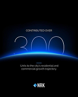

- **Original file:** `inspiration/103c90fb8d01d8c6703a76fb5cb50ab1 1.png` (158x198 px, source folder: (root), batch-001 (inspiration.zip, 2026-10-13))
- **Category / subcategory:** FUL / horizon-arc. **Style family:** HORIZON-ARC. **Also useful for:** -
- **Tags:** big-number, outline-numerals, planet-horizon, blue, stat, vertical
- **Alternate copies:** none

**Observed (visible in the image)**
- **Visual description:** Vertical black; 'CONTRIBUTED OVER' tracked caps; giant thin-outline numerals '300' standing on a curved blue glowing planet horizon; small body below; logo at bottom.
- **Typography:** Ultra-thin outline/hairline numerals (huge), tracked caps kicker, small centred body.
- **Colour palette (measured, dominant first):** `#000000` 59.2%  `#020713` 13.1%  `#061D44` 12.0%  `#275798` 8.1%  `#010003` 6.6%  `#010000` 1.1%
- **Composition:** Vertical, centred column: tracked kicker at ~35% height, huge numerals directly below whose bases sink into the planet's glowing limb at ~55%, a short accent dash and a 2-line body under the horizon, and the logo near the bottom; large black space above.
- **Lighting & effects:** A bright blue-white atmospheric rim along the planet's horizon arc, with a wide blue haze rising above it that lights the bases of the numerals; the rest of the frame is pure black.
- **Depth & layering:** Three planes: black space at the back, the thin numerals in the middle, and the dark planet in front, whose limb occludes the bottom of the numerals so they appear to stand behind the horizon.

**Inferred (creative interpretation - not visible in a still)**
- **Animation behaviour:** INFERRED: horizon rises/brightens (sunrise), numerals draw stroke-by-stroke, count-up.
- **Suitable use cases:** Big milestone numbers and impact stats ('over 300 clients', '10,000 students'), chapter openers built around a single number.
- **Technical recreation:** Horizon = large circle with blurred inner/outer glow; numerals SVG text stroke-only.

---

### FUL-003 - Journey Line Chart with Highlight Column (Idea → Scale)

- **Original file:** `inspiration/115158b311bb5bcc56702a089baf7055 1.png` (198x248 px, source folder: (root), batch-001 (inspiration.zip, 2026-10-13))
- **Category / subcategory:** FUL / data-viz-scene. **Style family:** DATA-GLOW. **Also useful for:** -
- **Tags:** line-chart, journey, milestones, blue, highlight-column, poster, vertical
- **Alternate copies:** none

**Observed (visible in the image)**
- **Visual description:** Vertical bright-blue gradient; logo; headline 'From idea to scale under one roof.' white bold; line chart with labels Idea→Launch→Scale→Evolve; translucent vertical glass column highlighting 'Scale' with ring marker; footer 'One partner. One continuous journey. Zero handoffs.'
- **Typography:** Bold white sans headline; small labels; stacked footer lines.
- **Colour palette (measured, dominant first):** `#072A8D` 21.6%  `#2561C0` 20.1%  `#397DD0` 19.6%  `#0D3AA2` 16.1%  `#1746AD` 14.8%  `#65ABDB` 7.7%
- **Composition:** Vertical poster: logo top-left, a centred 2-line white headline in the top 25%, a small sub-line, a line chart in a framed area covering the middle 50%, and a centred 3-line tagline at the bottom.
- **Lighting & effects:** Monochrome blue: a bright blue gradient background brighter at the top, a white chart line with a soft glow, a translucent glass column highlighting one stage, and a white ring marker with a glow at the active point.
- **Depth & layering:** The translucent glass column overlays the chart, sitting in front of the line and gridlines; the chart sits on the gradient background.

**Inferred (creative interpretation - not visible in a still)**
- **Animation behaviour:** INFERRED: line draws through stages; column slides to active stage; labels fade.
- **Suitable use cases:** Process or lifecycle explanations ('from idea to scale'), customer journeys, 'we handle every stage' messaging.
- **Technical recreation:** SVG line chart with stage labels; the highlight column is a translucent rect (rgba(255,255,255,.12)) with backdrop blur and a 1px border; a ring marker at the active point; background linear-gradient(#1E4FD6, #1336A8).

---

### FUL-004 - Giant 3D Quote Marks with Frosted Text Bar (light)

- **Original file:** `inspiration/13cda48dae23f52d6cc7bfa7e308ea2e 1.png` (122x162 px, source folder: (root), batch-001 (inspiration.zip, 2026-10-13))
- **Category / subcategory:** FUL / typographic-quote. **Style family:** 3D-METAPHOR. **Also useful for:** TXT
- **Tags:** quote, quote-marks, 3d-glyph, frosted-bar, light-blue, statement
- **Alternate copies:** none

**Observed (visible in the image)**
- **Visual description:** Light sky-blue; giant navy 3D quotation marks; a tilted frosted-glass bar crosses them carrying 'Refresh your story as often as your audience changes.'
- **Typography:** Medium-weight white sans in 2 lines ('Refresh your story as often as your audience changes.') inside the tilted bar, at ~4% of frame height.
- **Colour palette (measured, dominant first):** `#7EABD1` 20.5%  `#ACC9E2` 19.0%  `#88B1D4` 18.0%  `#3D5F88` 15.9%  `#9ABDDB` 15.0%  `#B9D2E7` 11.5%
- **Composition:** Giant quote marks centred, filling ~60% of the frame; a long translucent bar crosses them diagonally at about -6°, slightly above centre.
- **Lighting & effects:** Soft studio light on a pale sky-blue background; the frosted bar blurs the navy glyph behind it, and the glyph has subtle shading suggesting extrusion.
- **Depth & layering:** The frosted text bar sits in front of the 3D quote glyph, which sits in front of the flat background.

**Inferred (creative interpretation - not visible in a still)**
- **Animation behaviour:** INFERRED: glyph rotates in 3D slightly; bar slides in with blur; text reveals.
- **Suitable use cases:** Quotes, key statements and testimonials; a pull-quote moment from the speaker's own words.
- **Technical recreation:** Glyph SVG with extrude-ish shadow; bar backdrop-filter blur.

---

### FUL-005 - Light Hero with Inline Toggle and Floating 3D App Icons

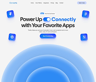

- **Original file:** `inspiration/1a627d483097063c2257c9e75ab2f170 1.png` (198x170 px, source folder: (root), batch-001 (inspiration.zip, 2026-10-13))
- **Category / subcategory:** FUL / web-hero-light. **Style family:** FROST-LIGHT. **Also useful for:** -
- **Tags:** hero, light, inline-ui-in-headline, toggle, floating-icons, blue-rings
- **Alternate copies:**
  - `assets/references/_alternates/FUL-005__alt1__1a627d483097063c2257c9e75ab2f170_2.png` (original `inspiration/1a627d483097063c2257c9e75ab2f170 2.png`, 198x170, identical bytes, distance 0)

**Observed (visible in the image)**
- **Visual description:** White web hero: headline 'Power Up [toggle] Connectly with Your Favorite Apps' with an iOS toggle inline in the text; floating glossy blue 3D app icons around; concentric blue gradient semicircles at bottom.
- **Typography:** A bold dark sans headline in 2 lines with the blue accent word 'Connectly' and an inline toggle switch between 'Power Up' and 'Connectly'; a small grey sub-line; a small blue pill CTA; tiny nav links at the top.
- **Colour palette (measured, dominant first):** `#F4F4F4` 44.2%  `#AECDF3` 22.3%  `#5392E5` 21.3%  `#F3F3F4` 8.2%  `#F9F9F7` 3.2%  `#F5F3F4` 0.8%
- **Composition:** A centred headline block in the upper half; four glossy blue app icons at the four corners around it; large concentric light-blue semicircles rising from the bottom edge, filling the lower 40%.
- **Lighting & effects:** Bright, soft daylight; the app icons are glossy with highlights; the semicircles graduate from pale to saturated blue toward the centre.
- **Depth & layering:** The icons float at different depths around the headline (slight size differences and shadows); the rings sit behind everything at the bottom.

**Inferred (creative interpretation - not visible in a still)**
- **Animation behaviour:** INFERRED: toggle switches on as word is said; icons float/parallax; rings pulse outward.
- **Suitable use cases:** Integrations ('connect your favourite apps'), app-ecosystem explainers, light-theme product hooks.
- **Technical recreation:** Inline toggle element inside the headline (switches on as the word is spoken); app icons as PNGs with parallax float (±6px, 3-4s); rings as concentric circles with radial gradients (#BFDBFE → #3B82F6).

---

### FUL-006 - Blue X Light-Streak Key Visual (Galaxy Unpacked)

- **Original file:** `inspiration/1e601a4065c50294f3f3bf364c688c98 1.png` (121x69 px, source folder: (root), batch-001 (inspiration.zip, 2026-10-13))
- **Category / subcategory:** FUL / light-streak. **Style family:** LIGHT-STREAK. **Also useful for:** -
- **Tags:** light-streaks, x-shape, blue, event, key-visual, energy
- **Alternate copies:** none

**Observed (visible in the image)**
- **Visual description:** Black; luminous blue light ribbons crossing in an X from the left; event title text right ('Galaxy Unpacked').
- **Typography:** A medium-weight white event wordmark ('Galaxy Unpacked') with a small grey date/URL line beneath, on the right side.
- **Colour palette (measured, dominant first):** `#000000` 22.2%  `#0D1439` 19.3%  `#1D3270` 16.1%  `#020106` 15.8%  `#030519` 15.7%  `#5279C1` 10.9%
- **Composition:** Landscape: the light-streak visual occupies the left ~55% with its crossing point left-of-centre; the text is right-of-centre, vertically centred.
- **Lighting & effects:** Bright blue-white light ribbons cross in an X; the core of each ribbon is near-white with bloom falling off into deep blue and black.
- **Depth & layering:** The ribbons curve through depth, coming from behind and sweeping past the camera.

**Inferred (creative interpretation - not visible in a still)**
- **Animation behaviour:** INFERRED: streaks shoot in and intersect, flash, text fades.
- **Suitable use cases:** Event or launch intros, energetic section transitions, keynote-style title cards.
- **Technical recreation:** Bezier strokes with gradient + additive blur; or ffmpeg/After Effects light streaks.

---

### FUL-007 - Orbit Rings Diorama with Tiny World in Centre

- **Original file:** `inspiration/2111200a196671ed83b8ed704b47b385 1.png` (122x138 px, source folder: (root), batch-001 (inspiration.zip, 2026-10-13))
- **Category / subcategory:** FUL / cosmic-diorama. **Style family:** HORIZON-ARC. **Also useful for:** -
- **Tags:** orbits, planets, moons, diorama, fantasy, teal, vertical
- **Alternate copies:** none

**Observed (visible in the image)**
- **Visual description:** Vertical deep teal-navy; concentric orbit rings with moons/planets; centre circular window showing grass and a tree under a starry sky; tiny centred text.
- **Typography:** Tiny widely tracked caps at the very top and two tiny tracked words on either side of the central window ('fantasy' / 'night'); all very small.
- **Colour palette (measured, dominant first):** `#0A3250` 20.8%  `#0A243D` 20.0%  `#021223` 18.8%  `#010C1B` 17.1%  `#06172E` 15.7%  `#1B4F6B` 7.6%
- **Composition:** Vertical radial symmetry: concentric orbit rings centred on a circular window; moons and planets sit on the rings at different positions; a vertical dotted axis runs top to bottom; a cable or stand enters from the bottom-left.
- **Lighting & effects:** Soft starlight: the planets are lit from one side (crescent shading), the centre window holds a tiny night scene with grass and a tree, and the rings are faint teal; deep teal-navy background.
- **Depth & layering:** Multiple depth layers: rings recede, planets at varied sizes imply distance, and the centre window opens into a separate miniature world.

**Inferred (creative interpretation - not visible in a still)**
- **Animation behaviour:** INFERRED: rings rotate at different speeds; slow zoom into centre world.
- **Suitable use cases:** Dreamy, visionary or imaginative moments ('imagine your world'), chapter breaks, slower reflective sections.
- **Technical recreation:** Layered PNG/SVG rings with rotate; centre image masked circle.

---

### FUL-008 - Particle Torus Horizon Web Hero (violet)

- **Original file:** `inspiration/220d5e37ec3242724b20de61d42648f6 1.png` (94x64 px, source folder: (root), batch-001 (inspiration.zip, 2026-10-13))
- **Category / subcategory:** FUL / horizon-arc. **Style family:** HORIZON-ARC. **Also useful for:** -
- **Tags:** particles, torus, violet, blue, hero, web
- **Alternate copies:** none

**Observed (visible in the image)**
- **Visual description:** Black web hero; glowing violet/blue particle ring/torus (planet edge) wraps the headline 'Start promoting on coin official'; dark footer UI.
- **Typography:** A medium-weight white headline ('Start promoting on coin official') centred inside the ring; tiny footer columns of grey text below.
- **Colour palette (measured, dominant first):** `#030303` 44.5%  `#0B061B` 21.0%  `#474779` 13.3%  `#080313` 9.1%  `#030302` 6.2%  `#05010F` 5.9%
- **Composition:** Landscape web hero: a glowing particle torus or planet edge arcs across the upper half with the headline inside its opening; dark footer UI fills the lower third.
- **Lighting & effects:** A particle glow in violet and blue along the ring, brightest at its front edge; black background.
- **Depth & layering:** The ring is in 3D perspective, tilted toward the viewer, with particles suggesting volume.

**Inferred (creative interpretation - not visible in a still)**
- **Animation behaviour:** INFERRED: the particles flow continuously around the ring while it slowly rotates; the headline fades up inside the ring after it brightens.
- **Suitable use cases:** Crypto or tech intros, launch announcements, sci-fi section openers.
- **Technical recreation:** Particle system in canvas or three.js (several thousand points on a torus, additive blending, violet #8B5CF6 to blue #3B82F6), or a pre-rendered video loop composited behind HTML text.

---

### FUL-009 - Hand Holding Neon-Outlined Lightbulb (Creator)

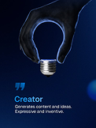

- **Original file:** `inspiration/2451af9e83c3e8e75b898e5a7d5fa384 1.png` (122x162 px, source folder: (root), batch-001 (inspiration.zip, 2026-10-13))
- **Category / subcategory:** FUL / metaphor-object-dark. **Style family:** 3D-METAPHOR. **Also useful for:** -
- **Tags:** lightbulb, idea, hand, neon-rim, blue, archetype, series-archetypes, vertical
- **Alternate copies:** none

**Observed (visible in the image)**
- **Visual description:** Vertical navy; dark hand from top holds a lightbulb whose glass is drawn only by a glowing blue rim; quote glyph; 'Creator' blue heading + white body bottom-left.
- **Typography:** The same series typography as FUL-001: a blue quote-mark glyph, a medium blue heading 'Creator', and 2 lines of white body ('Generates content and ideas. Expressive and inventive.'), left-aligned in the lower third.
- **Colour palette (measured, dominant first):** `#050D24` 19.8%  `#091B40` 18.6%  `#01061A` 18.5%  `#021036` 17.8%  `#041438` 17.6%  `#374E72` 7.7%
- **Composition:** Vertical: the hand and lightbulb occupy the top-centre half, entering from the top edge; the text block is bottom-left; a blurred blue orb sits at the right edge.
- **Lighting & effects:** Rim light only: the bulb's glass is defined solely by a glowing blue outline and the hand is dark with blue edge light, a silhouette style on a navy gradient.
- **Depth & layering:** The hand and bulb hang in front of a dark gradient background; the out-of-focus orb adds depth at the edge.

**Inferred (creative interpretation - not visible in a still)**
- **Animation behaviour:** INFERRED: the bulb's rim ignites with a brief flicker (two quick opacity dips, then full glow), the bloom swells, and the heading and body fade up 300ms later.
- **Suitable use cases:** Ideas, creativity, the 'creator' archetype, 'that's when the idea clicked' moments.
- **Technical recreation:** A generated image or 3D render with rim lighting only; reuse the series layout (glyph, heading, body) from FUL-001 and swap the hero object.

---

### FUL-010 - Blue Hourglass + Stacked Condensed Caps (TODAY/TOMORROW)

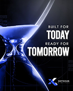

- **Original file:** `inspiration/2902959e28deb8634559636315f85069 1.png` (122x152 px, source folder: (root), batch-001 (inspiration.zip, 2026-10-13))
- **Category / subcategory:** FUL / metaphor-object-dark. **Style family:** 3D-METAPHOR. **Also useful for:** TXT
- **Tags:** hourglass, time, condensed-caps, stacked-type, blue, light-swoosh, vertical
- **Alternate copies:** none

**Observed (visible in the image)**
- **Visual description:** Vertical dark; glowing blue glass hourglass left with light swoosh; right: 'BUILT FOR / TODAY / READY FOR / TOMORROW' — small tracked caps alternate with huge condensed bold caps; logo bottom-right.
- **Typography:** Condensed heavy caps (Bebas/Anton-like) + small tracked caps.
- **Colour palette (measured, dominant first):** `#010102` 26.4%  `#212745` 22.7%  `#0A0F2D` 15.6%  `#CDD3EB` 12.4%  `#06070E` 11.9%  `#4B568B` 11.0%
- **Composition:** Vertical: a large hourglass fills the left half and bleeds off the left and bottom edges; a right-aligned type stack occupies the right half from ~30% to 65% height; a logo sits bottom-right.
- **Lighting & effects:** Blue rim light on the hourglass glass and a bright white-blue light swoosh trailing diagonally across the top; the background is dark navy with faint tech lines.
- **Depth & layering:** The hourglass is large in the foreground and cropped; the type stack sits on a flat plane to its right; the swoosh crosses in front of the background.

**Inferred (creative interpretation - not visible in a still)**
- **Animation behaviour:** INFERRED: the type lines enter alternately (small tracked lines fade, big condensed words slide in 30px from the right), sand flows continuously in the hourglass, and the swoosh sweeps once across the top.
- **Suitable use cases:** Future-proof or time messaging ('built for today, ready for tomorrow'), long-term thinking, brand promise statements.
- **Technical recreation:** Type stack in HTML (Anton/Bebas for the big words, Inter tracked caps for the small lines); hourglass from a 3D render or generated image with a sand particle overlay; swoosh as a blurred gradient stroke.

---

### FUL-011 - Snowy Blue Waves with Floating Glossy Coins

- **Original file:** `inspiration/2f249a31854c9e4a165a1d2f2b6d76bd 1.png` (122x74 px, source folder: (root), batch-001 (inspiration.zip, 2026-10-13))
- **Category / subcategory:** FUL / web-hero-light. **Style family:** FROST-LIGHT. **Also useful for:** -
- **Tags:** coins, crypto, payments, light, blue, waves, 3d
- **Alternate copies:** none

**Observed (visible in the image)**
- **Visual description:** Light white/blue scene with soft wave dunes; floating glossy blue 3D coins with crypto symbols; headline 'The future of payments is here'; email pill input.
- **Typography:** A medium-weight dark sans headline in 2 lines ('The future of payments is here') centred in the lower half; a small logo at the top; an email input pill with a dark button at the bottom.
- **Colour palette (measured, dominant first):** `#2479DB` 20.4%  `#D7E5FA` 19.5%  `#EDF1FB` 17.3%  `#82BBFB` 15.5%  `#B6D0F7` 14.4%  `#F7F9FD` 12.8%
- **Composition:** Landscape: glossy coins cluster in the top half above soft snowy wave dunes; the headline is centred in the lower-middle and the input pill below it.
- **Lighting & effects:** Soft, high-key light: white and pale-blue scene, glossy blue coins with specular highlights, gentle shadows on the dunes.
- **Depth & layering:** The coins sit at various depths (sizes and focus differ) above layered wave shapes that recede.

**Inferred (creative interpretation - not visible in a still)**
- **Animation behaviour:** INFERRED: the coins float and rotate slowly with parallax between layers, a coin flips as 'payments' is said, and the headline fades up.
- **Suitable use cases:** Payments and fintech topics, positive light-theme scenes, product launch hooks.
- **Technical recreation:** 3D coin renders (or generated PNGs) on 3-4 parallax layers over a gradient of soft wave shapes; HTML headline and input pill.

---

### FUL-012 - Light-Speed Blue Streaks Burst (Technology Background)

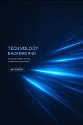

- **Original file:** `inspiration/36e28be6138579556d80ac05059631ef 1.png` (122x183 px, source folder: (root), batch-001 (inspiration.zip, 2026-10-13))
- **Category / subcategory:** FUL / light-streak. **Style family:** LIGHT-STREAK. **Also useful for:** -
- **Tags:** light-streaks, speed, blue, tech, background, vertical
- **Alternate copies:** none

**Observed (visible in the image)**
- **Visual description:** Vertical navy; blue/cyan light-speed streaks bursting from right edge; 'TECHNOLOGY BACKGROUND' teal caps + body + outline button left.
- **Typography:** Medium-weight teal caps heading 'TECHNOLOGY BACKGROUND' in 2 lines, small grey body, and a small outline button 'GET STARTED', left-aligned.
- **Colour palette (measured, dominant first):** `#041A39` 22.4%  `#040E1D` 20.4%  `#031326` 19.0%  `#042D64` 14.9%  `#061121` 13.2%  `#0E6BB6` 10.1%
- **Composition:** Vertical: the text block sits left-middle; blue streaks burst from the right edge toward a vanishing point on the right.
- **Lighting & effects:** Additive cyan and blue light streaks with bright cores that fade into a navy background; strongest glow where the streaks converge.
- **Depth & layering:** Strong motion depth: the streaks radiate from a vanishing point, implying travel toward the viewer.

**Inferred (creative interpretation - not visible in a still)**
- **Animation behaviour:** INFERRED: the streaks accelerate outward from the vanishing point toward the camera in a continuous loop, and the text block fades in from the left.
- **Suitable use cases:** Transitions and speed or tech backgrounds behind a headline, a 'fast-forward' moment, section openers.
- **Technical recreation:** Canvas particles emitted from a vanishing point, drawn as lines whose length scales with speed (additive blending, #22D3EE to #2563EB); loop for the duration.

---

### FUL-013 - Planet Arc Glow over Product Hero (Lumine)

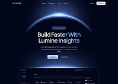

- **Original file:** `inspiration/37cce64bc95918146fefb124a8d236c0 1.png` (199x141 px, source folder: (root), batch-001 (inspiration.zip, 2026-10-13))
- **Category / subcategory:** FUL / horizon-arc. **Style family:** HORIZON-ARC. **Also useful for:** -
- **Tags:** planet-arc, hero, dashboard, blue, saas, web
- **Alternate copies:** none

**Observed (visible in the image)**
- **Visual description:** Dark navy hero; glowing blue planet-horizon arc at top; 'Build Faster With Lumine Insights' headline, body, two buttons; dashboard mockup emerging below.
- **Typography:** A medium-weight white 2-line headline 'Build Faster With Lumine Insights' centred, with a tiny tag pill above, small grey body, and two small buttons (white and dark); tiny nav at the top.
- **Colour palette (measured, dominant first):** `#010619` 48.7%  `#02061A` 23.3%  `#212B47` 22.1%  `#010314` 3.1%  `#010617` 2.5%  `#00061A` 0.3%
- **Composition:** Landscape web hero, centred: a planet-horizon arc at the top, the headline block in the middle, and a dashboard mockup emerging at the bottom edge.
- **Lighting & effects:** A blue planet rim light arcs across the top with a soft glow downward; a second faint glow line sits above the dashboard; dark navy background.
- **Depth & layering:** The dashboard sits below the horizon line, partly cut off by the frame bottom, as if rising into view.

**Inferred (creative interpretation - not visible in a still)**
- **Animation behaviour:** INFERRED: the arc brightens like a sunrise (1.2s outQuart), the headline fades up, and the dashboard rises 60px into view with a slight scale.
- **Suitable use cases:** Product reveals, software launches, 'introducing the dashboard' moments.
- **Technical recreation:** Arc as the edge of a very large dark circle with a blue box-shadow glow (see templates/fullscreen-horizon-title.html); dashboard screenshot or HTML mock below.

---

### FUL-014 - Parametric Wave of Blue Slats + Floating Sphere (light studio)

- **Original file:** `inspiration/39ba3dedcbde663502aaae3f8554b6ab 1.png` (199x112 px, source folder: (root), batch-001 (inspiration.zip, 2026-10-13))
- **Category / subcategory:** FUL / abstract-material. **Style family:** MATERIAL-ABSTRACT. **Also useful for:** -
- **Tags:** parametric, slats, wave, blue, sphere, light-grey, minimal-3d
- **Alternate copies:** none

**Observed (visible in the image)**
- **Visual description:** Light grey studio; a flowing wave formed by many blue vertical 3D slats/bars; a glossy blue sphere floats above; small text 'We embrace challenges' left.
- **Typography:** A small dark sans phrase 'We embrace challenges' at the left-middle, ~3% of frame height; no other text.
- **Colour palette (measured, dominant first):** `#1A3058` 24.8%  `#C5D1D5` 24.0%  `#C0C8CE` 21.7%  `#CBD5DA` 13.1%  `#D5DCE1` 12.3%  `#97B1C2` 4.1%
- **Composition:** Landscape: a wave of blue slats runs horizontally across the lower third and peaks near the centre-right; a single blue sphere floats right-of-centre above it; the text sits at the left; lots of empty light-grey space.
- **Lighting & effects:** Soft studio light from above with subtle shadows between the slats; a glossy highlight on the sphere; the slats graduate from dark to light blue along their faces.
- **Depth & layering:** True 3D scene: the slats recede into depth and the sphere floats in front of the background above the wave.

**Inferred (creative interpretation - not visible in a still)**
- **Animation behaviour:** INFERRED: a ripple travels through the slats (height wave moving left to right, 2s loop) while the sphere bobs gently and the text fades in.
- **Suitable use cases:** Challenges and resilience topics, calm premium transitions, abstract section openers on light-theme videos.
- **Technical recreation:** 3D (Blender array + wave modifier) or canvas bars with sine heights.

---

### FUL-015 - Glowing Crowned Figure among Silhouettes (unique audience)

- **Original file:** `inspiration/3ba1308bfaf8d851ac49dcb47e7b7472 1.png` (122x162 px, source folder: (root), batch-001 (inspiration.zip, 2026-10-13))
- **Category / subcategory:** FUL / metaphor-object-dark. **Style family:** 3D-METAPHOR. **Also useful for:** -
- **Tags:** stand-out, crown, figure, crowd, blue, archetype, series-archetypes, vertical
- **Alternate copies:** none

**Observed (visible in the image)**
- **Visual description:** Vertical navy; glowing blue pawn-like figure with a crown among dark silhouettes; quote glyph; 'Every audience is unique' heading + body.
- **Typography:** The series typography (as FUL-001): a blue quote glyph, a medium blue heading 'Every audience is unique', and 3 lines of small white body, left-aligned in the top third.
- **Colour palette (measured, dominant first):** `#010314` 24.4%  `#03163D` 22.2%  `#010922` 20.8%  `#010F31` 14.1%  `#031032` 11.1%  `#21466F` 7.4%
- **Composition:** Vertical: the text block top-left; a glowing figure with a crown stands at the bottom-centre, surrounded by rows of dark silhouettes that fill the lower third.
- **Lighting & effects:** The figure is emissive light-blue with a glowing crown above; the crowd silhouettes stay dark with faint rim light; navy background.
- **Depth & layering:** Crowd silhouettes in several rows recede in depth; the glowing figure stands in the front-centre row.

**Inferred (creative interpretation - not visible in a still)**
- **Animation behaviour:** INFERRED: the crowd fades in dark, then the central figure lights up from within (emission 0→1, 600ms) and the crown drops onto it and settles; the text fades in.
- **Suitable use cases:** Standing out, audience targeting and niching, 'be the one they choose' messaging.
- **Technical recreation:** Generated image or 3D scene, reusing the series layout from FUL-001; animate the emission with a brightness/glow overlay and the crown with a drop and settle.

---

### FUL-016 - Human Hand Shaking Digital Particle Hand

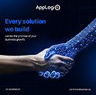

- **Original file:** `inspiration/4022c420b7cb0f1bc9147642ff29ba33 1.png` (122x121 px, source folder: (root), batch-001 (inspiration.zip, 2026-10-13))
- **Category / subcategory:** FUL / metaphor-object-dark. **Style family:** 3D-METAPHOR. **Also useful for:** -
- **Tags:** handshake, digital, particles, voxel, blue, partnership, ai
- **Alternate copies:** none

**Observed (visible in the image)**
- **Visual description:** Square navy grid bg; realistic human hand shakes a hand made of blue voxels/particles; 'Every solution we build' blue heading + body; logo top.
- **Typography:** A medium-weight blue 2-line heading 'Every solution we build' at the top-left, with 2 lines of small white body; a logo top-centre and tiny footer text.
- **Colour palette (measured, dominant first):** `#000513` 28.7%  `#01071A` 21.2%  `#04102C` 20.9%  `#1B2E57` 12.8%  `#7488AF` 11.3%  `#01040E` 5.1%
- **Composition:** Square: the text in the top-left third; two hands meet in a handshake across the centre-right and lower half, the human hand from the left and the digital hand from the right edge.
- **Lighting & effects:** The digital hand is made of self-illuminated blue particles and voxels with bright points; the human hand is lit naturally; a faint navy grid fills the background.
- **Depth & layering:** A perspective grid floor recedes behind the hands, which are in the foreground.

**Inferred (creative interpretation - not visible in a still)**
- **Animation behaviour:** INFERRED: the particle hand assembles from scattered points (800ms), then the two hands grip; a soft pulse of light travels up the digital arm.
- **Suitable use cases:** Human and AI collaboration, partnerships, 'we build this with you' agency messaging.
- **Technical recreation:** Generated image with a particle overlay (canvas points converging to the hand silhouette's sampled positions), or a 3D particle system in Blender.

---

### FUL-017 - Chrome Pawns with Blue King Standing Out (Don't Just Exist)

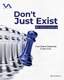

- **Original file:** `inspiration/40735c53b0b82998d7ee6ffee3cde9f2 1.png` (106x132 px, source folder: (root), batch-001 (inspiration.zip, 2026-10-13))
- **Category / subcategory:** FUL / metaphor-object-light. **Style family:** 3D-METAPHOR. **Also useful for:** -
- **Tags:** chess, stand-out, chrome, blue, white, branding, vertical
- **Alternate copies:** none

**Observed (visible in the image)**
- **Visual description:** Vertical white; 'Don't Just Exist' heavy navy sans with blue tag 'Be Unmissable'; row of chrome pawns receding with a glossy blue king; small body right.
- **Typography:** A heavy navy geometric sans headline 'Don't Just Exist' in 2 lines (~10% of frame height), a small white-on-blue tag bar beneath ('Be Unmissable'), and a small 2-line navy body line at the right; a logo at the top-left.
- **Colour palette (measured, dominant first):** `#F6F6F6` 23.1%  `#5F6386` 19.4%  `#F8F8F8` 18.8%  `#E3E3E7` 16.9%  `#F7F7F7` 13.7%  `#FBFBFA` 8.1%
- **Composition:** Vertical: the headline block in the top-right third; a row of chess pieces runs diagonally from the left edge toward the centre in the lower two-thirds, with the blue king/queen piece standing out at the front-right of the row.
- **Lighting & effects:** Bright studio light on white: the chrome pawns show crisp reflections and highlights, and the blue piece is glossy with deep blue reflections.
- **Depth & layering:** Depth of field along the row: the pawns recede to the left and blur, while the blue piece in front is sharp.

**Inferred (creative interpretation - not visible in a still)**
- **Animation behaviour:** INFERRED: camera dolly along row, focus racks to the blue king.
- **Suitable use cases:** Differentiation and standing out ('don't blend in'), brand positioning, 'be the one they notice' messaging.
- **Technical recreation:** 3D render or generated still with rack-focus blur animation.

---

### FUL-018 - Flipping Glossy Coins Arc (Digital Ownership)

- **Original file:** `inspiration/43a83b431c68263293d32ca2d0bbb94d 1.png` (122x84 px, source folder: (root), batch-001 (inspiration.zip, 2026-10-13))
- **Category / subcategory:** FUL / web-hero-light. **Style family:** FROST-LIGHT. **Also useful for:** -
- **Tags:** coins, flip, arc, light, blue, crypto, hero
- **Alternate copies:** none

**Observed (visible in the image)**
- **Visual description:** White hero 'A New Era of Digital Ownership Starts Now'; glossy blue coins in an arc at various flip angles.
- **Typography:** A medium-weight dark sans headline in 2 lines ('A New Era of Digital Ownership Starts Now') centred, with a small tag pill above, a tiny grey sub-line and a small dark button; tiny nav at the top.
- **Colour palette (measured, dominant first):** `#FFFFFF` 75.8%  `#687198` 8.4%  `#FEFEFE` 8.4%  `#EBF0F2` 6.0%  `#FFFFFE` 1.2%  `#F1FFFE` 0.2%
- **Composition:** Landscape white web hero: the headline block in the upper-middle; five glossy coins form a gentle arc across the lower half, each at a different flip angle, like a motion study.
- **Lighting & effects:** Soft, even light; the coins are glossy blue/navy with bright specular rims; a faint lavender fade under the leftmost coin.
- **Depth & layering:** The coins sit in perspective at different angles and slight depth offsets along the arc.

**Inferred (creative interpretation - not visible in a still)**
- **Animation behaviour:** INFERRED: a single coin flips along arc path (motion study).
- **Suitable use cases:** Ownership, crypto and tokens, transformation sequences, 'step by step it changes' visual metaphors.
- **Technical recreation:** One 3D coin rendered at several rotations (or a single coin animated along an arc path with rotateY from 0 to 180°), on a white background with an HTML headline.

---

### FUL-019 - Violet Glowing Curve with Node + Outline Pill (Adaptive AI)

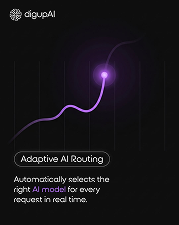

- **Original file:** `inspiration/44beb81141fbec3685b9692c3d9bae70 1.png` (179x225 px, source folder: (root), batch-001 (inspiration.zip, 2026-10-13))
- **Category / subcategory:** FUL / data-viz-scene. **Style family:** DATA-GLOW. **Also useful for:** -
- **Tags:** curve, violet, node, outline-pill, ai, vertical
- **Alternate copies:** none

**Observed (visible in the image)**
- **Visual description:** Vertical dark; logo top-left; violet glowing curve rising to a bright node; outline pill 'Adaptive AI Routing'; body with violet highlighted 'AI model'.
- **Typography:** Light-weight white sans body in 3 lines ('Automatically selects the right AI model for every request in real time.') with 'AI model' in violet; a medium-weight label 'Adaptive AI Routing' inside an outlined pill above it; a logo top-left.
- **Colour palette (measured, dominant first):** `#0E0E0E` 64.2%  `#120E15` 18.0%  `#26202B` 10.6%  `#0C0C0E` 3.6%  `#0D0E0D` 3.1%  `#0E0E0D` 0.4%
- **Composition:** Vertical: a rising curve with a glowing node occupies the upper half; the pill and body sit left-aligned in the lower third; faint vertical gridlines in the background.
- **Lighting & effects:** The violet curve brightens toward its end, and the node is a hot violet-white bloom (#C084FC); dark charcoal background.
- **Depth & layering:** Flat, with faint vertical lines receding slightly behind the curve.

**Inferred (creative interpretation - not visible in a still)**
- **Animation behaviour:** INFERRED: the curve draws upward to the node (900ms inOutCubic), the node flares (bloom radius up then settling), and the pill and body text fade up line by line.
- **Suitable use cases:** AI features, routing or decision-making explanations, 'it picks the best option automatically' product claims.
- **Technical recreation:** SVG cubic path in violet (#A855F7) with a blurred duplicate; node as a circle with a large blurred halo; outlined pill with a 1px white border at 60%; violet keyword span in the body text.

---

### FUL-020 - Revenue Forecast Fan on Wall Screen in Dark Room

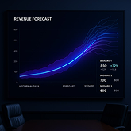

- **Original file:** `inspiration/46cda8b962557f9dc677068a45c489db 1.png` (165x165 px, source folder: (root), batch-001 (inspiration.zip, 2026-10-13))
- **Category / subcategory:** FUL / in-situ-display. **Style family:** DATA-GLOW. **Also useful for:** -
- **Tags:** forecast, scenarios, lines, blue, boardroom, in-situ, screen
- **Alternate copies:** none

**Observed (visible in the image)**
- **Visual description:** Dark boardroom with chair silhouettes; large wall screen 'REVENUE FORECAST' with multiple glowing blue lines fanning into scenarios, stats at right.
- **Typography:** A small caps title 'REVENUE FORECAST' at the top-left of the screen, tiny axis labels, and tiny scenario stats at the right (labels with medium numbers such as 830, 700, 600 and green deltas).
- **Colour palette (measured, dominant first):** `#010415` 27.9%  `#010208` 21.1%  `#040811` 19.3%  `#080D29` 13.5%  `#19274D` 9.9%  `#04082A` 8.3%
- **Composition:** A large wall screen fills most of the frame, with its edges near the frame edges; two dark chair backs sit in the lower foreground corners.
- **Lighting & effects:** The screen is the only light source: blue forecast lines glow on it and spill a faint blue onto the dark room and chairs.
- **Depth & layering:** Foreground chairs, then the screen on the back wall; this in-situ framing makes the data feel like a real boardroom presentation.

**Inferred (creative interpretation - not visible in a still)**
- **Animation behaviour:** INFERRED: camera push toward screen; lines fan out from a single point.
- **Suitable use cases:** Forecasts and scenarios, business planning, 'here's where this is going' predictions, investor-style moments.
- **Technical recreation:** Render the chart in HTML or SVG (a fan of lines diverging from one point, #3B82F6 → #818CF8), then composite it onto a dark room plate with a corner pin and add a subtle screen glow and glare.

---

### FUL-021 - Glass Dome on Mirror Horizon with Orbit Line

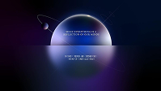

- **Original file:** `inspiration/48e54c5ec99bd5cd4e9ac522930df4e5 1.png` (199x112 px, source folder: (root), batch-001 (inspiration.zip, 2026-10-13))
- **Category / subcategory:** FUL / horizon-arc. **Style family:** HORIZON-ARC. **Also useful for:** -
- **Tags:** dome, sphere, reflection, orbit, violet, navy, serif-caps
- **Alternate copies:** none

**Observed (visible in the image)**
- **Visual description:** Dark navy/violet; glowing glass half-dome sits on reflective horizon, orbit line with small moon; tiny serif caps text on the dome and mirrored text in reflection.
- **Typography:** Tiny tracked serif caps (2 lines) centred on the dome and mirrored in the reflection below; illegible at this source size.
- **Colour palette (measured, dominant first):** `#010511` 22.3%  `#020E29` 21.7%  `#10041A` 17.5%  `#1E2754` 14.8%  `#161338` 12.6%  `#6870A6` 11.0%
- **Composition:** Landscape, centred symmetry: a glowing half-dome sits on a horizon line at mid-height with its mirror image below; a thin orbit ellipse with a small moon crosses the dome diagonally.
- **Lighting & effects:** Violet under-glow along the horizon, a specular highlight across the dome's top, and the reflection fading below; dark navy-violet background.
- **Depth & layering:** A mirror floor gives a reflective plane, and the orbit line passes in front of and behind the dome, implying 3D space.

**Inferred (creative interpretation - not visible in a still)**
- **Animation behaviour:** INFERRED: the dome rises from the horizon with its reflection (1.2s outQuart), the moon orbits along the ellipse in a slow loop, and the text fades in on the dome.
- **Suitable use cases:** Reflection and introspection themes, premium title cards, calm philosophical openers.
- **Technical recreation:** Sphere as a radial gradient with a specular highlight, clipped at the horizon; a mirrored copy below with a vertical fade mask; an SVG ellipse orbit with a small moon moving along it.

---

### FUL-022 - Chaos Scribble → Light Trail → System Cube

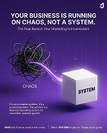

- **Original file:** `inspiration/4afc1c4fe46e7cbc0e936f18d13e1d16 1.png` (154x191 px, source folder: (root), batch-001 (inspiration.zip, 2026-10-13))
- **Category / subcategory:** FUL / metaphor-object-dark. **Style family:** 3D-METAPHOR. **Also useful for:** TXT
- **Tags:** chaos-to-order, scribble, cube, violet, transformation, poster, vertical
- **Alternate copies:** none

**Observed (visible in the image)**
- **Visual description:** Vertical violet grid poster; headline 'YOUR BUSINESS IS RUNNING ON CHAOS, NOT A SYSTEM.' white caps; black tangled scribble ball labelled 'CHAOS' emits a violet light trail into a white 3D cube labelled 'SYSTEM'; small body; footer CTA.
- **Typography:** A bold white caps headline in 2 lines ('YOUR BUSINESS IS RUNNING ON CHAOS, NOT A SYSTEM.') at ~5% of frame height, a small grey sub-line, small labels 'CHAOS' and 'SYSTEM' (the latter printed on the cube), small body text, and a tiny footer CTA line.
- **Colour palette (measured, dominant first):** `#27164E` 20.8%  `#7251A4` 18.9%  `#54338F` 17.4%  `#371F6C` 17.3%  `#42267B` 16.6%  `#B5A9C6` 8.9%
- **Composition:** Vertical poster: the headline in the top 20%; a left-to-right transformation in the middle (black scribble ball at left → violet light trail → white 3D cube at right); the body copy in the lower-left; a footer strip at the bottom.
- **Lighting & effects:** A violet glowing light trail connects the scribble to the cube; the cube is lit white with a soft shadow; a violet background with a faint grid.
- **Depth & layering:** The cube is a 3D object with a cast shadow; the scribble is a flat ink tangle; the grid recedes slightly behind.

**Inferred (creative interpretation - not visible in a still)**
- **Animation behaviour:** INFERRED: scribble untangles into a single line that wraps/forms the cube.
- **Suitable use cases:** Chaos to order, building systems, before/after transformations, 'you need a process' messaging.
- **Technical recreation:** SVG scribble path morph/draw into cube outline; cube 3D or CSS.

---

### FUL-023 - Hourglass Sand onto Blue Cube (9 AM & 11 PM)

- **Original file:** `inspiration/4da966fce6042d48bfbe8e499b7fc847 1.png` (122x152 px, source folder: (root), batch-001 (inspiration.zip, 2026-10-13))
- **Category / subcategory:** FUL / metaphor-object-light. **Style family:** 3D-METAPHOR. **Also useful for:** -
- **Tags:** hourglass, time, blue, cube, light, poster, vertical
- **Alternate copies:** none

**Observed (visible in the image)**
- **Visual description:** Vertical white/blue; logo; 'Your website shouldn't look the same at 9 AM & 11 PM.' with blue large time; giant glass hourglass with blue sand pouring onto a blue cube.
- **Typography:** Small grey 2-line sans ('Your website shouldn't look the same at'), large medium-weight royal-blue '9 AM & 11 PM.' (~5% of frame height), small grey supporting lines and a column of tiny body text; a small logo at the top-left.
- **Colour palette (measured, dominant first):** `#18467E` 24.0%  `#F6F6F8` 20.3%  `#FCFCFD` 16.8%  `#FFFFFF` 16.3%  `#E8EAF0` 13.3%  `#BAC3CF` 9.4%
- **Composition:** Vertical: a text column on the left ~45%; a giant glass hourglass on the right half bleeding off the top and right edges, with blue sand pouring onto a blue cube at the bottom-right.
- **Lighting & effects:** Bright, clean studio light on white: transparent glass with soft reflections and deep blue sand catching the light.
- **Depth & layering:** Macro object: the hourglass is very large and close, cropped by the frame, with the text on a flat plane beside it.

**Inferred (creative interpretation - not visible in a still)**
- **Animation behaviour:** INFERRED: sand pours continuously in a thin stream while the cube slowly grows from the accumulating sand; the time text fades in, with '9 AM' then '11 PM' appearing one after the other.
- **Suitable use cases:** Timing and time-based personalisation, 'different times need different approaches', schedules and routines.
- **Technical recreation:** Generated or rendered still of the hourglass, plus a particle sand stream overlay (canvas particles falling with slight noise) and the cube scaled up slowly; HTML text column.

---

### FUL-024 - 3D Violet '11' with Crown + Ghost Month Text

- **Original file:** `inspiration/4e9737fab3a496d851c8895218e6bd80 1.png` (122x152 px, source folder: (root), batch-001 (inspiration.zip, 2026-10-13))
- **Category / subcategory:** FUL / big-numeral-3d. **Style family:** 3D-METAPHOR. **Also useful for:** -
- **Tags:** 3d-numeral, crown, violet, month, ghost-text, vertical
- **Alternate copies:** none

**Observed (visible in the image)**
- **Visual description:** Vertical violet; logo; 'New Month, New Visibility Goals!'; huge glossy violet extruded '11' with crown on top; huge faint 'NOVEMBER' text behind.
- **Typography:** A medium-weight white headline in 2 lines ('New Month, New Visibility Goals!'), centred near the top under a logo; huge ghost display text 'NOVEMBER' at ~10% opacity across the middle.
- **Colour palette (measured, dominant first):** `#2C1365` 24.2%  `#6C34C1` 20.3%  `#4C1F9D` 16.4%  `#9860E7` 15.9%  `#49129E` 11.9%  `#CDA9F9` 11.3%
- **Composition:** Vertical: the logo and headline in the top quarter; a giant extruded '11' with a crown on top fills the lower 60%, centred; the ghost word spans behind it.
- **Lighting & effects:** Glossy specular violet: the numerals have bright highlights on their bevels and deep violet shadows; the crown is the same violet glossy material.
- **Depth & layering:** The ghost text sits behind the numeral, which is a 3D extrusion with depth and a crown resting on top.

**Inferred (creative interpretation - not visible in a still)**
- **Animation behaviour:** INFERRED: numeral rises, crown drops and settles; ghost text slides.
- **Suitable use cases:** Dates and new-month posts, rankings ('number 1'), milestones and anniversaries.
- **Technical recreation:** 3D extruded text in Blender (bevel, glossy violet material, studio HDRI) or a generated image; ghost text as HTML at 10% opacity behind; crown as a separate layer for a drop-in animation.

---

### FUL-025 - Curved Blue Speed Trails under Headline (Abstract Technology)

- **Original file:** `inspiration/50658e3882f70aedd11eed20687bf755 1.png` (169x254 px, source folder: (root), batch-001 (inspiration.zip, 2026-10-13))
- **Category / subcategory:** FUL / light-streak. **Style family:** LIGHT-STREAK. **Also useful for:** -
- **Tags:** light-trails, curved, blue, tech, background, vertical
- **Alternate copies:** none

**Observed (visible in the image)**
- **Visual description:** Vertical navy; 'Abstract Technology' white + body + button upper-left; curved blue light trails sweep along bottom.
- **Typography:** Medium-weight white sans heading 'Abstract Technology' in 2 lines (~5% of frame height), a tiny tracked caps kicker above, 2 lines of small grey body, and a small outline button.
- **Colour palette (measured, dominant first):** `#0A111E` 21.0%  `#041F45` 20.4%  `#061731` 17.1%  `#091427` 16.0%  `#053372` 14.7%  `#2281C7` 10.8%
- **Composition:** Vertical: the text block top-left at ~25-40% height; curved light trails sweep across the bottom third from the left, rising toward the right edge.
- **Lighting & effects:** Cyan-blue additive light trails with bright cores fading at their tails; navy background.
- **Depth & layering:** The trails curve and recede in perspective, implying motion across a surface.

**Inferred (creative interpretation - not visible in a still)**
- **Animation behaviour:** INFERRED: the trails flow continuously along their curves in a loop (dash offset animation), and the text block fades up.
- **Suitable use cases:** Background plates for statements, tech-themed section openers, transitions.
- **Technical recreation:** Bezier strokes with linear gradients (#22D3EE → #2563EB → transparent) and a blurred duplicate for glow; animate stroke-dashoffset in a loop.

---

### FUL-026 - 3D Axes Rising Surface with Scatter → Glow Peak

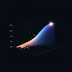

- **Original file:** `inspiration/577ae12480ed2751a8d1e9ec29b592a0 1.png` (118x118 px, source folder: (root), batch-001 (inspiration.zip, 2026-10-13))
- **Category / subcategory:** FUL / data-viz-3d. **Style family:** DATA-GLOW. **Also useful for:** -
- **Tags:** 3d-chart, surface, scatter, orange-to-blue, peak, growth
- **Alternate copies:** none

**Observed (visible in the image)**
- **Visual description:** Dark; 3D axes and grid; a rising ribbon/surface from orange scatter points to blue to a white glowing peak.
- **Typography:** Tiny grey axis tick labels on the vertical axis; no headline.
- **Colour palette (measured, dominant first):** `#080B12` 60.3%  `#090B13` 22.2%  `#212433` 9.3%  `#080B11` 4.7%  `#060B12` 1.8%  `#05080F` 1.7%
- **Composition:** Square: 3D axes with a grid box occupy the centre; the data rises diagonally from bottom-left (scatter points) to top-right (bright peak).
- **Lighting & effects:** A hot white bloom at the peak; the surface gradient runs from orange scatter dots through blue to white; dark navy-black background.
- **Depth & layering:** True 3D axes: the grid box is in perspective and the surface or ribbon has volume.

**Inferred (creative interpretation - not visible in a still)**
- **Animation behaviour:** INFERRED: camera orbits chart while surface grows; points scatter in.
- **Suitable use cases:** Data growth, 'everything leads to this result', analytics deep-dives, results reveals.
- **Technical recreation:** three.js or Blender for a real 3D surface, or matplotlib 3D frames with a glow post-process; scatter points as small orange spheres with additive glow.

---

### FUL-027 - Spiral of Blue Glass Rings (web hero)

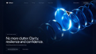

- **Original file:** `inspiration/58118ac26e00488a36b8ab8dce44dcdb 1.png` (121x68 px, source folder: (root), batch-001 (inspiration.zip, 2026-10-13))
- **Category / subcategory:** FUL / abstract-material. **Style family:** MATERIAL-ABSTRACT. **Also useful for:** -
- **Tags:** glass-rings, spiral, coil, blue, hero, clarity
- **Alternate copies:** none

**Observed (visible in the image)**
- **Visual description:** Dark web hero; spiral chain of glowing blue glass rings at right; 'No more clutter. Clarity, resilience and confidence.' left.
- **Typography:** Medium-weight white sans headline in 2 lines ('No more clutter. Clarity, resilience and confidence.') at the lower-left, a tiny kicker above and small buttons below; tiny nav at the top.
- **Colour palette (measured, dominant first):** `#091A3A` 21.1%  `#030B21` 19.3%  `#020817` 18.5%  `#051027` 15.6%  `#0F2A56` 14.9%  `#3274B0` 10.6%
- **Composition:** Landscape web hero: text in the left third, lower half; a spiral chain of glass rings on the right two-thirds, receding diagonally toward the top-right.
- **Lighting & effects:** Blue rim and inner glow on each glass ring; bright highlights where the rings face the light; dark navy background.
- **Depth & layering:** The rings recede into depth along a spiral path, with the closer rings larger and brighter.

**Inferred (creative interpretation - not visible in a still)**
- **Animation behaviour:** INFERRED: the rings rotate and coil continuously along the spiral (a seamless 6-8s loop) while the camera drifts slightly.
- **Suitable use cases:** Clarity, flow or continuity backgrounds, 'one connected system' metaphors, calm tech openers.
- **Technical recreation:** 3D loop render (Blender: array of torus rings along a curve with glass + emission shader and bloom), exported as an alpha PNG sequence or video.

---

### FUL-028 - Planet Earth Rim from Orbit with Wordmark

- **Original file:** `inspiration/5d617fd714022de53e1d2bc7d88f40d3 1.png` (198x149 px, source folder: (root), batch-001 (inspiration.zip, 2026-10-13))
- **Category / subcategory:** FUL / horizon-arc. **Style family:** HORIZON-ARC. **Also useful for:** -
- **Tags:** planet, earth, orbit, atmosphere, blue, intro, wordmark
- **Alternate copies:** none

**Observed (visible in the image)**
- **Visual description:** Black space; large blue planet arc with atmospheric rim light; small centred wordmark.
- **Typography:** A small white wordmark centred on the planet ('mHolo') with a tiny line beneath; no other text.
- **Colour palette (measured, dominant first):** `#000000` 51.2%  `#01061C` 19.0%  `#00000C` 11.7%  `#000003` 9.6%  `#234A7C` 8.3%  `#010000` 0.1%
- **Composition:** Landscape: a planet's curved limb spans the frame, occupying the lower 60%; the wordmark is centred just below the horizon.
- **Lighting & effects:** Atmospheric scattering rim: a bright blue-white thin edge with a wide blue haze over the dark planet surface; sparse stars in black space.
- **Depth & layering:** Deep space depth: the planet is huge in the foreground and the stars are distant.

**Inferred (creative interpretation - not visible in a still)**
- **Animation behaviour:** INFERRED: a slow rotation or push-in with a sunrise flare blooming over the rim, then the wordmark fades in.
- **Suitable use cases:** Global or scale openers ('worldwide'), channel intros and outros, big-picture moments.
- **Technical recreation:** Stock or generated planet image with an added glow layer and a slow 3-5% push; or a CSS large circle with a blue box-shadow rim (see templates/fullscreen-horizon-title.html).

---

### FUL-029 - Perspective Data Light Lines to Horizon + Question

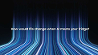

- **Original file:** `inspiration/60583247d2a8213f8d55ccf669da1227 1.png` (122x69 px, source folder: (root), batch-001 (inspiration.zip, 2026-10-13))
- **Category / subcategory:** FUL / light-streak. **Style family:** LIGHT-STREAK. **Also useful for:** -
- **Tags:** light-lines, perspective, data-stream, blue, question, ai
- **Alternate copies:** none

**Observed (visible in the image)**
- **Visual description:** Black; blue/white thin light lines run in perspective toward horizon (like a data highway); centred question 'How would life change when AI meets your fridge?'
- **Typography:** Small white sans single line centred ('How would life change when AI meets your fridge?'), ~3% of frame height.
- **Colour palette (measured, dominant first):** `#07080A` 20.1%  `#183464` 18.6%  `#2F6098` 18.5%  `#080B0E` 18.2%  `#0A1124` 14.6%  `#71A1C8` 9.9%
- **Composition:** Landscape: the question sits exactly on the horizon line in the centre; light lines fill the lower half and converge toward that horizon.
- **Lighting & effects:** Luminous blue and white lines that fade with distance, brightest in the foreground, plus a faint glow at the horizon.
- **Depth & layering:** Strong one-point perspective: the lines stream from the foreground toward the vanishing horizon.

**Inferred (creative interpretation - not visible in a still)**
- **Animation behaviour:** INFERRED: the lines stream toward the viewer continuously while the question fades in at the horizon.
- **Suitable use cases:** Rhetorical questions to the audience, chapter openers, 'imagine if...' moments.
- **Technical recreation:** Canvas lines with perspective projection (x = x0 / z) animated by decreasing z; additive blend in blue (#60A5FA) and white; centred HTML text.

---

### FUL-030 - Blue 3D Signpost of Brand Directions

- **Original file:** `inspiration/650a5ea669acc1d16ef9a83741f0d693 1.png` (194x241 px, source folder: (root), batch-001 (inspiration.zip, 2026-10-13))
- **Category / subcategory:** FUL / metaphor-object-light. **Style family:** 3D-METAPHOR. **Also useful for:** TXT
- **Tags:** signpost, direction, choice, blue, branding, serif-mix, vertical
- **Alternate copies:** none

**Observed (visible in the image)**
- **Visual description:** Vertical white; 'Branding without clarity is just expensive guesswork' blue sans with italic serif for 'expensive guesswork'; small sub; blue 3D signpost with arrows 'Modern Minimalism', 'Heritage & Legacy', 'Disruptive Innovation'.
- **Typography:** A blue sans headline in 2 lines with an italic serif phrase ('Branding without clarity is just expensive guesswork', with 'expensive guesswork' in italic serif), a tiny grey sub-line, a small logo top-left and a year top-right.
- **Colour palette (measured, dominant first):** `#FFFFFF` 69.8%  `#174EBF` 13.1%  `#638AE0` 9.1%  `#C8D4E5` 4.1%  `#FFFFFD` 3.2%  `#FEFFFF` 0.8%
- **Composition:** Vertical white poster: the headline centred in the top 25%; a blue 3D signpost with three arrow signs fills the lower two-thirds, angled in different directions.
- **Lighting & effects:** Studio light on white: glossy blue signs with soft reflections and a grey metal post.
- **Depth & layering:** A 3D sign in perspective, with the signs pointing toward and away from the viewer.

**Inferred (creative interpretation - not visible in a still)**
- **Animation behaviour:** INFERRED: the signs swing into place one by one (rotateY with a soft settle, 150ms stagger), each labelled as it is mentioned.
- **Suitable use cases:** Choices and directions ('which path should you take'), comparing strategies, decision moments.
- **Technical recreation:** 3D model or generated signpost with the sign text replaced (or the signs built as tilted HTML panels in CSS 3D); headline in Inter + Playfair Italic.

---

### FUL-031 - Giant Pencil Draws Bridge between Cliffs

- **Original file:** `inspiration/65a9f860849be3b274c799814068ce7b 1.png` (179x223 px, source folder: (root), batch-001 (inspiration.zip, 2026-10-13))
- **Category / subcategory:** FUL / metaphor-object-light. **Style family:** 3D-METAPHOR. **Also useful for:** -
- **Tags:** pencil, bridge, cliffs, figures, violet, light, vertical
- **Alternate copies:** none

**Observed (visible in the image)**
- **Visual description:** Vertical light grey; 'You focus on walking. We focus on the bridge.' (bold, violet 'bridge'); giant violet pencil draws a thin line bridging two B&W rock cliffs; tiny walking figures cross.
- **Typography:** A light sans paired with bold sans across 4 lines ('You focus on walking. We focus on the bridge.'); the word 'bridge' is in violet bold; a small logo top-left.
- **Colour palette (measured, dominant first):** `#ECEBEA` 26.6%  `#574475` 23.7%  `#F2F0EF` 16.6%  `#F6F4F3` 14.4%  `#F0EDED` 12.7%  `#DAD8DB` 6.0%
- **Composition:** Vertical: text top-left in the upper 35%; a giant violet pencil enters from the top-right diagonally; its tip draws a thin line between two B&W rock cliffs at the bottom; tiny running figures cross from left to right.
- **Lighting & effects:** Neutral, even light on a light-grey background; the pencil is glossy violet; the cliffs are textured grey photography.
- **Depth & layering:** Scale contrast: tiny figures against the huge pencil and cliffs create a sense of depth and meaning.

**Inferred (creative interpretation - not visible in a still)**
- **Animation behaviour:** INFERRED: pencil draws line across gap; figures walk across after.
- **Suitable use cases:** Bridging gaps, a service that enables progress, 'we handle the hard part' agency messaging.
- **Technical recreation:** Animate the line's stroke-dashoffset synced to the pencil's transform (the tip follows the line's end point); figures as small silhouette sprites moving across after the line completes.

---

### FUL-032 - Eclipse Ring with Teal Light Cone (Portfolio)

- **Original file:** `inspiration/677b27344bdba1518ae637b277f65294 1.png` (93x56 px, source folder: (root), batch-001 (inspiration.zip, 2026-10-13))
- **Category / subcategory:** FUL / light-streak. **Style family:** LIGHT-STREAK. **Also useful for:** -
- **Tags:** eclipse, ring, teal, light-cone, portfolio, dark
- **Alternate copies:** none

**Observed (visible in the image)**
- **Visual description:** Dark; black disc eclipse with bright teal rim and a cone of teal light emanating right; 'PORTFOLIO 2025' left.
- **Typography:** Heavy white caps 'PORTFOLIO' with a tiny kicker above and a small year '2025' below, at the left.
- **Colour palette (measured, dominant first):** `#0E0E0E` 43.6%  `#172E47` 23.9%  `#37737F` 18.7%  `#0F0F0F` 10.3%  `#050505` 2.6%  `#0C0F0D` 0.9%
- **Composition:** Landscape: the text block left-of-centre; a black eclipse disc with a bright rim on the right-middle, with a teal light cone spreading toward the top-right.
- **Lighting & effects:** A volumetric teal cone fanning from the eclipse's rim, plus a bright teal-white rim around the dark disc; a dark gradient background.
- **Depth & layering:** Flat composition with an atmospheric light cone suggesting volume.

**Inferred (creative interpretation - not visible in a still)**
- **Animation behaviour:** INFERRED: the eclipse rim ignites around the circumference (conic reveal, 600ms), then the teal cone sweeps open and the title fades in.
- **Suitable use cases:** Title cards (portfolio, case study, 'my work'), section openers, outro frames.
- **Technical recreation:** Dark circle with a conic/radial gradient rim (#5EEAD4 → white); cone as a blurred triangular gradient (teal at 40% → transparent) with mix-blend screen; heavy caps in Inter 800 or Anton.

---

### FUL-033 - Calendar Page Close-up with Pinned SAT Sticky Note

- **Original file:** `inspiration/70965c5f2d848f8f83df7d0561ecc3dd 1.png` (122x152 px, source folder: (root), batch-001 (inspiration.zip, 2026-10-13))
- **Category / subcategory:** FUL / metaphor-object-light. **Style family:** 3D-METAPHOR. **Also useful for:** -
- **Tags:** calendar, date, sticky-note, pin, blue, paper, vertical
- **Alternate copies:** none

**Observed (visible in the image)**
- **Visual description:** Vertical blue-tinted calendar close-up; big date numbers (24-27 'Yanvar'); curled paper sticky note 'SAT' pinned with red pin; small note card.
- **Typography:** Large bold condensed date numerals (24, 25, 26, 27) printed on the calendar, small month words 'Yanvar' beside them, and a heavy navy 'SAT' on the sticky note with a small blue tag line and tiny body text; a tiny card in the corner carries more small text.
- **Colour palette (measured, dominant first):** `#014481` 23.5%  `#4F91BC` 21.3%  `#004283` 17.1%  `#ADCADB` 16.5%  `#E1E8EE` 13.1%  `#134C80` 8.6%
- **Composition:** Vertical: the calendar page fills the frame at a diagonal tilt; a curled white sticky note pinned with a red pin dominates the centre, with a smaller blue note card pinned at the lower-right.
- **Lighting & effects:** A soft blue tint over everything; the white paper notes catch soft light with gentle shadows under the curled edges; the red pins add the only warm accent.
- **Depth & layering:** Macro depth of field: the sticky notes are sharp in the foreground and the calendar numbers soften toward the edges.

**Inferred (creative interpretation - not visible in a still)**
- **Animation behaviour:** INFERRED: the camera drifts slowly across the dates (a 3-4% diagonal push), the sticky note flutters slightly as if in a breeze, and the pinned date pops with a subtle scale when the deadline is mentioned.
- **Suitable use cases:** Deadlines, dates and schedules, 'mark your calendar', weekend or holiday announcements.
- **Technical recreation:** Generated image (blue-toned calendar macro) split into 2-3 parallax layers (background calendar, sticky note, small card); animate a slow push and a gentle rotate on the note.

---

### FUL-034 - Pins and Strings Network (Start syncing everything)

- **Original file:** `inspiration/716ab5e9198f97df1acd94f1080fe1f1 1.png` (179x178 px, source folder: (root), batch-001 (inspiration.zip, 2026-10-13))
- **Category / subcategory:** FUL / metaphor-object-light. **Style family:** 3D-METAPHOR. **Also useful for:** -
- **Tags:** network, pins, strings, violet, light, sync
- **Alternate copies:** none

**Observed (visible in the image)**
- **Visual description:** White; 'Start syncing everything' with gradient violet 'syncing'; 'Stop jumping between tabs.'; 3D pushpins (violet and grey spheres) connected by thin strings.
- **Typography:** Medium-weight dark sans headline 'Start syncing everything' with 'syncing' in a violet-to-pink gradient, a smaller dark sub-line 'Stop jumping between tabs.', and a small brand mark at the bottom-left.
- **Colour palette (measured, dominant first):** `#F9F9F9` 23.0%  `#F2F2F2` 21.9%  `#F7F7F7` 15.3%  `#F4F4F4` 15.1%  `#F6F6F5` 13.7%  `#BDB7C0` 11.0%
- **Composition:** Square: the headline block centred in the top 30%; a network of pushpins (violet and grey spheres) connected by thin grey strings spreads across the lower 60%, bleeding off the edges.
- **Lighting & effects:** Soft, even studio light on white; the glossy pin heads catch highlights, with soft shadows beneath them.
- **Depth & layering:** The 3D pins stand at slightly different depths; the strings run between them in space.

**Inferred (creative interpretation - not visible in a still)**
- **Animation behaviour:** INFERRED: the pins drop in one by one, then the strings draw between them sequentially (each 200ms), forming the network as 'syncing' is said.
- **Suitable use cases:** Connecting tools or ideas, integrations, 'everything in one place' messaging, network effects.
- **Technical recreation:** 3D render, or 2.5D with circles shaded by radial gradients (violet #7C3AED, grey #6B7280) plus SVG lines drawn with stroke-dashoffset; gradient text via background-clip.

---

### FUL-035 - Fanned Blue Sheets Sculpture (skeps)

- **Original file:** `inspiration/726e5d732c4c09cec21388e790142399 1.png` (198x133 px, source folder: (root), batch-001 (inspiration.zip, 2026-10-13))
- **Category / subcategory:** FUL / abstract-material. **Style family:** MATERIAL-ABSTRACT. **Also useful for:** -
- **Tags:** fanned-sheets, sculpture, blue, light, finance, 3d
- **Alternate copies:** none

**Observed (visible in the image)**
- **Visual description:** White/light-blue card; blue 3D fanned sheets/pages forming a curved wave sculpture; 'The next generation of Financing!' + logo.
- **Typography:** Small bold blue 3-line text ('The next generation of Financing!') at the left and a larger dark wordmark 'skeps' beneath it.
- **Colour palette (measured, dominant first):** `#F8F8FA` 21.7%  `#283FAB` 21.6%  `#638AD9` 16.1%  `#DCE3F2` 14.4%  `#97ACE0` 13.1%  `#FDFDFD` 13.0%
- **Composition:** Landscape card: text in the left third; a large fanned sculpture of blue sheets curving across the right two-thirds, rising toward the top-right.
- **Lighting & effects:** Soft gradient shading on each sheet (light at the edges, deeper blue in the folds); a pale blue-white background with a soft vignette.
- **Depth & layering:** A 3D sculpture: the sheets fan through space with overlapping layers that create strong depth.

**Inferred (creative interpretation - not visible in a still)**
- **Animation behaviour:** INFERRED: the sheets fan open sequentially from a closed stack (each rotating a few degrees, 30ms stagger), like pages turning or a deck spreading.
- **Suitable use cases:** Growth, stacking or accumulation ideas, 'next generation' launches, finance and fintech intros.
- **Technical recreation:** An array of rotated planes (Blender array modifier with incremental rotation, or CSS 3D with 30+ thin divs rotated around a shared axis), with a blue gradient material.

---

### FUL-036 - Glowing Figure Standing Out in Crowd (violet)

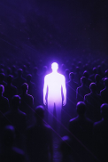

- **Original file:** `inspiration/746b0b0edece41837425f917fbab7429 1.png` (122x182 px, source folder: (root), batch-001 (inspiration.zip, 2026-10-13))
- **Category / subcategory:** FUL / metaphor-object-dark. **Style family:** 3D-METAPHOR. **Also useful for:** -
- **Tags:** stand-out, silhouette, crowd, violet, volumetric, vertical
- **Alternate copies:** none

**Observed (visible in the image)**
- **Visual description:** Vertical dark violet; glowing white-violet human silhouette in a crowd of dark silhouettes; volumetric haze.
- **Typography:** No text in the image. Use it as a silent cutaway, or add one short line in a light white sans in the empty top third.
- **Colour palette (measured, dominant first):** `#0B0C13` 24.0%  `#1B1241` 22.8%  `#0F0E1D` 15.9%  `#140F31` 15.1%  `#181037` 13.6%  `#674EA3` 8.7%
- **Composition:** Vertical: a single glowing human silhouette stands in the centre, with dark silhouettes of a crowd filling the frame around and behind it.
- **Lighting & effects:** The figure is emissive white-violet with a strong glow that lights the haze around it; the crowd stays dark with only faint violet rim light; volumetric haze in a dark violet atmosphere.
- **Depth & layering:** The crowd rows recede into darkness in depth; the glowing figure stands in the mid-ground at the centre.

**Inferred (creative interpretation - not visible in a still)**
- **Animation behaviour:** INFERRED: the crowd dims slightly as the figure ignites (glow 0→1 over 600ms), with the haze brightening around it, then a slow push-in.
- **Suitable use cases:** Standing out and being noticed, personal branding, 'be the one in the crowd' messaging.
- **Technical recreation:** Generated still with a glow animation (an overlay of the figure's mask with a blur and brightness ramp); optional particle dust floating in the haze.

---

### FUL-037 - Chrome Chain with One Violet Link (Stronger)

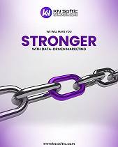

- **Original file:** `inspiration/754d8b8e4aae33f3ec5c2bad19132b7f 1.png` (169x211 px, source folder: (root), batch-001 (inspiration.zip, 2026-10-13))
- **Category / subcategory:** FUL / metaphor-object-light. **Style family:** 3D-METAPHOR. **Also useful for:** -
- **Tags:** chain, strength, violet, chrome, light, vertical
- **Alternate copies:** none

**Observed (visible in the image)**
- **Visual description:** Vertical light violet; logo; 'WE WILL MAKE YOU STRONGER WITH DATA-DRIVEN MARKETING' (bold violet 'STRONGER'); chrome chain with one violet link centre.
- **Typography:** Heavy violet caps 'STRONGER' (~8% of frame height), with small dark caps above ('WE WILL MAKE YOU') and below ('WITH DATA-DRIVEN MARKETING'); a logo at the top and a URL at the bottom.
- **Colour palette (measured, dominant first):** `#D6C8DF` 18.9%  `#E5E1E7` 18.5%  `#DED7E4` 17.8%  `#8D71A0` 15.8%  `#FAF9FC` 14.8%  `#EFECF2` 14.2%
- **Composition:** Vertical: a logo and the headline block centred in the top 35%; a chrome chain runs diagonally across the lower-middle with a single violet link at its centre.
- **Lighting & effects:** Studio chrome reflections on the silver links and glossy violet on the highlighted link; a soft lavender background gradient.
- **Depth & layering:** The 3D chain passes through space in a diagonal, with the links interlocking.

**Inferred (creative interpretation - not visible in a still)**
- **Animation behaviour:** INFERRED: the violet link locks into place between the chrome links (a slight rotate and snap), then the chain tightens with a subtle pull.
- **Suitable use cases:** Strength, the weak link, connection and reliability, 'we make you stronger' offers.
- **Technical recreation:** Generated image or 3D (Blender chain with chrome and violet glossy materials); HTML type with a violet (#6D28D9) headline.

---

### FUL-038 - Violet Sand Hourglass Macro (Every moment counts)

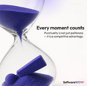

- **Original file:** `inspiration/7738d8020f4517f5d9c28aea945c5e85 1.png` (179x178 px, source folder: (root), batch-001 (inspiration.zip, 2026-10-13))
- **Category / subcategory:** FUL / metaphor-object-light. **Style family:** 3D-METAPHOR. **Also useful for:** -
- **Tags:** hourglass, time, violet, light, macro
- **Alternate copies:** none

**Observed (visible in the image)**
- **Visual description:** Light; hourglass close-up with violet sand and a violet block inside; 'Every moment counts' + body.
- **Typography:** Medium-weight dark sans headline 'Every moment counts' on the right, with 2 lines of small grey body and a small brand mark at the bottom-right.
- **Colour palette (measured, dominant first):** `#3F3D7A` 24.1%  `#F5F4F3` 19.8%  `#FBF9F7` 17.1%  `#FAF8F6` 14.9%  `#E0DDE2` 12.5%  `#FBFBF8` 11.6%
- **Composition:** Square: a hourglass macro bleeds off the left and top edges, filling the left 55%; the text block sits right-of-centre.
- **Lighting & effects:** Soft, high-key light on a white background; the glass is clear with subtle reflections, and the violet sand is matte and textured.
- **Depth & layering:** Macro: the hourglass is very close to the camera and cropped, with a violet block lying in the sand at the bottom.

**Inferred (creative interpretation - not visible in a still)**
- **Animation behaviour:** INFERRED: sand flows continuously through the neck, the pile grows slowly, and the headline fades in once the stream is visible.
- **Suitable use cases:** Time and urgency, punctuality, 'don't waste the moment' messaging.
- **Technical recreation:** Generated still with a sand particle overlay (thin falling stream plus surface grains), and a slow 2% push-in.

---

### FUL-039 - Twisted Ribbon of Blue Glass Slats

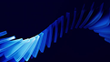

- **Original file:** `inspiration/77f8b448743edd1b07d0365c0887a0da 1.png` (121x68 px, source folder: (root), batch-001 (inspiration.zip, 2026-10-13))
- **Category / subcategory:** FUL / abstract-material. **Style family:** MATERIAL-ABSTRACT. **Also useful for:** -
- **Tags:** ribbon, slats, twist, blue, glass, abstract, transition
- **Alternate copies:** none

**Observed (visible in the image)**
- **Visual description:** Dark navy; a diagonal twisted ribbon formed of many blue glass slats.
- **Typography:** No text in the image. It works as a pure transition, or behind one short centred statement in white sans.
- **Colour palette (measured, dominant first):** `#010021` 38.0%  `#02001C` 15.0%  `#020026` 14.9%  `#08218E` 14.1%  `#338CDB` 11.1%  `#02022C` 6.9%
- **Composition:** Landscape: a diagonal band of many blue glass slats twists across the frame from the lower-left to the upper-right on a dark navy background.
- **Lighting & effects:** Bright edge highlights on each slat, with a cyan-to-blue gradient across the band; the background is deep navy.
- **Depth & layering:** A 3D twist: the slats rotate progressively along the band, creating depth and motion.

**Inferred (creative interpretation - not visible in a still)**
- **Animation behaviour:** INFERRED: a twist travels along the ribbon in a seamless loop (2-3s), as if the band is rotating.
- **Suitable use cases:** Transitions between sections, background loops behind a single statement, tech or motion-design openers.
- **Technical recreation:** 3D array of thin boxes along a curve with a twist modifier and glass/emission material (Blender), rendered as a loop; or a CSS 3D array with per-slat rotateX offsets.

---

### FUL-040 - Halftone Dot Sphere Glow Event Page (OnRamp)

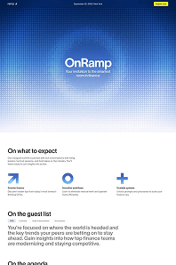

- **Original file:** `inspiration/7db05076605ac55ee3d4b9ba9dbea2e5 1.png` (198x298 px, source folder: (root), batch-001 (inspiration.zip, 2026-10-13))
- **Category / subcategory:** FUL / web-hero-light. **Style family:** FROST-LIGHT. **Also useful for:** -
- **Tags:** halftone, dots, sphere, blue, event, web, light
- **Alternate copies:** none

**Observed (visible in the image)**
- **Visual description:** Vertical web page; top hero blue halftone-dot gradient with glowing sphere 'OnRamp'; white content below (agenda, icons).
- **Typography:** A medium-weight white wordmark 'OnRamp' with a tiny sub-line centred in the hero; small dark headings ('On what to expect', 'On the guest list') and small dark body text in the white section below; tiny nav at the top.
- **Colour palette (measured, dominant first):** `#FFFFFF` 38.8%  `#204B92` 24.6%  `#ABC0DD` 20.7%  `#F1F2F7` 12.5%  `#FAF9FF` 2.4%  `#FEFFFF` 1.0%
- **Composition:** Vertical web page: a blue halftone hero fills the top 45% with the wordmark centred; white content below with three small icon columns and text paragraphs.
- **Lighting & effects:** A halftone dot gradient forms a glowing sphere in the hero (dots larger and brighter at the centre, fading outward); the white section below is flat.
- **Depth & layering:** Flat; the halftone gradient implies a glowing sphere.

**Inferred (creative interpretation - not visible in a still)**
- **Animation behaviour:** INFERRED: the halftone dots ripple outward from the centre (dot size modulated by a moving radial wave), and the wordmark fades up.
- **Suitable use cases:** Event invitations and announcements, halftone texture backgrounds, conference or webinar promos.
- **Technical recreation:** Canvas dot grid with each dot's radius sized by a radial gradient function plus a time-based ripple; blue dots (#2563EB) on a lighter blue background.

---

### FUL-041 - Bright Blue Poster with Frosted Pocket of Flyers

- **Original file:** `inspiration/80cdd34cb41f7cad4ffa570aa188b029 1.png` (122x152 px, source folder: (root), batch-001 (inspiration.zip, 2026-10-13))
- **Category / subcategory:** FUL / typographic-poster. **Style family:** FROST-LIGHT. **Also useful for:** -
- **Tags:** poster, blue, frosted-glass, pocket, label-pills, vertical
- **Alternate copies:** none

**Observed (visible in the image)**
- **Visual description:** Vertical bright blue; 'Social Media Flyer Designs' bold white with small tilted label pills; frosted glass pocket with flyer cards peeking out; info lines; footer.
- **Typography:** Heavy white sans headline in 2 lines 'Social Media Flyer Designs' (~8% of frame height) with small tilted label pills attached; tiny info lines on the pocket; a small name and contact footer.
- **Colour palette (measured, dominant first):** `#DCDEDB` 24.7%  `#348AF4` 19.8%  `#047FF0` 19.5%  `#2779F2` 18.2%  `#1866E8` 11.8%  `#7DA9E1` 5.9%
- **Composition:** Vertical: the headline in the top 25%; a frosted glass pocket in the centre-lower area holds flyer cards peeking out of its top; a footer row at the bottom.
- **Lighting & effects:** Bright blue background with soft white glows; the pocket blurs what is behind it (frosted glass); the flyers are lit evenly.
- **Depth & layering:** The cards sit inside the pocket: partially hidden behind the frosted front panel and sticking out above it.

**Inferred (creative interpretation - not visible in a still)**
- **Animation behaviour:** INFERRED: the cards slide up out of the pocket one by one with a slight fan (rotation ±4°), and the label pills pop onto the headline.
- **Suitable use cases:** Portfolio or showcase reveals, 'here's my work' moments, design services promos.
- **Technical recreation:** A clip region for the pocket (cards behind a frosted front panel with backdrop-filter: blur(12px)); cards as images that translateY upward; headline in Inter 800.

---

### FUL-042 - Mint Translucent Glyph with Dark Glass Bar (quote)

- **Original file:** `inspiration/85438f3d131c3248f9c49eb6c2179e8d 1.png` (75x75 px, source folder: (root), batch-001 (inspiration.zip, 2026-10-13))
- **Category / subcategory:** FUL / typographic-quote. **Style family:** 3D-METAPHOR. **Also useful for:** TXT
- **Tags:** quote, glyph, mint, teal, glass-bar, statement
- **Alternate copies:** none

**Observed (visible in the image)**
- **Visual description:** Teal-mint gradient; giant translucent mint quote/hash glyph; dark glass bar diagonal with 'Hard Work Today More Success Tomorrow'; small logo bottom.
- **Typography:** Medium-weight white sans in 2 lines inside the dark glass bar ('Hard Work Today More Success Tomorrow'); a small logo and tiny text at the bottom. Very low-res source (75px wide).
- **Colour palette (measured, dominant first):** `#145548` 22.0%  `#217564` 17.7%  `#4BD3C2` 17.2%  `#196959` 15.3%  `#38A792` 15.0%  `#60E9E0` 12.7%
- **Composition:** Square: a giant translucent mint glyph (quote or hash shape) centred; a dark glass bar crosses it diagonally at about -8°; the same layout family as FUL-004.
- **Lighting & effects:** Soft teal-mint gradient lighting with a brighter top; the glyph is translucent mint and the bar is dark frosted glass.
- **Depth & layering:** The bar is in front of the glyph, which is in front of the gradient background.

**Inferred (creative interpretation - not visible in a still)**
- **Animation behaviour:** INFERRED: as FUL-004. The glyph rotates in slightly in 3D, the bar slides in with blur, and the text reveals word by word.
- **Suitable use cases:** Motivational statements, quotes and mantras, end-of-video takeaways.
- **Technical recreation:** See FUL-004 (same layout family): glyph as an SVG with a mint fill at 60% opacity, bar with backdrop blur and a dark tint, on a teal gradient (#5EEAD4 → #0F766E).

---

### FUL-043 - Clay Thinker on Keyboard (escape the bad design)

- **Original file:** `inspiration/8a5a1386e0c061ddcfebf35547694484 1.png` (122x152 px, source folder: (root), batch-001 (inspiration.zip, 2026-10-13))
- **Category / subcategory:** FUL / metaphor-object-light. **Style family:** 3D-METAPHOR. **Also useful for:** TXT
- **Tags:** clay, figure, keyboard, handwritten, serif-mix, warm, dof, vertical
- **Alternate copies:** none

**Observed (visible in the image)**
- **Visual description:** Vertical warm light; tag pill top; 'escape' bold + 'the bad design' italic serif; violet handwritten annotation with arrow; violet clay 'thinker' figure sitting on mechanical keyboard; shallow DOF.
- **Typography:** A bold sans word 'escape' with an italic serif line 'the bad design' beneath it (similar sizes, ~6% of frame height); a violet handwritten annotation with an arrow; a small tag pill at the top.
- **Colour palette (measured, dominant first):** `#645A5E` 19.6%  `#ECE5DA` 19.5%  `#A19895` 17.2%  `#BBAEAA` 16.7%  `#D5CCC5` 15.2%  `#F7F1DF` 11.7%
- **Composition:** Vertical: the text block centred in the top 40%; a violet clay 'thinker' figure sits on a mechanical keyboard in the lower-right, with the keyboard running diagonally out of frame.
- **Lighting & effects:** Warm window light from the upper-left with soft shadows; a creamy, slightly desaturated palette with the violet figure as the accent.
- **Depth & layering:** Shallow depth of field: the figure and the nearby keys are sharp, and the background and far keys blur.

**Inferred (creative interpretation - not visible in a still)**
- **Animation behaviour:** INFERRED: the handwriting draws on (stroke reveal, 800ms), the arrow follows, and a rack focus moves from the text to the figure.
- **Suitable use cases:** Design mistakes, reflective or thoughtful moments, 'stop doing this' advice for creatives.
- **Technical recreation:** Generated image with depth-of-field; SVG handwriting path drawn with stroke-dashoffset; headline in Inter Bold + Playfair Italic.

---

### FUL-044 - Testimonial Quote Cards Stack (3D Project Workflow)

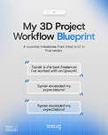

- **Original file:** `inspiration/8b12f6ecf093b3944d1ae5e25eece2e6 1.png` (122x152 px, source folder: (root), batch-001 (inspiration.zip, 2026-10-13))
- **Category / subcategory:** FUL / typographic-poster. **Style family:** FROST-LIGHT. **Also useful for:** -
- **Tags:** testimonials, quote-cards, light, blue, stack, vertical
- **Alternate copies:** none

**Observed (visible in the image)**
- **Visual description:** Vertical light grey-blue; 'My 3D Project Workflow Blueprint' ('Blueprint' blue); stacked white testimonial cards with quote marks; blue gradient bottom.
- **Typography:** Medium-weight dark sans headline in 2 lines ('My 3D Project Workflow Blueprint', with 'Blueprint' in blue), a small grey sub-line, and small dark testimonial text in each card with blue quote marks.
- **Colour palette (measured, dominant first):** `#DDDEE0` 22.7%  `#799DC9` 18.7%  `#E4E4E5` 17.9%  `#D8D9DA` 14.1%  `#C7D1DD` 13.6%  `#EDEDEE` 13.0%
- **Composition:** Vertical: the headline centred in the top 25%; a column of three testimonial cards stacked in the centre, each with quote marks at its corners; a blue gradient at the bottom with tiny footer text.
- **Lighting & effects:** Soft shadows under the white cards on a light grey-blue background; a blue glow rises from the bottom.
- **Depth & layering:** The stacked cards float slightly above the background, each with its own shadow.

**Inferred (creative interpretation - not visible in a still)**
- **Animation behaviour:** INFERRED: the cards slide up sequentially (120ms stagger) with the quote marks popping in at their corners.
- **Suitable use cases:** Testimonials and social proof, client feedback moments, 'what people say' sections.
- **Technical recreation:** HTML cards (white, radius 14, soft shadow) with blue quote glyphs; headline with a blue keyword span; background gradient fading to #3B82F6 at the bottom.

---

### FUL-045 - Row of Dark Tiles with Lit Centre Framer Tile + Hero Text

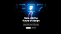

- **Original file:** `inspiration/8c317decf89ebe769525b6c2fff2a378 1.png` (122x69 px, source folder: (root), batch-001 (inspiration.zip, 2026-10-13))
- **Category / subcategory:** FUL / web-hero-dark. **Style family:** NEON-RIM. **Also useful for:** -
- **Tags:** tiles, framer, hero, blue, glow, design
- **Alternate copies:** none

**Observed (visible in the image)**
- **Visual description:** Black; row of dark glass app tiles with centre (Framer) lit blue by a hand/figure; 'Step into the future of design' + body + buttons.
- **Typography:** Medium-weight white 2-line headline 'Step into the future of design' centred, with small grey body and two small buttons beneath.
- **Colour palette (measured, dominant first):** `#000000` 71.3%  `#153661` 8.8%  `#040C1B` 7.5%  `#6D97B7` 5.3%  `#010005` 5.1%  `#000003` 2.0%
- **Composition:** Landscape: a row of dark glass app tiles across the top third with the centre tile lit; the headline block centred below; black background.
- **Lighting & effects:** A single light source: the centre tile (Framer) glows blue-white with a figure or hand touching it, while the other tiles stay dark with faint rims.
- **Depth & layering:** The tiles recede slightly toward the edges; the lit tile is in front of the row.

**Inferred (creative interpretation - not visible in a still)**
- **Animation behaviour:** INFERRED: the centre tile lights up (glow 0→1) as the others dim, then the headline fades up.
- **Suitable use cases:** Tool-focused intros ('let's talk about Framer'), design or software topics.
- **Technical recreation:** As ONS-010 (glass tiles with a neon rim and bloom), arranged in a row with only the centre tile emissive.

---

### FUL-046 - Frosted Glass Donut with Blurred Blue Core

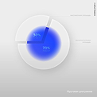

- **Original file:** `inspiration/8c62155cc8837dafa2340d994083c526 1.png` (122x122 px, source folder: (root), batch-001 (inspiration.zip, 2026-10-13))
- **Category / subcategory:** FUL / data-viz-scene. **Style family:** FROST-LIGHT. **Also useful for:** -
- **Tags:** donut, pie, frosted, blue, light, neumorphic, percent
- **Alternate copies:** none

**Observed (visible in the image)**
- **Visual description:** Light grey; large frosted white glass donut/pie with a separated segment; inner deep blue blurred glow showing 30% / 70%.
- **Typography:** Small white percentages ('30%', '70%') on the blurred blue core, and tiny grey annotation text around the chart; a tiny caption at the bottom-right.
- **Colour palette (measured, dominant first):** `#D1D1D2` 39.9%  `#EDEDED` 28.3%  `#E5E5E5` 13.7%  `#949ED7` 9.5%  `#EBEDED` 6.8%  `#F1F1F1` 1.8%
- **Composition:** Square: a large donut chart sits left-of-centre and fills ~70% of the height, with one segment slightly separated; annotation lines extend to the right.
- **Lighting & effects:** A deep blue glow seen through frosted white glass (the core is a blurred blue blob); soft neumorphic shadows on the light grey background.
- **Depth & layering:** Glass layers: a frosted white donut on top of a blue glow, with a separated segment raised slightly above the rest.

**Inferred (creative interpretation - not visible in a still)**
- **Animation behaviour:** INFERRED: the segment slides out from the donut (translate along its bisector), the blue glow intensifies behind it, and the percentages count up.
- **Suitable use cases:** Proportions and percentages on a light theme, 'this share vs that share' explanations.
- **Technical recreation:** Layered circles: a blurred blue blob (#2563EB, blur 40px) under a frosted donut (rgba(255,255,255,.6) with backdrop blur); the segment as an SVG arc path translated outward.

---

### FUL-047 - Violet Light Rays through Key Grid (Premiere key)

- **Original file:** `inspiration/93d23a55a0912f5ab25713f9fed31e09 1.png` (122x68 px, source folder: (root), batch-001 (inspiration.zip, 2026-10-13))
- **Category / subcategory:** FUL / abstract-material. **Style family:** MATERIAL-ABSTRACT. **Also useful for:** -
- **Tags:** keys, grid, violet, rays, premiere, 3d
- **Alternate copies:** none

**Observed (visible in the image)**
- **Visual description:** Dark; violet volumetric rays radiate behind a grid of dark keycaps; central glossy violet 'Pr' key raised.
- **Typography:** Only the 'Pr' logo on the central key.
- **Colour palette (measured, dominant first):** `#040405` 28.2%  `#08040D` 19.8%  `#14081C` 18.2%  `#341249` 15.9%  `#793FA3` 10.8%  `#020202` 7.0%
- **Composition:** Landscape, centred: a grid of dark keycaps fills the frame with the central violet key raised; light rays radiate from behind it.
- **Lighting & effects:** Violet volumetric rays fan out from the centre and the emissive key glows; the surrounding keys are dark and catch violet edge light.
- **Depth & layering:** A 3D grid in perspective, with the central key raised above the surrounding keys.

**Inferred (creative interpretation - not visible in a still)**
- **Animation behaviour:** INFERRED: the central key rises and lights up while the rays expand outward (500ms), followed by a slow push-in.
- **Suitable use cases:** Software or tool reveals (Premiere Pro, an editing app), 'the tool I use' moments.
- **Technical recreation:** 3D render (Blender: array of rounded cubes, emission on the central key, volumetric light behind), or a generated image with a ray overlay animated via scale and opacity.

---

### FUL-048 - Isometric Glass Tiles with Blue Underlight (macro)

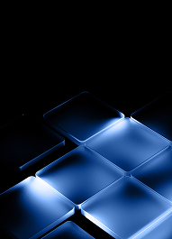

- **Original file:** `inspiration/946180e17dec456d5d0f47ae6ae4f33f 1.png` (191x265 px, source folder: (root), batch-001 (inspiration.zip, 2026-10-13))
- **Category / subcategory:** FUL / abstract-material. **Style family:** MATERIAL-ABSTRACT. **Also useful for:** -
- **Tags:** tiles, isometric, glass, blue, underlight, macro, vertical
- **Alternate copies:** none

**Observed (visible in the image)**
- **Visual description:** Vertical black; isometric macro of acrylic tiles with blue under-light edges.
- **Typography:** No text in the image. Keep it textless as b-roll, or place a single headline in the dark upper-left corner.
- **Colour palette (measured, dominant first):** `#000000` 49.6%  `#295A9E` 19.5%  `#000002` 11.5%  `#041734` 9.8%  `#6F9BD7` 9.2%  `#010000` 0.4%
- **Composition:** Vertical: an isometric close-up of a grid of glass tiles running diagonally from the lower-left to the upper-right, cropped on all sides.
- **Lighting & effects:** A blue under-light makes the tile edges glow cyan-blue; deep black elsewhere.
- **Depth & layering:** Macro: the tiles are close to the camera and the edges toward the frame fall into darkness.

**Inferred (creative interpretation - not visible in a still)**
- **Animation behaviour:** INFERRED: the tiles light up in a wave that travels diagonally across the grid (each tile's edge glow pulsing with a stagger).
- **Suitable use cases:** Tech b-roll, backgrounds behind a statement, transitions.
- **Technical recreation:** 3D (Blender grid of bevelled glass tiles with an emissive plane beneath), or a generated loop; or CSS 3D with rotateX/rotateZ and per-tile glow animations.

---

### FUL-049 - Starry Night Palette Poster (ripple + gradient bar)

- **Original file:** `inspiration/96f33288037febe8c297ad7125607247 1.png` (121x152 px, source folder: (root), batch-001 (inspiration.zip, 2026-10-13))
- **Category / subcategory:** FUL / typographic-poster. **Style family:** FROST-LIGHT. **Also useful for:** -
- **Tags:** palette, gradient-bar, ripple, navy, light, vertical
- **Alternate copies:** none

**Observed (visible in the image)**
- **Visual description:** Vertical white→blue gradient; ripple contour lines; 'Starry Night' bold navy centred; wide pill gradient swatch bar with hex labels.
- **Typography:** A heavy navy geometric sans 'Starry Night' in 2 lines (~9% of frame height), centred; a tiny grey intro line at the top; tiny hex-code labels under the swatch bar; a tiny footer.
- **Colour palette (measured, dominant first):** `#D5E1EC` 20.2%  `#325180` 19.0%  `#7E9CBC` 18.4%  `#FDFEFE` 16.9%  `#A8BDD2` 12.9%  `#F3F7FA` 12.6%
- **Composition:** Vertical, centred stack: tiny intro text at the top, the title in the upper-middle, a wide rounded swatch bar spanning ~80% of the width below it, then a row of hex labels and a footer.
- **Lighting & effects:** Soft, cool light: a white-to-pale-blue gradient background with concentric ripple contour lines radiating behind the title; the swatch bar graduates from deep navy to white.
- **Depth & layering:** The ripple contours create a subtle embossed, layered depth behind the flat title and bar.

**Inferred (creative interpretation - not visible in a still)**
- **Animation behaviour:** INFERRED: ripples expand outward from behind the title, the swatch bar fills left to right with its gradient, and the hex labels type in.
- **Suitable use cases:** Colour or brand topics, palette reveals, calm title cards for design content.
- **Technical recreation:** SVG concentric rounded paths with a faint stroke and a subtle shadow (or repeated border rings), a rounded bar with linear-gradient(#1E3A8A → #FFFFFF), and the title in Inter 800 navy.

---

### FUL-050 - Robot and Human Hands Reaching (Bridge to the Future)

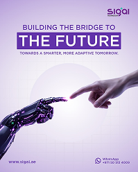

- **Original file:** `inspiration/a1f9a5437bc584f7f63ced1367c99b51 1.png` (199x248 px, source folder: (root), batch-001 (inspiration.zip, 2026-10-13))
- **Category / subcategory:** FUL / metaphor-object-light. **Style family:** 3D-METAPHOR. **Also useful for:** -
- **Tags:** creation-of-adam, robot, hands, ai, violet, lavender, vertical
- **Alternate copies:** none

**Observed (visible in the image)**
- **Visual description:** Vertical lavender; 'BUILDING THE BRIDGE TO THE FUTURE' violet caps with filled violet box on 'THE FUTURE'; robot hand and human hand nearly touching with spark glow.
- **Typography:** Medium-weight violet caps 'BUILDING THE BRIDGE TO', heavy white caps 'THE FUTURE' set inside a filled violet highlight box, and a small violet caps line beneath; a logo at the top-right and tiny contact text at the bottom.
- **Colour palette (measured, dominant first):** `#EDE9F4` 19.4%  `#CBBCE3` 19.0%  `#D6C9E8` 16.8%  `#775E9B` 16.7%  `#E3DBEE` 16.1%  `#F5F2F8` 12.0%
- **Composition:** Vertical: the headline block centred in the top 30%; a robot hand enters from the lower-left and a human hand from the upper-right, fingertips nearly touching just right of centre (Creation of Adam pose).
- **Lighting & effects:** A bright violet-white spark glows at the touch point; a soft lavender gradient background with a faint grid and a pale circle behind the hands.
- **Depth & layering:** The hands are in the foreground, crossing the frame diagonally, with the background grid and circle behind.

**Inferred (creative interpretation - not visible in a still)**
- **Animation behaviour:** INFERRED: the hands move toward each other slowly (2-3% each), a spark flashes at contact with a glow bloom, and the highlight box wipes on behind 'THE FUTURE'.
- **Suitable use cases:** Human and AI collaboration, bridging to the future, partnership or 'connection' themes.
- **Technical recreation:** Generated image of the hands, split into two layers for subtle movement, plus a spark overlay (a radial gradient flash); headline in HTML with a violet (#6D28D9) highlight box.

---

### FUL-051 - 3D Blue '1' with Gold Crown (1 Year)

- **Original file:** `inspiration/a8377f219621e4e188034c0f32cbc96a 1.png` (122x153 px, source folder: (root), batch-001 (inspiration.zip, 2026-10-13))
- **Category / subcategory:** FUL / big-numeral-3d. **Style family:** 3D-METAPHOR. **Also useful for:** -
- **Tags:** 3d-numeral, crown, gold, blue, anniversary, vertical
- **Alternate copies:** none

**Observed (visible in the image)**
- **Visual description:** Vertical deep blue; 'Celebrating 1 Year of Active Building' (blue accent 'Building'); giant glossy blue 3D '1' with gold crown.
- **Typography:** A medium-weight white 3-line headline ('Celebrating 1 Year of Active Building' with 'Building' in blue), a small 'Happy Anniversary' line and a logo at the top-left; tiny footer text and a small badge.
- **Colour palette (measured, dominant first):** `#031351` 27.4%  `#08114A` 20.5%  `#2854AA` 19.7%  `#0D3182` 18.2%  `#7C8BBD` 9.2%  `#011250` 5.1%
- **Composition:** Vertical: text in the top-left third; a giant glossy blue 3D '1' rises from the bottom-centre to mid-frame with a gold crown resting on top.
- **Lighting & effects:** Glossy blue reflections on the numeral and gold specular highlights on the crown; a deep blue background with a soft light gradient.
- **Depth & layering:** 3D: the extruded numeral has visible bevel depth and the crown sits on top casting a slight shadow.

**Inferred (creative interpretation - not visible in a still)**
- **Animation behaviour:** INFERRED: the numeral rises from below the frame (700ms outQuart), the crown drops onto it and settles, and the headline fades in.
- **Suitable use cases:** Anniversaries ('1 year of...'), 'rank #1' claims, milestones and celebrations.
- **Technical recreation:** 3D extruded text (Blender: bevelled '1' with glossy blue material, a gold crown model) or a generated image; HTML headline overlay.

---

### FUL-052 - Violet Planet Arc over Centred Headline (meetings)

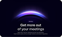

- **Original file:** `inspiration/a85101d4b77ba3408e2db82cfa378ca4 1.png` (122x73 px, source folder: (root), batch-001 (inspiration.zip, 2026-10-13))
- **Category / subcategory:** FUL / horizon-arc. **Style family:** HORIZON-ARC. **Also useful for:** -
- **Tags:** planet-arc, violet, headline, centred, saas
- **Alternate copies:** none

**Observed (visible in the image)**
- **Visual description:** Dark navy; violet glowing planet arc at top; 'Get more out of your meetings' centred white; small body.
- **Typography:** Medium-weight white 2-line headline 'Get more out of your meetings' centred, with a tiny tag above and 2 lines of tiny grey body below.
- **Colour palette (measured, dominant first):** `#030116` 39.3%  `#030118` 35.1%  `#302950` 14.4%  `#010010` 4.8%  `#020116` 3.8%  `#020112` 2.6%
- **Composition:** Landscape rounded card: a violet planet arc spans the top third; the headline block is centred directly beneath it.
- **Lighting & effects:** The violet arc glows with a bright white-violet rim and a soft haze above and below; a dark navy background.
- **Depth & layering:** Flat, with the glow implying a horizon.

**Inferred (creative interpretation - not visible in a still)**
- **Animation behaviour:** INFERRED: the arc brightens like a sunrise (1.2s outQuart) and the headline fades up beneath it.
- **Suitable use cases:** Statement cards, product or feature intros, calm section openers.
- **Technical recreation:** The arc glow recipe from templates/fullscreen-horizon-title.html in violet (#8B5CF6 rim, rgba(139,92,246,.3) haze), with an HTML headline.

---

### FUL-053 - Web2.0 → Logo → Web3.0 Lens Flare Transition

- **Original file:** `inspiration/a8bdaaec9edc5305383228b6c8e40ecb 1.png` (122x69 px, source folder: (root), batch-001 (inspiration.zip, 2026-10-13))
- **Category / subcategory:** FUL / transition-concept. **Style family:** NEON-RIM. **Also useful for:** -
- **Tags:** transition, before-after, lens-flare, blue, pills, arrows
- **Alternate copies:** none

**Observed (visible in the image)**
- **Visual description:** Blue; glowing pill 'Web2.0' → logo with radial lens flare rings → pill 'Web3.0'; title 'Web2.0 — Web3.0' below.
- **Typography:** Bold white sans labels 'Web2.0' and 'Web3.0' inside glowing pills, a bold white title 'Web2.0 — Web3.0' beneath, and a small pill caption at the bottom; a logo at the top-left.
- **Colour palette (measured, dominant first):** `#01051D` 27.0%  `#0326A1` 19.0%  `#03145F` 18.7%  `#102863` 12.9%  `#174DA1` 11.4%  `#4FAAEA` 10.9%
- **Composition:** Landscape, horizontally symmetric: the 'Web2.0' pill on the left, a central logo with concentric flare rings, the 'Web3.0' pill on the right, connected by blue arrows; the title centred below.
- **Lighting & effects:** Strong blue lens flares and glowing rings around the central logo, blue light bursts behind both pills, on a deep blue background.
- **Depth & layering:** Flat composition, with the flare rings suggesting depth around the centre.

**Inferred (creative interpretation - not visible in a still)**
- **Animation behaviour:** INFERRED: left pill flows through centre and transforms into right pill.
- **Suitable use cases:** Before → after transitions, evolutions ('old way → new way'), product upgrades.
- **Technical recreation:** Pills (rounded rects with a blue border and glow), radial-gradient flares and concentric rings around the logo, and arrows; animate left → centre → right with a light pulse travelling along.

---

### FUL-054 - Human and Robot Hands on Navy Grid (clarity meets creativity)

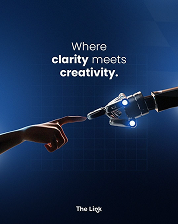

- **Original file:** `inspiration/b148f2e07365a6b897c8e370a1594da1 1.png` (178x224 px, source folder: (root), batch-001 (inspiration.zip, 2026-10-13))
- **Category / subcategory:** FUL / metaphor-object-dark. **Style family:** 3D-METAPHOR. **Also useful for:** -
- **Tags:** hands, robot, ai, navy, grid, vertical
- **Alternate copies:** none

**Observed (visible in the image)**
- **Visual description:** Vertical navy grid; 'Where clarity meets creativity.' light+bold mix; human hand and robot hand with glowing joints reaching.
- **Typography:** A light + bold sans mix in 3 centred lines ('Where clarity meets creativity.'), with 'clarity' and 'creativity' in bold; a small logo at the bottom.
- **Colour palette (measured, dominant first):** `#102950` 25.6%  `#040D20` 24.1%  `#183968` 21.5%  `#081935` 19.2%  `#425E88` 6.9%  `#0D1A33` 2.6%
- **Composition:** Vertical: the headline in the top third; a human hand from the left and a robot hand from the right reach toward each other across the middle.
- **Lighting & effects:** Blue glows at the robot's joints and fingertip, soft light on the human hand, and a navy gradient background with a faint grid.
- **Depth & layering:** A grid in perspective behind the hands, which are in the foreground.

**Inferred (creative interpretation - not visible in a still)**
- **Animation behaviour:** INFERRED: the hands approach until nearly touching, the robot's joints light up in sequence, and the headline fades in line by line.
- **Suitable use cases:** AI + human collaboration, creative technology, 'where X meets Y' statements.
- **Technical recreation:** Generated image of the hands with glow overlays on the joints (small radial gradients pulsing), and an HTML headline.

---

### FUL-055 - Ornate Glass Hourglass in Blue Studio (savings)

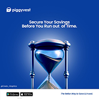

- **Original file:** `inspiration/b873f49d85fc95894193aae00380a131 1.png` (165x166 px, source folder: (root), batch-001 (inspiration.zip, 2026-10-13))
- **Category / subcategory:** FUL / metaphor-object-dark. **Style family:** 3D-METAPHOR. **Also useful for:** -
- **Tags:** hourglass, time, blue, savings, poster, vertical
- **Alternate copies:** none

**Observed (visible in the image)**
- **Visual description:** Vertical blue; logo; 'Secure Your Savings Before You Run out of Time.'; ornate glass hourglass with blue sand; app badges footer.
- **Typography:** A bold white 2-line sans headline 'Secure Your Savings Before You Run out of Time.' centred near the top; a logo at the top-left; small app-store badges and tiny text at the bottom.
- **Colour palette (measured, dominant first):** `#083E9E` 29.8%  `#2252A5` 22.6%  `#0B409F` 20.1%  `#ADC0DD` 19.9%  `#061959` 6.0%  `#053F93` 1.7%
- **Composition:** Vertical: the logo and headline in the top 25%; an ornate glass hourglass centred in the middle-lower area; a white footer strip with badges at the bottom.
- **Lighting & effects:** Studio blue: a bright blue background with a soft glow, reflections on the glass and metal frame, and deep blue sand.
- **Depth & layering:** The hourglass is the hero object in the mid-ground, with a soft glow behind it.

**Inferred (creative interpretation - not visible in a still)**
- **Animation behaviour:** INFERRED: sand flows continuously through the neck with a slow push-in on the hourglass, and the headline fades in.
- **Suitable use cases:** Urgency and time ('before it's too late'), savings and finance deadlines.
- **Technical recreation:** Generated or rendered hourglass still with a sand particle overlay and a 3% push-in; HTML headline in Inter 800 white.

---

### FUL-056 - Hand Reaching to Glowing Orb (decentralization)

- **Original file:** `inspiration/bb209cf6c9db2da8da96853f6b29b381 1.png` (112x75 px, source folder: (root), batch-001 (inspiration.zip, 2026-10-13))
- **Category / subcategory:** FUL / web-hero-dark. **Style family:** HORIZON-ARC. **Also useful for:** -
- **Tags:** orb, hand, reach, blue, hero, web
- **Alternate copies:** none

**Observed (visible in the image)**
- **Visual description:** Blue web hero; hand reaching up to a glowing blue orb; 'Where decentralization meets destiny.' bottom-left.
- **Typography:** A medium-weight white 2-line headline 'Where decentralization meets destiny.' at the bottom-left; tiny nav at the top, a small body paragraph and a button at the bottom-right.
- **Colour palette (measured, dominant first):** `#010B16` 22.2%  `#096191` 21.3%  `#06416A` 18.7%  `#062745` 15.9%  `#021930` 15.0%  `#2885AF` 7.0%
- **Composition:** Landscape web hero: a glowing orb centred in the upper-middle, a hand reaching up toward it from the bottom-centre, the headline bottom-left.
- **Lighting & effects:** The orb glows teal-blue with a ring of light; the hand is a dark silhouette rim-lit by the orb; a dark teal-blue background.
- **Depth & layering:** The hand is in the foreground reaching up, with the orb floating above in the mid-ground.

**Inferred (creative interpretation - not visible in a still)**
- **Animation behaviour:** INFERRED: the orb pulses gently while the hand rises slightly toward it, and the headline fades up.
- **Suitable use cases:** Aspiration and reaching goals, 'the future is within reach' messaging, crypto or tech hero intros.
- **Technical recreation:** Generated image with a glow overlay (radial gradient pulsing scale 1→1.05) and a subtle upward drift on the hand layer.

---

### FUL-057 - Chrome Clock Face Perspective (Timing matters!)

- **Original file:** `inspiration/bc2fd3d245864982b474c3f1cefc9d3d 1.png` (121x122 px, source folder: (root), batch-001 (inspiration.zip, 2026-10-13))
- **Category / subcategory:** FUL / metaphor-object-light. **Style family:** 3D-METAPHOR. **Also useful for:** -
- **Tags:** clock, time, chrome, lavender, ghost-text, vertical
- **Alternate copies:** none

**Observed (visible in the image)**
- **Visual description:** Vertical light lavender; 'Timing matters!' blue bold; sub with pill tag; big chrome clock face with roman numerals in perspective; ghost text 'Best Time' behind.
- **Typography:** A heavy blue sans headline 'Timing matters!' (~8% of frame height), a small dark sub-line with a small tilted blue pill tag, ghost text 'Best Time' in very faint lavender behind, and a blue info bar at the bottom; a logo at the top-left.
- **Colour palette (measured, dominant first):** `#5C5B8B` 22.4%  `#E5E5E7` 20.6%  `#CAC8DD` 19.4%  `#FFFFFF` 16.0%  `#FBFBFB` 10.8%  `#F1F1F3` 10.7%
- **Composition:** Square: the headline block in the top 30%; a big chrome clock face fills the lower 70%, seen in perspective and bleeding off the bottom and right edges.
- **Lighting & effects:** Chrome reflections on the clock's bezel, a soft lavender light gradient, and dark roman numerals.
- **Depth & layering:** The clock is in strong perspective, receding toward the right, with the ghost text behind it.

**Inferred (creative interpretation - not visible in a still)**
- **Animation behaviour:** INFERRED: the clock hands sweep rapidly, then decelerate and stop on the target time (outQuart), and the headline drops in.
- **Suitable use cases:** Timing and scheduling ('post at the right time'), deadlines, 'when matters as much as what'.
- **Technical recreation:** Generated clock image with separately animated hand layers (rotate around the centre), ghost text in HTML at 8% opacity, and a headline in Inter 800 blue.

---

### FUL-058 - Giant Dial Hand with Violet Timeline Arc

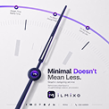

- **Original file:** `inspiration/be2dbc8bbe6c218a83e2760cf76b40d9 1.png` (122x122 px, source folder: (root), batch-001 (inspiration.zip, 2026-10-13))
- **Category / subcategory:** FUL / metaphor-object-light. **Style family:** 3D-METAPHOR. **Also useful for:** -
- **Tags:** dial, watch-hand, timeline, violet, navy, light, minimal
- **Alternate copies:** none

**Observed (visible in the image)**
- **Visual description:** Light grey; huge navy watch hand pivoting from bottom-centre; purple arc track with nodes and labels along dial edge; 'Minimal Doesn't Mean Less.' (violet 'Doesn't'); logo.
- **Typography:** A medium-weight navy 2-line headline 'Minimal Doesn't Mean Less.' with 'Doesn't' in violet, tiny grey body lines, a logo 'ilmixo' and tiny social icons along the bottom.
- **Colour palette (measured, dominant first):** `#ECEAED` 22.4%  `#E6E4E7` 22.3%  `#F0EEF1` 17.3%  `#E9E7EA` 13.5%  `#F6F4F6` 13.1%  `#A39DB7` 11.4%
- **Composition:** Square macro: a giant navy watch hand pivots from a violet hub at the lower-left, pointing up to the top-right; a purple arc track with nodes and tiny labels runs along the dial's top edge; text in the lower-right.
- **Lighting & effects:** Soft, clean light on a light grey dial with faint tick marks; the violet arc and hub are the accent colour.
- **Depth & layering:** Macro: a very close view of a dial, cropped, with the hand above the dial surface.

**Inferred (creative interpretation - not visible in a still)**
- **Animation behaviour:** INFERRED: the hand sweeps from node to node along the arc (each step 400ms with a soft settle), and the node labels highlight as it passes.
- **Suitable use cases:** Timelines and milestones, steps over time, 'phase 1, phase 2, phase 3' roadmaps.
- **Technical recreation:** SVG arc track with node circles, a hand as a long rounded rect rotated around a hub (transform-origin at the hub), and stepwise rotation keyed to speech.

---

### FUL-059 - Floating Blue Glass Shards around Title (FutureTech)

- **Original file:** `inspiration/c16d7e5b666c6e8631c6c1d34ce98ea0 1.png` (122x72 px, source folder: (root), batch-001 (inspiration.zip, 2026-10-13))
- **Category / subcategory:** FUL / abstract-material. **Style family:** MATERIAL-ABSTRACT. **Also useful for:** -
- **Tags:** glass-shards, panels, blue, title, depth
- **Alternate copies:** none

**Observed (visible in the image)**
- **Visual description:** Black; floating blue glass panels/shards at varied angles around 'FutureTech' title.
- **Typography:** A medium-weight white wordmark 'FutureTech' centred, with a tiny tagline beneath.
- **Colour palette (measured, dominant first):** `#000000` 50.6%  `#040B28` 18.4%  `#06285A` 14.0%  `#2469AD` 9.8%  `#01000A` 4.6%  `#010000` 2.5%
- **Composition:** Landscape: the title centred, surrounded by floating blue glass panels and shards at varied angles and sizes, some cropped by the frame edges.
- **Lighting & effects:** Edge highlights and reflections on the blue glass panels with bright cyan rims; a black background.
- **Depth & layering:** Many depth layers: shards sit in front of and behind the title at different distances (size and blur vary).

**Inferred (creative interpretation - not visible in a still)**
- **Animation behaviour:** INFERRED: shards drift past camera (parallax), title resolves.
- **Suitable use cases:** Title cards, futuristic intros, tech-themed chapter openers.
- **Technical recreation:** 3D (Blender: thin glass boxes scattered with a slow camera dolly) or layered PNG shards with parallax at different speeds; HTML title.

---

### FUL-060 - Blurred Light-Blue Bars (soft bokeh transition)

- **Original file:** `inspiration/c1cac7458c91b63ae48d77111a691c0c 1.png` (122x68 px, source folder: (root), batch-001 (inspiration.zip, 2026-10-13))
- **Category / subcategory:** FUL / transition-plate. **Style family:** LIGHT-STREAK. **Also useful for:** -
- **Tags:** blur, bokeh, light-blue, white, transition, abstract
- **Alternate copies:** none

**Observed (visible in the image)**
- **Visual description:** White field with heavily defocused light-blue vertical bars.
- **Typography:** No text in the image. It is a transition plate, so any text belongs to the scene it reveals.
- **Colour palette (measured, dominant first):** `#F8F8F8` 23.1%  `#C5E5FC` 21.5%  `#F9F9F9` 20.8%  `#DBE9F9` 16.0%  `#FAFAFA` 11.4%  `#ECF2F9` 7.1%
- **Composition:** Landscape: heavily defocused light-blue vertical bars on a white field, clustered at the top-left and bottom-right.
- **Lighting & effects:** Soft defocus: the bars are diffuse light-blue shapes with no hard edges; a bright white background.
- **Depth & layering:** Out-of-focus foreground elements, as if the camera were looking past near objects.

**Inferred (creative interpretation - not visible in a still)**
- **Animation behaviour:** INFERRED: the bars slide horizontally across the frame as a soft wipe (600-800ms inOutSine), revealing the next scene.
- **Suitable use cases:** Light-theme transitions, soft wipes between sections, calm breathers.
- **Technical recreation:** Blurred rects (#93C5FD at 60%, blur 40px) on white, translated horizontally; composite as a transition layer with an alpha fade.

---

### FUL-061 - Tangled Cables Straighten into Arrow (Less Complexity)

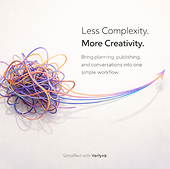

- **Original file:** `inspiration/c22d2407417533c70d97e906b3072f33 1.png` (170x169 px, source folder: (root), batch-001 (inspiration.zip, 2026-10-13))
- **Category / subcategory:** FUL / metaphor-object-light. **Style family:** 3D-METAPHOR. **Also useful for:** TXT
- **Tags:** tangle, simplify, cables, arrow, warm-white, violet-orange, before-after
- **Alternate copies:** none

**Observed (visible in the image)**
- **Visual description:** Warm white; colourful tangled cable knot (violet/orange/blue) on left resolves into parallel flowing lines ending in an arrow at right; 'Less Complexity. More Creativity.' light/bold pair; body; footer.
- **Typography:** A light/regular-weight thin sans pair: 'Less Complexity.' (light) and 'More Creativity.' (regular), at ~5% of frame height, with 3 lines of small grey body; a tiny footer credit.
- **Colour palette (measured, dominant first):** `#ECE7E6` 22.5%  `#FAF7F4` 17.6%  `#FEFCFA` 16.7%  `#FEF9F8` 15.5%  `#C0ADB9` 14.1%  `#F3EDEA` 13.6%
- **Composition:** Square: the text block top-right; a tangled multicolour cable knot sits on the left-centre, with its strands straightening into parallel flowing lines that arc to the upper-right and end in an arrowhead.
- **Lighting & effects:** Soft studio shadows on a warm white background; the cables are glossy violet, orange and blue.
- **Depth & layering:** 3D cables with shading and soft shadows; the tangle has depth and the straightened lines lift off the surface.

**Inferred (creative interpretation - not visible in a still)**
- **Animation behaviour:** INFERRED: knot untangles as lines pull to the right (path morph).
- **Suitable use cases:** Simplification ('one simple workflow'), chaos to clarity, decluttering processes.
- **Technical recreation:** SVG paths that morph from a tangled state to parallel arcs (flubber or a manual morph with matched point counts), or a 3D curve simulation in Blender; arrowhead at the end.

---

### FUL-062 - Money Roll with Bars + Glowing Line (RIBAA!?)

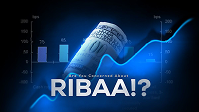

- **Original file:** `inspiration/c4f47bdaba4fc5ac05162be6d82ab07f 1.png` (199x112 px, source folder: (root), batch-001 (inspiration.zip, 2026-10-13))
- **Category / subcategory:** FUL / data-viz-scene. **Style family:** DATA-GLOW. **Also useful for:** TXT
- **Tags:** money, finance, bars, line, blue, headline-caps, question
- **Alternate copies:** none

**Observed (visible in the image)**
- **Visual description:** Blue; rolled dollar bill centre, blue bar chart left, glowing line chart rising right, axes both sides; 'Are You Concerned About' small kicker + 'RIBAA!?' heavy white caps.
- **Typography:** Heavy wide white caps 'RIBAA!?' (~15% of frame height) at the bottom-centre, with a tiny kicker above ('Are You Concerned About'); tiny axis labels on both sides.
- **Colour palette (measured, dominant first):** `#000206` 23.3%  `#052D60` 22.9%  `#1253A6` 16.2%  `#010A18` 14.6%  `#021733` 14.5%  `#68A2D5` 8.4%
- **Composition:** Landscape: a rolled dollar bill in the centre; a blue bar chart on the left and a glowing line chart rising to the right; the headline at the bottom-centre overlapping the object.
- **Lighting & effects:** The blue line glows brightly as it rises; the bars are translucent blue; the money roll is lit with a blue tint on a deep blue background.
- **Depth & layering:** The object sits between the two charts, and the headline is in front of everything.

**Inferred (creative interpretation - not visible in a still)**
- **Animation behaviour:** INFERRED: the bars grow from the baseline, the line shoots upward with a glow trail, and the headline slams in (scale 1.1→1, 150ms) with a small flash.
- **Suitable use cases:** Finance hooks and questions, interest or riba explanations, money-concern topics.
- **Technical recreation:** Composite a money PNG between SVG charts (bars with a vertical blue gradient, line with glow); headline in a wide heavy font (Unbounded or Archivo Black).

---

### FUL-063 - Mixed-Weight Stacked Spanish Headline (Esta historia comienza ahora)

- **Original file:** `inspiration/ca8f247df699dd080bfed06d8b327e69 1.png` (122x152 px, source folder: (root), batch-001 (inspiration.zip, 2026-10-13))
- **Category / subcategory:** FUL / typographic-poster. **Style family:** SERIF-ACCENT-CAPTION. **Also useful for:** TXT
- **Tags:** kinetic-typography, stacked, mixed-weights, outline, handwritten-tag, blue, vertical
- **Alternate copies:** none

**Observed (visible in the image)**
- **Visual description:** Vertical blue gradient with light swoosh; 'Esta historia comienza ahora' stacked: light thin 'Esta', heavy 'historia', medium 'comienza', heavy outline-ish 'ahora'; tilted handwritten tag 'Haz esto por lograr'; logo top.
- **Typography:** Single family, extreme weight contrast (Thin↔Black), tight leading, overlapping lines.
- **Colour palette (measured, dominant first):** `#264599` 26.1%  `#7093DA` 21.3%  `#9CB7EC` 15.0%  `#4E74C6` 15.0%  `#DDE7F9` 11.5%  `#3458AF` 11.2%
- **Composition:** Vertical, centred stack: logo at the top, then four lines of mixed weights tightly overlapping in the middle ('Esta' thin, 'historia' heavy, 'comienza' medium, 'ahora' heavy), with a tilted handwritten tag across the 'historia' line and tiny handle text at the bottom.
- **Lighting & effects:** A soft white light sweep diagonally from the top-right across the blue gradient background, giving a glossy, luminous feel; the text is white and pale blue.
- **Depth & layering:** The lines overlap each other (negative leading), and the handwritten tag sits on top of the headline.

**Inferred (creative interpretation - not visible in a still)**
- **Animation behaviour:** INFERRED: each line enters with different motion (slide, scale, mask), tag stamps on.
- **Suitable use cases:** Hook titles and story openers ('this story starts now'), dramatic intros, chapter titles.
- **Technical recreation:** Variable-font weight animation (Inter 100→900): each line enters with its own motion (slide, scale, mask) and settles at its final weight; the tag is an SVG handwriting stroke draw.

---

### FUL-064 - Giant Key Bridging a Canyon (dream step by step)

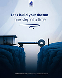

- **Original file:** `inspiration/cbacaa4f88a8deee3555c53ac52d1514 1.png` (121x152 px, source folder: (root), batch-001 (inspiration.zip, 2026-10-13))
- **Category / subcategory:** FUL / metaphor-object-light. **Style family:** 3D-METAPHOR. **Also useful for:** -
- **Tags:** key, bridge, canyon, figure, blue, matte, vertical
- **Alternate copies:** none

**Observed (visible in the image)**
- **Visual description:** Vertical light-blue; 'Let's build your dream one step at a time' + scribble underline; giant key laid across a canyon between cliffs, a house on left, tiny figure on right; matte blue landscape.
- **Typography:** A medium-weight navy sans 2-line headline 'Let's build your dream one step at a time' centred in the top quarter, with a hand-drawn scribble underline beneath; a small logo at the top and tiny footer text.
- **Colour palette (measured, dominant first):** `#020F1E` 25.0%  `#C9D5E5` 21.0%  `#DFE7F1` 20.8%  `#082B47` 15.9%  `#E8EFF7` 11.5%  `#5B7895` 5.9%
- **Composition:** Vertical: text in the top 30%; a canyon scene fills the bottom half, with a giant key laid across the gap between two cliffs, a small house on the left cliff and a tiny standing figure on the right.
- **Lighting & effects:** Soft fog and pale blue haze; matte blue rocks; low-contrast atmospheric light.
- **Depth & layering:** Atmospheric perspective: the cliffs in the foreground, fog and sky receding behind, and tiny scale elements (house, figure) for depth.

**Inferred (creative interpretation - not visible in a still)**
- **Animation behaviour:** INFERRED: key lowers into place to form bridge; figure walks.
- **Suitable use cases:** Unlocking and bridging ideas, building dreams step by step, overcoming a gap or obstacle.
- **Technical recreation:** Generated image split into 2.5D layers (foreground cliffs, key, figure, sky) with parallax and a slow push; animate the key lowering into place; scribble as an SVG stroke draw.

---

### FUL-065 - Cyan Line Dips then Rises on Grid Floor (Brand Evolving)

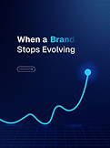

- **Original file:** `inspiration/ceabbb07563626b2230c05f0f9d759db (1) 1.png` (121x162 px, source folder: (root), batch-001 (inspiration.zip, 2026-10-13))
- **Category / subcategory:** FUL / data-viz-scene. **Style family:** DATA-GLOW. **Also useful for:** -
- **Tags:** line-chart, cyan, grid-floor, brand, node, vertical
- **Alternate copies:**
  - `assets/references/_alternates/FUL-065__alt1__ceabbb07563626b2230c05f0f9d759db_1_2.png` (original `inspiration/ceabbb07563626b2230c05f0f9d759db (1) 2.png`, 122x162, same design, different resolution/crop, distance 9)

**Observed (visible in the image)**
- **Visual description:** Vertical navy with perspective grid floor; 'When a Brand Stops Evolving' (blue gradient 'Brand'); arrow pill; cyan glowing line wiggles then rises to endpoint node.
- **Typography:** A medium-weight white 2-line headline 'When a Brand Stops Evolving' at the top-left, with the word 'Brand' in a blue-to-transparent gradient; a small outlined arrow pill beneath.
- **Colour palette (measured, dominant first):** `#030E3A` 26.9%  `#03092D` 20.9%  `#0E2459` 18.6%  `#06123E` 15.1%  `#081748` 11.6%  `#305984` 6.9%
- **Composition:** Vertical: the headline and pill in the top-left third; a cyan line runs across the lower half, dipping and wiggling before rising steeply to an endpoint node at the right; a perspective grid floor at the bottom.
- **Lighting & effects:** A cyan glowing line with a bright endpoint node and bloom, on a navy background with a faint blue grid floor.
- **Depth & layering:** The grid floor recedes in perspective under the line, giving it a stage-like depth.

**Inferred (creative interpretation - not visible in a still)**
- **Animation behaviour:** INFERRED: the line draws left to right (1.2s inOutCubic), dips and then shoots up, the endpoint node flashes, and the headline fades in.
- **Suitable use cases:** Decline and recovery narratives ('when a brand stops evolving it drops, then...'), turnaround stories, growth after a setback.
- **Technical recreation:** SVG path in cyan (#22D3EE) with a blurred duplicate; endpoint circle with a halo; grid floor as a CSS perspective transform on a repeating linear-gradient grid; gradient keyword via background-clip.

---

### FUL-066 - Rainbow Neon Tubes Looping into Frosted Capsule

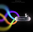

- **Original file:** `inspiration/d1546db33a16d4d578ea06b7ed323b05 1.png` (67x66 px, source folder: (root), batch-001 (inspiration.zip, 2026-10-13))
- **Category / subcategory:** FUL / abstract-material. **Style family:** MATERIAL-ABSTRACT. **Also useful for:** -
- **Tags:** neon-tubes, rainbow, capsule, flow, convergence, black
- **Alternate copies:** none

**Observed (visible in the image)**
- **Visual description:** Black; thick glowing neon tubes (blue, violet, orange, yellow) loop and flow into a frosted glass pill capsule; small figure silhouette atop; tiny text top.
- **Typography:** Tiny grey text at the top and a tiny label on the capsule, all illegible at this 67px source size.
- **Colour palette (measured, dominant first):** `#000000` 30.6%  `#6A6764` 21.6%  `#120C1A` 18.5%  `#020104` 17.6%  `#000100` 8.9%  `#030200` 2.8%
- **Composition:** Square: thick rainbow tubes loop in from the left half and converge into a frosted glass capsule at the centre-right; a small silhouette figure sits on top of the capsule.
- **Lighting & effects:** Strong neon bloom: the tubes glow blue, violet, orange, yellow and green with soft out-of-focus edges; the capsule is frosted white glass catching the light; black background.
- **Depth & layering:** The tubes overlap and loop in depth, some blurred as if near the camera; the capsule is in the mid-ground.

**Inferred (creative interpretation - not visible in a still)**
- **Animation behaviour:** INFERRED: energy flows through tubes into capsule, capsule glows.
- **Suitable use cases:** Many inputs merging into one product, data or content flowing into a tool, 'it all comes together here'.
- **Technical recreation:** Thick SVG strokes (20-40px) with multi-stop gradients and a heavy blur copy for bloom, flowing into a frosted capsule (backdrop blur); animate the tubes' dash offset so energy flows toward the capsule.

---

### FUL-067 - Wireframe Hologram Hand Building a Bridge (Right Path)

- **Original file:** `inspiration/d3522bf2358887caa38dc678a9d1464c 1.png` (199x248 px, source folder: (root), batch-001 (inspiration.zip, 2026-10-13))
- **Category / subcategory:** FUL / metaphor-object-dark. **Style family:** 3D-METAPHOR. **Also useful for:** -
- **Tags:** wireframe, hologram, hand, bridge, figure, blue, vertical
- **Alternate copies:** none

**Observed (visible in the image)**
- **Visual description:** Vertical navy; 'Guiding every step toward Right Path' with large blue gradient words and small inline words; blue wireframe hand placing a bridge segment; tiny figure walking.
- **Typography:** Large gradient display + small inline words (size contrast).
- **Colour palette (measured, dominant first):** `#061442` 21.8%  `#080D21` 19.4%  `#050D2D` 17.8%  `#062162` 15.5%  `#020829` 15.2%  `#275EA9` 10.3%
- **Composition:** Vertical: the headline in the top-left half ('Guiding' and 'Right' huge, 'every step toward' and 'Path' small); a wireframe scene in the lower half shows a hand placing a bridge segment between two truss bridge sections over a gap, with a tiny figure on the left bridge.
- **Lighting & effects:** Glowing blue wireframe lines on dark navy, brightest on the hand and the bridge edges; a logo at the top-right and tiny footer text.
- **Depth & layering:** The bridge sections recede in slight perspective, with the hand coming from the upper-right toward the gap.

**Inferred (creative interpretation - not visible in a still)**
- **Animation behaviour:** INFERRED: the wireframe hand lowers the missing bridge segment into the gap (800ms), the lines brighten on contact, and the tiny figure walks across.
- **Suitable use cases:** Guidance and mentorship ('we guide every step'), education or coaching offers, bridging a skills gap.
- **Technical recreation:** 3D wireframe (Blender wireframe modifier + emission) or SVG line art with stroke-draw; animate the segment's descent and a glow pulse on contact.

---

### FUL-068 - Close-up Glowing Glass Keys Grid (blue)

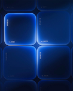

- **Original file:** `inspiration/dcbe45c0e1ae80c24e20cf0d5abba272 1.png` (122x151 px, source folder: (root), batch-001 (inspiration.zip, 2026-10-13))
- **Category / subcategory:** FUL / abstract-material. **Style family:** MATERIAL-ABSTRACT. **Also useful for:** -
- **Tags:** keys, tiles, glass, blue, neon, macro, vertical
- **Alternate copies:** none

**Observed (visible in the image)**
- **Visual description:** Vertical; close-up of big blue glowing glass keys/tiles grid with tiny labels.
- **Typography:** Tiny labels printed on the keys (rotated, very small); not legible at this size.
- **Colour palette (measured, dominant first):** `#07102A` 25.1%  `#07265E` 23.9%  `#073077` 15.4%  `#041B48` 14.1%  `#091B43` 11.1%  `#2760BD` 10.3%
- **Composition:** Vertical: a close-up of a 2x2+ grid of large rounded glass keys filling the frame, cropped on all sides.
- **Lighting & effects:** Edge neon: each key glows electric blue along its edges, brightest on the inner rims, with a dark navy interior.
- **Depth & layering:** Macro: the keys are large and close, with the outer keys partially cropped.

**Inferred (creative interpretation - not visible in a still)**
- **Animation behaviour:** INFERRED: the keys press in sequence (each depresses slightly and flashes brighter), like a keypad being typed.
- **Suitable use cases:** Tech b-roll, background plates, keypad or 'input' metaphors.
- **Technical recreation:** 3D (rounded cubes with an emission rim) or a CSS 3D grid of rounded squares with inset/outer blue glows; animate the press per key.

---

### FUL-069 - Giant 3D Violet Question Mark (Why Marketing?)

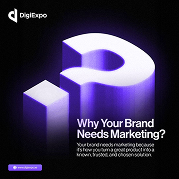

- **Original file:** `inspiration/e1163dfabcaf4b73a8b07d501c509a8b 1.png` (179x179 px, source folder: (root), batch-001 (inspiration.zip, 2026-10-13))
- **Category / subcategory:** FUL / big-numeral-3d. **Style family:** 3D-METAPHOR. **Also useful for:** -
- **Tags:** question-mark, 3d, violet, white, poster, vertical
- **Alternate copies:** none

**Observed (visible in the image)**
- **Visual description:** Vertical black; logo; giant extruded glossy violet/white question mark with a cube; 'Why Your Brand Needs Marketing?' white bold; body; CTA pill.
- **Typography:** A bold white 2-line sans headline 'Why Your Brand Needs Marketing?' (~6% of frame height) at the lower-right, with 3 lines of small grey body beneath; a logo at the top-left and a small violet URL pill at the bottom-left.
- **Colour palette (measured, dominant first):** `#030303` 30.5%  `#06050B` 17.8%  `#120C20` 16.1%  `#EAE6F5` 13.8%  `#2F1870` 12.0%  `#6F59AA` 9.9%
- **Composition:** Square: a giant extruded question mark fills the upper-middle-right, with a white cube beside it on the left; the text block sits in the lower-right.
- **Lighting & effects:** A violet glow from below and inside the extrusion, with white glossy top faces; a black background.
- **Depth & layering:** 3D extrusion: the question mark and cube have strong depth and are lit from the top.

**Inferred (creative interpretation - not visible in a still)**
- **Animation behaviour:** INFERRED: the question mark rotates into view (rotateY 60°→0°, 700ms outQuart) while the cube drops in, and the headline fades up.
- **Suitable use cases:** Question hooks ('why does X matter?'), FAQ segments, curiosity openers.
- **Technical recreation:** 3D text (Blender extrude with a white top and violet emissive sides), or a generated image; HTML headline overlay.

---

### FUL-070 - Double Violet Planet Arcs Framing Headline (10000X)

- **Original file:** `inspiration/e232285f4fd934697e590c6db798b2bf 1.png` (121x69 px, source folder: (root), batch-001 (inspiration.zip, 2026-10-13))
- **Category / subcategory:** FUL / horizon-arc. **Style family:** HORIZON-ARC. **Also useful for:** -
- **Tags:** planet-arc, violet, double-arc, headline, ghost-text
- **Alternate copies:** none

**Observed (visible in the image)**
- **Visual description:** Dark violet; two glowing violet planet arcs (top and bottom) frame 'Technology Illuminates a Better Future'; ghost '10000X' faint in lower arc.
- **Typography:** A medium-weight white 2-line headline 'Technology Illuminates a Better Future' centred; ghost text '10000X' very faint inside the lower arc.
- **Colour palette (measured, dominant first):** `#140934` 22.0%  `#1A093F` 19.6%  `#261755` 16.6%  `#483488` 15.7%  `#090722` 15.4%  `#8169B8` 10.7%
- **Composition:** Landscape: one violet planet arc curves down from the top edge and another curves up from the bottom edge, framing the centred headline between them.
- **Lighting & effects:** Rim glows: both arcs have bright violet-white edges with soft haze; a deep violet-black background.
- **Depth & layering:** Flat, with the two arcs suggesting two horizons.

**Inferred (creative interpretation - not visible in a still)**
- **Animation behaviour:** INFERRED: the arcs slide in from the top and bottom simultaneously and meet to frame the text, which then fades in; the ghost text fades up last.
- **Suitable use cases:** Statement cards, chapter titles, 'the future' messaging.
- **Technical recreation:** Two very large circles (top and bottom) with violet box-shadow rims, as in templates/fullscreen-horizon-title.html; ghost text at 8% opacity.

---

### FUL-071 - Glowing Blue Person in Crowd + Boxed Question

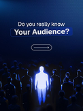

- **Original file:** `inspiration/e9645a9e726a1255661caec0bee04ccc 1.png` (122x163 px, source folder: (root), batch-001 (inspiration.zip, 2026-10-13))
- **Category / subcategory:** FUL / metaphor-object-dark. **Style family:** 3D-METAPHOR. **Also useful for:** -
- **Tags:** stand-out, crowd, silhouette, blue, question, audience, vertical
- **Alternate copies:** none

**Observed (visible in the image)**
- **Visual description:** Vertical navy; 'Do you really know' + 'Your Audience?' in glass outline box; arrow pill; glowing blue person silhouette amid dark crowd.
- **Typography:** A medium-weight white line 'Do you really know' with a bold phrase 'Your Audience?' inside a thin glass outline box, centred in the top quarter; a small outlined arrow pill beneath.
- **Colour palette (measured, dominant first):** `#06070F` 27.3%  `#040B25` 20.5%  `#122E66` 17.1%  `#0A1F51` 15.5%  `#0C1532` 12.2%  `#667BAA` 7.3%
- **Composition:** Vertical: the question in the top 30%; a crowd of dark silhouettes fills the lower half with one glowing blue person standing in the front-centre.
- **Lighting & effects:** The person is emissive light-blue with a glow on the ground; the crowd is dark with faint rim light; a navy gradient background.
- **Depth & layering:** Crowd rows recede into depth, and the glowing figure is in the front-centre.

**Inferred (creative interpretation - not visible in a still)**
- **Animation behaviour:** INFERRED: a spotlight sweeps across the crowd and finds the person, who then lights up; the question box draws its outline.
- **Suitable use cases:** Audience and targeting topics ('do you know who you're talking to?'), niching down, customer avatars.
- **Technical recreation:** Generated image with a glow overlay on the figure; the question box as an HTML element with a 1px rgba(255,255,255,.4) border and backdrop blur.

---

### FUL-072 - Violet Glowing Key Grid in Perspective (Motion Design)

- **Original file:** `inspiration/f090d59958137c86c106d59089aac2af 1.png` (122x69 px, source folder: (root), batch-001 (inspiration.zip, 2026-10-13))
- **Category / subcategory:** FUL / abstract-material. **Style family:** MATERIAL-ABSTRACT. **Also useful for:** -
- **Tags:** keys, grid, perspective, violet, title, glow
- **Alternate copies:** none

**Observed (visible in the image)**
- **Visual description:** Dark; 'The Power of Motion Design' top; violet glowing 3D tiles grid in perspective, centre tile with ring highlight.
- **Typography:** A medium-weight white single-line title 'The Power of Motion Design' centred near the top.
- **Colour palette (measured, dominant first):** `#020106` 24.1%  `#0F0718` 22.5%  `#1F184A` 17.8%  `#3E2E8C` 16.1%  `#8E5CCF` 11.4%  `#070416` 8.1%
- **Composition:** Landscape: the title in the top 30%; a perspective grid of keys in the lower 60%, with the centre key highlighted by a ring marker.
- **Lighting & effects:** Violet emission: the keys glow violet/magenta on their top faces, brightest at the centre; a dark background.
- **Depth & layering:** Strong perspective: the grid recedes toward the top, and the centre key is slightly raised.

**Inferred (creative interpretation - not visible in a still)**
- **Animation behaviour:** INFERRED: tiles light up in waves from the centre outward (rings of tiles, 80ms per ring), and the ring marker pulses on the centre key.
- **Suitable use cases:** Topic title cards, 'the power of X' openers, tool or skill highlights.
- **Technical recreation:** CSS 3D grid (perspective 800px, rotateX 55deg) of rounded squares with violet gradients and staggered glow animations, or a 3D render.

---

### FUL-073 - Dark Hand Holding Glowing Blue Sphere (wide)

- **Original file:** `inspiration/f14281875b7b16d18596fab170cd9b29 1.png` (198x112 px, source folder: (root), batch-001 (inspiration.zip, 2026-10-13))
- **Category / subcategory:** FUL / metaphor-object-dark. **Style family:** 3D-METAPHOR. **Also useful for:** -
- **Tags:** hand, sphere, orb, blue, dark, wide
- **Alternate copies:** none

**Observed (visible in the image)**
- **Visual description:** Dark navy; dark sculpted hand holds glowing blue sphere; small text left.
- **Typography:** Tiny 2-line text at the left, illegible.
- **Colour palette (measured, dominant first):** `#161C29` 25.1%  `#07090E` 20.4%  `#131823` 16.1%  `#0A0E17` 14.8%  `#0E1118` 14.4%  `#4361A6` 9.2%
- **Composition:** Landscape: a dark sculpted hand holds a glowing blue sphere on the right-centre; the text is small at the left; lots of empty dark space.
- **Lighting & effects:** The sphere is emissive blue, lighting the fingers and palm with blue rim light; a dark navy background.
- **Depth & layering:** The hand wraps around the sphere, with fingers in front of and behind it.

**Inferred (creative interpretation - not visible in a still)**
- **Animation behaviour:** INFERRED: the sphere brightens slowly (glow swell) while the hand rotates slightly, followed by a slow push-in.
- **Suitable use cases:** Holding potential or power, 'it's in your hands', a calm aspirational cutaway.
- **Technical recreation:** Generated image with a glow overlay on the sphere (radial gradient scale and opacity), with a slight rotation of the hand layer.

---

### FUL-074 - Explorer Archetype: Hand + Glowing Sphere (series)

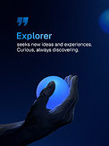

- **Original file:** `inspiration/f34b8489b465dae67e0582a3214bd12c 1.png` (122x163 px, source folder: (root), batch-001 (inspiration.zip, 2026-10-13))
- **Category / subcategory:** FUL / metaphor-object-dark. **Style family:** 3D-METAPHOR. **Also useful for:** -
- **Tags:** hand, sphere, archetype, series-archetypes, blue, vertical
- **Alternate copies:** none

**Observed (visible in the image)**
- **Visual description:** Vertical navy; quote glyph; 'Explorer' blue heading + body; dark hand holding glowing blue sphere bottom.
- **Typography:** Series typography (as FUL-001): a blue quote glyph, a medium blue heading 'Explorer', and 2 lines of white body ('seeks new ideas and experiences. Curious, always discovering.'), left-aligned at the top.
- **Colour palette (measured, dominant first):** `#031236` 22.2%  `#05173E` 19.9%  `#010414` 19.2%  `#030A20` 14.8%  `#020D2C` 14.7%  `#31548D` 9.1%
- **Composition:** Vertical: the text block top-left in the upper 35%; a dark hand holding a glowing blue sphere in the lower-centre; a blurred blue orb at the top-right edge.
- **Lighting & effects:** Emissive: the sphere glows blue and lights the hand; a navy gradient background.
- **Depth & layering:** The object is in front of the background, with an out-of-focus orb adding depth at the edge.

**Inferred (creative interpretation - not visible in a still)**
- **Animation behaviour:** INFERRED: the sphere ignites (emission 0→1 with bloom), then the heading and body fade in.
- **Suitable use cases:** Archetype or personality series ('the explorer'), audience persona explanations.
- **Technical recreation:** Series layout shared with FUL-001, FUL-009, FUL-015: same glyph, heading and body placement, swapping the hero object.

---

### FUL-075 - Neon Tubes Converge into Chrome Capsule → White Beam

- **Original file:** `inspiration/f8c4c648fd8f077ceb64f8842bef1c41 1.png` (105x59 px, source folder: (root), batch-001 (inspiration.zip, 2026-10-13))
- **Category / subcategory:** FUL / abstract-material. **Style family:** MATERIAL-ABSTRACT. **Also useful for:** -
- **Tags:** neon-tubes, convergence, capsule, beam, compress, black
- **Alternate copies:** none

**Observed (visible in the image)**
- **Visual description:** Black; glowing tubes (cyan, violet, orange, yellow) converge into a chrome capsule that emits a single white beam to the right.
- **Typography:** Tiny grey text at the top and bottom, illegible at this 105px source size.
- **Colour palette (measured, dominant first):** `#030303` 32.7%  `#090909` 30.5%  `#5E5157` 15.9%  `#050404` 13.8%  `#010101` 6.8%  `#010407` 0.2%
- **Composition:** Landscape: coloured tubes enter from the left and converge into a chrome capsule at the centre, which emits a single straight white beam to the right edge.
- **Lighting & effects:** Neon tubes (cyan, violet, orange, yellow) with bloom, a chrome capsule with specular highlights, and a bright white beam; a black background.
- **Depth & layering:** The tubes curve in depth before entering the capsule; the beam is a flat line extending to the right.

**Inferred (creative interpretation - not visible in a still)**
- **Animation behaviour:** INFERRED: colour streams enter, white beam exits — compression/merge.
- **Suitable use cases:** Many into one, distillation ('all your data in, one answer out'), compression, simplification.
- **Technical recreation:** Thick blurred SVG strokes with gradients flowing into a capsule (rounded rect with a metallic gradient), plus a white beam (thin rect with glow) animated by scaleX from the capsule outward.

---

### FUL-076 - Hands Holding Envelope with Calendar Card (holidays)

- **Original file:** `inspiration/f9001e99cec4a33f94467c8df7bfb93d 1.png` (122x163 px, source folder: (root), batch-001 (inspiration.zip, 2026-10-13))
- **Category / subcategory:** FUL / metaphor-object-light. **Style family:** 3D-METAPHOR. **Also useful for:** -
- **Tags:** envelope, calendar, hands, blue, kraft, dates, vertical
- **Alternate copies:** none

**Observed (visible in the image)**
- **Visual description:** Vertical blue; hands hold kraft envelope with blue calendar card emerging (dates 22–31, 1–4); 'Dam olish kunlari' bold black on envelope; logo top.
- **Typography:** Heavy black sans 'Dam olish kunlari' in 2 lines on the kraft envelope, small black date lines beneath, small weekday and date numerals on the blue calendar card, and a logo at the top. A third-party watermark ('FREE AI DESIGN STUDIO' + QR) in the top-right is not part of the design.
- **Colour palette (measured, dominant first):** `#1E3D9B` 24.5%  `#58433D` 20.8%  `#111D45` 18.3%  `#7888A4` 16.7%  `#CDBFB2` 13.0%  `#5D6987` 6.7%
- **Composition:** Vertical: two hands hold a kraft envelope filling the lower two-thirds, with a blue calendar card sliding out of it; a logo at the top-centre.
- **Lighting & effects:** Even studio light on a blue background; the kraft paper texture is visible; the calendar card is bright blue.
- **Depth & layering:** The hands are in front, holding the envelope, with the card partially out of it.

**Inferred (creative interpretation - not visible in a still)**
- **Animation behaviour:** INFERRED: the calendar card slides out of the envelope (translateY −30%, 600ms outQuart), and the holiday dates highlight.
- **Suitable use cases:** Announcements (holidays, schedules, events), date reveals, 'save the date'.
- **Technical recreation:** Generated image without the watermark, layered: envelope front, card, envelope back; animate the card sliding up; type in HTML.

> Note: Source contains third-party watermark 'FREE AI DESIGN STUDIO' + QR — not part of the design; never reproduce.

---

### FUL-077 - Diagonal Coil of Blue Glowing Glass Discs

- **Original file:** `inspiration/fd90b546fb9f916e70f8180e14aa0292 1.png` (93x94 px, source folder: (root), batch-001 (inspiration.zip, 2026-10-13))
- **Category / subcategory:** FUL / abstract-material. **Style family:** MATERIAL-ABSTRACT. **Also useful for:** -
- **Tags:** glass-rings, coil, spiral, blue, transition, loop
- **Alternate copies:** none

**Observed (visible in the image)**
- **Visual description:** Dark navy; diagonal spiral of blue glowing glass rings/discs.
- **Typography:** No text in the image. Use it as a transition, or behind a short white headline in the dark upper-left.
- **Colour palette (measured, dominant first):** `#000001` 25.4%  `#010929` 18.9%  `#01061E` 17.8%  `#031744` 12.9%  `#01020E` 12.7%  `#2373BE` 12.3%
- **Composition:** Square: a diagonal coil of blue glowing glass discs spirals from the lower-left to the upper-right.
- **Lighting & effects:** Rim glows on each disc (bright blue-white edges) with soft reflections; a dark navy-black background.
- **Depth & layering:** 3D: the discs recede and overlap along the spiral, with the closer discs larger.

**Inferred (creative interpretation - not visible in a still)**
- **Animation behaviour:** INFERRED: the coil rotates continuously around its axis in a seamless loop.
- **Suitable use cases:** Transitions or backgrounds behind a statement; 'flow' or continuity metaphors.
- **Technical recreation:** 3D loop (Blender: array of thin tori along a helix, glass + emission, bloom), rendered as a seamless loop.

---

### FUL-078 - World Brain Day Condensed Type + Wired Brain

- **Original file:** `inspiration/image 100.png` (290x362 px, source folder: (root), batch-001 (inspiration.zip, 2026-10-13))
- **Category / subcategory:** FUL / editorial-poster. **Style family:** EDITORIAL-PRINT. **Also useful for:** TXT
- **Tags:** editorial, poster, brain, condensed, crimson, navy, print, vertical
- **Alternate copies:** none

**Observed (visible in the image)**
- **Visual description:** Vertical white print poster; 'World' small + giant condensed crimson/navy 'BRAIN' + 'Day' script; red/blue 3D brain with cable plug; quote line; clinic footer with Arabic.
- **Typography:** Ultra-condensed bold display caps 'BRAIN' (huge, crimson-to-navy split colour) with a small 'World' above and a small script 'Day' beside; a small date line; a centred quote line ('The Most Powerful Organ Deserves The Best Care.'); a footer with an Arabic and English clinic name and contact block.
- **Colour palette (measured, dominant first):** `#FFFFFF` 50.8%  `#602D4B` 20.7%  `#FFFFFD` 10.6%  `#A792A7` 9.3%  `#F0ECED` 7.5%  `#FEFFFF` 1.1%
- **Composition:** Vertical print poster: the 'BRAIN' wordmark across the top half; a red/blue 3D brain with a cable plug overlapping the lower part of the letters in the centre; the quote below; a footer bar at the bottom.
- **Lighting & effects:** Studio light on a white background; the brain is glossy with red and navy tones and a soft shadow.
- **Depth & layering:** The brain sits in front of the type, overlapping the letters' bases (text-behind-object).

**Inferred (creative interpretation - not visible in a still)**
- **Animation behaviour:** INFERRED: the letters slide up one by one (60ms stagger), the brain drops in front with a soft settle, and the cable wiggles.
- **Suitable use cases:** Health and awareness days, medical or wellness themes, brain and psychology topics.
- **Technical recreation:** Text-behind-object layering: HTML condensed type (Anton/Oswald), then a brain PNG with a transparent background in front; the cable as an SVG path.

---

### FUL-079 - White Brain in Frame (Your Brain Has No Limits)

- **Original file:** `inspiration/image 101.png` (202x202 px, source folder: (root), batch-001 (inspiration.zip, 2026-10-13))
- **Category / subcategory:** FUL / editorial-poster. **Style family:** EDITORIAL-PRINT. **Also useful for:** -
- **Tags:** editorial, brain, teal, label-box, ghost-text, light
- **Alternate copies:** none

**Observed (visible in the image)**
- **Visual description:** White; teal label box 'Brain' within 'Your Brain Has No Limits'; white 3D brain hanging in thin frame; ghost vertical 'BRAIN' text; footer contact bar.
- **Typography:** Bold sans 'Brain' in white inside a teal label box, with a small 'Your' above and small 'Has No Limits' below, plus 3 lines of tiny body; huge ghost vertical 'BRAIN' text at the left; a footer bar with a logo and contact info.
- **Colour palette (measured, dominant first):** `#FFFFFF` 23.5%  `#7F9496` 20.1%  `#F0F9FA` 17.0%  `#EEF1F3` 15.6%  `#CED9D9` 15.2%  `#FEFEFE` 8.6%
- **Composition:** Square: a centred frame panel (thin lines) holds the text in its top half and a white 3D brain in the bottom half; the ghost type runs vertically along the left; circular arcs at the right.
- **Lighting & effects:** Soft, even light on white; the brain is matte white with soft shading.
- **Depth & layering:** The brain extends below the frame's bottom edge (breaking the frame), and the ghost text sits behind.

**Inferred (creative interpretation - not visible in a still)**
- **Animation behaviour:** INFERRED: the brain lowers into the frame from above, the teal label box wipes on, and the ghost text slides up.
- **Suitable use cases:** Education and potential ('your brain has no limits'), learning or coding courses.
- **Technical recreation:** Generated brain image plus layered HTML text; the teal box (#0D9488) with white bold type; ghost text at 6% opacity.

---

### FUL-080 - Halftone Profile with Brain + Blue Pie Wedge HUD

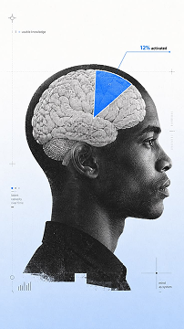

- **Original file:** `inspiration/image 87.png` (202x360 px, source folder: (root), batch-001 (inspiration.zip, 2026-10-13))
- **Category / subcategory:** FUL / editorial-poster. **Style family:** EDITORIAL-PRINT. **Also useful for:** -
- **Tags:** halftone, profile, brain, hud, callout, blue, editorial, vertical
- **Alternate copies:** none

**Observed (visible in the image)**
- **Visual description:** Vertical light-blue editorial; B&W halftone profile of a man with exposed brain; blue pie wedge overlay labelled '12% activated' with thin callout line; small HUD marks.
- **Typography:** Tiny sans annotations only (a tiny label at the top, '12% activated' at the callout, small HUD text at the bottom-left).
- **Colour palette (measured, dominant first):** `#313232` 24.2%  `#FCFCFB` 20.0%  `#C2D1E7` 16.9%  `#DCE8FB` 16.8%  `#FAFAFB` 11.5%  `#91A0B5` 10.6%
- **Composition:** Vertical editorial: a B&W halftone profile of a man facing right, centre-left, with the top of the skull showing a brain; a blue pie wedge overlays the brain with a thin callout line to the top-right label.
- **Lighting & effects:** Flat print look: a light-blue gradient background brighter at the top, a high-contrast halftone figure, and a solid royal-blue wedge.
- **Depth & layering:** Overlay on a cut-out: the wedge and callout sit on top of the halftone figure; thin HUD marks float around it.

**Inferred (creative interpretation - not visible in a still)**
- **Animation behaviour:** INFERRED: wedge sweeps open, callout line draws, label types.
- **Suitable use cases:** Psychology or brain facts ('you only use 12%...' myths), mindset topics, editorial explainers.
- **Technical recreation:** Halftone filter (ImageMagick -ordered-dither h6x6a or PIL) on a grayscale cut-out; SVG wedge (#2563EB) and callout line with a label; animate the wedge sweeping open and the line drawing.

---

### FUL-081 - Halftone Brain + Blue Circle + Serif Headline

- **Original file:** `inspiration/image 88.png` (297x371 px, source folder: (root), batch-001 (inspiration.zip, 2026-10-13))
- **Category / subcategory:** FUL / editorial-poster. **Style family:** EDITORIAL-PRINT. **Also useful for:** TXT
- **Tags:** halftone, brain, blue-circle, serif, editorial, white, vertical
- **Alternate copies:** none

**Observed (visible in the image)**
- **Visual description:** Vertical white; name pill top; halftone B&W brain with solid blue circle overlay (multiply); royal-blue serif headline 'Como criar conexão psicológica antes do primeiro contato'; thin vertical line.
- **Typography:** Royal-blue transitional serif (Times/Libre Caslon-like) centred.
- **Colour palette (measured, dominant first):** `#FFFFFF` 60.9%  `#596793` 16.4%  `#FCFCFC` 9.5%  `#DDDEE4` 8.7%  `#FEFFFF` 2.4%  `#FFFFFD` 2.1%
- **Composition:** Vertical editorial: a small outlined name pill at the top-centre; a halftone brain in the upper-middle with a solid blue circle overlapping its right half; a centred 3-line serif headline in the lower third; a thin vertical blue line linking the brain to the headline and continuing to the bottom edge.
- **Lighting & effects:** Flat print light: a pure white background, a high-contrast black-and-white halftone brain, and a flat royal-blue circle (#3B6CF6) that tints the brain where they overlap.
- **Depth & layering:** The circle blends over the brain (multiply-like overlap); everything else sits on one flat paper plane.

**Inferred (creative interpretation - not visible in a still)**
- **Animation behaviour:** INFERRED: the blue circle scales in behind or over the brain (500ms outCubic), the halftone dots resolve from blurred to sharp, the line draws downward, and the headline sets line by line.
- **Suitable use cases:** Psychology or education topics with an editorial tone, relationship or connection advice, calm explainer cutaways.
- **Technical recreation:** As the EDITORIAL-PRINT recipe: a halftone grayscale cut-out (dot size ~4px at 1080w), a circle with mix-blend-mode: multiply in #2F5BEA, a transitional serif headline (Libre Caslon / Times) in royal blue, and a 2px vertical line.

---

### FUL-082 - Thin Serif 'Brain' + Bullets + Halftone Brain (green)

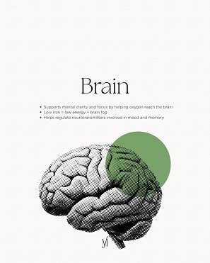

- **Original file:** `inspiration/image 89.png` (297x371 px, source folder: (root), batch-001 (inspiration.zip, 2026-10-13))
- **Category / subcategory:** FUL / editorial-poster. **Style family:** EDITORIAL-PRINT. **Also useful for:** -
- **Tags:** halftone, brain, green-circle, thin-serif, bullets, editorial
- **Alternate copies:** none

**Observed (visible in the image)**
- **Visual description:** Vertical off-white; 'Brain' thin serif title; bullet list; halftone brain with green circle overlay; signature.
- **Typography:** A thin serif display word 'Brain' (light weight, ~6% of frame height) centred at the top third, with 3 tiny sans bullet points beneath and a tiny handwritten signature at the bottom.
- **Colour palette (measured, dominant first):** `#FAF8F8` 20.3%  `#FAF9F9` 18.5%  `#9CA299` 17.6%  `#F9F9F7` 17.0%  `#FAF9F7` 16.3%  `#FBFAF9` 10.3%
- **Composition:** Vertical: the title and bullets centred in the top 45%; a halftone brain in the lower half, offset to the left, with a solid green circle overlapping its upper-right.
- **Lighting & effects:** Flat print light on off-white paper; a muted sage-green circle (#6A9A5B) overlapping the halftone.
- **Depth & layering:** The circle overlays the brain; one flat paper plane.

**Inferred (creative interpretation - not visible in a still)**
- **Animation behaviour:** INFERRED: the title fades in, the bullets reveal one by one (200ms stagger), then the brain and circle drop in.
- **Suitable use cases:** Fact lists (health, nutrition, brain facts), calm educational summaries.
- **Technical recreation:** As the EDITORIAL-PRINT halftone recipe: a thin serif (Cormorant Garamond Light) title, small Inter bullets, a halftone brain cut-out with a green multiply circle.

---

### FUL-083 - Silver Coin + Heavy Condensed Money Headline + Barcode

- **Original file:** `inspiration/image 90.png` (228x371 px, source folder: (root), batch-001 (inspiration.zip, 2026-10-13))
- **Category / subcategory:** FUL / editorial-poster. **Style family:** EDITORIAL-PRINT. **Also useful for:** TXT
- **Tags:** coin, money, condensed, barcode, editorial, white, orbit-lines
- **Alternate copies:** none

**Observed (visible in the image)**
- **Visual description:** Vertical white; realistic silver coin; 'OVER $20,000 In a single month' heavy condensed tight sans; body; barcode; thin orbit lines.
- **Typography:** A heavy condensed grotesk with tight tracking: 'OVER $20,000' and 'In a single month' (2 lines, ~7% of frame height), then a small 3-line body and a barcode; all black on white.
- **Colour palette (measured, dominant first):** `#FDFDFD` 34.3%  `#FEFEFE` 30.2%  `#AAAAA7` 19.5%  `#FDFDFC` 11.3%  `#FFFFFF` 4.6%  `#FDFEFD` 0.0%
- **Composition:** Vertical: a realistic silver coin in the upper-middle-right; the text block left-aligned in the lower-middle; thin orbit-like curved lines crossing the upper area; a faint grid behind the coin.
- **Lighting & effects:** Specular highlights on the coin's raised relief, with a soft shadow beneath; the rest is flat white.
- **Depth & layering:** Flat, except for the coin's shadow and thin curves passing behind it.

**Inferred (creative interpretation - not visible in a still)**
- **Animation behaviour:** INFERRED: the coin spins in (rotateY 180→0, 600ms outQuart), the dollar figure counts up, and the barcode wipes on.
- **Suitable use cases:** Income claims ('$20k in a month'), money results, case-study numbers.
- **Technical recreation:** Coin PNG with a transparent background, HTML type in a heavy condensed sans (Inter Tight Black / Archivo Narrow 800, letter-spacing −0.03em), and the curves as thin SVG arcs.

---

### FUL-084 - Handshake Photo with Ghost Serif Letters

- **Original file:** `inspiration/image 91.png` (209x371 px, source folder: (root), batch-001 (inspiration.zip, 2026-10-13))
- **Category / subcategory:** FUL / editorial-poster. **Style family:** EDITORIAL-PRINT. **Also useful for:** -
- **Tags:** handshake, business, serif, ghost-text, white, editorial
- **Alternate copies:** none

**Observed (visible in the image)**
- **Visual description:** Vertical white; 'sotuv menejer' navy serif; small kicker; business handshake photo; huge ghost italic serif letters behind.
- **Typography:** A navy serif 2-word title 'sotuv menejer' (~6% of frame height) under a tiny kicker line; a tiny navy pill tag; huge ghost italic serif letters behind the photo; a small brand line at the bottom.
- **Colour palette (measured, dominant first):** `#977D79` 21.5%  `#E6E7E9` 18.5%  `#DBD4D2` 18.4%  `#EAEAEB` 17.2%  `#FAFAFA` 14.6%  `#F1F1F2` 9.9%
- **Composition:** Vertical: the title block in the top 25%; a business handshake photo spans the middle at full width; a small brand line at the bottom; the ghost letters sit behind the hands.
- **Lighting & effects:** Studio light: crisp suits and skin tones on a white/light-grey background, with soft shadows under the hands.
- **Depth & layering:** The ghost text is behind the photo, which is in front, with a small tag pill overlapping the cuff.

**Inferred (creative interpretation - not visible in a still)**
- **Animation behaviour:** INFERRED: the ghost text drifts slowly sideways, the hands meet (a subtle zoom), and the title types in.
- **Suitable use cases:** Sales and partnership topics, hiring or job roles, B2B deals.
- **Technical recreation:** Cut-out photo with a transparent background over ghost type (Playfair Italic at 8% opacity, scaled to ~40% of frame height); title in a navy serif.

---

### FUL-085 - Dollar Bills Corners + Serif/Sans Statement (leaking money)

- **Original file:** `inspiration/image 92.png` (207x368 px, source folder: (root), batch-001 (inspiration.zip, 2026-10-13))
- **Category / subcategory:** FUL / editorial-poster. **Style family:** EDITORIAL-PRINT. **Also useful for:** TXT
- **Tags:** money, dollar-bills, white, serif-sans-mix, minimal, curves
- **Alternate copies:** none

**Observed (visible in the image)**
- **Visual description:** Vertical white; 'Your ad budget is' small serif + 'leaking money.' bold sans; dollar bills at top-right and bottom-left with thin curved lines.
- **Typography:** A serif/sans pairing: 'Your ad budget is' in small regular serif over 'leaking money.' in bold sans, both black at ~3% of frame height, centred; a small logo at the top-left.
- **Colour palette (measured, dominant first):** `#FEFEFE` 70.5%  `#B0B2B2` 17.7%  `#FDFEFE` 7.9%  `#FFFFFF` 3.4%  `#FEFEFD` 0.4%  `#FFFEFE` 0.0%
- **Composition:** Vertical: the text centred at mid-height; dollar bills at the top-right and bottom-left corners, partly out of frame; thin curved lines sweep diagonally through the corners.
- **Lighting & effects:** Flat, even light on white; the bills have realistic print detail and soft shadows.
- **Depth & layering:** The bills cast slight shadows on the page; the lines are flat.

**Inferred (creative interpretation - not visible in a still)**
- **Animation behaviour:** INFERRED: the bills slide out of the frame along the curved lines (leaking away), and the statement types in.
- **Suitable use cases:** Money loss or waste ('your budget is leaking'), ad-spend advice, inefficiency warnings.
- **Technical recreation:** Dollar bill PNG props animated along SVG motion paths (offset-path), thin 1px curved lines, and the statement in Playfair + Inter Bold.

---

### FUL-086 - Orbit Icons around Avatar over B&W Skyscraper

- **Original file:** `inspiration/image 93.png` (202x360 px, source folder: (root), batch-001 (inspiration.zip, 2026-10-13))
- **Category / subcategory:** FUL / editorial-poster. **Style family:** EDITORIAL-PRINT. **Also useful for:** TXT
- **Tags:** orbit, skyscraper, money, italic-serif, violet-numerals, grey
- **Alternate copies:** none

**Observed (visible in the image)**
- **Visual description:** Vertical grey; 'and build a' italic serif + '$1,163,684,337' violet bold; orbit rings with icons around avatar above a B&W skyscraper.
- **Typography:** An italic serif kicker 'and build a' over bold violet numerals '$1,163,684,337' (~5% of frame height), centred at the top.
- **Colour palette (measured, dominant first):** `#444551` 21.3%  `#A9A9B0` 19.7%  `#C4C5CB` 18.5%  `#D5D6DC` 14.9%  `#CDCED4` 13.4%  `#E5E5EB` 12.1%
- **Composition:** Vertical: text at the top, a concentric orbit diagram with a central avatar and 4-5 small icons on the rings in the middle, and a B&W skyscraper rising from the bottom edge under the orbit.
- **Lighting & effects:** Grey atmospheric light: a soft grey gradient background, a monochrome building, black orbit lines, and violet as the only colour.
- **Depth & layering:** The orbit floats above the top of the tower; the building recedes upward in perspective.

**Inferred (creative interpretation - not visible in a still)**
- **Animation behaviour:** INFERRED: the icons orbit slowly around the avatar while the number counts up rapidly, and the camera tilts up the tower.
- **Suitable use cases:** Business empire stories, wealth totals, founder biographies, 'he built a billion-dollar...' hooks.
- **Technical recreation:** Composite: a B&W building photo, an SVG orbit with icon circles rotating, an avatar in a circle mask, a violet (#7C3AED) number count-up, and an italic serif kicker.

---

### FUL-087 - Huge Blue Condensed Caps + Person Covering Face

- **Original file:** `inspiration/image 94.png` (202x253 px, source folder: (root), batch-001 (inspiration.zip, 2026-10-13))
- **Category / subcategory:** FUL / editorial-poster. **Style family:** EDITORIAL-PRINT. **Also useful for:** TXT
- **Tags:** condensed-caps, blue, cutout, person, bold, editorial
- **Alternate copies:** none

**Observed (visible in the image)**
- **Visual description:** Vertical white; 'DESBLOQUEANDO A' black tag + 'MENTALIDADE CRIATIVA' huge blue condensed caps; person in blue cap covering face with hands, small text over face area; cutout outline.
- **Typography:** Ultra-condensed caps: a small black tag 'DESBLOQUEANDO A', 'MENTALIDADE' in black, and huge 'CRIATIVA' in royal blue; small white caps text printed over the person's face area; tiny caps labels at the top.
- **Colour palette (measured, dominant first):** `#EBEBEB` 30.4%  `#161013` 28.3%  `#393F8A` 20.8%  `#D3CFD1` 8.2%  `#EBEBE9` 7.7%  `#F2F1F0` 4.7%
- **Composition:** Vertical: the headline fills the top half; a person in a blue cap covering their face with their hands stands in the lower half and overlaps the bottom of 'CRIATIVA'; a thin outline traces around the cut-out.
- **Lighting & effects:** Flat, even light: an editorial white background and a natural photo of the person.
- **Depth & layering:** The person is in front of the type (text-behind-subject), and the outline stroke reinforces the cut-out.

**Inferred (creative interpretation - not visible in a still)**
- **Animation behaviour:** INFERRED: the type slams in line by line (scale 1.08→1, 120ms each), the person cut-out pops up from the bottom, and the outline draws around them.
- **Suitable use cases:** Mindset or creativity hooks, bold Portuguese/Spanish-market editorial posts, 'unlock your creative mindset' topics.
- **Technical recreation:** Text-behind-subject: HTML condensed type (Anton / Bebas Neue) behind a matted photo (rembg cut-out); the outline is an SVG offset path of the matte.

---

### FUL-088 - Blue Brain in Open Birdcage (A importância da mente)

- **Original file:** `inspiration/image 95.png` (202x253 px, source folder: (root), batch-001 (inspiration.zip, 2026-10-13))
- **Category / subcategory:** FUL / editorial-poster. **Style family:** EDITORIAL-PRINT. **Also useful for:** TXT
- **Tags:** brain, birdcage, freedom, serif, navy, outline-pill
- **Alternate copies:** none

**Observed (visible in the image)**
- **Visual description:** Vertical white; 'A IMPORTÂNCIA DA' caps + big navy serif 'mente' + outline pill 'NA REABILITAÇÃO'; blue brain inside open birdcage.
- **Typography:** Medium caps navy 'A IMPORTÂNCIA DA', a large navy serif 'mente' (~10% of frame height), and caps 'NA REABILITAÇÃO' inside an outlined pill; tiny handle text at the corners.
- **Colour palette (measured, dominant first):** `#CCCCCE` 20.2%  `#ECECEC` 19.9%  `#6D7FA7` 16.2%  `#F6F6F6` 16.1%  `#DCDCDD` 14.3%  `#FAFAFA` 13.3%
- **Composition:** Vertical: the text at the top and bottom sandwiches the object; a birdcage with an open door holding a blue brain sits in the centre, overlapping the bottom of 'mente'.
- **Lighting & effects:** Soft daylight on a white/light-grey background; the brain is saturated royal blue; the cage is metallic silver.
- **Depth & layering:** The cage overlaps the serif headline from the front, and the pill sits below on the same flat plane.

**Inferred (creative interpretation - not visible in a still)**
- **Animation behaviour:** INFERRED: the cage door swings open (rotateY), the brain glows slightly, and the headline settles.
- **Suitable use cases:** Freedom or mindset topics, mental health or rehabilitation, 'free your mind' messaging.
- **Technical recreation:** Generated object (cage + brain) with a transparent background over HTML type (Playfair Display navy + Inter caps); the pill as an outlined rounded rect.

---

### FUL-089 - Brain Hub Connected to App Icons (extensions)

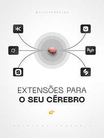

- **Original file:** `inspiration/image 96.png` (212x282 px, source folder: (root), batch-001 (inspiration.zip, 2026-10-13))
- **Category / subcategory:** FUL / editorial-poster. **Style family:** EDITORIAL-PRINT. **Also useful for:** -
- **Tags:** brain, hub, icons, connectors, white, minimal
- **Alternate copies:** none

**Observed (visible in the image)**
- **Visual description:** Vertical white; small brain in concentric grey discs centre; six app icons around connected with curves; 'EXTENSÕES PARA O SEU CÉREBRO'.
- **Typography:** Thin caps 'EXTENSÕES PARA' over bold caps 'O SEU CÉREBRO' (~4% of frame height) in the lower third; tiny tracked caps at the top and bottom; a small emoji pointer.
- **Colour palette (measured, dominant first):** `#F9F9F9` 20.8%  `#F0F0F0` 19.6%  `#F4F4F4` 19.5%  `#FFFFFF` 15.6%  `#B9B8B7` 13.1%  `#FDFDFD` 11.5%
- **Composition:** Vertical: a small brain inside concentric grey discs at the upper-middle; six small black app-icon squares arranged around it, three on each side, connected to the hub by thin curved lines; text below.
- **Lighting & effects:** Soft, flat light: an off-white background, grey discs with gentle gradients, black icons.
- **Depth & layering:** The discs stack concentrically for a subtle depth; everything else is flat.

**Inferred (creative interpretation - not visible in a still)**
- **Animation behaviour:** INFERRED: the connections draw outward from the hub to each icon (150ms stagger), then the icons pop in.
- **Suitable use cases:** Tools that extend your brain (apps, AI tools), productivity stacks, 'second brain' topics.
- **Technical recreation:** SVG: concentric circles with radial grey gradients, cubic connector paths, icon tiles as rounded black squares; animate stroke-dashoffset per connector.

---

### FUL-090 - Chrome Pawns + Blue King with Highlighted Caps Statement

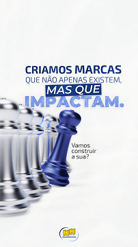

- **Original file:** `inspiration/image 97.png` (202x360 px, source folder: (root), batch-001 (inspiration.zip, 2026-10-13))
- **Category / subcategory:** FUL / editorial-poster. **Style family:** EDITORIAL-PRINT. **Also useful for:** TXT
- **Tags:** chess, stand-out, caps, highlight-box, blue
- **Alternate copies:** none

**Observed (visible in the image)**
- **Visual description:** Vertical white; 'CRIAMOS MARCAS QUE NÃO APENAS EXISTEM, MAS QUE IMPACTAM.' blue caps with highlight box; chrome pawns with blue king.
- **Typography:** Navy and blue caps statement in 4 lines ('CRIAMOS MARCAS QUE NÃO APENAS EXISTEM, MAS QUE IMPACTAM.'), with 'MAS QUE' in white on a navy highlight box and 'IMPACTAM.' in larger blue; a small 3-line italic aside at the right.
- **Colour palette (measured, dominant first):** `#F7F8F7` 22.6%  `#F5F6F5` 18.9%  `#F6F7F6` 17.8%  `#757FA0` 16.9%  `#E4E6E9` 14.0%  `#F9FAF9` 9.8%
- **Composition:** Vertical: the statement in the upper-middle; a row of chrome pawns recedes from the left edge, with a blue king in front at the centre-left in the lower half; a small logo at the bottom.
- **Lighting & effects:** Studio light on white, chrome reflections, and a glossy blue king.
- **Depth & layering:** Depth of field: the pawns blur toward the back-left and the king is sharp.

**Inferred (creative interpretation - not visible in a still)**
- **Animation behaviour:** INFERRED: the highlight box wipes on behind 'MAS QUE', 'IMPACTAM.' scales in, and the camera racks focus to the king.
- **Suitable use cases:** Differentiation and brand impact, agency positioning, 'be remarkable' messaging.
- **Technical recreation:** See FUL-017 (same concept): a generated or 3D chess scene with DOF and HTML caps text with a navy highlight span.

---

### FUL-091 - Brain Balloon Tied to Rock (Sobrecarga Emocional)

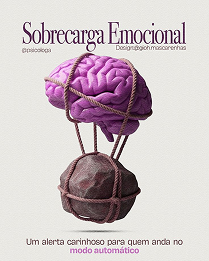

- **Original file:** `inspiration/image 98.png` (209x261 px, source folder: (root), batch-001 (inspiration.zip, 2026-10-13))
- **Category / subcategory:** FUL / editorial-poster. **Style family:** EDITORIAL-PRINT. **Also useful for:** -
- **Tags:** brain, balloon, rock, burden, violet, magenta, condensed-serif
- **Alternate copies:** none

**Observed (visible in the image)**
- **Visual description:** Vertical cream; 'Sobrecarga Emocional' condensed serif; violet brain as hot-air balloon tied by rope to a heavy rock; magenta accent text bottom.
- **Typography:** A condensed serif display 'Sobrecarga Emocional' (~6% of frame height) at the top, a tiny credit line beneath, and a small 2-line footer with a magenta keyword.
- **Colour palette (measured, dominant first):** `#E9E8E4` 31.9%  `#734964` 19.5%  `#EAE8E4` 17.6%  `#E8E8E3` 15.1%  `#E0D8D9` 8.8%  `#EBEAE6` 7.2%
- **Composition:** Vertical: the title across the top; a pink-violet brain rendered as a hot-air balloon is tied by ropes to a heavy rock below it, centred in the middle.
- **Lighting & effects:** Soft, even light on a cream background; the brain is saturated magenta-violet and the rock is dark brown with a rough texture.
- **Depth & layering:** The object is a single surreal sculpture with a soft shadow, the ropes connecting top and bottom.

**Inferred (creative interpretation - not visible in a still)**
- **Animation behaviour:** INFERRED: the balloon strains upward (a subtle up-down bob) while the rope tightens and the rock stays put, conveying tension.
- **Suitable use cases:** Burden or emotional overload, stress and mental load topics, 'what's holding you down'.
- **Technical recreation:** Generated surreal object with a transparent background over a cream page; animate a slight upward bob and rope stretch; title in a condensed serif (Playfair Display SC / Bodoni Moda).

---

### FUL-092 - Performance Isn't Created: Boxed Italic + Brain Disc

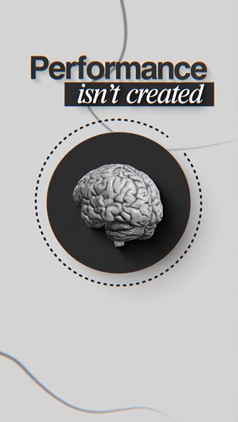

- **Original file:** `inspiration/image 99.png` (303x538 px, source folder: (root), batch-001 (inspiration.zip, 2026-10-13))
- **Category / subcategory:** FUL / editorial-poster. **Style family:** EDITORIAL-PRINT. **Also useful for:** TXT
- **Tags:** boxed-italic, brain, disc, dotted-ring, grey, editorial
- **Alternate copies:** none

**Observed (visible in the image)**
- **Visual description:** Vertical light grey; 'Performance' bold sans + 'isn't created' italic serif white on black box; B&W 3D brain in dark circle with dotted ring; thin line accents.
- **Typography:** A bold black sans 'Performance' (~5% of frame height) over a reversed white italic serif 'isn't created' inside a black box; no other text.
- **Colour palette (measured, dominant first):** `#D4D4D4` 58.5%  `#777676` 22.9%  `#D2D4D4` 11.5%  `#D6D4D4` 2.5%  `#D4D4D3` 2.4%  `#D8D7D7` 2.2%
- **Composition:** Vertical: the text block in the top quarter, offset right; a dark circle containing a B&W 3D brain in the centre, with a dotted ring around it; thin curved accent lines at the top-right and bottom-left.
- **Lighting & effects:** Soft light on a light-grey background; the brain is silver-grey; the dark disc has a soft drop shadow.
- **Depth & layering:** The disc casts a shadow and appears raised; the dotted ring sits slightly outside it.

**Inferred (creative interpretation - not visible in a still)**
- **Animation behaviour:** INFERRED: the black box wipes on behind the italic line, the dotted ring rotates slowly, and the brain fades up.
- **Suitable use cases:** Performance and mindset ('performance isn't created, it's built'), discipline topics.
- **Technical recreation:** HTML type (Inter Black + Playfair Italic white on a #111 box), a brain PNG inside a dark circle with box-shadow, and a dotted ring with stroke-dasharray rotating.

---

### FUL-093 - Violet Light Portal Doorway from Floor

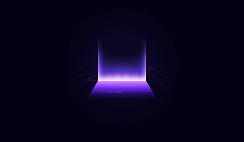

- **Original file:** `inspiration/image 123 1.png` (244x142 px, source folder: (root), batch-001 (inspiration.zip, 2026-10-13))
- **Category / subcategory:** FUL / transition-plate. **Style family:** LIGHT-STREAK. **Also useful for:** -
- **Tags:** portal, light-wall, violet, doorway, transition, reveal
- **Alternate copies:** none

**Observed (visible in the image)**
- **Visual description:** Dark violet; glowing violet vertical light wall/portal rising from a floor line with reflections.
- **Typography:** No text in the image. A one-line white title can sit above the portal, or appear inside it after the camera push-through.
- **Colour palette (measured, dominant first):** `#030013` 65.0%  `#050217` 24.9%  `#201443` 7.0%  `#030015` 2.4%  `#030012` 0.6%  `#020013` 0.1%
- **Composition:** Landscape: a glowing doorway or light wall rises from a floor line at the exact centre, with lots of dark space around it.
- **Lighting & effects:** An emissive gradient wall: bright violet-white at the floor fading upward to transparent, with a violet glow pooling on the floor in front.
- **Depth & layering:** A floor plane in perspective: the portal stands on the floor and its light spills forward toward the viewer.

**Inferred (creative interpretation - not visible in a still)**
- **Animation behaviour:** INFERRED: portal rises; camera passes through as transition.
- **Suitable use cases:** Transitions into a new section, 'entering a new chapter', reveals.
- **Technical recreation:** Gradient rect (linear-gradient to top: #C4B5FD → transparent) with blur, plus a reflection or glow on a perspective floor; animate scaleY from 0 and then push the camera through (scale 1→3 with a white flash).

---

