<!-- GENERATED by scripts/build_library.py from data/references.json. Do not edit by hand. -->

# ONS - On-Screen Visuals (speaker stays visible)

79 references. Palette values are measured from the image; animation/use/recreation are inferred from a still and must be treated as proposals.

### ONS-001 - Live: Client Network Chips + Script Accent Caption

- **Original file:** `inspiration/on screen inspo/image 575.png` (308x553 px, source folder: on screen inspo, batch-001 (inspiration.zip, 2026-10-13))
- **Category / subcategory:** ONS / live-composite. **Style family:** LIVE-UI. **Also useful for:** TXT
- **Tags:** talking-head, live-composite, ui-chips, network, dotted-connector, avatar, caption, script-accent, dark-ui
- **Alternate copies:** none

**Observed (visible in the image)**
- **Visual description:** Real talking-head frame: young man in a grey tee against a dark wood-slat wall, with a broadcast mic on a boom arm. Caption 'working with' in white semibold sans, plus 'clients' in a large cream-gold italic script. At the lower-right of his torso is a vertical stack of three dark list chips ('Northfield Coffee - Needs video edits', 'Loop Agency', 'Maya - Creator') with letter avatars. A circular 'You' avatar sits at the lower-left, joined to the chips by a dotted line.
- **Typography:** Caption sans is SF Pro/Inter Semibold, white, ~3.2% of frame height. The accent is an elegant italic script serif (cream #F3E6C4) ~2x size, overlapping the sans line. UI text is tiny Inter: medium titles, regular grey sublines.
- **Colour palette (measured, dominant first):** `#070608` 24.8%  `#170E0F` 24.3%  `#453B42` 15.2%  `#1C1B24` 12.8%  `#34211C` 12.6%  `#857074` 10.2%
- **Composition:** Face kept fully clear in the top 45%. The caption sits just below the chin (~50%). UI occupies the 58-80% band on the right half, over the shirt and mic arm, and the 'You' node sits left. Elements are ~40% of frame width. A small brand logo is bottom-left.
- **Lighting & effects:** UI chips are dark charcoal (#1B1C20 at ~85%) with a 1px light border and a soft drop shadow. The footage's lower area is naturally dark, which the UI sits into. No blur of the speaker.
- **Depth & layering:** Footage, then a dark vignette (bottom), then UI, then caption. The UI does not occlude the face or hands' key gestures.

**Inferred (creative interpretation - not visible in a still)**
- **Animation behaviour:** INFERRED: the chips pop in staggered top to bottom (each 60-80ms apart, y+12px->0, opacity, scale .96->1, 250ms ease-out). The dotted connector then draws from 'You' to the active chip. The caption builds word by word, with 'clients' arriving in script on the stressed word. Everything exits together with a quick fade/slide down.
- **Suitable use cases:** Explaining relationships, inbound clients, network or audience. A visual proof of a claim while the speaker keeps eye contact.
- **Technical recreation:** See templates/live-ui-list.html. Chip: 220-280px wide at 1080w, radius 12, padding 10/12, bg rgba(24,25,30,.86), border 1px rgba(255,255,255,.08), shadow 0 8px 24px rgba(0,0,0,.45). Avatar square 22px radius 6 #2A2B30. Dotted line: SVG stroke-dasharray 2 4, stroke #9AA0AA, with a blue dot head #3B82F6.

---

### ONS-002 - Live: Big Stat + Dot-Matrix Growth Panel

- **Original file:** `inspiration/on screen inspo/image 576.png` (306x553 px, source folder: on screen inspo, batch-001 (inspiration.zip, 2026-10-13))
- **Category / subcategory:** ONS / live-composite. **Style family:** LIVE-UI. **Also useful for:** TXT
- **Tags:** talking-head, live-composite, stat, dot-matrix, chart, blue, counter
- **Alternate copies:** none

**Observed (visible in the image)**
- **Visual description:** Same speaker and set as ONS-001. Caption 'in the last'. Over the chest is '1,262' in bold white with a tiny 'editors coached' label, above a dense dot-matrix panel of blue dots forming a rising area (Year 1 to Year 2 axis) with a thin blue progress line beneath.
- **Typography:** Stat: Inter Bold ~4% of frame height, white. Labels are tiny grey.
- **Colour palette (measured, dominant first):** `#090709` 23.4%  `#2E272F` 19.9%  `#4E444E` 16.3%  `#22130E` 15.7%  `#140F13` 14.9%  `#8A757D` 9.8%
- **Composition:** Panel is centred-left over the torso (35-62% x, 58-82% y). The caption is centred above at 50%.
- **Lighting & effects:** Dots in blue (#2F6BFF) with varying opacity creating a gradient density. No hard card background; the panel floats directly over the dark shirt.
- **Depth & layering:** Panel is semi-transparent, so the speaker's shirt texture is visible through gaps.

**Inferred (creative interpretation - not visible in a still)**
- **Animation behaviour:** INFERRED: the counter ticks 0->1,262 (700ms ease-out). Dots fill column by column left to right (stagger 8ms/column) as the axis progress line extends.
- **Suitable use cases:** Growth claims, totals over time, and 'X people / X items' social proof.
- **Technical recreation:** Canvas or SVG grid of circles r=1.6px with 5px pitch. Column fill height follows the data curve. Opacity is ramped by row. Counter uses tabular-nums.

---

### ONS-003 - Live: Inbox Inquiry Cards

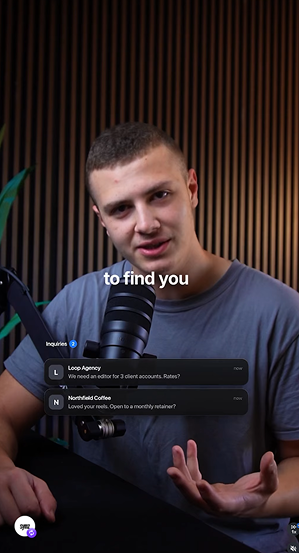

- **Original file:** `inspiration/on screen inspo/image 577.png` (299x553 px, source folder: on screen inspo, batch-001 (inspiration.zip, 2026-10-13))
- **Category / subcategory:** ONS / live-composite. **Style family:** LIVE-UI. **Also useful for:** -
- **Tags:** talking-head, live-composite, inbox, notification, messages, dark-ui, badge
- **Alternate copies:** none

**Observed (visible in the image)**
- **Visual description:** Caption 'to find you'. An 'Inquiries (2)' label with a blue count badge sits over two dark message cards: 'Loop Agency - We need an editor for 3 client accounts. Rates?' and 'Northfield Coffee - Loved your reels. Open to a monthly retainer?' with 'now' timestamps.
- **Typography:** UI: Inter Semibold for the sender, Regular for the message, tiny grey timestamp. Blue pill badge with a white number.
- **Colour palette (measured, dominant first):** `#0A0709` 23.7%  `#302528` 18.7%  `#51454C` 16.3%  `#151013` 15.8%  `#22120E` 15.4%  `#877076` 10.1%
- **Composition:** Cards span ~55% of width, left-of-centre over the lower chest (60-73% height). The caption is centred at 50%.
- **Lighting & effects:** Dark glass cards (#17181C ~88%), 1px border, soft shadow.
- **Depth & layering:** Cards overlap the mic body. The speaker's hands stay visible below.

**Inferred (creative interpretation - not visible in a still)**
- **Animation behaviour:** INFERRED: cards slide in from 16px below with a 120ms stagger, like notifications arriving. The badge increments 1->2 with a tiny pop (scale 1.15 then 1, no bounce).
- **Suitable use cases:** Showing demand (DMs, leads, emails), and proof that a method brings inbound requests.
- **Technical recreation:** templates/live-ui-list.html variant with message rows. Keep copy short and realistic.

---

### ONS-004 - Live: 30-Day Posting Calendar Grid

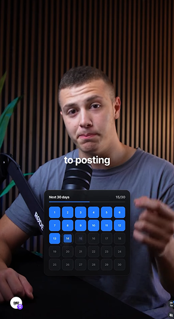

- **Original file:** `inspiration/on screen inspo/image 578.png` (290x529 px, source folder: on screen inspo, batch-001 (inspiration.zip, 2026-10-13))
- **Category / subcategory:** ONS / live-composite. **Style family:** LIVE-UI. **Also useful for:** -
- **Tags:** talking-head, live-composite, calendar, consistency, progress, blue-grid
- **Alternate copies:** none

**Observed (visible in the image)**
- **Visual description:** Caption 'to posting'. A dark card 'Next 30 days 15/30' with a thin blue progress bar shows a 6-column grid of rounded day squares. The first 14 are bright blue with white numbers and the remainder dark grey.
- **Typography:** Tiny Inter, white on blue, grey on dark.
- **Colour palette (measured, dominant first):** `#090709` 22.5%  `#322527` 18.0%  `#20110D` 16.8%  `#141114` 16.0%  `#564A52` 15.9%  `#7C7995` 10.8%
- **Composition:** Card centred over the chest (~42% width, 60-85% height). The caption sits above it.
- **Lighting & effects:** Saturated blue fills (#2563EB) with a subtle inner highlight. The card is dark with a faint border.
- **Depth & layering:** Card over the torso and mic. The speaker's gesturing hand is partially overlapped at the right edge, which is acceptable because the face stays clear.

**Inferred (creative interpretation - not visible in a still)**
- **Animation behaviour:** INFERRED: squares fill blue sequentially (20-30ms stagger) as the counter runs 0/30->15/30, and the progress bar grows in sync.
- **Suitable use cases:** Consistency, habits, challenges, streaks, schedules and content calendars.
- **Technical recreation:** CSS grid 6 cols, gap 6px, cell 34px radius 7. Animate the fill class with a JS timeline. Counter tied to fills.

---

### ONS-005 - Live: Video Thumbnails Row + Script Caption (don't give up)

- **Original file:** `inspiration/on screen inspo/image 579.png` (296x531 px, source folder: on screen inspo, batch-001 (inspiration.zip, 2026-10-13))
- **Category / subcategory:** ONS / live-composite. **Style family:** LIVE-UI. **Also useful for:** TXT
- **Tags:** talking-head, live-composite, thumbnails, views, script-caption, motivation
- **Alternate copies:** none

**Observed (visible in the image)**
- **Visual description:** Caption 'don't give up' entirely in cream-gold italic script. Left: 'POSTS 23'. A row of portrait video thumbnails with play icons and view counts under each; the last one is highlighted with a blue border and '3.6K views' in blue.
- **Typography:** Script serif italic for the emotional line. UI uses tiny Inter with a blue highlight for the winning metric.
- **Colour palette (measured, dominant first):** `#0A090C` 22.9%  `#151319` 17.5%  `#584A52` 17.3%  `#34282B` 17.2%  `#231411` 15.5%  `#927A7F` 9.6%
- **Composition:** Row spans ~45% of width at ~62-75% height, right of the mic. The caption is centred at ~52%.
- **Lighting & effects:** Thumbnails dark with a subtle border. The highlighted card has a blue stroke and slight glow.
- **Depth & layering:** The UI row sits in front of the torso and the mic arm (the mic stays partly visible behind it); the caption is above the UI, and the face is untouched behind both layers.

**Inferred (creative interpretation - not visible in a still)**
- **Animation behaviour:** INFERRED: thumbnails appear left to right with low view counts. The final one scales up slightly (1->1.06) with a blue border draw and a count-up to 3.6K, marking the payoff.
- **Suitable use cases:** 'Keep going, it finally works' stories, content growth, and persistence payoff.
- **Technical recreation:** Flex row of 4-5 cards 9:16 at 52px width. Highlight card border 1.5px #3B82F6 with box-shadow 0 0 16px rgba(59,130,246,.45).

---

### ONS-006 - Minimal Histogram with Single Highlighted Bar

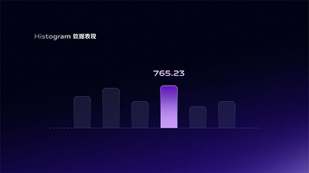

- **Original file:** `inspiration/on screen inspo/002b1e8036915b888ee883106afd0f9f 1.png` (381x214 px, source folder: on screen inspo, batch-001 (inspiration.zip, 2026-10-13))
- **Category / subcategory:** ONS / chart-card. **Style family:** DATA-GLOW. **Also useful for:** -
- **Tags:** chart, histogram, highlight, violet, gradient-bg, minimal, data
- **Alternate copies:**
  - `assets/references/_alternates/ONS-006__alt1__002b1e8036915b888ee883106afd0f9f_2.png` (original `inspiration/002b1e8036915b888ee883106afd0f9f 2.png`, 121x68, same design, different resolution/crop, distance 26)

**Observed (visible in the image)**
- **Visual description:** Deep navy-to-violet gradient background (brighter violet bottom-right). Six short dark rounded bars sit on a dotted baseline; one bar is a bright lavender-to-violet gradient with the value '765.23' above it. A small label 'Histogram' (plus CJK text) is at the top-left.
- **Typography:** Two tiers only: a tiny label 'Histogram' (plus CJK subtitle) in light-weight white sans at ~3% of frame height, top-left; the value '765.23' in a small medium-weight white sans centred above the highlighted bar. No headline; the data is the hero.
- **Colour palette (measured, dominant first):** `#010214` 37.5%  `#241659` 23.7%  `#090529` 23.7%  `#030318` 14.1%  `#000114` 0.4%  `#000111` 0.4%
- **Composition:** Chart occupies the centre third. Large negative space. Single focal bar slightly right of centre.
- **Lighting & effects:** Highlighted bar has a soft vertical gradient (#C9A7FF to #7C4DFF) and a faint glow. Other bars are dark translucent (#1A1A3A).
- **Depth & layering:** Flat 2D. Depth comes only from the background gradient (navy top-left to violet bottom-right) and from the highlighted bar glowing slightly brighter than its dark translucent neighbours.

**Inferred (creative interpretation - not visible in a still)**
- **Animation behaviour:** INFERRED: bars rise from the baseline with a stagger (40ms). The focal bar rises last and lights up (colour crossfade + glow), and the value counts up above it.
- **Suitable use cases:** Highlighting a single data point vs peers (best month, outlier, 'this one').
- **Technical recreation:** SVG rects rx=6. Dotted baseline stroke-dasharray 2 4. Use as an ONS card over darkened footage or full-screen on its gradient.

---

### ONS-007 - Sales Card with Green Neon Line Chart

- **Original file:** `inspiration/on screen inspo/0489194518aef2d92d12a256f08184cb 1.png` (384x384 px, source folder: on screen inspo, batch-001 (inspiration.zip, 2026-10-13))
- **Category / subcategory:** ONS / glass-ui-card. **Style family:** GLASS-DARK. **Also useful for:** -
- **Tags:** chart, line-chart, green, glass-card, saas, sales, dark
- **Alternate copies:**
  - `assets/references/_alternates/ONS-007__alt1__0489194518aef2d92d12a256f08184cb_2.png` (original `inspiration/0489194518aef2d92d12a256f08184cb 2.png`, 122x122, same design, different resolution/crop, distance 1)

**Observed (visible in the image)**
- **Visual description:** Charcoal background. A dark card with the title 'Optimize Your Sales' and subtitle 'Boost your revenue with AI-driven insights' contains an inset panel 'Product Sales' with a glowing green line chart, a soft green gradient fill and a highlighted point.
- **Typography:** Inter/SF-style sans. Title 'Optimize Your Sales' semibold white (~5% of frame height), body two lines regular grey (~60% white), inner panel label 'Product Sales' tiny semibold, axis labels 100k/75k/50k tiny grey. Left-aligned throughout.
- **Colour palette (measured, dominant first):** `#131419` 63.2%  `#14141A` 15.1%  `#182326` 12.8%  `#121419` 5.7%  `#111116` 2.1%  `#131418` 1.2%
- **Composition:** Card centred, ~45% width. Inset chart panel bottom-aligned within the card.
- **Lighting & effects:** Green (#2BD47D) line with an outer glow. Card border 1px #2A2D33. Inner panel slightly lighter.
- **Depth & layering:** Card on the background, with the inner panel nested (two-level depth).

**Inferred (creative interpretation - not visible in a still)**
- **Animation behaviour:** INFERRED: the card fades up, then the line draws left to right while the area fill fades in, and the point pulses once.
- **Suitable use cases:** Talking about revenue growth, a sales optimisation tactic, or an AI tool that improves sales. Overlay it beside the speaker when they say 'sales went up' or name a product feature.
- **Technical recreation:** Card radius 16, bg #141518. Chart SVG path with stroke-dasharray draw, plus a blur duplicate for glow.

---

### ONS-008 - System Update Glass Modal with Blue Bloom

- **Original file:** `inspiration/on screen inspo/064ab59d132530b3b10ae945b660fc3a 1.png` (531x531 px, source folder: on screen inspo, batch-001 (inspiration.zip, 2026-10-13))
- **Category / subcategory:** ONS / glass-ui-card. **Style family:** NEON-RIM. **Also useful for:** -
- **Tags:** modal, progress-bar, blue, glow, glass-card, button, update
- **Alternate copies:**
  - `assets/references/_alternates/ONS-008__alt1__064ab59d132530b3b10ae945b660fc3a_2.png` (original `inspiration/064ab59d132530b3b10ae945b660fc3a 2.png`, 170x169, same design, different resolution/crop, distance 7)

**Observed (visible in the image)**
- **Visual description:** Deep blue background with a strong radial blue bloom behind a rounded glass modal. The modal has a luminous blue edge, a small grey kicker, a bold white title 'System Update', a body line, a cyan-to-blue gradient progress bar ('Progress 15.65%'), and a white pill button 'Restart Now'.
- **Typography:** Inter Bold title (large), regular grey body, medium labels. The button label is dark on white.
- **Colour palette (measured, dominant first):** `#03022C` 25.8%  `#061B4E` 22.1%  `#0C3974` 17.4%  `#040730` 17.2%  `#020026` 9.2%  `#85A7C7` 8.2%
- **Composition:** Modal centred, square-ish 4:3. Content centre-aligned with generous padding.
- **Lighting & effects:** Strong outer bloom (#1E5BFF) around the modal edges, rim light on the border, and a dark interior (#06103A at 70%).
- **Depth & layering:** Background glow, then the modal glass, then content.

**Inferred (creative interpretation - not visible in a still)**
- **Animation behaviour:** INFERRED: the modal scales 0.96->1 with the blur clearing while the bloom intensifies. The progress bar fills, and the button gets a subtle shine sweep.
- **Suitable use cases:** 'Update/upgrade yourself' metaphors, loading or progress, and software announcements.
- **Technical recreation:** box-shadow: 0 0 0 1px rgba(120,160,255,.5), 0 0 60px 10px rgba(30,91,255,.55). Progress gradient #22D3EE to #2563EB.

---

### ONS-009 - Bento Feature Cards with Aurora Bottom Glow

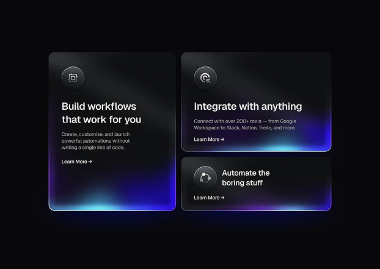

- **Original file:** `inspiration/on screen inspo/0971347c1306a759113f4aa214aa388f 1.png` (622x441 px, source folder: on screen inspo, batch-001 (inspiration.zip, 2026-10-13))
- **Category / subcategory:** ONS / glass-ui-card. **Style family:** AURORA-GRADIENT. **Also useful for:** -
- **Tags:** bento, feature-cards, aurora, blue-violet, saas, automation
- **Alternate copies:**
  - `assets/references/_alternates/ONS-009__alt1__0971347c1306a759113f4aa214aa388f_2.png` (original `inspiration/0971347c1306a759113f4aa214aa388f 2.png`, 198x141, same design, different resolution/crop, distance 5)

**Observed (visible in the image)**
- **Visual description:** Black background. A bento of three dark cards (one tall left, two stacked right), each with a circular icon, title ('Build workflows that work for you', 'Integrate with anything', 'Automate the boring stuff'), small body and 'Learn More ->'. Each card's lower edge glows with a blue/violet aurora gradient.
- **Typography:** Inter Medium titles ('Build workflows that work for you', 'Integrate with anything', 'Automate the boring stuff') in white at two sizes (left card larger), small grey body copy, and a tiny 'Learn More →' link. Left-aligned inside each card.
- **Colour palette (measured, dominant first):** `#08080A` 51.7%  `#0F0E1C` 28.1%  `#2D3044` 14.9%  `#080816` 3.6%  `#060617` 1.3%  `#070807` 0.4%
- **Composition:** Bento grid centred at ~75% of frame width: one tall card on the left, two stacked shorter cards on the right, ~12px gutters. Icon circles sit top-left in each card; text anchors to the upper half while the glow fills the lower half.
- **Lighting & effects:** Aurora: blurred blue (#3B5BFF) and violet (#8B5CF6) blobs clipped inside the card bottom, plus a 1px light border.
- **Depth & layering:** Cards sit flat on black, but the aurora glow inside each lower edge and the 1px light border make them read as lit glass slabs. No overlap between cards.

**Inferred (creative interpretation - not visible in a still)**
- **Animation behaviour:** INFERRED: cards enter staggered (scale .97->1, opacity). The aurora gradients drift slowly (background-position loop 6-8s).
- **Suitable use cases:** Listing two or three benefits ('build, integrate, automate'), explaining what an automation or AI tool does, or summarising a section's key points in one frame.
- **Technical recreation:** Each card: overflow hidden with an absolutely positioned blurred gradient blob (filter: blur(30px)) at the bottom.

---

### ONS-010 - Finger Pressing Glowing n8n App Tile

- **Original file:** `inspiration/on screen inspo/0f69f5cee6228de6729fe65b187c9ef7 1.png` (381x381 px, source folder: on screen inspo, batch-001 (inspiration.zip, 2026-10-13))
- **Category / subcategory:** ONS / neon-icon-tile. **Style family:** NEON-RIM. **Also useful for:** FUL
- **Tags:** 3d-icon, app-tile, neon-blue, hand, press, tool-stack, automation
- **Alternate copies:**
  - `assets/references/_alternates/ONS-010__alt1__0f69f5cee6228de6729fe65b187c9ef7_2.png` (original `inspiration/0f69f5cee6228de6729fe65b187c9ef7 2.png`, 122x122, same design, different resolution/crop, distance 3)

**Observed (visible in the image)**
- **Visual description:** Black scene. Three large rounded-square glass tiles with intense blue neon rims and icons (Telegram, n8n centre, Notion). A realistic finger, lit blue from the tile, presses the centre tile, which glows brightest.
- **Typography:** No set type: identity comes from the logos alone (Telegram plane, the 'n8n' wordmark, Notion 'N'), rendered as glowing white/blue glyphs inside the tiles. If a label is needed, add a small white Inter Medium caption under the centre tile.
- **Colour palette (measured, dominant first):** `#000001` 26.2%  `#03173F` 20.3%  `#000210` 17.8%  `#0B4285` 15.4%  `#5DA6DD` 10.8%  `#02020F` 9.4%
- **Composition:** Centre tile dominant and slightly forward. Side tiles cropped at the frame edges. The hand enters from the bottom.
- **Lighting & effects:** Very strong bloom, blue light spill onto the finger, and a dark falloff.
- **Depth & layering:** 3D tiles with bevelled glass thickness. The finger is in front. Shallow depth of field on the side tiles.

**Inferred (creative interpretation - not visible in a still)**
- **Animation behaviour:** INFERRED: the camera eases in, the finger presses (tile depresses 4-6px, glow flash +40%), and the side tiles dim. Optional: tiles slide in from the sides first.
- **Suitable use cases:** Naming the tool being used ('I use n8n...'), and tool comparisons.
- **Technical recreation:** Best in 3D (Blender: rounded cube, emission rim, glass shader, bloom) or via generated image + 2.5D parallax. A 2D approximation: CSS tiles with layered box-shadows and a cut-out hand PNG.

---

### ONS-011 - Three-Card Carousel with Gradient Centre Card

- **Original file:** `inspiration/on screen inspo/14223721b7c53d1c90975a5c0dfeba6c 1.png` (381x215 px, source folder: on screen inspo, batch-001 (inspiration.zip, 2026-10-13))
- **Category / subcategory:** ONS / card-carousel. **Style family:** AURORA-GRADIENT. **Also useful for:** -
- **Tags:** carousel, cards, onboarding, blue-gradient, violet, pink, focus
- **Alternate copies:**
  - `assets/references/_alternates/ONS-011__alt1__14223721b7c53d1c90975a5c0dfeba6c_2.png` (original `inspiration/14223721b7c53d1c90975a5c0dfeba6c 2.png`, 121x69, same design, different resolution/crop, distance 9)

**Observed (visible in the image)**
- **Visual description:** Navy background. A centre card with a bright blue gradient ('Do you want a unique design?', small body, Back/Skip buttons) is flanked by two smaller dim cards holding a violet hexagon icon and a magenta sparkle icon.
- **Typography:** Centre card: small semibold white title 'Do you want a unique design?' and 3-line tiny body; tiny 'Back'/'Skip' labels with icons at the bottom. Side cards carry no text, only icons.
- **Colour palette (measured, dominant first):** `#09092E` 30.1%  `#020107` 28.0%  `#4D77D3` 13.5%  `#130A3C` 11.7%  `#1D1761` 11.4%  `#1C042E` 5.3%
- **Composition:** Centre card larger and in focus. Side cards at ~70% scale and lower opacity, symmetrically placed.
- **Lighting & effects:** Each card has its own gradient glow colour. The centre is brightest.
- **Depth & layering:** Pseudo-3D carousel: the centre card is largest, sharpest and brightest; side cards are smaller, dimmer and slightly lower, implying they sit further from camera.

**Inferred (creative interpretation - not visible in a still)**
- **Animation behaviour:** INFERRED: a horizontal carousel slide, with the incoming card scaling up to 1 and brightening while the others recede. Good for 'option A / B / C' beats.
- **Suitable use cases:** Presenting three options and highlighting one, stepping through a sequence of tips, or 'swipe through the choices' moments.
- **Technical recreation:** Three absolutely positioned cards. Animate translateX, scale and opacity together with one easing curve.

---

### ONS-012 - Phone Cards with 3D Crystal Icons on Pastel Gradient

- **Original file:** `inspiration/on screen inspo/21caad6c399c6f43c9651a9cdbac9e84 1.png` (388x280 px, source folder: on screen inspo, batch-001 (inspiration.zip, 2026-10-13))
- **Category / subcategory:** ONS / feature-cards-3d-icon. **Style family:** AURORA-GRADIENT. **Also useful for:** -
- **Tags:** cards, 3d-icons, crystal, pastel, pink, lavender, crypto, onboarding
- **Alternate copies:**
  - `assets/references/_alternates/ONS-012__alt1__21caad6c399c6f43c9651a9cdbac9e84_2.png` (original `inspiration/21caad6c399c6f43c9651a9cdbac9e84 2.png`, 124x90, same design, different resolution/crop, distance 5)

**Observed (visible in the image)**
- **Visual description:** Soft pink-to-lavender gradient background. Three tall dark phone-screen cards each show a glowing 3D crystalline object (rainbow prism pyramid, pink faceted crystal, neon concentric ring) above a title ('Nominated Proof of Stake', 'Decentralized Data', 'Oracles'), body and pagination dots.
- **Typography:** Bold white sans titles ('Nominated Proof of Stake', 'Decentralized Data', 'Oracles') at ~5% of frame height, left-aligned in each card's lower third; 2-line small grey descriptions; tiny pagination dots centred at the bottom.
- **Colour palette (measured, dominant first):** `#000010` 21.2%  `#010110` 19.5%  `#F1BBD8` 18.3%  `#8B74B0` 17.5%  `#DAD2E4` 12.0%  `#35133E` 11.5%
- **Composition:** Three equal cards in a row with even gaps. Each object sits in the top half with its glow pooling below.
- **Lighting & effects:** Objects emit coloured light onto the card surface. The contrast of a light background against dark cards makes them pop.
- **Depth & layering:** Cards over the background, objects floating within the cards.

**Inferred (creative interpretation - not visible in a still)**
- **Animation behaviour:** INFERRED: objects rotate slowly (y-axis, 8-10s loop) and cards enter left to right. Pagination dots animate to the active card.
- **Suitable use cases:** Explaining three concepts, pillars or features (one per card), crypto/tech explainers, onboarding-style 'here is how it works' sequences.
- **Technical recreation:** 3D objects as rendered PNG sequences or generated images. The card is a dark rounded rect with a radial glow behind the object.

---

### ONS-013 - Glass Orb Intro on Reflective Horizon (envato present)

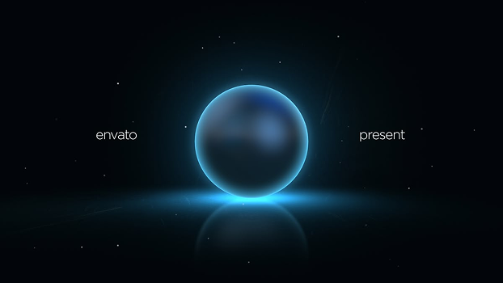

- **Original file:** `inspiration/on screen inspo/2a9007db1e4f771c236939c123330adc 1.png` (622x350 px, source folder: on screen inspo, batch-001 (inspiration.zip, 2026-10-13))
- **Category / subcategory:** ONS / hero-object-intro. **Style family:** HORIZON-ARC. **Also useful for:** FUL
- **Tags:** orb, sphere, intro, title-reveal, starfield, cyan-rim, reflection
- **Alternate copies:**
  - `assets/references/_alternates/ONS-013__alt1__2a9007db1e4f771c236939c123330adc_2.png` (original `inspiration/2a9007db1e4f771c236939c123330adc 2.png`, 198x112, same design, different resolution/crop, distance 9)

**Observed (visible in the image)**
- **Visual description:** Black starfield. A dark glass orb with a cyan rim light rests on a reflective horizon line that glows faintly. Thin small white words 'envato' (left) and 'present' (right) flank it symmetrically.
- **Typography:** Two words only, 'envato' and 'present', in a light, small lowercase sans (~3% of frame height), white at ~85%, placed symmetrically left and right of the orb at its vertical centre.
- **Colour palette (measured, dominant first):** `#02050A` 40.5%  `#020A0E` 29.6%  `#143242` 16.9%  `#03060B` 11.7%  `#01060A` 1.2%  `#010308` 0.2%
- **Composition:** Perfect symmetry, orb centred. The horizon line splits the frame at ~55%.
- **Lighting & effects:** Rim light from below and behind (cyan #3FD0FF), mirror reflection with falloff, sparse stars.
- **Depth & layering:** Orb in front of space, with its reflection on a glossy floor.

**Inferred (creative interpretation - not visible in a still)**
- **Animation behaviour:** INFERRED: the orb rises into frame or its rim light ignites (light sweep around the circumference). The words fade in from slight blur. Slow dolly-in.
- **Suitable use cases:** Channel intro or outro, chapter title card, 'presenting...' reveal before a product or topic name, or a calm opener for an educational video.
- **Technical recreation:** Radial gradient sphere + rim (conic/radial highlight) + mirrored copy with a gradient mask for the reflection. Or render in 3D with an emissive ring light.

> Note: User placed this in the on-screen folder; it reads as a full-screen intro. The orb alone can be used as an on-screen element.

---

### ONS-014 - Three Glass Heart App Tiles (staggered)

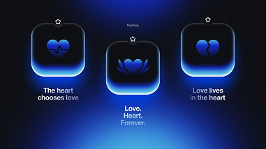

- **Original file:** `inspiration/on screen inspo/36b5625ac7d4924a28ffc2f20971601d 1.png` (381x214 px, source folder: on screen inspo, batch-001 (inspiration.zip, 2026-10-13))
- **Category / subcategory:** ONS / neon-icon-tile. **Style family:** NEON-RIM. **Also useful for:** -
- **Tags:** 3d-icon, app-tile, heart, blue, glass, triad, staggered
- **Alternate copies:**
  - `assets/references/_alternates/ONS-014__alt1__36b5625ac7d4924a28ffc2f20971601d_2.png` (original `inspiration/36b5625ac7d4924a28ffc2f20971601d 2.png`, 121x69, same design, different resolution/crop, distance 7)
  - `assets/references/_alternates/ONS-014__alt2__36b5625ac7d4924a28ffc2f20971601d_3.png` (original `inspiration/36b5625ac7d4924a28ffc2f20971601d 3.png`, 105x59, same design, different resolution/crop, distance 7)

**Observed (visible in the image)**
- **Visual description:** Deep royal-blue background with a bright floor glow. Three thick glass app tiles with blue heart icons (heartbeat heart, lotus heart, broken heart) are each captioned ('The heart chooses love', 'Love. Heart. Forever.', 'Love lives in the heart'). The centre tile sits lower than the others.
- **Typography:** Small white medium sans captions, centred under the tiles. The centre caption is stacked over three lines.
- **Colour palette (measured, dominant first):** `#0E0F14` 24.7%  `#101D5D` 18.5%  `#0E132B` 17.5%  `#1A3BA0` 16.9%  `#0E1018` 11.3%  `#4885CA` 11.1%
- **Composition:** V-shaped stagger: outer tiles high, centre tile low. Symmetric.
- **Lighting & effects:** Tiles have a glowing blue bottom edge and an inner glass highlight on top. Strong blue floor bloom.
- **Depth & layering:** Tiles float above a glowing floor, each with thickness.

**Inferred (creative interpretation - not visible in a still)**
- **Animation behaviour:** INFERRED: tiles drop in with soft settle (no bounce), and icons animate subtly (heartbeat pulse, lotus open).
- **Suitable use cases:** Three variations of one idea, and emotional or wellness topics.
- **Technical recreation:** CSS: tile radius 28%, bg linear-gradient(#0B1E66,#081443), inset 0 1px 0 rgba(255,255,255,.35), 0 12px 30px rgba(0,60,255,.6). Icons as SVG with a blue glow.

---

### ONS-015 - Tilted Neon Revenue Dashboard Card (VIREX)

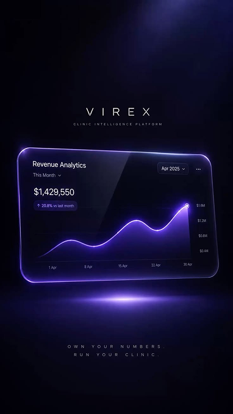

- **Original file:** `inspiration/on screen inspo/478e2a897499cabfd8fe629cdefd8bb7 1.png` (382x680 px, source folder: on screen inspo, batch-001 (inspiration.zip, 2026-10-13))
- **Category / subcategory:** ONS / hero-dashboard-perspective. **Style family:** NEON-RIM. **Also useful for:** FUL
- **Tags:** dashboard, perspective, violet, neon-border, revenue, line-chart, brand-title, vertical
- **Alternate copies:**
  - `assets/references/_alternates/ONS-015__alt1__478e2a897499cabfd8fe629cdefd8bb7_2.png` (original `inspiration/478e2a897499cabfd8fe629cdefd8bb7 2.png`, 122x216, same design, different resolution/crop, distance 15)

**Observed (visible in the image)**
- **Visual description:** Vertical frame in indigo/black. 'VIREX' sits top-centre in wide-tracked caps with a tiny subtitle. A glass dashboard card ('Revenue Analytics', '$1,429,550', violet line chart with gridlines) is tilted in 3D perspective with a glowing violet neon border. A horizontal light streak glows beneath it like a reflection, and the tracked tagline 'OWN YOUR NUMBERS / RUN YOUR CLINIC' sits at the bottom.
- **Typography:** Title in wide letterspaced caps (0.6em). Card UI is small Inter. Tagline is tiny tracked caps.
- **Colour palette (measured, dominant first):** `#03020B` 21.4%  `#07061A` 18.9%  `#0B0A26` 18.0%  `#14113A` 17.7%  `#060512` 14.5%  `#362D6D` 9.4%
- **Composition:** Vertical, centred column: title (20%), card (40-60%), tagline (85%).
- **Lighting & effects:** Neon violet edge (#8B5CF6), purple ambient glow, and a lens-like horizontal flare under the card.
- **Depth & layering:** 3D-rotated card (rotateX ~10deg, rotateY ~-12deg) floating over a reflective dark floor.

**Inferred (creative interpretation - not visible in a still)**
- **Animation behaviour:** INFERRED: the card rotates from flat to tilted while floating (y oscillation 4px, 4s). The chart line draws on and the number counts up. The light streak expands from the centre.
- **Suitable use cases:** Business results, analytics or ROI moments, and a vertical-format brand title.
- **Technical recreation:** CSS 3D transform: perspective(1200px) rotateX(12deg) rotateY(-14deg). Border 1px #A78BFA with box-shadow 0 0 24px #7C3AED. Streak: blurred ellipse 4px tall.

> Note: In the on-screen folder; composition is full-screen vertical. The card alone works as an overlay.

---

### ONS-016 - Tool Stack Mini Cards with Gradient Neon Borders

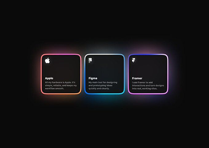

- **Original file:** `inspiration/on screen inspo/4892c1e76f317dd6df1a0339b97ecd59 1.png` (353x251 px, source folder: on screen inspo, batch-001 (inspiration.zip, 2026-10-13))
- **Category / subcategory:** ONS / feature-cards. **Style family:** NEON-RIM. **Also useful for:** -
- **Tags:** tool-stack, cards, gradient-border, apple, figma, framer, row
- **Alternate copies:**
  - `assets/references/_alternates/ONS-016__alt1__4892c1e76f317dd6df1a0339b97ecd59_2.png` (original `inspiration/4892c1e76f317dd6df1a0339b97ecd59 2.png`, 112x80, same design, different resolution/crop, distance 6)

**Observed (visible in the image)**
- **Visual description:** Black background. Three small dark square cards in a row (Apple, Figma, Framer), each with a short description and a distinct gradient neon border: pink-orange, cyan-blue and violet-pink.
- **Typography:** Tiny white semibold names (Apple, Figma, Framer) with a logo glyph top-left of each card and 2-3 lines of tiny grey description beneath; left-aligned.
- **Colour palette (measured, dominant first):** `#0A0A0A` 64.4%  `#242127` 20.5%  `#0B0A0B` 13.0%  `#090A0C` 1.5%  `#0A0A09` 0.3%  `#090909` 0.3%
- **Composition:** Centred row, small (~40% width total). Lots of negative space.
- **Lighting & effects:** Gradient borders glow softly, with colour-coded identity per tool.
- **Depth & layering:** Flat cards on black. The gradient neon borders glow outward, adding a halo, but cards do not overlap or cast directional shadows.

**Inferred (creative interpretation - not visible in a still)**
- **Animation behaviour:** INFERRED: borders trace around each card (conic-gradient rotation or stroke draw) one after another, then the text fades in.
- **Suitable use cases:** 'My tool stack' moments, listing the 2-4 apps a creator uses, or tagging tools mentioned in quick succession while the speaker stays on screen.
- **Technical recreation:** Card with ::before padding-box border via mask-composite, or SVG rect stroke with a linearGradient. Radius 10.

---

### ONS-017 - Single Tall Card with Magenta Aurora Base

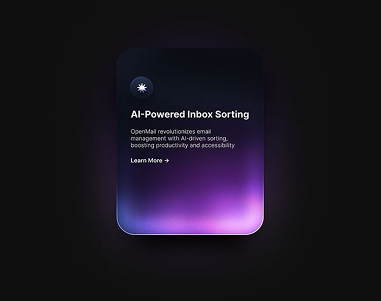

- **Original file:** `inspiration/on screen inspo/4d8d963f9d1c39493d9b22b063022aaf 1.png` (381x301 px, source folder: on screen inspo, batch-001 (inspiration.zip, 2026-10-13))
- **Category / subcategory:** ONS / glass-ui-card. **Style family:** AURORA-GRADIENT. **Also useful for:** -
- **Tags:** card, aurora, magenta, violet, ai, feature, single-focus
- **Alternate copies:**
  - `assets/references/_alternates/ONS-017__alt1__4d8d963f9d1c39493d9b22b063022aaf_2.png` (original `inspiration/4d8d963f9d1c39493d9b22b063022aaf 2.png`, 122x96, same design, different resolution/crop, distance 6)

**Observed (visible in the image)**
- **Visual description:** Black background. One tall dark glass card with a sparkle icon, title 'AI-Powered Inbox Sorting', small description and 'Learn More ->'. Its bottom third glows with blended violet/magenta aurora light.
- **Typography:** Inter Semibold white title 'AI-Powered Inbox Sorting' (~3.5% of frame height), 3-line small grey body, tiny 'Learn More →' link; a small sparkle icon in a dark circle above the title. Left-aligned.
- **Colour palette (measured, dominant first):** `#0F0F0F` 50.8%  `#120E17` 23.4%  `#312341` 13.2%  `#101012` 8.9%  `#0B0C13` 3.1%  `#100B0D` 0.6%
- **Composition:** One portrait card centred, ~35% of frame width and ~70% of frame height, with large empty black margins on all sides. Text sits in the upper half; the glow occupies the lower third.
- **Lighting & effects:** Aurora clipped inside the card, with a slight outer bloom below it.
- **Depth & layering:** A single card on black. The magenta/violet aurora inside the lower edge plus a faint outer bloom beneath make the card read as a lit glass slab floating just above the background.

**Inferred (creative interpretation - not visible in a still)**
- **Animation behaviour:** INFERRED: the card fades up 20px. The aurora swells from 0 to full and slowly drifts.
- **Suitable use cases:** A single AI feature or idea callout, introducing one product capability, or emphasising 'this one thing' while the speaker explains it.
- **Technical recreation:** Same recipe as ONS-009. Colours #7C3AED and #EC4899 blobs, blur 40px.

---

### ONS-018 - Light Frosted Glass Service Tiles (blue)

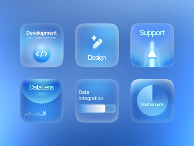

- **Original file:** `inspiration/on screen inspo/5635eac50b74d405d0104c6013be978f 1.png` (381x286 px, source folder: on screen inspo, batch-001 (inspiration.zip, 2026-10-13))
- **Category / subcategory:** ONS / frosted-tile-grid. **Style family:** FROST-LIGHT. **Also useful for:** -
- **Tags:** frosted-glass, light-glass, blue, tiles, services, grid, icons
- **Alternate copies:**
  - `assets/references/_alternates/ONS-018__alt1__5635eac50b74d405d0104c6013be978f_2.png` (original `inspiration/5635eac50b74d405d0104c6013be978f 2.png`, 122x91, same design, different resolution/crop, distance 9)

**Observed (visible in the image)**
- **Visual description:** Bright blue gradient background. A 3x2 grid of light frosted-glass tiles: Development (code icon), Design (pen with sparkle), Support (arrow), DataLens (waveform), Data Integration (progress bar), Dashboards (pie).
- **Typography:** Medium-weight white and light-blue sans labels (Development, Design, Support, DataLens, Data Integration, Dashboards) at ~4% of frame height, some with tiny sub-labels such as 'Low-code platforms'. Labels sit top-left or centre in each tile.
- **Colour palette (measured, dominant first):** `#5988D0` 23.7%  `#5996E6` 18.8%  `#3C74C8` 18.1%  `#61ABF3` 15.8%  `#4887DE` 13.6%  `#87BCEF` 9.9%
- **Composition:** Even 3x2 grid of square frosted tiles centred at ~80% of frame width with equal gutters; each tile holds one icon or mini-visual (code brackets, pen, arrow, waveform, progress bar, pie).
- **Lighting & effects:** Translucent white glass with inner highlights, blue tint, and soft refraction of the background.
- **Depth & layering:** Tiles slightly raised with soft shadows. Icons are 3D-ish glass.

**Inferred (creative interpretation - not visible in a still)**
- **Animation behaviour:** INFERRED: tiles pop in grid-order with a 50ms stagger, then the active tile brightens as each is mentioned.
- **Suitable use cases:** Service lists, skill areas, and categories, especially for bright or airy footage.
- **Technical recreation:** backdrop-filter: blur(20px); background: rgba(255,255,255,.18); border: 1px solid rgba(255,255,255,.45); radius 22.

---

### ONS-019 - Silver-Lavender Sales Card with Bar+Line Chart

- **Original file:** `inspiration/on screen inspo/61bc62ca4c33d99410ab9164d2a80cd4 1.png` (381x381 px, source folder: on screen inspo, batch-001 (inspiration.zip, 2026-10-13))
- **Category / subcategory:** ONS / chart-card. **Style family:** GLASS-DARK. **Also useful for:** -
- **Tags:** sales, chart, bar-chart, glass-card, silver, lavender, tooltip, growth
- **Alternate copies:**
  - `assets/references/_alternates/ONS-019__alt1__61bc62ca4c33d99410ab9164d2a80cd4_2.png` (original `inspiration/61bc62ca4c33d99410ab9164d2a80cd4 2.png`, 122x121, same design, different resolution/crop, distance 19)

**Observed (visible in the image)**
- **Visual description:** Black textured background. A dark glass card with a silver-lavender sheen in its upper area shows 'SALES', '$70,318' large, and '+$10,967 (+7.36%)'. A bar chart with a rising line and arrow and a tooltip pill '$42,710' is below.
- **Typography:** Small caps label 'SALES' in grey, a large medium-weight white figure '$70,318' (~9% of frame height), and a smaller delta line '+$10,967 (+7.36%)'. Tiny month labels JAN-JUL along the chart base. Tooltip pill '$42,710' in tiny dark text on a light lavender chip.
- **Colour palette (measured, dominant first):** `#050505` 24.8%  `#111217` 21.0%  `#010101` 20.2%  `#292C39` 13.6%  `#7D8197` 11.9%  `#030303` 8.5%
- **Composition:** Single square-ish card centred at ~55% of frame width and height. Stat block top-left, chart filling the lower half. The third-party watermark/QR in the top-right is not part of the design.
- **Lighting & effects:** Diagonal light sheen across the glass (a soft white-lavender radial in the top-right corner).
- **Depth & layering:** The card floats over a dark textured field (faint diagonal pattern). Glass sheen in the card's top-right corner suggests a light source above-right; the chart sits inside the card plane.

**Inferred (creative interpretation - not visible in a still)**
- **Animation behaviour:** INFERRED: the number counts up and bars grow in sequence. The line draws and the arrow head appears last, then the tooltip pops on a bar.
- **Suitable use cases:** Sales or revenue jumps, month-over-month growth, 'here are my numbers' proof moments in business or creator-economy videos.
- **Technical recreation:** Card bg radial-gradient(at 80% 10%, rgba(200,190,255,.35), transparent 50%), #0E0E14.

> Note: Source contains a third-party social watermark ('free AI here nano banana pro,2,grok' + QR code) that is NOT part of the design. Never reproduce it.

---

### ONS-020 - iOS-Style Glass Widgets Trio (battery, flight, Siri)

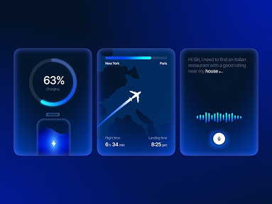

- **Original file:** `inspiration/on screen inspo/6a32816d50431c03d1c74960c4b12cce 1.png` (383x287 px, source folder: on screen inspo, batch-001 (inspiration.zip, 2026-10-13))
- **Category / subcategory:** ONS / widgets. **Style family:** GLASS-DARK. **Also useful for:** -
- **Tags:** widgets, ios, battery-ring, flight, map, siri, waveform, royal-blue
- **Alternate copies:**
  - `assets/references/_alternates/ONS-020__alt1__6a32816d50431c03d1c74960c4b12cce_2.png` (original `inspiration/6a32816d50431c03d1c74960c4b12cce 2.png`, 121x91, same design, different resolution/crop, distance 8)

**Observed (visible in the image)**
- **Visual description:** Royal-blue background. Three glass widgets: a battery ring '63% Charging' with a phone glyph, a flight card (New York to Paris map with plane arrow, flight time and landing time), and a Siri request card with a waveform and orb button.
- **Typography:** SF Pro-like sans: '63%' medium white inside the ring with tiny 'Charging'; flight card with tiny 'New York'/'Paris' and times '6h 34min', '8:25 pm'; Siri card with 3 lines of small grey request text. White primary, grey secondary.
- **Colour palette (measured, dominant first):** `#031431` 25.1%  `#031551` 22.5%  `#031A6E` 21.0%  `#062966` 14.6%  `#1D4695` 10.1%  `#031664` 6.8%
- **Composition:** Three equal tall widgets in a row centred at ~85% of frame width, even gutters, each a self-contained vignette: ring at the top of card 1, map filling card 2, waveform centred in card 3.
- **Lighting & effects:** Cards darker blue glass with bright blue rim, waveform glowing.
- **Depth & layering:** Flat glass widgets on a royal-blue field; bright blue rims and inner glows (battery, plane path, waveform) create lift without overlap or shadows.

**Inferred (creative interpretation - not visible in a still)**
- **Animation behaviour:** INFERRED: battery ring fills, plane travels along arc, waveform oscillates — each widget gets one micro-animation.
- **Suitable use cases:** Lifestyle/tech moments, travel, productivity, demonstrating phone features.
- **Technical recreation:** Build each as an HTML widget; ring via SVG stroke-dasharray; plane via offset-path.

---

### ONS-021 - Huge 78% Behind Glowing Area Line

- **Original file:** `inspiration/on screen inspo/75e28a10c53dd46e0a6c992a2e654e75 1.png` (258x145 px, source folder: on screen inspo, batch-001 (inspiration.zip, 2026-10-13))
- **Category / subcategory:** ONS / stat-chart. **Style family:** DATA-GLOW. **Also useful for:** FUL, TXT
- **Tags:** stat, percentage, area-chart, blue, gradient-numerals, productivity
- **Alternate copies:**
  - `assets/references/_alternates/ONS-021__alt1__75e28a10c53dd46e0a6c992a2e654e75_2.png` (original `inspiration/75e28a10c53dd46e0a6c992a2e654e75 2.png`, 83x46, same design, different resolution/crop, distance 22)
  - `assets/references/_alternates/ONS-021__alt2__99e2d622f558fde4df2c717092b4e058_1.png` (original `inspiration/99e2d622f558fde4df2c717092b4e058 1.png`, 79x44, same design, different resolution/crop, distance 17)

**Observed (visible in the image)**
- **Visual description:** Black background. Headline 'With WorkloadAI your productivity increases by 78%' small at top. A huge '78%' in blue gradient numerals sits partly behind a blue area chart whose line has white nodes and vertical drop lines.
- **Typography:** Huge bold numerals (blue to transparent gradient). Small white headline.
- **Colour palette (measured, dominant first):** `#000000` 45.2%  `#051B37` 20.6%  `#010711` 12.5%  `#000002` 9.9%  `#255074` 7.7%  `#030002` 4.1%
- **Composition:** Stat centred; chart sweeps full width across lower half, overlapping the numerals.
- **Lighting & effects:** Area under the line filled with deep blue fading to black; the line itself is a brighter blue with soft glow; white nodes with small glows sit on the line and drop thin vertical lines to the base. The '78%' numerals fade from bright blue to transparent at their base.
- **Depth & layering:** Two planes: the huge '78%' sits behind the chart line, so the line and its nodes cross in front of the digits; the headline floats above both on the black background.

**Inferred (creative interpretation - not visible in a still)**
- **Animation behaviour:** INFERRED: line draws left→right, nodes pop sequentially, numerals count up behind and rise from below the line.
- **Suitable use cases:** Single headline percentage claims ('productivity up 78%'), before/after improvements, or a stat that deserves a full beat on screen.
- **Technical recreation:** Numerals with background-clip:text gradient #3B82F6→rgba(59,130,246,.1); chart SVG in front.

---

### ONS-022 - Source Logos Converging into Product (node graph)

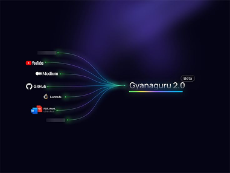

- **Original file:** `inspiration/on screen inspo/79abde395d75079ced9453cb5490174c 1.png` (381x286 px, source folder: on screen inspo, batch-001 (inspiration.zip, 2026-10-13))
- **Category / subcategory:** ONS / flow-diagram. **Style family:** DATA-GLOW. **Also useful for:** FUL
- **Tags:** diagram, integration, convergence, logos, curved-connectors, green, purple-haze
- **Alternate copies:**
  - `assets/references/_alternates/ONS-022__alt1__79abde395d75079ced9453cb5490174c_2.png` (original `inspiration/79abde395d75079ced9453cb5490174c 2.png`, 122x91, same design, different resolution/crop, distance 7)

**Observed (visible in the image)**
- **Visual description:** Dark indigo with violet haze at top. Left: stacked source labels with logos (YouTube, Medium, GitHub, Leetcode, PDF/Word). Thin green curved connectors converge right into 'Gyanaguru 2.0' with a 'Beta' badge and rainbow gradient underline.
- **Typography:** Source labels are tiny white sans (YouTube, Medium, GitHub, Leetcode, PDF/Word) each preceded by its brand logo; the target 'Gyanaguru 2.0' is a medium-weight white sans ~2.5x larger, with a tiny outlined 'Beta' pill above its end and a short rainbow gradient bar underneath.
- **Colour palette (measured, dominant first):** `#050414` 55.9%  `#1A183A` 25.8%  `#080415` 16.3%  `#040212` 1.5%  `#030414` 0.2%  `#050412` 0.2%
- **Composition:** Left-to-right funnel; sources spread vertically, target at right-centre.
- **Lighting & effects:** Connector curves are thin green strokes with a faint glow and small bright dots at their source ends; a soft violet/indigo haze blooms in the top-right corner, otherwise the field is near-black navy.
- **Depth & layering:** Flat 2D diagram. Slight depth comes from the haze behind and from short blurred grey bars beside some sources that look out of focus.

**Inferred (creative interpretation - not visible in a still)**
- **Animation behaviour:** INFERRED: sources appear top→bottom, connectors draw toward the target with traveling light pulses, target lights up and underline sweeps.
- **Suitable use cases:** 'All your sources in one place', aggregation, inputs → output explanations.
- **Technical recreation:** SVG cubic paths from each source to target point; animated dash pulses (stroke-dasharray 6 200, animate offset).

---

### ONS-023 - Four Mini Cards with Rainbow Gradient Glow

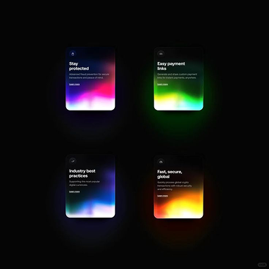

- **Original file:** `inspiration/on screen inspo/87024fbcc8c20c2d14dbf30aba40f6bc 1.png` (382x382 px, source folder: on screen inspo, batch-001 (inspiration.zip, 2026-10-13))
- **Category / subcategory:** ONS / feature-cards. **Style family:** AURORA-GRADIENT. **Also useful for:** -
- **Tags:** feature-cards, rainbow, gradient-glow, grid, fintech
- **Alternate copies:**
  - `assets/references/_alternates/ONS-023__alt1__87024fbcc8c20c2d14dbf30aba40f6bc_2.png` (original `inspiration/87024fbcc8c20c2d14dbf30aba40f6bc 2.png`, 122x122, same design, different resolution/crop, distance 7)

**Observed (visible in the image)**
- **Visual description:** Black background; 2x2 sparse grid of small dark cards ('Stay protected', 'Easy payment links', 'Industry best practices', 'Fast, secure, global') each with an intense multi-hue gradient glowing at its bottom (pink/blue, green/yellow, blue/violet, red/orange).
- **Typography:** Tiny white semibold titles ('Stay protected', 'Easy payment links', 'Industry best practices', 'Fast, secure, global') top-left in each card, 2-3 lines of tiny grey body, and a tiny underlined 'Learn more' link.
- **Colour palette (measured, dominant first):** `#050505` 66.1%  `#2C2B2A` 11.2%  `#0B0506` 10.0%  `#030508` 5.1%  `#050503` 4.7%  `#0A0307` 2.9%
- **Composition:** Four small portrait cards in a sparse 2x2 grid, each ~18% of frame width, with large black gaps between them; the grid is centred and the cards occupy well under half the frame.
- **Lighting & effects:** Very saturated, blurred gradients inside each card bottom; spill glow.
- **Depth & layering:** Flat cards on black. The saturated gradients inside each card's lower half bleed outward as glow, which is the only depth cue.

**Inferred (creative interpretation - not visible in a still)**
- **Animation behaviour:** INFERRED: each card's gradient ignites as it's mentioned; idle hue drift.
- **Suitable use cases:** Four-benefit or four-feature lists, quick feature tours, 'four reasons why' segments where each card lights up as it is named.
- **Technical recreation:** As ONS-009 aurora cards with a different palette per card: blurred blobs (pink #FF4FA0 + blue #3B82F6; green #22E37A + yellow #FACC15; blue #3B82F6 + violet #8B5CF6; red #EF4444 + orange #F59E0B), blur 30-40px, clipped to the lower 45% of each card, plus a matching outer glow.

---

### ONS-024 - Conversion 400% Card with Glowing Peak Curve

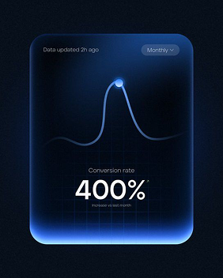

- **Original file:** `inspiration/on screen inspo/8bba9b4b4e60e49648ce5b9498de4dd7 1.png` (282x352 px, source folder: on screen inspo, batch-001 (inspiration.zip, 2026-10-13))
- **Category / subcategory:** ONS / stat-chart-card. **Style family:** NEON-RIM. **Also useful for:** -
- **Tags:** stat, percentage, bell-curve, glow-node, blue-rim, glass-card
- **Alternate copies:**
  - `assets/references/_alternates/ONS-024__alt1__8bba9b4b4e60e49648ce5b9498de4dd7_2.png` (original `inspiration/8bba9b4b4e60e49648ce5b9498de4dd7 2.png`, 90x113, same design, different resolution/crop, distance 16)

**Observed (visible in the image)**
- **Visual description:** Dark navy; tall glass card with blue glowing bottom rim. Top: 'Data updated 2h ago' and a 'Monthly' dropdown pill. A smooth bell-curve line peaks with a glowing node. Bottom: 'Conversion rate' label and huge '400%' plus tiny comparison text. Faint grid in card.
- **Typography:** Huge medium-weight white numerals '400%' (~12% of frame height) with a small superscript mark; tiny grey 'Conversion rate' above and 'Increase vs last month' below; small grey 'Data updated 2h ago' top-left and a 'Monthly' dropdown pill top-right.
- **Colour palette (measured, dominant first):** `#060F1B` 21.7%  `#08111D` 19.7%  `#030A16` 17.6%  `#091832` 16.2%  `#061122` 14.8%  `#335387` 9.9%
- **Composition:** Portrait card centred at ~75% of frame width and ~85% of height; header row at the top, bell curve filling the upper-middle, stat block centred in the lower third above the glowing bottom edge.
- **Lighting & effects:** Blue rim light on lower edge and corners (#2F6BFF), glowing node on peak.
- **Depth & layering:** Card reads as a thick glass slab: faint inner grid recedes behind the curve, the bottom edge glows as if lit from beneath, and the textured navy backdrop sits far behind.

**Inferred (creative interpretation - not visible in a still)**
- **Animation behaviour:** INFERRED: curve draws upward, node flashes at peak, number counts to 400%.
- **Suitable use cases:** Conversion or ROI spikes, 'X% increase' claims, before/after results; works as a lower-band overlay or as a full-screen stat moment.
- **Technical recreation:** Use templates/stat-card.html (accent #2F6BFF; green variant ONS-050). Card radius ~10% of card width, inset bottom glow, 1px accent border at 40%, faint 48px grid, bell-curve SVG path with a glowing white peak node; count-up with outExpo.

---

### ONS-025 - Odometer Year Roll (2026) on Paper Texture

- **Original file:** `inspiration/on screen inspo/8f5d7c6d8e6ca2faa2ada0c63dfb376b 1.png` (380x379 px, source folder: on screen inspo, batch-001 (inspiration.zip, 2026-10-13))
- **Category / subcategory:** ONS / number-roll. **Style family:** NEUMORPHIC-LIGHT. **Also useful for:** FUL, TXT
- **Tags:** odometer, number-roll, year, light-theme, royal-blue, paper-texture, new-year
- **Alternate copies:**
  - `assets/references/_alternates/ONS-025__alt1__8f5d7c6d8e6ca2faa2ada0c63dfb376b_2.png` (original `inspiration/8f5d7c6d8e6ca2faa2ada0c63dfb376b 2.png`, 122x121, same design, different resolution/crop, distance 21)

**Observed (visible in the image)**
- **Visual description:** Light grey paper-textured background. 'Welcome' above a white pill containing '202' in bold italic royal blue, with the final digit on a blue tile '6'. A curved wheel of digits 4,5,(6),7,8 arcs vertically through the tile like a slot reel. 'Happy New Year / Make each journey a "FRESH" start...' below; small logo/social icons.
- **Typography:** Heavy italic grotesk numerals (royal blue #1D4ED8); small medium sans body.
- **Colour palette (measured, dominant first):** `#DEDEDF` 22.6%  `#E1E2E3` 22.5%  `#E5E5E5` 18.2%  `#E1E1E1` 15.5%  `#728BB2` 13.1%  `#DFE0E2` 8.1%
- **Composition:** Left-centre pill; digit wheel on right edge of pill extending above/below on an arc.
- **Lighting & effects:** Soft, diffuse daylight on a grainy paper texture; the white pill casts a soft drop shadow below-right, the blue digit tile is glossy and slightly embossed, and the arc of reel digits fades in opacity away from the active digit.
- **Depth & layering:** Pill raised; reel digits recede along arc (scale/opacity falloff).

**Inferred (creative interpretation - not visible in a still)**
- **Animation behaviour:** INFERRED: reel spins and decelerates to land on target digit (ease-out cubic, 900ms), slight motion blur during spin.
- **Suitable use cases:** Years ('Welcome 2026'), counters, 'day 5 of 30', version numbers, countdowns, or any moment where a number changes to its new value.
- **Technical recreation:** Digits on a vertical strip translated with eased Y; arc via rotateX on a cylinder (CSS 3D) or per-digit transforms.

> Note: In on-screen folder; usable as overlay counter or full-screen.

---

### ONS-026 - Settings Card under Anamorphic Light Beam

- **Original file:** `inspiration/on screen inspo/9524ebbc50c9c647645cf2fbf380b6b6 1.png` (623x467 px, source folder: on screen inspo, batch-001 (inspiration.zip, 2026-10-13))
- **Category / subcategory:** ONS / glass-ui-card. **Style family:** AURORA-GRADIENT. **Also useful for:** -
- **Tags:** glass-card, light-beam, blue-violet, settings, gradient, cinematic
- **Alternate copies:**
  - `assets/references/_alternates/ONS-026__alt1__9524ebbc50c9c647645cf2fbf380b6b6_2.png` (original `inspiration/9524ebbc50c9c647645cf2fbf380b6b6 2.png`, 199x149, same design, different resolution/crop, distance 5)
  - `assets/references/_alternates/ONS-026__alt2__9524ebbc50c9c647645cf2fbf380b6b6_3.png` (original `inspiration/9524ebbc50c9c647645cf2fbf380b6b6 3.png`, 170x128, same design, different resolution/crop, distance 4)

**Observed (visible in the image)**
- **Visual description:** Black background with a diagonal blue anamorphic light beam from top-left. A glass card ('Powered-UP Settings', gear icon, body, Back/Skip) whose lower half is blue→violet gradient, lit by the beam.
- **Typography:** Inter Semibold white title 'Powered-UP Settings' (~4% of frame height) under a small gear icon in a dark circle; two lines of small grey body; tiny 'Back' and 'Skip' labels with icons at the bottom corners.
- **Colour palette (measured, dominant first):** `#0A0A0A` 33.9%  `#181B39` 20.4%  `#2D3A98` 15.8%  `#0D0D10` 15.4%  `#478BDA` 9.6%  `#090909` 4.9%
- **Composition:** Card centred; beam enters from top-left corner aiming at card.
- **Lighting & effects:** Volumetric beam with soft falloff; card gradient brighter on lit side.
- **Depth & layering:** The diagonal beam appears to travel through the space in front of and behind the card, giving a volumetric, atmospheric depth; the card itself is a single glass plane with a gradient lower half.

**Inferred (creative interpretation - not visible in a still)**
- **Animation behaviour:** INFERRED: beam sweeps in (opacity + slight rotation), card brightens as light hits it.
- **Suitable use cases:** 'Power-up' or upgrade moments, settings/optimisation talk, 'turn this on' tips, or introducing an automated service.
- **Technical recreation:** Beam = rotated, blurred linear-gradient rectangle with mix-blend-mode: screen.

---

### ONS-027 - Perk Cards with 3D Gems (orange diamond / blue drop)

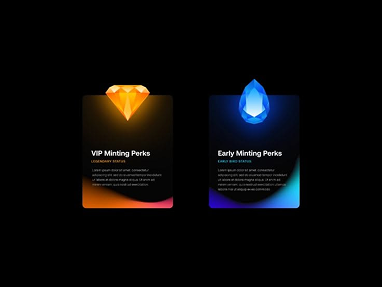

- **Original file:** `inspiration/on screen inspo/9685450e382d2708b6eafc60b28c6425 1.png` (382x287 px, source folder: on screen inspo, batch-001 (inspiration.zip, 2026-10-13))
- **Category / subcategory:** ONS / feature-cards-3d-icon. **Style family:** AURORA-GRADIENT. **Also useful for:** -
- **Tags:** cards, 3d-gem, diamond, perks, orange, blue, tiers
- **Alternate copies:**
  - `assets/references/_alternates/ONS-027__alt1__32b278e68dcff0e6bd45f5fa6507670d_1.png` (original `inspiration/32b278e68dcff0e6bd45f5fa6507670d 1.png`, 171x128, same design, different resolution/crop, distance 3)
  - `assets/references/_alternates/ONS-027__alt2__9685450e382d2708b6eafc60b28c6425_2.png` (original `inspiration/9685450e382d2708b6eafc60b28c6425 2.png`, 121x92, same design, different resolution/crop, distance 3)

**Observed (visible in the image)**
- **Visual description:** Black background; two dark cards each crowned by a glossy 3D gem (orange diamond, blue crystal drop) overlapping the top edge; titles 'VIP Minting Perks', 'Early Minting Perks', body; bottom gradient glow matching gem colour.
- **Typography:** Small white bold titles, coloured small subtitles, grey body.
- **Colour palette (measured, dominant first):** `#000000` 78.0%  `#09080F` 7.0%  `#1C1A21` 6.1%  `#766D5F` 4.0%  `#020001` 3.5%  `#000002` 1.4%
- **Composition:** Two equal cards side by side, centred, together ~55% of frame width, with a modest gap; each gem sits half above the card's top edge, breaking the frame.
- **Lighting & effects:** Gems emit coloured light down into card; matching bottom gradient.
- **Depth & layering:** The gems overlap the card borders and sit in front, so the objects pop out of the UI plane; coloured light from each gem falls onto its card's surface below.

**Inferred (creative interpretation - not visible in a still)**
- **Animation behaviour:** INFERRED: gems drop in and rotate slightly, light spills into card.
- **Suitable use cases:** Comparing tiers or plans (premium vs standard), early-bird vs VIP offers, or two rewards/perks the speaker is describing.
- **Technical recreation:** Cards as dark rounded rects (radius ~8% of width) with a bottom gradient matching the gem (orange #F97316 / blue #3B82F6); gems as rendered or generated PNGs with transparent background, positioned with overflow visible; add a radial glow under each gem.

---

### ONS-028 - Iceberg Tip vs Base (split waterline)

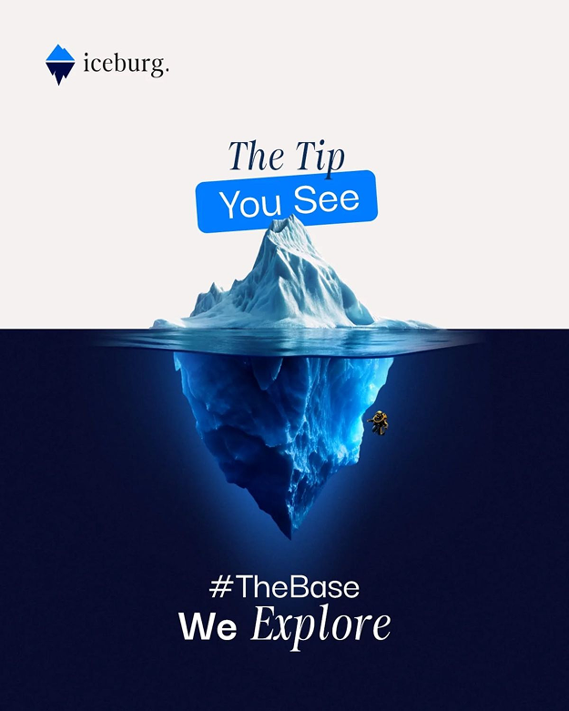

- **Original file:** `inspiration/on screen inspo/9e8b7dc3655263bfadead282f918f386 1.png` (625x781 px, source folder: on screen inspo, batch-001 (inspiration.zip, 2026-10-13))
- **Category / subcategory:** ONS / concept-poster. **Style family:** 3D-METAPHOR. **Also useful for:** FUL, TXT
- **Tags:** iceberg, metaphor, hidden-depth, split-frame, serif-italic, highlight-pill, vertical
- **Alternate copies:**
  - `assets/references/_alternates/ONS-028__alt1__9e8b7dc3655263bfadead282f918f386_2.png` (original `inspiration/9e8b7dc3655263bfadead282f918f386 2.png`, 199x248, same design, different resolution/crop, distance 6)

**Observed (visible in the image)**
- **Visual description:** Vertical poster split by a waterline: off-white top, deep navy bottom. Photoreal iceberg: small tip above, huge base below. Top text 'The Tip' italic serif + 'You See' white on tilted blue pill; bottom '#TheBase We Explore' with 'Explore' in italic serif. 'iceburg.' logo top-left.
- **Typography:** Italic serif (Playfair-like) mixed with medium sans; highlight pill tilted ~-4°.
- **Colour palette (measured, dominant first):** `#F5F1F0` 37.8%  `#080C2D` 37.5%  `#0C1D47` 12.6%  `#629ECD` 8.7%  `#E6F2F3` 2.2%  `#F9F4F2` 1.3%
- **Composition:** Top/bottom halves mirror the message; iceberg centred vertical.
- **Lighting & effects:** Above the waterline: bright, neutral studio light on an off-white background with the iceberg tip lit white-blue. Below: deep navy water with caustic blue light, the submerged mass glowing pale cyan toward the waterline and fading to dark at the bottom.
- **Depth & layering:** Split-level camera: half above the surface, half below, as if the lens sits at the waterline. The waterline is a hard horizontal edge at ~45% height; the text layers sit in front of both halves.

**Inferred (creative interpretation - not visible in a still)**
- **Animation behaviour:** INFERRED: start on tip (top) then camera tilts/pans down below waterline revealing base; text swaps.
- **Suitable use cases:** 'What you see vs what's underneath', hidden work, surface vs depth.
- **Technical recreation:** Generated/stock iceberg image; vertical camera move via transform translateY; waterline ripple displacement.

> Note: In on-screen folder; reads as full-screen.

---

### ONS-029 - Glowing Curve with Scanner Marker

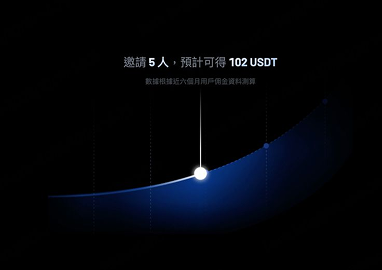

- **Original file:** `inspiration/on screen inspo/bdeea3e0b851a3c1650b308444f49084 1.png` (382x270 px, source folder: on screen inspo, batch-001 (inspiration.zip, 2026-10-13))
- **Category / subcategory:** ONS / stat-chart. **Style family:** DATA-GLOW. **Also useful for:** -
- **Tags:** line-chart, glow, marker, scanner, blue, minimal, rewards
- **Alternate copies:**
  - `assets/references/_alternates/ONS-029__alt1__bdeea3e0b851a3c1650b308444f49084_2.png` (original `inspiration/bdeea3e0b851a3c1650b308444f49084 2.png`, 122x87, same design, different resolution/crop, distance 11)

**Observed (visible in the image)**
- **Visual description:** Black; a thick blue glowing curve rises across lower frame; a white glowing dot marks a point with a vertical light line above; dotted vertical gridlines; CJK headline (invite 5 people, get 102 USDT).
- **Typography:** Medium-weight white CJK headline (with '102 USDT' in bold) centred at the top, ~3.5% of frame height, and a smaller grey sub-line beneath.
- **Colour palette (measured, dominant first):** `#000000` 66.0%  `#010001` 10.6%  `#020819` 9.5%  `#010203` 6.6%  `#182A4E` 6.1%  `#000001` 1.2%
- **Composition:** Headline top-centre, curve lower 40%, marker left-of-centre.
- **Lighting & effects:** The blue curve has a wide, soft glow that fades into the black; a hot white dot with a halo marks one point, and a thin vertical light line rises above it like a scanner beam. Faint dotted vertical gridlines sit in the background.
- **Depth & layering:** Flat. The glow halo and the fading gridlines provide the only sense of depth.

**Inferred (creative interpretation - not visible in a still)**
- **Animation behaviour:** INFERRED: marker slides along curve as value updates; beam follows.
- **Suitable use cases:** Progress along a curve, 'you are here', rewards accumulation.
- **Technical recreation:** SVG path for the curve with a blurred duplicate for glow; a marker circle positioned with getPointAtLength(progress) plus a vertical gradient line above it; dotted gridlines via stroke-dasharray. Animate progress to slide the marker along the curve.

---

### ONS-030 - Twin Circular Progress Rings (75.6% / 83%)

- **Original file:** `inspiration/on screen inspo/cad554f4e1fb8f66d98ececeecce5233 1.png` (382x214 px, source folder: on screen inspo, batch-001 (inspiration.zip, 2026-10-13))
- **Category / subcategory:** ONS / chart-card. **Style family:** DATA-GLOW. **Also useful for:** -
- **Tags:** progress-ring, donut, percentages, violet, blue, comparison
- **Alternate copies:**
  - `assets/references/_alternates/ONS-030__alt1__cad554f4e1fb8f66d98ececeecce5233_2.png` (original `inspiration/cad554f4e1fb8f66d98ececeecce5233 2.png`, 122x68, same design, different resolution/crop, distance 25)

**Observed (visible in the image)**
- **Visual description:** Same navy→violet gradient as ONS-006; two thin circular rings with gradient strokes (violet / blue) showing '75.6%' and '83%' with tiny labels.
- **Typography:** Medium-weight white numerals ('75.6%', '83%') centred inside each ring at ~5% of frame height, with two tiny grey lines 'Proportion of transactions' beneath; tiny 'Histogram' label top-left as in ONS-006.
- **Colour palette (measured, dominant first):** `#010214` 38.2%  `#1E1354` 25.4%  `#080425` 22.6%  `#03031A` 9.9%  `#000117` 3.1%  `#010111` 0.7%
- **Composition:** Two equal rings side by side, centred with balanced spacing, each about 22% of frame width, on the same navy-to-violet gradient as ONS-006.
- **Lighting & effects:** Ring strokes use gradients (violet to pink, blue to cyan) with a subtle glow; the unfilled track is a very faint dark stroke.
- **Depth & layering:** Flat. The background gradient brightens toward the bottom-right, giving gentle atmosphere.

**Inferred (creative interpretation - not visible in a still)**
- **Animation behaviour:** INFERRED: rings sweep from 0 with count-up, second ring 150ms later.
- **Suitable use cases:** Comparing two rates, scores or completion percentages side by side, such as 'before vs after' or 'channel A vs channel B'.
- **Technical recreation:** SVG circle stroke-dasharray animation with linearGradient stroke.

---

### ONS-031 - AI Model Comparison Cards (Meta vs Mistral)

- **Original file:** `inspiration/on screen inspo/d5cddb39403a9141fe12f5af0fd46ace 1.png` (381x214 px, source folder: on screen inspo, batch-001 (inspiration.zip, 2026-10-13))
- **Category / subcategory:** ONS / comparison-cards. **Style family:** GLASS-DARK. **Also useful for:** -
- **Tags:** comparison, ai-models, logos, glow, spec-meter, versus
- **Alternate copies:**
  - `assets/references/_alternates/ONS-031__alt1__d5cddb39403a9141fe12f5af0fd46ace_2.png` (original `inspiration/d5cddb39403a9141fe12f5af0fd46ace 2.png`, 122x69, same design, different resolution/crop, distance 18)

**Observed (visible in the image)**
- **Visual description:** Dark textured background; two dark glass cards with glowing logos (Meta blue infinity, Mistral orange M), names 'Meta Llama 2 70B', 'Mistral Mixtral 8x7B', descriptions, and spec rows (Speed, Intelligence, Context window) with dash-segment meters.
- **Typography:** Small bold white model names ('Meta Llama 2 70B', 'Mistral Mixtral 8x7B'), 3-4 lines of tiny grey description, and tiny caps spec labels (SPEED, INTELLIGENCE, CONTEXT WINDOW) with segmented dash meters on the right.
- **Colour palette (measured, dominant first):** `#1D1B1D` 21.8%  `#080708` 20.6%  `#0B0909` 18.4%  `#131112` 17.9%  `#030306` 14.2%  `#434041` 7.1%
- **Composition:** Two portrait cards side by side, centred, together ~65% of frame width; glowing logo at the top-left of each, description in the middle, spec rows at the bottom.
- **Lighting & effects:** Logo glows tint card edges (blue vs orange) — colour-coded contrast.
- **Depth & layering:** Flat cards on a dark textured backdrop; each logo's glow tints its own card edge (blue vs orange), which separates the two cards visually.

**Inferred (creative interpretation - not visible in a still)**
- **Animation behaviour:** INFERRED: cards slide in from opposite sides; meters fill segment-by-segment to compare.
- **Suitable use cases:** X vs Y comparisons of tools, AI models, products or plans, especially when the speaker compares speed, quality or price.
- **Technical recreation:** Segmented meter = flex of 5 dashes with fill class per value.

---

### ONS-032 - Fanned Arc of AI Model Cards

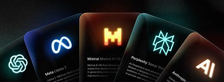

- **Original file:** `inspiration/on screen inspo/d735ae1d82a0fe9bf21fbac0cda4872c 1.png` (381x140 px, source folder: on screen inspo, batch-001 (inspiration.zip, 2026-10-13))
- **Category / subcategory:** ONS / card-fan. **Style family:** GLASS-DARK. **Also useful for:** -
- **Tags:** card-fan, arc, ai-models, logos, colour-glow, overview
- **Alternate copies:**
  - `assets/references/_alternates/ONS-032__alt1__d735ae1d82a0fe9bf21fbac0cda4872c_2.png` (original `inspiration/d735ae1d82a0fe9bf21fbac0cda4872c 2.png`, 121x45, same design, different resolution/crop, distance 13)

**Observed (visible in the image)**
- **Visual description:** A fan of tilted dark cards along an arc (OpenAI, Meta, Mistral, Perplexity, Anthropic) each with glowing logo in its brand colour.
- **Typography:** Tiny white names and descriptions on each card (Meta Llama 2, Mistral Mixtral 8x7B, Perplexity Sonar, Anthropic), mostly illegible at this size; the logos carry the identity.
- **Colour palette (measured, dominant first):** `#181719` 21.3%  `#040507` 20.4%  `#232728` 18.4%  `#07080A` 18.2%  `#170B0A` 13.2%  `#6E7A73` 8.5%
- **Composition:** Arc spanning width, cards rotated progressively (-25°..+25°).
- **Lighting & effects:** Each card has its own brand-coloured glow from its logo: teal (OpenAI), blue (Meta), orange (Mistral), cyan (Perplexity), warm white (Anthropic), against a dark background.
- **Depth & layering:** Overlapping cards fanned on an arc; each card partly covers the next, creating layered depth like a hand of playing cards.

**Inferred (creative interpretation - not visible in a still)**
- **Animation behaviour:** INFERRED: cards fan out from a stack (rotate + translate from centre), like dealing cards.
- **Suitable use cases:** 'All the options' overviews, an AI-tools ecosystem moment, or introducing a list before zooming into one choice.
- **Technical recreation:** transform-origin at bottom centre far below; rotate each card by index.

---

### ONS-033 - Principles Grid with Highlighted Card + Cursor

- **Original file:** `inspiration/on screen inspo/f206cbffbd71fd8449b8db0d56c261d7 1.png` (625x469 px, source folder: on screen inspo, batch-001 (inspiration.zip, 2026-10-13))
- **Category / subcategory:** ONS / card-grid-focus. **Style family:** AURORA-GRADIENT. **Also useful for:** FUL
- **Tags:** grid, focus, cursor, violet, education, principles, highlight
- **Alternate copies:**
  - `assets/references/_alternates/ONS-033__alt1__f206cbffbd71fd8449b8db0d56c261d7_2.png` (original `inspiration/f206cbffbd71fd8449b8db0d56c261d7 2.png`, 199x149, same design, different resolution/crop, distance 5)

**Observed (visible in the image)**
- **Visual description:** Violet field with vertical light bloom from top. Heading 'What are the Principles of Design?' with small body. Grid of faint glass cards with arrow icons; centre 'Hierarchy' card raised and glowing violet; neighbouring 'Contrast', 'Balance'. A cursor with 'Hey!' tag hovers the centre card.
- **Typography:** Medium-weight white heading 'What are the Principles of Design?' centred at the top with a tiny body paragraph; each card has a tiny grey 'Design Principles' label and a large light-weight white label (Hierarchy, Contrast, Balance).
- **Colour palette (measured, dominant first):** `#0D101B` 23.0%  `#1C1834` 19.1%  `#593C92` 17.1%  `#34245C` 14.7%  `#131324` 14.6%  `#996FC5` 11.6%
- **Composition:** Heading in the top 25%; below it a 3-column grid of glass cards with arrow icons in their top-right; the centre 'Hierarchy' card is lifted and brightest, with neighbours fading off-frame at the edges.
- **Lighting & effects:** A vertical violet spotlight falls from the top centre onto the focus card; the other cards are dimmer and lit only by ambient violet light.
- **Depth & layering:** The focus card is raised (brighter, shadowed, slightly larger) above the grid plane; a cursor with a small 'Hey!' tag hovers in front of it.

**Inferred (creative interpretation - not visible in a still)**
- **Animation behaviour:** INFERRED: cursor moves to card, card lifts/glows, label fades in; can step through principles.
- **Suitable use cases:** Educational lists where one item is discussed at a time (principles, rules, steps), with the active one highlighted.
- **Technical recreation:** CSS grid; focus via scale 1.04, brightness, box-shadow violet.

---

### ONS-034 - AI Chat Input with Warm-to-Cool Edge Glow

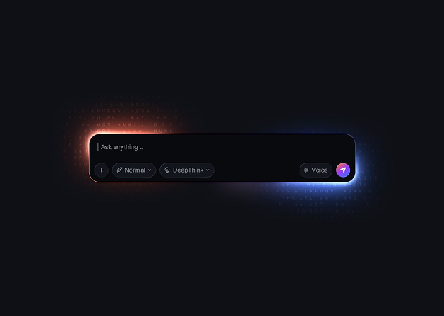

- **Original file:** `inspiration/on screen inspo/fc5141a240ec711ca69f65a49178d6e8 1.png` (624x445 px, source folder: on screen inspo, batch-001 (inspiration.zip, 2026-10-13))
- **Category / subcategory:** ONS / input-bar. **Style family:** NEON-RIM. **Also useful for:** -
- **Tags:** ai, input, prompt, chat, edge-glow, orange, blue, dot-grid
- **Alternate copies:**
  - `assets/references/_alternates/ONS-034__alt1__fc5141a240ec711ca69f65a49178d6e8_2.png` (original `inspiration/fc5141a240ec711ca69f65a49178d6e8 2.png`, 198x142, same design, different resolution/crop, distance 4)
  - `assets/references/_alternates/ONS-034__alt2__fc5141a240ec711ca69f65a49178d6e8_3.png` (original `inspiration/fc5141a240ec711ca69f65a49178d6e8 3.png`, 171x122, same design, different resolution/crop, distance 7)

**Observed (visible in the image)**
- **Visual description:** Dark navy dot-grid background; a wide rounded input bar 'Ask anything...' with chips (Normal, DeepThink, Voice) and violet send button; its edge glows orange on the left and blue on the right.
- **Typography:** Small grey placeholder 'Ask anything...' with a caret; tiny chip labels 'Normal', 'DeepThink' and 'Voice' with small icons; a violet circular send button.
- **Colour palette (measured, dominant first):** `#0F1015` 76.2%  `#111017` 8.4%  `#211E29` 6.8%  `#090A0E` 6.2%  `#0F1017` 2.3%  `#0D1017` 0.1%
- **Composition:** A single wide input bar centred, ~60% of frame width and ~12% of height, with lots of dark negative space around it.
- **Lighting & effects:** Edge glow gradient, background dots faintly lit near the bar.
- **Depth & layering:** Flat. The orange glow on the left and blue glow on the right spill onto a faint dotted texture around the bar, making it feel lit from within.

**Inferred (creative interpretation - not visible in a still)**
- **Animation behaviour:** INFERRED: glow travels around the border (conic rotation), placeholder replaced by typed prompt with caret, send button pulses.
- **Suitable use cases:** Showing a prompt being typed, 'I asked AI...' moments, demonstrating an AI workflow while the speaker talks through it.
- **Technical recreation:** Use templates/ai-input-bar.html (palette 'warm-cool'): conic-gradient border masked to a ring plus a blurred copy for the glow, typed prompt timed to the speech, send button press at the end.

---

### ONS-035 - Bank Balance Card with Stacked Credit Cards (light bg)

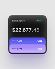

- **Original file:** `inspiration/0043916f56514ccc264ea1597c9bed89 1.png` (114x142 px, source folder: (root), batch-001 (inspiration.zip, 2026-10-13))
- **Category / subcategory:** ONS / glass-ui-card. **Style family:** NEUMORPHIC-LIGHT. **Also useful for:** -
- **Tags:** fintech, balance, credit-cards, stack, violet, light-background, soft-shadow
- **Alternate copies:** none

**Observed (visible in the image)**
- **Visual description:** Light grey background; dark rounded card 'Bank Balance' with green 'Active' pill, '$22,677.45' large white; two stacked violet-gradient credit cards (****5432 VISA, ****8776) slide out from the bottom.
- **Typography:** Medium white numerals with lighter decimals; small grey label.
- **Colour palette (measured, dominant first):** `#292836` 22.8%  `#DDDCE0` 18.6%  `#E7E7E8` 17.7%  `#E4E4E5` 15.5%  `#C5BFDD` 13.6%  `#8C80E2` 11.7%
- **Composition:** Single portrait object centred: the dark balance card occupies the upper two-thirds and the two credit cards stack below it, together ~75% of frame width on a light grey background.
- **Lighting & effects:** Huge soft diffused shadow on light background; violet gradient cards.
- **Depth & layering:** Z-stack: the balance card is on top, the violet credit cards sit beneath and peek out at the bottom, and a large soft shadow grounds the whole stack above the light background.

**Inferred (creative interpretation - not visible in a still)**
- **Animation behaviour:** INFERRED: credit cards slide out downward from behind the balance card one by one; balance counts up.
- **Suitable use cases:** Money, balance or savings topics, fintech app features, 'here's what my account looked like' moments on bright footage.
- **Technical recreation:** Dark card #121216 radius 28; cards linear-gradient(#8B7CF6,#6D5BD0); shadow 0 30px 60px rgba(0,0,0,.18).

---

### ONS-036 - Pensions Lime Area Chart + Phone Mockup

- **Original file:** `inspiration/076debae5b5718e8ccce8069d749aebd 1.png` (193x130 px, source folder: (root), batch-001 (inspiration.zip, 2026-10-13))
- **Category / subcategory:** ONS / chart-with-device. **Style family:** DATA-GLOW. **Also useful for:** -
- **Tags:** area-chart, lime, yellow, phone-mockup, finance, growth
- **Alternate copies:** none

**Observed (visible in the image)**
- **Visual description:** Black; 'Pensions' title with small lime subtext; wide lime-yellow gradient area chart rising to an endpoint dot; a phone mockup at right shows same chart in-app.
- **Typography:** Medium-weight white title 'Pensions' with two lines of tiny lime body text beneath, top-left; the phone screen repeats a small balance figure and labels.
- **Colour palette (measured, dominant first):** `#040205` 34.0%  `#15161A` 21.4%  `#020003` 21.3%  `#7A804F` 15.3%  `#070709` 7.6%  `#020203` 0.4%
- **Composition:** Wide composition: the area chart spans the left ~70% of the frame, rising left to right; a phone mockup on the right ~30% overlaps the chart's end and shows the same chart in-app.
- **Lighting & effects:** Lime (#D4F542) area fill fades from bright at the line to transparent black below; the line ends in a white glowing dot; the phone screen is lit with the same lime accent.
- **Depth & layering:** Two planes: the chart sits on the background and the phone mockup sits in front of it, overlapping the chart's end.

**Inferred (creative interpretation - not visible in a still)**
- **Animation behaviour:** INFERRED: chart draws, then phone slides in with mirrored mini chart drawing.
- **Suitable use cases:** Demonstrating a finance or savings app, showing growth inside a real product, or linking a chart to 'and this is in the app'.
- **Technical recreation:** SVG area chart with a lime-to-transparent linearGradient and a white end node; phone frame as a rounded rect with notch (CSS) or a device PNG, containing a mini version of the same chart.

---

### ONS-037 - Exponential Green Curve with Year Cursor

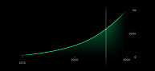

- **Original file:** `inspiration/0ff82b4ae563545ff24dee9034222f5b 1.png` (193x89 px, source folder: (root), batch-001 (inspiration.zip, 2026-10-13))
- **Category / subcategory:** ONS / stat-chart. **Style family:** DATA-GLOW. **Also useful for:** -
- **Tags:** exponential, growth-curve, green, cursor, years, minimal
- **Alternate copies:** none

**Observed (visible in the image)**
- **Visual description:** Black; thin green curve rising exponentially across years (2018…2026) with a vertical cursor line and dot at the knee; sparse axis labels.
- **Typography:** Tiny grey axis labels only (2018, 2026, 2028 and value ticks such as 500K) at the bottom and right edges; no headline.
- **Colour palette (measured, dominant first):** `#000000` 75.8%  `#03130B` 7.2%  `#000001` 6.2%  `#010302` 5.9%  `#0D3B25` 4.2%  `#010000` 0.7%
- **Composition:** The curve runs from the bottom-left nearly flat, then bends up steeply to the top-right; a vertical cursor line crosses the curve at ~60% of the width with a small node at the intersection.
- **Lighting & effects:** Green (#22C55E) line with a soft glow; the vertical cursor is a faint white gradient line fading at both ends; pure black background.
- **Depth & layering:** Flat 2D chart with no card or container.

**Inferred (creative interpretation - not visible in a still)**
- **Animation behaviour:** INFERRED: curve draws, cursor scrubs to current year with value label.
- **Suitable use cases:** Compounding and exponential growth, 'it starts slow then explodes', investing, habit or audience growth over years.
- **Technical recreation:** SVG path from an exponential function with a blurred duplicate for the glow; a cursor line and node positioned with getPointAtLength at the current year; draw the line with stroke-dashoffset, then scrub the cursor.

---

### ONS-038 - Shard Selection Cards (magenta / emerald) + Buttons

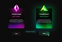

- **Original file:** `inspiration/153c095449f81b904e5f2c94a3c8a290 1.png` (122x83 px, source folder: (root), batch-001 (inspiration.zip, 2026-10-13))
- **Category / subcategory:** ONS / feature-cards-3d-icon. **Style family:** NEON-RIM. **Also useful for:** -
- **Tags:** cards, 3d-gem, magenta, green, selection, buttons, cursor, game-ui
- **Alternate copies:**
  - `assets/references/_alternates/ONS-038__alt1__153c095449f81b904e5f2c94a3c8a290_2.png` (original `inspiration/153c095449f81b904e5f2c94a3c8a290 2.png`, 105x73, same design, different resolution/crop, distance 17)

**Observed (visible in the image)**
- **Visual description:** Black; two cards topped by intensely glowing 3D shards (magenta crystal, green triangle prism) with matching glowing card bodies; 'Crimson shard', 'Emerald shard'; pill buttons below ('Choose shard'), cursor clicking green.
- **Typography:** Small bold white titles ('Crimson shard', 'Emerald shard') centred under each gem, a tiny coloured subtitle in the card's hue, and 3-4 lines of tiny grey body; below the cards, small rounded pill buttons with tiny labels, one reading 'Choose shard'. Most copy is illegible at this source size (122px wide).
- **Colour palette (measured, dominant first):** `#0C0C0C` 63.1%  `#1C2D26` 15.7%  `#090C0A` 7.7%  `#390C42` 7.7%  `#190818` 3.9%  `#0C0C0B` 1.9%
- **Composition:** Two portrait cards side by side, left-of-centre and right-of-centre, with a row of three dark pill buttons beneath spanning the gap; a cursor sits on the right (green) button. Cards fill ~60% of the frame width.
- **Lighting & effects:** Intensely saturated emissive light: the magenta gem floods its card with magenta from the bottom, the green gem floods its card with green; both cast coloured halos onto the black background. The selected button glows faintly green.
- **Depth & layering:** The gems sit above the cards' top edges (pop-out); the buttons and cursor are on the frontmost UI plane.

**Inferred (creative interpretation - not visible in a still)**
- **Animation behaviour:** INFERRED: cursor hovers, selected card brightens, other dims; button press.
- **Suitable use cases:** Choice or decision moments ('option A or option B'), picking a path, selecting a plan, game-like 'choose your reward' beats.
- **Technical recreation:** Two dark cards with an inner radial gradient in the gem colour (#E040FB, #22E37A) rising from the bottom, outer glow via box-shadow 0 0 60px of the same hue; gems as rendered or generated PNGs; pill buttons with a cursor PNG animated to click the chosen one.

> Note: Low-res source; near-duplicate copy also preserved.

---

### ONS-039 - Hand Holding Glowing Webflow Tile + Hire Cards

- **Original file:** `inspiration/162881353e3cbf69eb52f986aa3cdd0f 1.png` (199x112 px, source folder: (root), batch-001 (inspiration.zip, 2026-10-13))
- **Category / subcategory:** ONS / neon-icon-tile. **Style family:** NEON-RIM. **Also useful for:** -
- **Tags:** 3d-icon, hand, tile, blue, hire, cards, webflow
- **Alternate copies:** none

**Observed (visible in the image)**
- **Visual description:** Black; glowing blue 3D 'W' tile held/pressed by a dark hand silhouette above two dark horizontal cards ('Hire on Comma', 'Hire through Framer') with blue buttons.
- **Typography:** Small UI text only: tiny card titles 'Hire on Comma' and 'Hire through Framer', tiny body lines, small button labels; a tiny blue tag pill above the left card. The W logo on the tile is the only large glyph.
- **Colour palette (measured, dominant first):** `#000000` 50.6%  `#0A0B11` 19.9%  `#040408` 14.3%  `#283965` 7.3%  `#000002` 6.7%  `#010000` 1.2%
- **Composition:** Glowing tile top-centre, ~20% of frame width, held by a dark hand silhouette coming from below; a horizontal pair of wide dark cards spans the lower third across ~85% of the width.
- **Lighting & effects:** The tile emits strong blue bloom lighting the fingertips; the cards stay dark with faint borders and small blue buttons; black background.
- **Depth & layering:** Three layers: dark background, the hand and tile (the hand wraps behind and under the tile), and the cards on the front plane overlapping the hand's base.

**Inferred (creative interpretation - not visible in a still)**
- **Animation behaviour:** INFERRED: the tile ignites (bloom from 0 to full over 300ms) as the hand reaches it, then the two cards rise 20px into place with a 100ms stagger; the button on the recommended card pulses once.
- **Suitable use cases:** Recommending a platform or tool and then showing two ways to use it, 'where to hire/find X' explanations, tool callouts with options.
- **Technical recreation:** Tile as in ONS-010 (glass squircle, blue rim, bloom); hand as a cut-out PNG layer; cards per GLASS-DARK (dark rounded rects, 1px hairline, small blue buttons). Animate tile glow first, then cards.

---

### ONS-040 - Staking Widget Card with Violet Base Glow

- **Original file:** `inspiration/2a12fa03f4d7fe49b5db0a1ccc582c11 1.png` (171x212 px, source folder: (root), batch-001 (inspiration.zip, 2026-10-13))
- **Category / subcategory:** ONS / glass-ui-card. **Style family:** AURORA-GRADIENT. **Also useful for:** -
- **Tags:** widget, crypto, staking, form, toggle, violet, vertical
- **Alternate copies:** none

**Observed (visible in the image)**
- **Visual description:** Vertical dark frame; one compact widget card: 'Deposit amount 100 USDT', balance, staking period '1 year' with APY in green, auto-renew toggle in yellow; violet glow on lower edge.
- **Typography:** Tiny Inter UI throughout: field label 'Deposit amount', value '100' with a 'USDT' token chip, balance line, 'Staking period', '1 year' with a green APY percentage, and an 'Auto-renew' toggle in yellow. Barely legible at the 171px source size.
- **Colour palette (measured, dominant first):** `#0B0914` 70.2%  `#0D091A` 15.0%  `#201D3B` 11.6%  `#090912` 1.8%  `#0B0913` 0.9%  `#090615` 0.4%
- **Composition:** One compact card centred at ~50% of frame width, occupying the middle third of a tall dark frame; large empty margins above and below hold only tiny corner labels.
- **Lighting & effects:** A violet glow concentrates along the card's bottom edge and bleeds slightly below; the rest of the scene is near-black indigo with no other light.
- **Depth & layering:** Flat single card; the bottom glow makes it read as a lit slab hovering above the dark field.

**Inferred (creative interpretation - not visible in a still)**
- **Animation behaviour:** INFERRED: values type in, toggle flips, glow pulses on confirm.
- **Suitable use cases:** Showing an in-app action or form (deposit, settings, sign-up), crypto/fintech product demos, 'here is exactly what you click' moments.
- **Technical recreation:** GLASS-DARK card (#14141C at 90%, radius 16, 1px hairline) with an aurora strip: a blurred violet ellipse (#7C3AED, blur 30px) clipped to the bottom 20%; rows as flex with tiny labels; toggle as a pill with an animated knob.

---

### ONS-041 - Stacked Toast Notifications (blue/green/red)

- **Original file:** `inspiration/33fa82cc3dff24b9a1994a59d4e0376b 1.png` (104x78 px, source folder: (root), batch-001 (inspiration.zip, 2026-10-13))
- **Category / subcategory:** ONS / notification-stack. **Style family:** GLASS-DARK. **Also useful for:** -
- **Tags:** notifications, toast, stack, status, light-background
- **Alternate copies:** none

**Observed (visible in the image)**
- **Visual description:** Light grey-blue background; three stacked dark rectangular toast cards each with a coloured glowing dot (blue, green, red), a title, text and buttons.
- **Typography:** Tiny UI text: a bold title and 1-2 lines of body per toast, plus small button labels; illegible at the 104px source size, but the hierarchy (title, body, actions) is clear.
- **Colour palette (measured, dominant first):** `#D1D5E1` 63.2%  `#454758` 27.8%  `#D1D5E0` 4.7%  `#D8DCE8` 2.2%  `#A8D8CE` 1.9%  `#D2D5E0` 0.2%
- **Composition:** Three equal horizontal toast cards stacked vertically and centred, ~65% of frame width, with even gaps; each has a coloured status dot on the left and small buttons on the right.
- **Lighting & effects:** Each card carries a soft coloured glow from its status dot (blue, green, red) spreading across its left side; soft drop shadows separate the dark cards from the light grey-blue background.
- **Depth & layering:** Cards float above a light background with soft shadows; they do not overlap.

**Inferred (creative interpretation - not visible in a still)**
- **Animation behaviour:** INFERRED: toasts arrive from top pushing previous ones down; status colour pulses.
- **Suitable use cases:** Alerts, errors vs successes, system feedback, 'notifications flooding in'.
- **Technical recreation:** Flex column with 12px gaps; each toast a dark card (#1B1D24) with a radial gradient on the left in the status colour (#3B82F6 / #22C55E / #EF4444 at ~35%); enter each with translateY(-12px)→0 and opacity, 100ms stagger, pushing the previous ones down.

---

### ONS-042 - Cluster of Glowing Skill/Tool Pills

- **Original file:** `inspiration/40e15679fdb2c232bbc4c5d1b9e7f57c 1.png` (104x105 px, source folder: (root), batch-001 (inspiration.zip, 2026-10-13))
- **Category / subcategory:** ONS / tag-cluster. **Style family:** GLASS-DARK. **Also useful for:** -
- **Tags:** pills, tags, chips, cluster, icons, colourful, skills
- **Alternate copies:** none

**Observed (visible in the image)**
- **Visual description:** Black; 3 centred rows of small dark pill tags each with a coloured icon dot and label (Prototyping, Figma, UX research, etc.).
- **Typography:** Tiny white labels inside each pill (e.g. 'Prototyping', 'Figma', 'UX research') next to a small coloured icon dot; all the same small size and weight.
- **Colour palette (measured, dominant first):** `#000000` 85.9%  `#130E11` 3.8%  `#3C303B` 3.7%  `#6C7175` 2.9%  `#010001` 2.7%  `#000001` 1.0%
- **Composition:** A centred cloud of ~10 pills in three staggered rows (3-4-3), each row offset so the pills interlock like a word cloud; the cluster occupies the middle ~70% of the width on pure black.
- **Lighting & effects:** Each pill has a faint coloured glow and tinted border matching its icon colour (cyan, violet, yellow, red, green, pink), so the cluster reads as multicoloured light.
- **Depth & layering:** Flat. All pills sit on one plane with no overlap.

**Inferred (creative interpretation - not visible in a still)**
- **Animation behaviour:** INFERRED: pills pop in randomly-ordered but quick (30ms stagger), or highlight the ones mentioned.
- **Suitable use cases:** Listing skills, topics, keywords or tools quickly ('I use Figma, Framer, Notion...'), summarising what a video covers, or showing tags around a theme.
- **Technical recreation:** Flex-wrap centred pills; radius 999px; border 1px rgba(255,255,255,.12).

---

### ONS-043 - Onboarding Stepper + Glass Form under Warm Light Rays

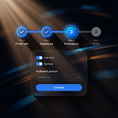

- **Original file:** `inspiration/4985b2422c9decddb6dd8b7d153a1daa 1.png` (145x146 px, source folder: (root), batch-001 (inspiration.zip, 2026-10-13))
- **Category / subcategory:** ONS / stepper-form. **Style family:** GLASS-DARK. **Also useful for:** -
- **Tags:** stepper, progress, steps, form, toggles, light-rays, amber, blue
- **Alternate copies:** none

**Observed (visible in the image)**
- **Visual description:** Dark scene with warm amber light rays from top-left and blue streaks; a horizontal 4-step stepper (two completed checks, step 3 active glowing blue, step 4 grey) above a glass form card with toggles (Full-time, Remote), dropdown and blue 'Continue' button.
- **Typography:** Inter-like UI: tiny step labels under each stepper circle (e.g. 'Profile info', 'Experience', 'Preference', 'Finish'), white check icons and the number '3' in the active circle; form card with small toggle labels 'Full-time', 'Remote', a field label, a dropdown and a 'Continue' button label.
- **Colour palette (measured, dominant first):** `#02060D` 23.0%  `#120F12` 18.9%  `#222023` 18.4%  `#483F3D` 15.6%  `#0A0A0D` 13.8%  `#6B7890` 10.4%
- **Composition:** Horizontal 4-step stepper across the top third (~75% of the width), connected by lines; a glass form card centred in the lower half, ~45% of the width.
- **Lighting & effects:** Volumetric warm rays + cool blue accents (complementary temperature).
- **Depth & layering:** Warm volumetric rays sit behind the card, cool blue streaks sweep around it, and the glass card floats in front with a soft shadow; the stepper is on the same front plane as the card.

**Inferred (creative interpretation - not visible in a still)**
- **Animation behaviour:** INFERRED: steps check off sequentially with connector line filling; active step glows.
- **Suitable use cases:** Processes and progress ('step 3 of 4'), onboarding or application flows, explaining where someone is in a journey.
- **Technical recreation:** Flex row of step circles (28px, done: solid #2563EB with a check, active: glowing ring, pending: grey) joined by 3px bars whose width animates to fill; card per GLASS-DARK with toggles and a blue button; background rays as rotated blurred gradients in amber (#F59E0B at 30%).

---

### ONS-044 - AI Mode Pill with Rainbow Edge + Contour Waves

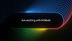

- **Original file:** `inspiration/49d4a6eeb07f324a4514cf8f58ef9ef9 1.png` (104x59 px, source folder: (root), batch-001 (inspiration.zip, 2026-10-13))
- **Category / subcategory:** ONS / input-bar. **Style family:** NEON-RIM. **Also useful for:** -
- **Tags:** ai, input, pill, rainbow-glow, contour-lines, search
- **Alternate copies:** none

**Observed (visible in the image)**
- **Visual description:** Black; large rounded pill 'Ask anything with AI Mode'; its border glows rainbow (blue top, red right, green/yellow bottom); concentric contour line waves ripple around it.
- **Typography:** One line of medium-weight white placeholder text 'Ask anything with AI Mode' centred inside the pill, ~4% of frame height.
- **Colour palette (measured, dominant first):** `#000305` 24.0%  `#0E1517` 21.4%  `#0A090C` 16.7%  `#1D303D` 13.3%  `#02070D` 13.1%  `#3E5D5F` 11.4%
- **Composition:** A large rounded pill centred, ~70% of frame width; concentric contour lines ripple outward to fill the whole frame around it.
- **Lighting & effects:** Multicolour edge glow along the pill border (blue on top, red on the right, yellow and green along the bottom), in a Google/Gemini-like palette, spilling onto nearby contour lines; black background.
- **Depth & layering:** Flat. The contour lines create an optical ripple suggesting depth or sound waves radiating from the pill.

**Inferred (creative interpretation - not visible in a still)**
- **Animation behaviour:** INFERRED: glow rotates around pill; contour lines ripple outward like sound waves when text appears.
- **Suitable use cases:** AI search or prompt moments, 'just ask the AI' tips, introducing an AI feature; especially for Google/Gemini-related content.
- **Technical recreation:** Conic-gradient border masked to ring + blur; SVG concentric rounded rects with animated scale/opacity.

---

### ONS-045 - $12B Market Card with Gradient Left Edge

- **Original file:** `inspiration/4aa8fbbde451348c87c32d54b26f9215 1.png` (105x105 px, source folder: (root), batch-001 (inspiration.zip, 2026-10-13))
- **Category / subcategory:** ONS / stat-chart-card. **Style family:** NEON-RIM. **Also useful for:** -
- **Tags:** stat, money, market-size, blue-gradient, squiggle-chart, wide-card
- **Alternate copies:** none

**Observed (visible in the image)**
- **Visual description:** Black; wide card with blue gradient left side fading to dark right: '$12B' huge white, small label; wavy red/blue line chart with a red dot at right.
- **Typography:** Bold large white numerals '$12B' (~25% of the card height) at the left, with a tiny label above and a tiny caption below; no other type.
- **Colour palette (measured, dominant first):** `#0C0C0C` 47.2%  `#0D0D0D` 25.6%  `#394673` 11.2%  `#09090B` 8.1%  `#0C0C18` 7.7%  `#0D0C0A` 0.2%
- **Composition:** One wide horizontal card centred at ~70% of frame width: the stat sits on the left half, a small wavy line chart on the right half ending in a red dot.
- **Lighting & effects:** The card's left side is filled with a bright blue gradient that fades to dark grey toward the right; the line chart is white/blue with a red accent point and a little glow.
- **Depth & layering:** Flat card on a dark background with a faint shadow.

**Inferred (creative interpretation - not visible in a still)**
- **Animation behaviour:** INFERRED: the card slides up and fades in, the number counts from $0 to $12B (700ms outExpo), and the line chart draws left to right, ending with the red dot popping in.
- **Suitable use cases:** Market size, funding amounts, big money statistics, 'this is a $12B industry' hooks.
- **Technical recreation:** Card background linear-gradient(90deg,#3B82F6 0%,#1E3A8A 35%,#0B0B0F 65%); radius 14; tabular-nums count-up; SVG polyline for the squiggle with a red (#EF4444) end node.

---

### ONS-046 - Milestone Area Chart with Icon Flags

- **Original file:** `inspiration/4d95cf3263572c1111df42cb1f7200dd 1.png` (154x95 px, source folder: (root), batch-001 (inspiration.zip, 2026-10-13))
- **Category / subcategory:** ONS / milestone-chart. **Style family:** DATA-GLOW. **Also useful for:** FUL
- **Tags:** milestones, journey, area-chart, crimson, icons, progression
- **Alternate copies:** none

**Observed (visible in the image)**
- **Visual description:** Charcoal; axes with an area chart rising from dark to crimson; four milestones as white icon tiles on vertical stems ('Fitness Test', 'Walking Test', 'Cycling Test', 'Running Test') at increasing heights.
- **Typography:** Tiny white labels under each milestone icon ('Fitness Test', 'Walking Test', 'Cycling Test', 'Running Test') and tiny grey axis titles.
- **Colour palette (measured, dominant first):** `#1E1E1E` 73.0%  `#463C42` 12.3%  `#261E21` 8.1%  `#181516` 4.5%  `#1C1E1D` 1.8%  `#1E1E1D` 0.2%
- **Composition:** An L-shaped axis frame; the area chart rises from the bottom-left to the top-right like an ascending staircase; four milestone flags (white icon tiles on thin vertical stems) stand at increasing heights along it.
- **Lighting & effects:** Area gradient runs from near-black at the left to crimson (#B5304A) at the right, brightest at the top edge; no glows, a matte dark charcoal background.
- **Depth & layering:** Flat 2D chart; the milestone stems rise in front of the area fill.

**Inferred (creative interpretation - not visible in a still)**
- **Animation behaviour:** INFERRED: area grows left→right; each flag rises when the area reaches it.
- **Suitable use cases:** Progression, levels, roadmaps or journeys ('first you do X, then Y'), fitness or skill progressions, stages of growth.
- **Technical recreation:** SVG area + clipPath reveal; flags positioned at data points.

---

### ONS-047 - Concentric Ecosystem Rings with Orbiting Device Icons

- **Original file:** `inspiration/54c278ca5113c6ac7f3f7d460e4e5461 1.png` (199x111 px, source folder: (root), batch-001 (inspiration.zip, 2026-10-13))
- **Category / subcategory:** ONS / ecosystem-diagram. **Style family:** DATA-GLOW. **Also useful for:** FUL
- **Tags:** ecosystem, orbit, rings, icons, user-centre, devices, diagram
- **Alternate copies:** none

**Observed (visible in the image)**
- **Visual description:** Black; concentric dark rings; centre glowing blue user tile 'A Future without Boundaries'; small device/app icons placed on rings with labels (Devices, Environment, Phone OS…).
- **Typography:** Tiny white labels around the rings ('Devices', 'Environment', 'Phone OS', and a small centred line 'A Future without Boundaries'); all very small relative to the frame.
- **Colour palette (measured, dominant first):** `#000000` 55.9%  `#091F31` 15.8%  `#010001` 10.6%  `#305572` 7.1%  `#05090E` 6.9%  `#000001` 3.8%
- **Composition:** Radial symmetry centred: a glowing blue user tile in the middle, a filled dark-blue inner disc, and two outer rings (one solid, one dashed) carrying ~14 small device/app icons evenly spaced.
- **Lighting & effects:** Blue glow concentrates in the centre tile and inner disc; the rings and icons are dim grey-blue on a black background.
- **Depth & layering:** Flat concentric rings with a subtle radial gradient that brightens toward the centre.

**Inferred (creative interpretation - not visible in a still)**
- **Animation behaviour:** INFERRED: rings expand from centre, icons orbit slowly into place.
- **Suitable use cases:** Ecosystems ('everything connects to you'), integrations around a central product, a person at the centre of their tools or devices.
- **Technical recreation:** SVG circles (one with stroke-dasharray for the dashed ring); icons positioned with rotate(angle) translate(radius) rotate(-angle) around the centre; centre tile with a blue radial glow; animate the rings scaling from 0.8 with an outward stagger, then a slow orbit.

---

### ONS-048 - Navigation Turn Widget (600 m) with Amber Road

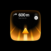

- **Original file:** `inspiration/5f7a27cbb67c14579779c861af5f8eb0 1.png` (105x105 px, source folder: (root), batch-001 (inspiration.zip, 2026-10-13))
- **Category / subcategory:** ONS / widget. **Style family:** NEON-RIM. **Also useful for:** -
- **Tags:** widget, navigation, maps, amber, road, arrow, app-icon
- **Alternate copies:** none

**Observed (visible in the image)**
- **Visual description:** Black; squircle widget with amber glowing perspective road and arrow, '600 m' and street text, small round buttons.
- **Typography:** Large medium-weight white '600 m' with a turn-arrow glyph, a tiny grey street line beneath, and a small round icon button top-right.
- **Colour palette (measured, dominant first):** `#000000` 64.8%  `#020001` 10.0%  `#E9AE4E` 8.4%  `#0E0904` 8.3%  `#73420D` 8.1%  `#000001` 0.4%
- **Composition:** A single squircle widget centred, ~65% of frame width, on black; text in the top third, a perspective road filling the lower two-thirds and converging toward the top.
- **Lighting & effects:** Warm amber emissive light: the road stripes and arrow glow orange-yellow (#FFB020) with bloom spilling onto the widget edges; the top of the widget is dark.
- **Depth & layering:** Strong one-point perspective inside a flat squircle, so the road appears to recede into the widget.

**Inferred (creative interpretation - not visible in a still)**
- **Animation behaviour:** INFERRED: road lines scroll toward viewer, distance counts down.
- **Suitable use cases:** Directions and 'next step' metaphors, travel or delivery topics, 'turn here' moments in a process explanation.
- **Technical recreation:** Squircle (radius 28%) with a dark top gradient; road as CSS perspective(400px) rotateX(60deg) on striped gradients scrolling via background-position; arrow as an SVG with a glow; colour #FFB020 to #FF7A00.

---

### ONS-049 - Known vs Unknown Info Curve with Focus Dot

- **Original file:** `inspiration/60aff4d7527c7ef7eba2a4318fd3bb26 1.png` (193x192 px, source folder: (root), batch-001 (inspiration.zip, 2026-10-13))
- **Category / subcategory:** ONS / stat-chart. **Style family:** DATA-GLOW. **Also useful for:** FUL
- **Tags:** line-chart, gold, focus-dot, known-unknown, dotted-region, concept
- **Alternate copies:** none

**Observed (visible in the image)**
- **Visual description:** Dark charcoal; wavy gold line crosses from a solid region into a dotted-grid region; at the transition a white dot with grey halo; labels 'KNOWN INFO' / 'UNKNOWN INFO' tracked caps.
- **Typography:** Tiny widely tracked bold caps 'KNOWN INFO' and 'UNKNOWN INFO' under the chart's left and right halves; no headline.
- **Colour palette (measured, dominant first):** `#121212` 76.8%  `#131213` 6.9%  `#2F2E28` 6.2%  `#0E0F10` 5.3%  `#111212` 3.4%  `#121210` 1.4%
- **Composition:** A wavy gold line enters from the left, crosses a central focus point and continues upward to the top-right; a grid of small dots fills the lower-right 'unknown' region; the focus dot sits at the centre of the frame.
- **Lighting & effects:** The gold line has a thin soft glow; the focus point is a white dot with a large translucent grey halo; dark charcoal background.
- **Depth & layering:** Flat. The halo and the dotted region add slight atmospheric depth.

**Inferred (creative interpretation - not visible in a still)**
- **Animation behaviour:** INFERRED: line draws to the dot, halo pulses, dotted future region fades in.
- **Suitable use cases:** Uncertainty, forecasting, 'beyond this point we don't know'.
- **Technical recreation:** SVG path in gold (#EAB308) with a blurred duplicate; a dot-grid pattern masked to the right half; a focus circle with a white core and a rgba(255,255,255,.15) halo; labels in caps at letter-spacing .3em.

---

### ONS-050 - Conversion 300% Card (green variant)

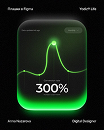

- **Original file:** `inspiration/7cfbfa0128d94931507a11faf9886b1e 1.png` (104x130 px, source folder: (root), batch-001 (inspiration.zip, 2026-10-13))
- **Category / subcategory:** ONS / stat-chart-card. **Style family:** NEON-RIM. **Also useful for:** -
- **Tags:** stat, percentage, bell-curve, green, neon-rim, vertical
- **Alternate copies:** none

**Observed (visible in the image)**
- **Visual description:** Vertical black; tall glass card with neon-green bottom rim; bell curve with glowing green peak node; 'Conversion rate 300%'; tiny corner labels.
- **Typography:** Large medium-weight white numerals '300%' centred in the lower third of the card, tiny grey labels above and below, tiny header text and a dropdown pill at the top, plus small corner credits outside the card.
- **Colour palette (measured, dominant first):** `#181D17` 26.3%  `#040404` 21.2%  `#020202` 19.5%  `#243722` 16.0%  `#40A14F` 8.8%  `#070807` 8.1%
- **Composition:** One tall card centred at ~65% of the frame width inside a vertical dark frame; bell curve in the upper half peaking at the centre, the stat beneath.
- **Lighting & effects:** Neon-green emissive rim (#22FF88) along the bottom edge and lower sides, flooding the lower third of the card with green light; the curve is bright green with a white-hot peak node.
- **Depth & layering:** A thick glass card: the green light pools inside the bottom of the glass, and the curve sits on an inner plane.

**Inferred (creative interpretation - not visible in a still)**
- **Animation behaviour:** INFERRED: same choreography as ONS-024. The card fades up, the curve draws to its peak (1.1s inOutCubic), the peak node flashes, and 300% counts up.
- **Suitable use cases:** The same uses as ONS-024; green signals positive results, money or health metrics.
- **Technical recreation:** templates/stat-card.html with accent #22E37A and glow rgba(34,227,122,.55); keep the bell-curve shape and a white peak node.

---

### ONS-051 - Habit Streak Widget (32 days, steps)

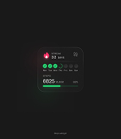

- **Original file:** `inspiration/8908dccb24e79f12b1b0c2c155c3f2ed 1.png` (171x197 px, source folder: (root), batch-001 (inspiration.zip, 2026-10-13))
- **Category / subcategory:** ONS / widget. **Style family:** GLASS-DARK. **Also useful for:** -
- **Tags:** widget, streak, habit, checkmarks, green, steps, progress
- **Alternate copies:** none

**Observed (visible in the image)**
- **Visual description:** Dark charcoal; small rounded widget with flame icon 'STREAK 32 days', weekday row of green check circles (some empty), 'STEPS 6825' with green progress bar.
- **Typography:** Tiny caps labels ('STREAK', 'STEPS'), medium numbers ('32 days', '6825'), and tiny weekday initials under the check circles.
- **Colour palette (measured, dominant first):** `#191919` 75.6%  `#1B191A` 16.1%  `#212421` 7.4%  `#171616` 0.4%  `#171918` 0.4%  `#191918` 0.0%
- **Composition:** One small widget centred, ~45% of frame width, on a dark charcoal background: flame icon and streak top-left, a row of 7 day circles in the middle, the steps figure with a progress bar at the bottom.
- **Lighting & effects:** Subtle green glow on the completed check circles and the progress fill; the flame is red-orange; otherwise a matte widget.
- **Depth & layering:** Flat widget with a 1px border and a slight inner highlight.

**Inferred (creative interpretation - not visible in a still)**
- **Animation behaviour:** INFERRED: checkmarks tick sequentially, streak number increments.
- **Suitable use cases:** Habits, consistency and streaks, daily routines, fitness tracking, 'don't break the chain' advice.
- **Technical recreation:** Flex row of 7 circles (completed: #22C55E fill with a white check SVG; pending: outline); progress bar with a green fill animated to the value; count the streak up as the checks tick on with a 60ms stagger.

---

### ONS-052 - Neon Dashboard Bento around Glowing Logo Tile

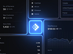

- **Original file:** `inspiration/96745c82bcb587272b23147ef6834c36 1.png` (149x110 px, source folder: (root), batch-001 (inspiration.zip, 2026-10-13))
- **Category / subcategory:** ONS / dashboard-bento. **Style family:** NEON-RIM. **Also useful for:** -
- **Tags:** dashboard, bento, metrics, blue, neon-border, logo, analytics
- **Alternate copies:** none

**Observed (visible in the image)**
- **Visual description:** Dark navy; dashboard panels with luminous blue borders around a central glowing blue logo tile; metric panels (No. of payments 59, New customers 17, Store visits 5,432, Total Revenue $169.03), list of payment methods/countries, small line chart.
- **Typography:** Small Inter UI: tiny metric labels ('No. of payments', 'New customers', 'Store visits', 'Total Revenue') with medium values (59, 17, 5,432, $169.03), a list of payment methods (CashApp, Bitcoin, Ethereum, Solana) and countries.
- **Colour palette (measured, dominant first):** `#0B0C10` 22.0%  `#0C121E` 20.7%  `#131C2F` 19.0%  `#233253` 16.3%  `#0E121B` 12.6%  `#4E7DC2` 9.4%
- **Composition:** Tight bento grid cropped by the frame edges, so it looks like a zoomed-in part of a larger dashboard; a square logo tile at the centre where four panels meet.
- **Lighting & effects:** Panel borders glow electric blue (#2F6BFF) and brighten toward the centre; the logo tile is the brightest element with a strong bloom; panels are dark navy.
- **Depth & layering:** Flat panels; the crop and the glowing seams imply a much larger interface beyond the frame.

**Inferred (creative interpretation - not visible in a still)**
- **Animation behaviour:** INFERRED: camera glides across dashboard (pan + slight zoom), metrics tick.
- **Suitable use cases:** Analytics or business overviews, 'all in one dashboard' product pitches, showing that money and data flow into one place.
- **Technical recreation:** Large HTML dashboard rendered bigger than frame; animate a camera transform.

---

### ONS-053 - Gold Net Worth Card with Amber Area Chart

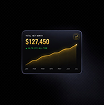

- **Original file:** `inspiration/98e70ea4fc831f051c022fc90293c3b3 1.png` (104x105 px, source folder: (root), batch-001 (inspiration.zip, 2026-10-13))
- **Category / subcategory:** ONS / stat-chart-card. **Style family:** GLASS-DARK. **Also useful for:** -
- **Tags:** net-worth, gold, amber, area-chart, wealth, glass-card
- **Alternate copies:** none

**Observed (visible in the image)**
- **Visual description:** Black textured; dark glass card 'TOTAL NET WORTH' '$127,450' in gold gradient, green delta, amber area chart rising; small gold icon top-right.
- **Typography:** Tiny grey caps label 'TOTAL NET WORTH', a bold figure '$127,450' in a gold/amber gradient (~18% of card height), a tiny green delta line beneath, and tiny month labels along the chart base; a small gold icon badge top-right.
- **Colour palette (measured, dominant first):** `#010102` 25.5%  `#0F0F13` 21.1%  `#030304` 16.3%  `#000000` 15.0%  `#08080B` 13.4%  `#2D2924` 8.8%
- **Composition:** One landscape card centred at ~60% of frame width: the stat block in the top-left third, a rising area chart across the lower half, generous dark margins around the card.
- **Lighting & effects:** Gold/amber (#F5B83D) glow on the numerals and the chart line; the area fill fades from translucent amber to transparent; the card has a faint silver border and a diagonal light gradient on a dark textured background.
- **Depth & layering:** Single glass card floating above a dark grid-textured field, with a soft shadow beneath.

**Inferred (creative interpretation - not visible in a still)**
- **Animation behaviour:** INFERRED: the card fades up 20px, the net-worth figure counts up from $0 (800ms outExpo), and the amber area rises from the baseline left to right (clip-path reveal, 900ms inOutCubic), ending with a small glow pulse on the last point.
- **Suitable use cases:** Wealth, net worth or portfolio talk, luxury/finance creators, 'this is what my savings look like now' proof moments.
- **Technical recreation:** GLASS-DARK card (#111114, 1px rgba(255,255,255,.12) border, radius 16); numerals with background-clip:text gradient #FFE08A→#E39B2B plus a 0 0 20px amber drop-shadow; SVG area with an amber linearGradient fading to 0 alpha.

---

### ONS-054 - Feature Card Carousel (centre lifted, sides dim)

- **Original file:** `inspiration/9f31a999fa992609e777b3dfbd7419f3 1.png` (169x169 px, source folder: (root), batch-001 (inspiration.zip, 2026-10-13))
- **Category / subcategory:** ONS / card-carousel. **Style family:** NEON-RIM. **Also useful for:** -
- **Tags:** carousel, feature-cards, navy, focus, blue-border
- **Alternate copies:** none

**Observed (visible in the image)**
- **Visual description:** Navy; three glass cards; centre 'Feature One' larger, blue-bordered, with pattern header image and body; 'Feature Two' and 'Feature Three' dim and recessed at sides.
- **Typography:** Medium-weight white sans title 'Feature One' on the centre card with a tiny caps tag 'FEATURE 1' above and 4 lines of small light body; side cards repeat the pattern ('Feature Two', 'Feature Three') at lower contrast.
- **Colour palette (measured, dominant first):** `#071945` 21.5%  `#020B2C` 20.0%  `#0D2354` 18.3%  `#021032` 18.0%  `#041239` 13.3%  `#29467D` 9.0%
- **Composition:** Three portrait cards: the centre card is largest and forward, the side cards are partially hidden behind it on either side; the group is centred with a navy vignette.
- **Lighting & effects:** The centre card has a bright blue rim (#3B82F6) and a patterned header image; the side cards are dim; a soft blue floor glow sits under the group.
- **Depth & layering:** Scale and opacity create depth: the side cards are smaller, dimmer and behind the centre card (a focus-pull carousel).

**Inferred (creative interpretation - not visible in a still)**
- **Animation behaviour:** INFERRED: the carousel advances on each spoken feature. The active card slides to the centre while scaling 0.85→1 and brightening (450ms inOutCubic), and the previous card recedes to the side and dims.
- **Suitable use cases:** Feature walkthroughs, step-by-step tips, presenting three offers where one is currently being discussed.
- **Technical recreation:** As ONS-011: three absolutely positioned cards animated together on translateX, scale and opacity; the centre card gets a 1.5px #3B82F6 border with a 0 0 30px glow.

---

### ONS-055 - Row of Dark Glass Icon Buttons with Blue Base Glow

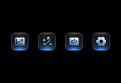

- **Original file:** `inspiration/a02fb3c0d32d9bc4010d6a6eadd6e4e0 1.png` (171x118 px, source folder: (root), batch-001 (inspiration.zip, 2026-10-13))
- **Category / subcategory:** ONS / icon-buttons. **Style family:** NEON-RIM. **Also useful for:** -
- **Tags:** icons, buttons, row, blue, glass, toolbar
- **Alternate copies:** none

**Observed (visible in the image)**
- **Visual description:** Black; four dark rounded glass buttons with white line icons (image, formula, code, gear), each with blue glow on bottom edge.
- **Typography:** No text: four white line icons only (image/chart, formula/variables, code brackets, gear).
- **Colour palette (measured, dominant first):** `#000000` 82.0%  `#232A34` 6.6%  `#000001` 4.4%  `#5D7CA2` 3.4%  `#0A0B0C` 3.0%  `#010000` 0.6%
- **Composition:** A centred horizontal row of four equal square buttons with even spacing, occupying ~70% of the frame width on pure black.
- **Lighting & effects:** Each button has a bright blue under-glow on its bottom edge and a subtle highlight on the top bevel; the icons are white with a faint blue tint.
- **Depth & layering:** Raised, bevelled glass buttons: an inner top highlight and a bottom glow make them look pressable and lifted off the background.

**Inferred (creative interpretation - not visible in a still)**
- **Animation behaviour:** INFERRED: buttons pop in left to right (scale 0.9→1, 80ms stagger); when a feature is mentioned its button presses (scale 0.95 then back) and its glow brightens.
- **Suitable use cases:** Quick lists of features or capabilities (charts, formulas, code, settings), toolbars, 'it can do all of this' moments.
- **Technical recreation:** Button 64px radius 16, inset highlight, bottom glow box-shadow 0 6px 16px rgba(59,130,246,.6).

---

### ONS-056 - Red Neon Timer Pill (20 seconds)

- **Original file:** `inspiration/aede9f2185475de59dddc57e598b16a0 1.png` (85x120 px, source folder: (root), batch-001 (inspiration.zip, 2026-10-13))
- **Category / subcategory:** ONS / timer. **Style family:** NEON-RIM. **Also useful for:** -
- **Tags:** timer, countdown, red, pill, progress-ring
- **Alternate copies:** none

**Observed (visible in the image)**
- **Visual description:** Dark top half (bottom half white — likely a crop artefact); a black pill with red neon gradient progress outline and '20 seconds' text.
- **Typography:** Small white bold number '20' with a tiny 'seconds' label inside the pill.
- **Colour palette (measured, dominant first):** `#0F1110` 45.3%  `#FFFFFF` 44.2%  `#030202` 6.9%  `#A6696F` 2.2%  `#4E1B1E` 0.8%  `#0E1311` 0.6%
- **Composition:** A single horizontal pill centred in the upper dark half of the frame; the bottom half of the source image is plain white (a crop artefact).
- **Lighting & effects:** A red neon gradient outline traces the pill border, brightest at the right end, with a soft red glow on dark grey.
- **Depth & layering:** Flat 2D: a single pill on a dark field; the red glow halo is the only depth cue.

**Inferred (creative interpretation - not visible in a still)**
- **Animation behaviour:** INFERRED: the red outline depletes around the pill as the countdown runs (stroke-dashoffset tied to time), the number ticks down each second, and the glow pulses on the final seconds.
- **Suitable use cases:** Time pressure ('in 20 seconds'), quick-tip countdowns, challenges, 'you only have X seconds to hook them'.
- **Technical recreation:** SVG rounded rect with a red gradient stroke (#FF3B3B→#FF7A7A), stroke-dasharray equal to the path length, dashoffset animated by the remaining time; text uses tabular-nums.

> Note: Source image is half white — probably cropped screenshot; only top half is design.

---

### ONS-057 - Finger Pressing Glowing MOZ Tile (variant)

- **Original file:** `inspiration/b2e09f8d911d5e1c88b5c4b57e49c3a0 1.png` (121x122 px, source folder: (root), batch-001 (inspiration.zip, 2026-10-13))
- **Category / subcategory:** ONS / neon-icon-tile. **Style family:** NEON-RIM. **Also useful for:** FUL
- **Tags:** 3d-icon, app-tile, neon-blue, hand, press, seo, tool-stack
- **Alternate copies:** none

**Observed (visible in the image)**
- **Visual description:** Same template as ONS-010: blue neon glass tiles (Telegram, MOZ centre, Canva) with a finger pressing the centre.
- **Typography:** No text other than the logos (Telegram plane, the 'MOZ' wordmark, Canva 'C') rendered as glowing white/blue glyphs on the tiles.
- **Colour palette (measured, dominant first):** `#010104` 24.4%  `#010412` 18.2%  `#020F2D` 18.0%  `#032563` 16.6%  `#010209` 13.2%  `#467BCB` 9.6%
- **Composition:** Three tiles in a row with the centre tile dominant and fully visible; the side tiles are cropped by the frame edges; a finger enters from the bottom-centre to press the centre tile.
- **Lighting & effects:** Strong electric-blue bloom from every tile rim, brightest on the pressed centre tile; blue light spills onto the finger; the background is a deep navy vignette.
- **Depth & layering:** Thick 3D glass tiles with bevels; the finger is in front of the centre tile, and the side tiles are slightly softer, implying depth of field.

**Inferred (creative interpretation - not visible in a still)**
- **Animation behaviour:** INFERRED: tiles slide in from the sides, the finger presses the centre tile (tile depresses 4-6px, glow flashes +40%, 250ms) and the side tiles dim.
- **Suitable use cases:** Tool callouts — evidence this template is reusable across tools.
- **Technical recreation:** See ONS-010: identical template, only the centre logo changes. That makes this a reusable 'tool callout' pattern.

---

### ONS-058 - Glass Capsules Row: Transparent to Bright Blue

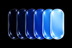

- **Original file:** `inspiration/b6eb02d848887942e8953d9c142405e7 1.png` (121x81 px, source folder: (root), batch-001 (inspiration.zip, 2026-10-13))
- **Category / subcategory:** ONS / material-progression. **Style family:** MATERIAL-ABSTRACT. **Also useful for:** FUL
- **Tags:** glass, capsules, progression, blue, gradient, 3d
- **Alternate copies:** none

**Observed (visible in the image)**
- **Visual description:** Black; six overlapping glossy glass capsules in a row, transitioning from dark transparent to bright saturated blue.
- **Typography:** No text in the image. If labels are needed, put small white Inter Medium step names or percentages under each capsule so the glass stays clean.
- **Colour palette (measured, dominant first):** `#000000` 47.5%  `#2E69C4` 14.5%  `#95CFFA` 13.4%  `#040F3B` 12.0%  `#000007` 10.3%  `#010000` 2.3%
- **Composition:** Six capsule shapes in a horizontal row, overlapping, centred and spanning ~75% of the frame width on black.
- **Lighting & effects:** Specular highlights on each glass capsule; emission increases from left (dark, transparent, rim only) to right (bright saturated blue), forming a light gradient across the row.
- **Depth & layering:** Overlapping 3D glass capsules, each in front of the previous one, creating a staggered depth stack.

**Inferred (creative interpretation - not visible in a still)**
- **Animation behaviour:** INFERRED: capsules fill with light one by one (progression/levels), slight slide-in.
- **Suitable use cases:** Progress levels, stages or tiers, 'from nothing to full', loading or charging metaphors, showing improvement over steps.
- **Technical recreation:** 3D render or CSS stacked rounded rects with gradients and highlights.

---

### ONS-059 - Segmented Gradient Ring Diagram (Opal)

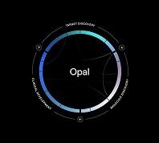

- **Original file:** `inspiration/b96b4823a11be2a70417b6868b17442d 1.png` (198x178 px, source folder: (root), batch-001 (inspiration.zip, 2026-10-13))
- **Category / subcategory:** ONS / ring-diagram. **Style family:** DATA-GLOW. **Also useful for:** -
- **Tags:** ring, cycle, segments, gradient, labels, process, circular
- **Alternate copies:** none

**Observed (visible in the image)**
- **Visual description:** Black; circular ring with segmented gradient (cyan→violet) and curved labels around (e.g. TARGET DISCOVERY, CLINICAL DEVELOPMENT…), small nodes on ring; centre word 'Opal'.
- **Typography:** A medium-weight white word 'Opal' in the centre (~6% of frame height); tiny tracked caps labels follow the ring's curve (e.g. 'TARGET DISCOVERY', 'CLINICAL DEVELOPMENT', 'MOLECULE DISCOVERY').
- **Colour palette (measured, dominant first):** `#000000` 86.2%  `#090A0C` 3.8%  `#000001` 3.3%  `#7FA7C0` 3.2%  `#354457` 3.0%  `#010000` 0.6%
- **Composition:** A centred circle diagram ~55% of the frame height: a thick segmented ring, thin arc lines inside connecting points, an outer thin ring with small node markers, and curved labels outside.
- **Lighting & effects:** The segmented ring has a gradient stroke (blue→cyan→violet→pink) with a soft glow; the inner arcs are faint grey; black background.
- **Depth & layering:** Flat 2D diagram; the inner connecting arcs sit faintly behind the bright segmented ring.

**Inferred (creative interpretation - not visible in a still)**
- **Animation behaviour:** INFERRED: ring segments draw clockwise, labels fade along; node travels around.
- **Suitable use cases:** Cycles, lifecycle stages, feedback loops, 'how the process repeats', or a platform covering every stage of a pipeline.
- **Technical recreation:** SVG arcs for each segment with a shared gradient stroke and blurred copy for glow; labels via <textPath> on a slightly larger circle; nodes as small circles at segment boundaries; draw the segments clockwise with stroke-dashoffset.

---

### ONS-060 - Linked Neon Rings Integration (Exa + MongoDB)

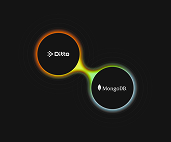

- **Original file:** `inspiration/bcd3072bb032ab0eecbf98dcda2aa87d 1.png` (171x142 px, source folder: (root), batch-001 (inspiration.zip, 2026-10-13))
- **Category / subcategory:** ONS / integration-link. **Style family:** NEON-RIM. **Also useful for:** -
- **Tags:** integration, rings, infinity, gradient, orange, green, logos, connect
- **Alternate copies:** none

**Observed (visible in the image)**
- **Visual description:** Charcoal; two neon rings linked in infinity shape with gradient (orange→yellow→green→cyan), logos 'Exa' and 'MongoDB' inside.
- **Typography:** Small white logo text inside each ring ('Exa' with its arrow mark, 'MongoDB' with its leaf mark).
- **Colour palette (measured, dominant first):** `#141414` 78.2%  `#151414` 9.8%  `#3B3825` 6.7%  `#131414` 3.3%  `#101112` 1.6%  `#141413` 0.3%
- **Composition:** Two rings of equal size placed on a diagonal (top-left and bottom-right) and touching, like an infinity sign, centred in the frame.
- **Lighting & effects:** Neon tube glow along the ring strokes, with a continuous gradient orange → yellow → green → cyan across both rings; a soft halo on the dark charcoal background.
- **Depth & layering:** Flat 2D; the neon halo around the tubes gives the only sense of volume.

**Inferred (creative interpretation - not visible in a still)**
- **Animation behaviour:** INFERRED: rings draw toward each other and fuse, light pulse travels the loop.
- **Suitable use cases:** Integrations ('X now connects with Y'), partnerships, 'X + Y' combinations, plugging two tools together.
- **Technical recreation:** Two SVG circles sharing one linearGradient stroke (#FF7A00→#FACC15→#22C55E→#22D3EE) with a blurred duplicate for glow; animate both strokes drawing toward the touch point, then a light pulse travelling around the loop.

---

### ONS-061 - Neumorphic Black Pills with Red Slider

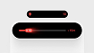

- **Original file:** `inspiration/bf348483722b9793a8f63336d0ef0b15 1.png` (105x59 px, source folder: (root), batch-001 (inspiration.zip, 2026-10-13))
- **Category / subcategory:** ONS / control-pill. **Style family:** NEUMORPHIC-LIGHT. **Also useful for:** -
- **Tags:** pill, slider, red, light-background, neumorphic, controls
- **Alternate copies:** none

**Observed (visible in the image)**
- **Visual description:** Light grey; two black pills (small with + and red dot, large slider with glowing red segment and label) on soft shadow.
- **Typography:** Tiny labels: a small plus icon and a tiny red figure in the top pill; a red numeric readout at the left and a small label at the right in the slider pill.
- **Colour palette (measured, dominant first):** `#EBEBEB` 50.9%  `#000000` 19.8%  `#E6E6E6` 10.8%  `#F2F2F2` 10.3%  `#090202` 6.1%  `#867473` 2.1%
- **Composition:** Two black pills stacked and centred: a small pill above and a wider pill below, ~70% of the frame width, on a light grey background.
- **Lighting & effects:** A glowing red segment (with a hot core) inside the large pill's track; soft grey drop shadows under both pills on the light background.
- **Depth & layering:** Raised neumorphic pills: large soft shadows make them float above the light surface.

**Inferred (creative interpretation - not visible in a still)**
- **Animation behaviour:** INFERRED: red slider moves; small pill expands into large one (morph).
- **Suitable use cases:** Recording, timer or volume metaphors, 'turn it up/down' moments, and UI morph transitions where a small control expands into a larger one.
- **Technical recreation:** Animate the small pill's width, height and border-radius into the large pill (shape morph, 500ms inOutCubic); the red segment is a blurred gradient bar (#FF2D2D) translated along the track; box-shadow 0 20px 40px rgba(0,0,0,.15).

---

### ONS-062 - Premium Banking Card with Lime Glossy Header

- **Original file:** `inspiration/c7b0197af44c65e37a93c53aaf7e64d1 1.png` (171x163 px, source folder: (root), batch-001 (inspiration.zip, 2026-10-13))
- **Category / subcategory:** ONS / glass-ui-card. **Style family:** NEON-RIM. **Also useful for:** -
- **Tags:** card, banking, lime, green, premium, 3d-thickness, toggle
- **Alternate copies:** none

**Observed (visible in the image)**
- **Visual description:** Pale mint background; thick black card with glossy lime-green gradient top area, '$80,600 TOTAL BALANCE', 'Premium Banking For Exclusive Clients', small toggle; visible card thickness with lime edge.
- **Typography:** Medium-weight white numerals '$80,600' top-right with a tiny 'TOTAL BALANCE' label; small white 'Premium Banking' over 'For Exclusive Clients' at mid-left; a small toggle bottom-right.
- **Colour palette (measured, dominant first):** `#DAE0D8` 33.5%  `#040503` 22.4%  `#E4E8DD` 18.1%  `#E1E6D7` 12.5%  `#B6E735` 8.3%  `#92B86A` 5.1%
- **Composition:** One thick card centred at ~70% of the frame width on a pale mint background; the glossy lime header occupies the top ~40% with a curved lower edge.
- **Lighting & effects:** Glossy specular reflections across the lime gradient (#B6F23A → deeper green); a lime edge light along the card's bottom thickness; soft overall daylight.
- **Depth & layering:** Visible 3D thickness: a lime-edged slab beneath the black face shows the card's depth, and there is a soft shadow on the light background.

**Inferred (creative interpretation - not visible in a still)**
- **Animation behaviour:** INFERRED: card rotates in (rotateY) to reveal thickness, settles.
- **Suitable use cases:** Premium or exclusive offers, banking and card products, 'level up' membership moments.
- **Technical recreation:** Two stacked divs (face + offset slab 10px below with a lime border) or a CSS 3D box; header as an SVG path with a lime linear gradient and a white specular streak at ~30% opacity.

---

### ONS-063 - Tilted Glass Pills Connected by Curves (flow)

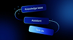

- **Original file:** `inspiration/d18968f2f832befac3fa9dba2eeabfa1 1.png` (106x59 px, source folder: (root), batch-001 (inspiration.zip, 2026-10-13))
- **Category / subcategory:** ONS / flow-pills. **Style family:** NEON-RIM. **Also useful for:** -
- **Tags:** flow, pills, connectors, 3d-tilt, blue, workflow
- **Alternate copies:** none

**Observed (visible in the image)**
- **Visual description:** Deep blue; three tilted blue glass pill labels stacked diagonally (e.g. 'Knowledge base', 'Assistant', 'Task list') joined by curved lines with dot nodes.
- **Typography:** Small white labels inside the pills (e.g. 'Knowledge base', 'Assistant', and a third label), medium weight; legible but small.
- **Colour palette (measured, dominant first):** `#000001` 26.2%  `#020E4B` 19.7%  `#09236C` 17.9%  `#010625` 15.6%  `#01020C` 12.9%  `#2F60A3` 7.8%
- **Composition:** Three pills in a diagonal cascade descending to the right, centred, connected by curved lines that loop out to the sides, with small dot nodes at the connection points.
- **Lighting & effects:** Pills are blue glass on a deep blue background; the bottom pill is the brightest (lighter cyan-blue), marking it as the active or final step.
- **Depth & layering:** Strong 3D perspective tilt: the whole group is rotated in space (rotateX/rotateZ), so the pills read as tilted slabs at different depths.

**Inferred (creative interpretation - not visible in a still)**
- **Animation behaviour:** INFERRED: pills appear sequentially with connector draw; active state moves down the chain.
- **Suitable use cases:** Workflows and pipelines (input → process → output), AI agent flows, 'first this, then that' explanations.
- **Technical recreation:** Group with CSS transform perspective(900px) rotateX(35deg) rotateZ(-12deg); pills as blue gradient rounded rects; SVG cubic connectors with small circle nodes; activate the pills sequentially by brightening each.

---

### ONS-064 - Minimal Glass Card with Spectrum Area Chart

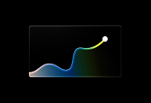

- **Original file:** `inspiration/d4efe908a68b779ff1ef3e8ffc045109 1.png` (193x131 px, source folder: (root), batch-001 (inspiration.zip, 2026-10-13))
- **Category / subcategory:** ONS / chart-card. **Style family:** DATA-GLOW. **Also useful for:** -
- **Tags:** area-chart, spectrum, gradient, glass-card, endpoint, minimal
- **Alternate copies:** none

**Observed (visible in the image)**
- **Visual description:** Black; thin-bordered glass card containing an area chart with spectrum gradient (blue→teal→yellow) ending in a white dot.
- **Typography:** No text in the image. When used, add a small grey label at the top-left of the card and an end value next to the white endpoint dot, in Inter.
- **Colour palette (measured, dominant first):** `#000000` 73.7%  `#020202` 9.8%  `#0B0D08` 7.8%  `#010001` 4.4%  `#2E4D56` 4.2%  `#000001` 0.1%
- **Composition:** A single landscape glass card centred, ~60% of the frame width; the area chart fills the card, rising from the left baseline to a peak near the top-right.
- **Lighting & effects:** The line runs a spectrum gradient (pink/peach → blue → teal → yellow) with a soft glow, ending in a white dot; the area fill is the same gradient at low opacity; a thin light border on a black background.
- **Depth & layering:** Flat card; the chart sits within the card plane.

**Inferred (creative interpretation - not visible in a still)**
- **Animation behaviour:** INFERRED: the card fades in, the line draws left to right (1s inOutCubic) with its colour shifting along the path, and the white endpoint dot pops in (scale 0→1, 200ms).
- **Suitable use cases:** A clean single-trend visual, 'things got better over time', transformation or journey arcs where the colour shift adds meaning.
- **Technical recreation:** SVG path with a linearGradient along x (#F9A8D4 → #3B82F6 → #14B8A6 → #FACC15); area fill as the same gradient at 25% opacity; endpoint circle in white with a soft glow; card border 1px rgba(255,255,255,.15).

---

### ONS-065 - Dark Pills with Neon Progress Rings (67%, $234)

- **Original file:** `inspiration/dcf7bd40848ef7edfe937b4a41d52773 1.png` (154x191 px, source folder: (root), batch-001 (inspiration.zip, 2026-10-13))
- **Category / subcategory:** ONS / progress-pills. **Style family:** NEUMORPHIC-LIGHT. **Also useful for:** -
- **Tags:** progress-ring, pills, green, magenta, light-background, kpi
- **Alternate copies:** none

**Observed (visible in the image)**
- **Visual description:** Light grey; two dark pills with neon ring gauges (green 67%, magenta $234) and small labels; big soft shadows; 'Figma Resource' footer.
- **Typography:** Medium-weight white numbers '67%' and '$ 234' next to their rings with tiny grey sub-labels; tiny site labels at the frame corners and a 'Figma Resource' footer.
- **Colour palette (measured, dominant first):** `#E8E8E8` 53.7%  `#DFDFDF` 21.9%  `#79787A` 15.3%  `#E1E8E5` 8.2%  `#ECECEC` 0.9%  `#E9E7E8` 0.0%
- **Composition:** Two dark pills stacked and centred on a light grey background, each with a ring gauge at the left and text at the right.
- **Lighting & effects:** Neon progress rings (green #22E37A, magenta #EC4899) with a slight glow; large soft grey shadows under the pills.
- **Depth & layering:** Raised neumorphic pills floating above the light surface.

**Inferred (creative interpretation - not visible in a still)**
- **Animation behaviour:** INFERRED: the pills slide up with a 100ms stagger, the rings sweep from 0 to their value (700ms outCubic) and the numbers tick up in sync.
- **Suitable use cases:** KPIs on bright or light footage, two quick metrics (completion rate and earnings), dashboards for light-theme videos.
- **Technical recreation:** Dark pill (#1F1F22, radius 999px, shadow 0 18px 40px rgba(0,0,0,.18)) containing an SVG ring (stroke-dasharray animated) and a two-line label; tabular-nums count-up.

---

### ONS-066 - Glass Card Pierced by Violet Light Beam

- **Original file:** `inspiration/dd181f578ad665fe1fcf27926e7fb0e4 1.png` (170x128 px, source folder: (root), batch-001 (inspiration.zip, 2026-10-13))
- **Category / subcategory:** ONS / glass-ui-card. **Style family:** NEON-RIM. **Also useful for:** FUL
- **Tags:** card, light-beam, violet, laser, circuit, transaction, speed
- **Alternate copies:** none

**Observed (visible in the image)**
- **Visual description:** Dark violet; glass card with faint icon and 'Quick-fire transactions'; a bright violet light beam shoots vertically through top and bottom of card; faint circuit lines.
- **Typography:** Small white text 'Quick-fire transactions' plus 2 lines of tiny body on the card's lower half; a faint watermark-like flame icon in the card's upper area.
- **Colour palette (measured, dominant first):** `#04030D` 21.9%  `#20155E` 20.7%  `#0B0825` 17.8%  `#160E42` 16.5%  `#080518` 16.0%  `#564794` 7.0%
- **Composition:** A square glass card centred; a vertical light beam enters from the top centre and exits from the bottom centre, aligning the card on the vertical axis.
- **Lighting & effects:** An intense violet-white beam with strong bloom; the card edges catch the light (bright rims at the top and bottom), with faint circuit-line traces in the dark violet background.
- **Depth & layering:** The beam passes through the card, in front at the top edge and continuing behind the bottom edge, giving a volumetric 'energy through the object' depth.

**Inferred (creative interpretation - not visible in a still)**
- **Animation behaviour:** INFERRED: beam fires down through card (energy transfer), card flashes.
- **Suitable use cases:** Speed and instant processing ('transactions in milliseconds'), power or energy moments, something being charged or activated.
- **Technical recreation:** Beam as a narrow vertical gradient rect (white core, #8B5CF6 edges) blurred 6px with mix-blend-mode: screen, plus a wider 40px-blur copy for bloom; card per GLASS-DARK with a violet rim; animate the beam's scaleY from 0 at the top through to the bottom (300ms), then flash the card.

---

### ONS-067 - Price Chart with Dotted Focus Ring (past/future split)

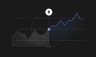

- **Original file:** `inspiration/ddf47eadf4696a57988e92ee0609ceab 1.png` (193x115 px, source folder: (root), batch-001 (inspiration.zip, 2026-10-13))
- **Category / subcategory:** ONS / stat-chart. **Style family:** DATA-GLOW. **Also useful for:** -
- **Tags:** line-chart, focus-ring, crypto, eth, cursor, past-future
- **Alternate copies:** none

**Observed (visible in the image)**
- **Visual description:** Charcoal; grey area chart (past) transitions to a violet line (future) at a node encircled by a dotted circle; vertical cursor line with ETH icon on top.
- **Typography:** No readable text: only an ETH icon in a white circle at the top of the vertical cursor line.
- **Colour palette (measured, dominant first):** `#1A1A1A` 69.6%  `#2B2C31` 14.6%  `#1A1A1D` 10.8%  `#171717` 2.8%  `#191A1A` 1.8%  `#1A1A18` 0.4%
- **Composition:** A line chart spanning the width; a dotted circle centred on one node at the middle of the frame, with a vertical cursor line from the icon at the top through the node.
- **Lighting & effects:** Past data is a grey area chart; future data is a brighter blue/violet line; the focus node glows blue; dark charcoal background.
- **Depth & layering:** Flat 2D chart; the dotted focus ring and the vertical cursor sit on top of the line.

**Inferred (creative interpretation - not visible in a still)**
- **Animation behaviour:** INFERRED: the cursor scrubs along the timeline, the dotted ring rotates slowly around the node (10s loop), and the colour shifts from grey to violet at the node to mark 'now'.
- **Suitable use cases:** Turning points ('this is where it changed'), markets and prices, past vs future predictions.
- **Technical recreation:** SVG: grey area path for the past and a violet polyline for the future; dotted circle (stroke-dasharray 2 6) with a CSS rotate animation; vertical line and icon positioned at the node's x.

---

### ONS-068 - Violet Finance Dashboard (gauge, line, hatched bars)

- **Original file:** `inspiration/e59785be9da20887c4e2d29fde70dd79 1.png` (121x144 px, source folder: (root), batch-001 (inspiration.zip, 2026-10-13))
- **Category / subcategory:** ONS / dashboard-bento. **Style family:** GLASS-DARK. **Also useful for:** -
- **Tags:** dashboard, violet, gauge, bar-chart, hatched, percentages
- **Alternate copies:** none

**Observed (visible in the image)**
- **Visual description:** Dark violet vertical; intro text; bento with line chart card, gauge '68%', and bar chart where highlighted bar has diagonal hatch pattern and tooltips 15%/40%/60%/25%.
- **Typography:** Small Inter UI: an intro paragraph at the top in small grey; '68%' figures with tiny labels in two cards; tiny chart title 'Income vs Expense Ratio'; small percentage tooltips (15%, 40%, 60%, 25%) above the bars.
- **Colour palette (measured, dominant first):** `#040011` 39.9%  `#110D1C` 38.3%  `#4C3D6C` 11.4%  `#02010A` 4.3%  `#100C1B` 3.2%  `#0B0716` 3.0%
- **Composition:** A vertical layout: intro text at the top, a 2-card row (line chart card and gauge card), then a wide bar-chart card below; essentially a 2x2 bento in a tall frame.
- **Lighting & effects:** Violet fills (#8B5CF6) on a dark violet-black background; the highlighted bar uses a diagonal hatch pattern; no strong glows.
- **Depth & layering:** Flat cards with subtle borders.

**Inferred (creative interpretation - not visible in a still)**
- **Animation behaviour:** INFERRED: cards fade up with a stagger, the bars grow from the baseline (60ms stagger), the gauge sweeps to 68%, and the hatch pattern on the highlighted bar scrolls slowly to draw attention.
- **Suitable use cases:** Budget or expense breakdowns, personal finance ratios, 'where my money goes' explanations.
- **Technical recreation:** SVG <pattern> with diagonal lines for the hatched bar; bars as rounded rects; gauge as an SVG arc with stroke-dasharray; tooltip pills positioned above the bars.

---

### ONS-069 - Green-Glow Hiring Feature Cards

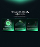

- **Original file:** `inspiration/f2bfd46694994778aafef1f91b637430 1.png` (82x97 px, source folder: (root), batch-001 (inspiration.zip, 2026-10-13))
- **Category / subcategory:** ONS / feature-cards. **Style family:** AURORA-GRADIENT. **Also useful for:** FUL
- **Tags:** cards, green, teal, hiring, radar, features, trio
- **Alternate copies:** none

**Observed (visible in the image)**
- **Visual description:** Dark teal; heading 'Hiring with Classify is simple'; three glass cards glowing green (radar ring icon, envelope, list/settings).
- **Typography:** A medium-weight white two-line heading 'Hiring with Classify is simple' centred near the top (one word replaced by a small circular icon inline), a tiny grey sub-line, and tiny 2-line captions inside each card. Very low-res source (82x97), so the small copy is illegible.
- **Colour palette (measured, dominant first):** `#071015` 32.1%  `#081115` 29.8%  `#0B1D1B` 14.8%  `#346D57` 12.6%  `#051012` 6.8%  `#050B0F` 3.9%
- **Composition:** Vertical frame: heading in the upper third, then a row of three equal cards across ~90% of the width in the middle; the lower third is empty dark teal. A green glow arc crowns the top edge of the frame.
- **Lighting & effects:** Each card emits a green (#22E37A) glow from its lower half and its icon (a radar ring, an envelope with dots, a list), so the trio reads as three green light boxes on dark teal.
- **Depth & layering:** Flat cards side by side; the green glow spills slightly beyond each card.

**Inferred (creative interpretation - not visible in a still)**
- **Animation behaviour:** INFERRED: the heading fades in, then the cards ignite left to right (glow 0→1, 150ms stagger) as each step is named; the radar ring in card 1 pulses outward.
- **Suitable use cases:** Three-step processes ('post, get inquiries, hire'), product feature trios, simple 'how it works' explanations.
- **Technical recreation:** As ONS-009/ONS-017 aurora cards in a green palette: dark teal cards (#0B1F1C) with a blurred #22E37A blob clipped to the lower half, a 1px rgba(34,227,122,.35) border and a small icon in the upper half.

---

### ONS-070 - Energy Area Chart with Draggable Nodes

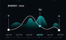

- **Original file:** `inspiration/f4f628f1ebf51b1e5616ead5cd4d6e8d 1.png` (112x69 px, source folder: (root), batch-001 (inspiration.zip, 2026-10-13))
- **Category / subcategory:** ONS / chart-card. **Style family:** DATA-GLOW. **Also useful for:** -
- **Tags:** area-chart, teal, nodes, handles, value-label, dates
- **Alternate copies:** none

**Observed (visible in the image)**
- **Visual description:** Dark teal; 'ENERGY' title; teal gradient peaks; smooth white curve with white handle nodes; highlighted cyan node with value '60' and vertical line; date axis with highlighted date.
- **Typography:** Small caps title 'ENERGY' with a tiny unit at the top-left, a value '60' above the highlighted node, and tiny date labels along the axis with the active date in cyan.
- **Colour palette (measured, dominant first):** `#060B0F` 36.2%  `#070A0F` 29.8%  `#1B3A3D` 12.7%  `#04060A` 8.0%  `#080B0F` 6.8%  `#050B0F` 6.4%
- **Composition:** The chart fills the card: overlapping teal area peaks across the width, a smooth white curve weaving through them with white handle nodes at both ends and a cyan highlighted node at the centre, and a vertical marker line above that node.
- **Lighting & effects:** Teal areas are translucent with gradients that brighten at their peaks; the white curve is crisp; the cyan node glows; the background is dark teal-black.
- **Depth & layering:** Layered areas: several translucent teal peaks overlap, giving a soft sense of depth behind the white curve, which sits on top.

**Inferred (creative interpretation - not visible in a still)**
- **Animation behaviour:** INFERRED: the areas rise from the baseline, the curve draws in, then the highlighted node slides to the current date with the value label updating and the date label turning cyan.
- **Suitable use cases:** Levels over time (energy, mood, focus, sleep), daily routines, 'my energy peaks here' explanations.
- **Technical recreation:** SVG with 3-4 overlapping area paths (#14B8A6 at 25-40% opacity with vertical gradients), a smooth cubic white path with endpoint handles, and a cyan node with a vertical line positioned via getPointAtLength.

---

### ONS-071 - Holder → Proof → Applications Node Flow

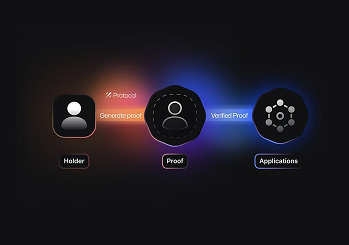

- **Original file:** `inspiration/image 106 1.png` (349x245 px, source folder: (root), batch-001 (inspiration.zip, 2026-10-13))
- **Category / subcategory:** ONS / flow-diagram. **Style family:** GLASS-DARK. **Also useful for:** -
- **Tags:** flow, nodes, avatars, pills, verification, pastel-glow
- **Alternate copies:** none

**Observed (visible in the image)**
- **Visual description:** Charcoal; three nodes left→right: 'Holder' avatar tile → pill 'Generate proof' → 'Proof' dashed circle avatar → pill 'Verified Proof' → 'Applications' cluster node; pastel red and blue glows between nodes; label tags under nodes.
- **Typography:** Tiny white labels in dark rounded tags under each node ('Holder', 'Proof', 'Applications'); tiny labels on the connector pills ('Generate proof', 'Verified Proof') and a tiny 'Protocol' tag above the first connector.
- **Colour palette (measured, dominant first):** `#111113` 47.9%  `#121115` 27.4%  `#2C2532` 19.3%  `#0D0E10` 2.6%  `#101113` 2.3%  `#111112` 0.6%
- **Composition:** A horizontal pipeline centred across ~85% of the width: three nodes (an avatar square, a dashed-circle avatar, a hexagonal cluster) joined by two connector pills, with equal spacing and labels below.
- **Lighting & effects:** Soft coloured glows behind the connectors: warm red/pink between nodes 1 and 2, cool blue/violet between nodes 2 and 3, suggesting data changing state; dark charcoal background.
- **Depth & layering:** Flat 2D flow; the glows sit behind the nodes and pills.

**Inferred (creative interpretation - not visible in a still)**
- **Animation behaviour:** INFERRED: a light packet travels left to right along the pipeline; each node activates (border brightens, scale 1→1.05) as the packet arrives, and the connector glow follows the packet.
- **Suitable use cases:** Explaining a process ('how something works', input → verification → output), identity or verification flows, data pipelines.
- **Technical recreation:** Flex row of node tiles (64px, dark with a 1px border) and connector pills; radial-gradient glows (#F87171 and #6366F1 at 35%, blur 30px) behind the connectors; animate a small bright dot along each connector with translateX.

---

### ONS-072 - Grow Card with Orange Orbit Diagram

- **Original file:** `inspiration/image 110 1.png` (398x399 px, source folder: (root), batch-001 (inspiration.zip, 2026-10-13))
- **Category / subcategory:** ONS / glass-ui-card. **Style family:** GLASS-DARK. **Also useful for:** -
- **Tags:** card, orbit, orange, investment, icons, dotted-bg
- **Alternate copies:** none

**Observed (visible in the image)**
- **Visual description:** Dark dotted background with strong orange/amber gradient glow from bottom-left; dark glass card 'Grow' + body; orbit rings with central orange '+' node and icon satellites.
- **Typography:** Medium-weight white title 'Grow' top-left of the card and 3 lines of small grey body ('We specialize in maximizing your investment potential across cash assets, ETFs, and cryptocurrencies.'); no other type.
- **Colour palette (measured, dominant first):** `#030202` 22.5%  `#47230F` 22.1%  `#121010` 16.2%  `#2D160A` 14.3%  `#D96D1E` 13.1%  `#88380E` 11.8%
- **Composition:** A portrait card centred, ~70% of the frame width, with the title and body in the top quarter and a centred orbit diagram (2 rings, a central node and 6 icon satellites) filling the lower two-thirds.
- **Lighting & effects:** A warm orange/amber gradient glow rises from the bottom-left of the frame behind the card and bleeds around its edges; the central '+' node is bright orange with a halo; the orbit rings are thin orange lines; a dotted dark background.
- **Depth & layering:** The card sits over the glowing background like frosted dark glass; the orbit diagram is inside the card plane.

**Inferred (creative interpretation - not visible in a still)**
- **Animation behaviour:** INFERRED: the card fades up, the rings draw in, the satellites orbit slowly (20s loop), and the centre node pulses once as 'grow' is said.
- **Suitable use cases:** Growth or investment topics, diversified portfolios, an ecosystem around one core idea; a warm alternative to the default blue.
- **Technical recreation:** Card per GLASS-DARK (rgba(20,16,14,.85), radius 20); background radial-gradient at bottom-left (#FF6A00 → transparent 60%); SVG orbit rings with small icon circles rotated around the centre; centre node #FF5A1F with a glow.

---

### ONS-073 - Framer vs Webflow Tiles + Search Pill

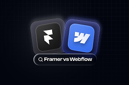

- **Original file:** `inspiration/image 112 1.png` (262x173 px, source folder: (root), batch-001 (inspiration.zip, 2026-10-13))
- **Category / subcategory:** ONS / versus-tiles. **Style family:** NEON-RIM. **Also useful for:** -
- **Tags:** versus, comparison, app-icons, search, grid-bg, tilt
- **Alternate copies:** none

**Observed (visible in the image)**
- **Visual description:** Dark navy grid; two glossy app tiles (Framer black, Webflow blue) overlapping and tilted; below, a search pill 'Framer vs Webflow'.
- **Typography:** A medium-weight white label 'Framer vs Webflow' inside a dark search pill with a magnifier icon, ~6% of frame height; the logos are the only other marks.
- **Colour palette (measured, dominant first):** `#040711` 26.8%  `#0A0D17` 17.6%  `#02050E` 16.8%  `#03060F` 15.3%  `#27293C` 14.5%  `#667AAF` 9.0%
- **Composition:** Two app tiles overlapping in the upper-middle (Framer black on the left, Webflow blue on the right), both slightly tilted; the search pill is centred beneath them; navy grid background.
- **Lighting & effects:** Glossy highlights on both tiles (light from the top-left), a faint glow around the blue tile, and a subtle grid on the background.
- **Depth & layering:** The tiles overlap with the Webflow tile in front, both tilted in opposite directions, and the pill sits on the front plane.

**Inferred (creative interpretation - not visible in a still)**
- **Animation behaviour:** INFERRED: tiles slide in from both sides and collide/overlap; search text types.
- **Suitable use cases:** Comparison videos (tool A vs tool B), 'which should you choose' hooks, search-intent framing.
- **Technical recreation:** Two squircles (radius 26%) rotated -8deg and +6deg with a slight overlap; the black tile with a grey border and the blue tile with a #3B82F6 gradient; search pill with a typed text animation.

---

### ONS-074 - Sales $63,921 Card with Blue Sheen and Glow Bars

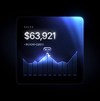

- **Original file:** `inspiration/image 114 1.png` (127x128 px, source folder: (root), batch-001 (inspiration.zip, 2026-10-13))
- **Category / subcategory:** ONS / stat-chart-card. **Style family:** NEON-RIM. **Also useful for:** -
- **Tags:** sales, card, blue, sheen, area-chart, tooltip
- **Alternate copies:** none

**Observed (visible in the image)**
- **Visual description:** Black; glass card with blue light sheen top-right; 'SALES' '$63,921' white; glowing blue area/bar chart with tooltip.
- **Typography:** Tiny caps label 'SALES', large medium-weight white figure '$63,921' (~15% of card height) and a tiny grey sub-line; a tiny tooltip pill above the chart's peak.
- **Colour palette (measured, dominant first):** `#000000` 35.5%  `#111837` 17.9%  `#02040B` 13.4%  `#080B19` 12.4%  `#010103` 11.6%  `#455C9C` 9.2%
- **Composition:** A square card centred, ~65% of frame width: the stat in the top-left, a glowing bar/area chart filling the lower half.
- **Lighting & effects:** A blue light sheen sweeps across the card's top-right corner like a reflection; the chart is luminous blue with bright tips and a glowing peak marker; black background.
- **Depth & layering:** A glass card with a sheen implying a light source at the upper right; the chart sits inside the card.

**Inferred (creative interpretation - not visible in a still)**
- **Animation behaviour:** INFERRED: the card fades up, the sheen sweeps across once, the figure counts up from $0, and the bars rise left to right with a 30ms stagger before the tooltip pops on the peak.
- **Suitable use cases:** Revenue numbers, sales milestones, 'this month we made...' moments.
- **Technical recreation:** As ONS-019 but in blue: card background radial-gradient at 90% 0% (rgba(59,130,246,.45) → transparent 55%) over #0A0C14; SVG bars with a blue vertical gradient and glow.

---

### ONS-075 - Neon Lightning Bolt from Frosted Folder (Supercharged)

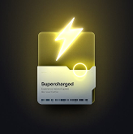

- **Original file:** `inspiration/image 115 1.png` (164x165 px, source folder: (root), batch-001 (inspiration.zip, 2026-10-13))
- **Category / subcategory:** ONS / hero-icon-card. **Style family:** NEON-RIM. **Also useful for:** FUL
- **Tags:** lightning, neon, yellow, folder, frosted, energy
- **Alternate copies:** none

**Observed (visible in the image)**
- **Visual description:** Dark olive; neon yellow lightning bolt emerging from a frosted card/folder labelled 'Supercharged'; yellow glow ring.
- **Typography:** A medium-weight dark label 'Supercharged' on the frosted card, with 2 lines of tiny body and a tiny barcode-like strip along the bottom.
- **Colour palette (measured, dominant first):** `#131317` 20.9%  `#413B21` 20.7%  `#26231C` 16.8%  `#1C1B19` 16.4%  `#837C45` 13.8%  `#D9D89F` 11.4%
- **Composition:** Centred: a frosted card/folder in the middle with a large neon yellow lightning bolt bursting out of its top edge, and a small yellow ring on the card's right side.
- **Lighting & effects:** Neon yellow emissive bloom from the bolt and ring lights the frosted card and turns the dark olive background yellow-green.
- **Depth & layering:** The bolt is in front of and above the card, as if leaping out of a pocket; the card has a light frosted surface.

**Inferred (creative interpretation - not visible in a still)**
- **Animation behaviour:** INFERRED: the bolt strikes up out of the folder (scale 0.6→1 with a fast flicker, 200ms), the bloom flashes, and the ring pulses outward once.
- **Suitable use cases:** Boosts, speed or power-ups, 'supercharge your workflow', energy and productivity moments.
- **Technical recreation:** SVG bolt path filled #FDE047 with layered drop-shadows (0 0 20px, 0 0 60px #FACC15); a frosted card (rgba(255,255,255,.75) with backdrop blur) clipped like a pocket; a ring as an SVG circle stroke.

---

### ONS-076 - Dreamer App Icon (violet glass squircle)

- **Original file:** `inspiration/image 116 1.png` (115x115 px, source folder: (root), batch-001 (inspiration.zip, 2026-10-13))
- **Category / subcategory:** ONS / app-icon-illustration. **Style family:** NEON-RIM. **Also useful for:** -
- **Tags:** app-icon, illustration, violet, glass, dreamer, moon
- **Alternate copies:** none

**Observed (visible in the image)**
- **Visual description:** Dark violet; large glass squircle icon with bevelled violet rim; inside a white person silhouette looking at a moon and sparkle star.
- **Typography:** No text in the image. Pair it with a caption from System B (for example, an italic serif word like 'dream') beneath the icon rather than text inside it.
- **Colour palette (measured, dominant first):** `#1C173B` 21.6%  `#2C214F` 18.4%  `#070617` 17.4%  `#0C0B22` 17.4%  `#120F2F` 16.9%  `#8B7CAD` 8.3%
- **Composition:** A single large squircle app icon centred, ~60% of the frame width, on a dark violet diagonal-textured background.
- **Lighting & effects:** A violet rim glow along the icon's bevel; inside, a white person silhouette looks up at a pale moon with small sparkle stars; soft violet ambient light.
- **Depth & layering:** A thick bevelled glass icon: an inner shadow and rim highlight give it volume, and the silhouette sits on an inner plane.

**Inferred (creative interpretation - not visible in a still)**
- **Animation behaviour:** INFERRED: the icon scales in from 0.9 with blur clearing (400ms outQuart), the moon brightens, and the star twinkles in a slow loop.
- **Suitable use cases:** Dreams, vision or ambition topics, 'imagine where you could be', personal-growth hooks.
- **Technical recreation:** Squircle (radius 28%) with a violet gradient (#4C1D95 → #1E1B4B), inset 0 2px 0 rgba(255,255,255,.25) and an outer glow; silhouette and moon as an SVG illustration in white/lavender.

---

### ONS-077 - Checklist Rows Fading into Blur

- **Original file:** `inspiration/image 124 1.png` (212x146 px, source folder: (root), batch-001 (inspiration.zip, 2026-10-13))
- **Category / subcategory:** ONS / checklist. **Style family:** GLASS-DARK. **Also useful for:** -
- **Tags:** checklist, tasks, blur, blue-glow, progress
- **Alternate copies:** none

**Observed (visible in the image)**
- **Visual description:** Dark with blue glow on left; three glass checklist rows ('Automated testing' checked, 'Initial usability assessment', 'Updating the doc…'), progressively blurred/faded to the right/bottom.
- **Typography:** Medium-weight white row labels ('Automated testing' with a checked box, 'Initial usability assessment', 'Updating the documentation...'), each with a checkbox on its left.
- **Colour palette (measured, dominant first):** `#0C0C0E` 54.0%  `#385270` 26.8%  `#0D0C10` 17.4%  `#0A0A0D` 1.4%  `#0A0C10` 0.3%  `#0C0C0D` 0.1%
- **Composition:** Three glass rows staggered diagonally from the upper-middle to the lower-left, with a fourth row cropped at the bottom; text runs off the right side.
- **Lighting & effects:** Blue light emanates from the lower-left corner, lighting the rows from below; the far rows fade into darkness.
- **Depth & layering:** Depth of field: the top row is sharp and the rows further down progressively blur and fade, as if receding from the camera.

**Inferred (creative interpretation - not visible in a still)**
- **Animation behaviour:** INFERRED: items check off one by one with focus shifting row to row.
- **Suitable use cases:** To-do lists and checklists, steps being completed, project progress, 'here's what we did' summaries.
- **Technical recreation:** Rows as glass tiles (rgba(20,24,34,.8), 1px border) with filter: blur(n×1.5px) and opacity 1−n×0.2 per index; the checkbox fills with a check-draw animation; a blue radial glow at the bottom-left.

---

### ONS-078 - Glowing Violet 'Generate Ad' Button Click (video frame)

- **Original file:** `inspiration/videoframe_1891 1.png` (68x46 px, source folder: (root), batch-001 (inspiration.zip, 2026-10-13))
- **Category / subcategory:** ONS / button. **Style family:** NEON-RIM. **Also useful for:** -
- **Tags:** button, cta, violet, click, cursor, video-frame
- **Alternate copies:** none

**Observed (visible in the image)**
- **Visual description:** Dark violet vignette; glowing violet pill button 'Generate Ad' with a sparkle icon and cursor clicking (frame from a video).
- **Typography:** A medium-weight white label inside the pill ('Generate Ad' per the original analysis; illegible at this 68x46 video-frame resolution) beside a small sparkle icon.
- **Colour palette (measured, dominant first):** `#180C2F` 21.0%  `#241443` 19.5%  `#351D69` 16.9%  `#14072A` 16.3%  `#120527` 16.0%  `#7345DA` 10.3%
- **Composition:** A single pill button centred in the frame with a cursor touching its lower-right edge; dark violet vignette all around.
- **Lighting & effects:** Violet bloom radiates from the button (#7C3AED/#8B5CF6), brightest at its centre, fading to near-black at the frame edges.
- **Depth & layering:** Flat; the cursor sits in front of the button.

**Inferred (creative interpretation - not visible in a still)**
- **Animation behaviour:** INFERRED: this is a frame from a video, captured mid-click. A plausible sequence: the cursor glides in, the button presses (scale 0.96, 100ms), the glow flashes, and a ripple expands.
- **Suitable use cases:** CTA or 'one click' moments, AI-generation features ('generate with one click'), demonstrating an action in an app.
- **Technical recreation:** Pill button with a violet gradient and box-shadow 0 0 40px rgba(139,92,246,.6); a cursor PNG animated along a short curved path; press timeline with scale and glow keyframes.

> Note: Low-res video frame.

---

### ONS-079 - Location Map Widget (Brooklyn coordinates) (video frame)

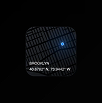

- **Original file:** `inspiration/videoframe_2826 1.png` (102x103 px, source folder: (root), batch-001 (inspiration.zip, 2026-10-13))
- **Category / subcategory:** ONS / widget. **Style family:** GLASS-DARK. **Also useful for:** -
- **Tags:** widget, map, location, blue-dot, coordinates, video-frame
- **Alternate copies:** none

**Observed (visible in the image)**
- **Visual description:** Black; dark squircle widget with dim blue city street map lines and a glowing blue location dot; 'BROOKLYN' and coordinates '40.6782 N, 73.9442 W'.
- **Typography:** Tiny white caps 'BROOKLYN' and a coordinates line '40.6782 N, 73.9442 W' at the bottom-left of the widget.
- **Colour palette (measured, dominant first):** `#020202` 27.1%  `#010101` 26.5%  `#030303` 26.2%  `#1A1F25` 14.1%  `#000000` 4.9%  `#010103` 1.2%
- **Composition:** A single dark squircle widget centred on black: dim street-map lines fill it diagonally, with a glowing blue location dot in the upper-right area and the text bottom-left.
- **Lighting & effects:** The blue location dot glows with a small halo; the map lines are dark grey; the widget edge is barely visible against black.
- **Depth & layering:** Flat widget with the map texture inside.

**Inferred (creative interpretation - not visible in a still)**
- **Animation behaviour:** INFERRED: the map pans slowly, the location dot drops in, and a radar ping ripples outward from it on a loop (scale 1→3, opacity 0.6→0, 1.6s).
- **Suitable use cases:** Locations ('I'm based in...'), travel, local businesses, 'where this happened' context.
- **Technical recreation:** Squircle with an SVG street map (thin lines at #2A2E38), a blue dot (#3B82F6) with a ping ring animated via scale/opacity, and tiny caps labels with letter-spacing .1em.

> Note: Low-res video frame.

---

