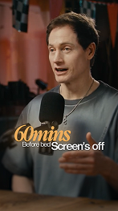
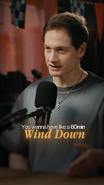
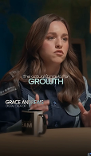
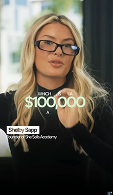
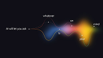

<!-- GENERATED by scripts/build_library.py from data/references.json. Do not edit by hand. -->

# TXT - Text Inspiration & Text Animations

10 references. Palette values are measured from the image; animation/use/recreation are inferred from a still and must be treated as proposals.

### TXT-001 - Warm Serif Number Hook (30,000ft)

- **Original file:** `inspiration/text inspo/image 2.png` (150x263 px, source folder: text inspo, batch-001 (inspiration.zip, 2026-10-13))
- **Category / subcategory:** TXT / serif-accent-caption. **Style family:** SERIF-ACCENT-CAPTION. **Also useful for:** -
- **Tags:** caption, hook, number, italic-serif, amber, podcast, warm-grade, three-tier-stack
- **Alternate copies:** none

**Observed (visible in the image)**
- **Visual description:** Vertical podcast frame, male speaker in a warm, dark wood studio with a black broadcast mic. A three-line caption sits over his chest: small white 'What's the', a large amber italic serif '30,000ft', and small white 'view on' tucked underneath.
- **Typography:** Two-family pairing. Connector words are a small, clean geometric sans (white, medium weight, ~3% of frame height). The key phrase is a condensed high-contrast italic serif (Playfair/Instrument Serif Italic feel) at ~2.5x the sans size, in warm amber (#F0A04B-ish), with a faint warm glow. Tight leading so the lines nest into each other.
- **Colour palette (measured, dominant first):** `#100F0E` 22.7%  `#3D2D21` 19.4%  `#514234` 17.1%  `#1F1B17` 17.0%  `#2E1F15` 14.1%  `#9B7C60` 9.8%
- **Composition:** Centred horizontally on the speaker's chest, ~55-62% down the frame, under the chin and clear of the face. The stack is a pyramid: small, LARGE, small. The text partly overlaps the mic, which reads as intentional layering.
- **Lighting & effects:** Very soft outer glow/shadow on the text so it separates from the mid-tone shirt. The footage is warm-graded with crushed blacks and a darker lower frame.
- **Depth & layering:** Text sits in front of the subject. No background replacement.

**Inferred (creative interpretation - not visible in a still)**
- **Animation behaviour:** INFERRED: the small words appear first (fade + 6-10px rise, 200ms), then the serif key phrase lands on its spoken syllable (scale 0.92->1, blur 6px->0, opacity 0->1, ~300ms ease-out). Hold while relevant, then the whole stack fades out together over 150-200ms.
- **Suitable use cases:** Podcast or interview hooks, numbers and memorable phrases, emphasising the single most important word in a sentence.
- **Technical recreation:** Stack three text layers in one centred group. Sans: Inter/SF Pro Medium. Serif: Instrument Serif Italic or Playfair Display Italic, colour #F2A14A, text-shadow 0 0 12px rgba(242,161,74,.35). Line-height 0.85-0.95 so lines interlock. Place the group at 58% of frame height.

---

### TXT-002 - Amber Serif Phrase with Tracked Sub-line + Name Super

- **Original file:** `inspiration/text inspo/image 3.png` (146x263 px, source folder: text inspo, batch-001 (inspiration.zip, 2026-10-13))
- **Category / subcategory:** TXT / serif-accent-caption. **Style family:** SERIF-ACCENT-CAPTION. **Also useful for:** ONS
- **Tags:** caption, lower-third, name-super, amber, italic-serif, tracked-caps, health
- **Alternate copies:** none

**Observed (visible in the image)**
- **Visual description:** Speaker in profile, warm backlight. Caption: small white 'Lower Your', then the amber italic serif 'Resting Heart Rate', then 'Before Bed' in widely tracked, light grey caps. A minimal name super at the bottom-left reads 'Bryan Johnson / Health and wellness expert' in small white sans.
- **Typography:** Three registers: small sans kicker, large amber italic serif phrase, and a tracked spaced sub-line (letter-spacing ~0.3em, lower opacity ~60%). The name super uses the sans in medium weight with a smaller, lighter role line beneath.
- **Colour palette (measured, dominant first):** `#10100F` 23.9%  `#59402F` 20.3%  `#6B5441` 18.4%  `#291E16` 14.0%  `#3E2D21` 13.6%  `#9D8061` 9.7%
- **Composition:** Caption is centred at ~60% height over the shoulder and chest. The name super is anchored bottom-left with ~6% margins. Two independent text zones.
- **Lighting & effects:** Strong warm rim light on the subject. The text has a subtle glow matching the amber.
- **Depth & layering:** Flat 2D text over footage.

**Inferred (creative interpretation - not visible in a still)**
- **Animation behaviour:** INFERRED: the name super appears once, early in the clip (fade/slide 12px from the left, 300ms) and holds 2-3s. The caption builds line by line with speech, and the tracked sub-line letter-spacing animates from 0.5em to 0.3em as it fades in.
- **Suitable use cases:** Introducing an expert or guest, and the topic phrase of a health or wellness claim.
- **Technical recreation:** Caption group as TXT-001. Tracked line: Inter Light caps, letter-spacing .3em, opacity .65. Name super: 2 lines, Inter Medium 2.2% height and Inter Regular 1.4% height, left-aligned at x=6%, y=88%.

---

### TXT-003 - Asymmetric Number + Sans Pair (60mins / Screen's off)

- **Original file:** `inspiration/text inspo/image 4.png` (147x263 px, source folder: text inspo, batch-001 (inspiration.zip, 2026-10-13))
- **Category / subcategory:** TXT / serif-accent-caption. **Style family:** SERIF-ACCENT-CAPTION. **Also useful for:** -
- **Tags:** caption, number, asymmetric, italic-serif, amber, two-column
- **Alternate copies:** none

**Observed (visible in the image)**
- **Visual description:** Speaker at the mic. A huge amber italic serif '60mins' is offset left, with tiny white 'Before bed' and a bigger white sans 'Screen's off' to the right on a shared baseline.
- **Typography:** The italic serif numeral dominates (~6% of frame height). The secondary phrase is a white semibold sans; the connector 'Before bed' is extra-small. Three sizes with clear hierarchy.
- **Colour palette (measured, dominant first):** `#101110` 26.2%  `#41291E` 19.6%  `#6F4434` 16.3%  `#44423D` 14.0%  `#6F584E` 13.9%  `#9D8A74` 10.0%
- **Composition:** Asymmetric: the serif block pushes left of centre and the sans phrase continues to the right, creating a diagonal read from top-left to bottom-right. It sits at chest level, overlapping the mic.
- **Lighting & effects:** Warm amber glow on the serif. Background is warm-graded orange/red bokeh.
- **Depth & layering:** Flat 2D text over the footage, in front of the shirt and mic; the face and background are untouched.

**Inferred (creative interpretation - not visible in a still)**
- **Animation behaviour:** INFERRED: '60mins' counts or slides in first on the stressed word, then 'Screen's off' types or fades in on its own beat. Consider a quick number tick-up 0->60 over 400ms only if the speech dwells on it.
- **Suitable use cases:** Rules or recommendations with a quantity ('60 mins before bed, screens off'), and habit advice.
- **Technical recreation:** Two text blocks in a flex row aligned to the baseline. Serif #F2A14A 2.4x the sans size. Keep total width under 80% of frame. Small connector text at 40% of the sans size.

---

### TXT-004 - Small Lead-in + Spaced Serif Key Phrase (Wind Down)

- **Original file:** `inspiration/text inspo/image 5.png` (148x263 px, source folder: text inspo, batch-001 (inspiration.zip, 2026-10-13))
- **Category / subcategory:** TXT / serif-accent-caption. **Style family:** SERIF-ACCENT-CAPTION. **Also useful for:** -
- **Tags:** caption, italic-serif, amber, two-tier, letterspaced
- **Alternate copies:** none

**Observed (visible in the image)**
- **Visual description:** Same speaker as TXT-003. A small white single line 'You wanna have like a 60min' over a large amber serif 'Wind Down' with slight letter-spacing, centred at chest.
- **Typography:** Lead-in line is small white sans. The key phrase is an amber italic/semi-condensed serif with open tracking (~0.03em).
- **Colour palette (measured, dominant first):** `#0E0F0E` 26.3%  `#2E2119` 20.3%  `#363430` 17.0%  `#6D4F44` 14.6%  `#633A2B` 12.2%  `#8E7D6B` 9.7%
- **Composition:** Centred, two tiers, ~62% height. The lead-in is narrower than the key phrase.
- **Lighting & effects:** A soft warm glow surrounds the amber 'Wind Down' (accent-coloured, ~20px radius at 1080w); the lead-in line has only a soft dark shadow. The footage is warm-graded with orange and red background bokeh.
- **Depth & layering:** Flat 2D text over the footage; the caption sits in front of the shirt and lower mic, and the face is untouched.

**Inferred (creative interpretation - not visible in a still)**
- **Animation behaviour:** INFERRED: the lead-in reveals word by word in sync with speech (each word fading 120ms), then the key phrase arrives as a unit with a soft blur-to-sharp.
- **Suitable use cases:** Showing the spoken sentence while stressing its payoff phrase.
- **Technical recreation:** As TXT-001, but only two tiers. Word-level timing comes from transcript timestamps.

---

### TXT-005 - Giant Name Behind Subject + Lime Serif Accent

- **Original file:** `inspiration/text inspo/image 53.png` (115x193 px, source folder: text inspo, batch-001 (inspiration.zip, 2026-10-13))
- **Category / subcategory:** TXT / depth-title-and-accent. **Style family:** SERIF-ACCENT-CAPTION. **Also useful for:** ONS
- **Tags:** name-title, text-behind-subject, depth, condensed-serif, lime-green, bright-scene, editorial
- **Alternate copies:** none

**Observed (visible in the image)**
- **Visual description:** Bright office with a woman in a white blazer. The guest name 'Marina Mogilko' runs across the top in a huge black condensed italic serif, partly hidden behind her head (text-behind-subject). 'Entrepreneur' sits small beneath. Mid-frame, tiny spaced caps 'YOU · SAID · A' float above a lime-green italic serif 'gap between'.
- **Typography:** Display: very condensed, high-contrast italic serif in black, editorial-magazine style. Accent: lime green (#A6E35A-ish) italic serif with a slight glow. Micro caps are tiny, white, and spread wide across the phrase width.
- **Colour palette (measured, dominant first):** `#505B5B` 26.2%  `#141519` 23.0%  `#BDC8B3` 14.0%  `#A3A899` 13.3%  `#7F8277` 11.9%  `#F8FAF5` 11.6%
- **Composition:** Name spans nearly the full width at the top third, behind the head. The accent phrase sits at chest height. Micro words are distributed across the width above the accent, like a ruler.
- **Lighting & effects:** Natural daylight scene. The lime text has a soft glow for legibility against the white blazer.
- **Depth & layering:** Three planes: background window, then the name text, then the subject (matted in front), then the caption in front of everything. The defining technique is subject segmentation.

**Inferred (creative interpretation - not visible in a still)**
- **Animation behaviour:** INFERRED: the name slides up from behind the shoulder line or tracks in from 0.2em to 0 spacing while staying occluded by the subject. The accent appears on the spoken word. A slow 2-3% push-in on the footage over the shot adds depth.
- **Suitable use cases:** Guest introductions with a magazine feel, opening shots, and bright, airy footage where dark overlays would look heavy.
- **Technical recreation:** Needs a subject matte: rembg/U2Net/RobustVideoMatting per frame, or a manual roto. Composite order: plate, then the name text, then the subject cut-out, then the caption. Name font: a condensed italic display serif (e.g. 'Bodoni Moda Italic' condensed via transform: scaleX(.8)). Check the matte edge quality at hair.

> Note: Low-resolution source (115x193). The serif family is approximate.

---

### TXT-006 - Warm Gradient Bold Sans Hook + Boxed Name Tag

- **Original file:** `inspiration/text inspo/image 54.png` (114x195 px, source folder: text inspo, batch-001 (inspiration.zip, 2026-10-13))
- **Category / subcategory:** TXT / bold-sans-caption. **Style family:** SERIF-ACCENT-CAPTION. **Also useful for:** ONS
- **Tags:** caption, bold-sans, gradient-text, name-tag, boxed-label, outdoor
- **Alternate copies:** none

**Observed (visible in the image)**
- **Visual description:** Woman seated outdoors with green foliage. Caption 'Social media' in a heavy, tight sans with a cream-to-yellow gradient and glow, over small white 'is very different now'. At lower-left, a name tag 'Maria Wendt' in an outlined/translucent box with a tiny role line beneath.
- **Typography:** Heavy geometric sans (Inter/Satoshi Bold) with negative tracking (-0.02em), and a warm white-to-pale-yellow gradient fill. Secondary line is small regular white. Name tag: medium sans inside a thin 1px rounded rectangle.
- **Colour palette (measured, dominant first):** `#1B1714` 20.7%  `#2F3120` 18.4%  `#463629` 16.8%  `#7F7168` 16.2%  `#56503C` 15.7%  `#B09C8C` 12.2%
- **Composition:** Caption centred at ~52% height (upper chest). Name tag bottom-left at ~68% height, left-aligned with a safe margin.
- **Lighting & effects:** A gentle warm glow surrounds the cream-to-yellow gradient text 'Social media'; the sub-line and name tag have only soft dark shadows. Natural daylight footage with green foliage.
- **Depth & layering:** Flat 2D layers over the footage: the caption at upper-chest level and the name tag lower-left; the subject is not occluded.

**Inferred (creative interpretation - not visible in a still)**
- **Animation behaviour:** INFERRED: the gradient text wipes in left to right with a soft mask edge (250ms), the sub-line fades after it, and the name tag box draws its border (stroke-dashoffset) and then the text fades in.
- **Suitable use cases:** Topic statements and opinion hooks, plus guest identification.
- **Technical recreation:** background-clip:text with linear-gradient(180deg,#FFF6D8,#F7D774). text-shadow 0 0 18px rgba(255,220,120,.35). Name tag: 1px rgba(255,255,255,.8) border, radius 4px, padding 4px 8px.

> Note: Low-resolution source.

---

### TXT-007 - Extended Caps Keyword (GROWTH) + Caps Name Super

- **Original file:** `inspiration/text inspo/image 55.png` (114x196 px, source folder: text inspo, batch-001 (inspiration.zip, 2026-10-13))
- **Category / subcategory:** TXT / bold-sans-caption. **Style family:** SERIF-ACCENT-CAPTION. **Also useful for:** -
- **Tags:** caption, extended-caps, keyword, name-super, dark-scene, cool-grade
- **Alternate copies:** none

**Observed (visible in the image)**
- **Visual description:** Woman in a dark, cool-toned room. A small light kicker 'The actual formula for' over a large white/pale-mint extended-width caps 'GROWTH'. Lower-left name super 'GRACE ANDREWS' in medium caps with a tiny role line.
- **Typography:** Keyword in a wide/extended grotesk (Druk Wide / Monument Extended feel) with a subtle mint tint. Kicker is a thin sans. Name super is caps sans with tracking.
- **Colour palette (measured, dominant first):** `#091418` 21.7%  `#352B24` 19.9%  `#503E34` 16.8%  `#181917` 16.1%  `#261D16` 15.4%  `#846E64` 10.1%
- **Composition:** Keyword centred at ~42% height (just below the chin, across the hair and shoulders). Name super bottom-left at ~62% height.
- **Lighting & effects:** Cool, desaturated footage grade; 'GROWTH' is slightly luminous (a pale mint fill with a faint glow), and the kicker and name super carry soft shadows only.
- **Depth & layering:** Flat 2D text over the footage; the keyword crosses the hair and shoulders and the name super sits over the jacket.

**Inferred (creative interpretation - not visible in a still)**
- **Animation behaviour:** INFERRED: letters of GROWTH rise with a 20ms stagger (y 30%->0, opacity), or the word scales horizontally from 0.9 to 1 width, matching the idea of growth.
- **Suitable use cases:** Single-keyword emphasis ('the formula for GROWTH', 'the secret is CONSISTENCY'), topic labels, key-term introductions.
- **Technical recreation:** Install a wide display face; fallback is Inter Black with letter-spacing .06em and transform scaleX(1.15). Colour #E9FFF6.

> Note: Low-resolution source; the kicker text is partially illegible.

---

### TXT-008 - Money Figure Hero ($100,000) + Highlight Name Box

- **Original file:** `inspiration/text inspo/image 56.png` (113x195 px, source folder: text inspo, batch-001 (inspiration.zip, 2026-10-13))
- **Category / subcategory:** TXT / bold-sans-caption. **Style family:** SERIF-ACCENT-CAPTION. **Also useful for:** -
- **Tags:** caption, number, money, mint, name-tag, highlight-box
- **Alternate copies:** none

**Observed (visible in the image)**
- **Visual description:** Blonde woman with glasses. Tiny scattered caps 'WHICH · IS · A' above a large '$100,000' in a medium-weight sans with a mint/white gradient. Lower-left, a name label 'Shelly Sapp' set as dark text on a white box, with the role 'Founder of The Sells Academy' beneath.
- **Typography:** Number in a clean rounded-grotesk medium, very large (~7% of frame height) with a soft mint gradient and glow. Name in a solid white highlight box with dark text.
- **Colour palette (measured, dominant first):** `#050606` 25.0%  `#282D2B` 18.5%  `#886D51` 16.5%  `#B6AD8E` 16.4%  `#DEE4DD` 12.8%  `#141616` 10.8%
- **Composition:** Number centred at ~40% height across the chest. Name box at the left, ~60% height.
- **Lighting & effects:** A soft mint glow behind the '$100,000' figure separates it from the dark sweater; the name box is a solid white highlight with no glow. Bright daylight window background.
- **Depth & layering:** Flat 2D text over the footage; the number sits across the chest and gesturing hands, and the name label is lower-left.

**Inferred (creative interpretation - not visible in a still)**
- **Animation behaviour:** INFERRED: the number counts up from $0 with ease-out over 600-800ms, landing on the spoken value. The highlight box wipes open from the left (scaleX 0->1) before its text appears.
- **Suitable use cases:** Money, revenue and statistics in talking-head content ('which is a $100,000 business'), income claims, prices.
- **Technical recreation:** Use tabular numerals (font-variant-numeric: tabular-nums) for the count-up so the width stays stable. Gradient #FFFFFF to #C9F5E3.

---

### TXT-009 - Script Accent Word Between Caps (steal TODAY) + Serif Name

- **Original file:** `inspiration/text inspo/image 57.png` (112x196 px, source folder: text inspo, batch-001 (inspiration.zip, 2026-10-13))
- **Category / subcategory:** TXT / mixed-script-caption. **Style family:** SERIF-ACCENT-CAPTION. **Also useful for:** -
- **Tags:** caption, script, gold, caps, name-super, serif-name, warm-beige
- **Alternate copies:** none

**Observed (visible in the image)**
- **Visual description:** Woman at a podcast mic against a beige wall. Top-right name 'Codie Sanchez / Journalist' in small serif with a hairline rule. Caption: tiny caps 'I WANT YOU TO', a large gold italic script/serif 'steal', and white bold caps 'TODAY', all interlocked.
- **Typography:** Gold (#E7A93B) italic display serif/script for the emotional verb, condensed bold caps sans for the time word, and tiny caps for the lead-in. Name super in a refined serif with a thin line accent.
- **Colour palette (measured, dominant first):** `#B89271` 24.5%  `#24170E` 20.7%  `#483628` 18.0%  `#A77F61` 16.2%  `#69482F` 11.9%  `#C4A994` 8.7%
- **Composition:** Caption left-of-centre at ~60% height, overlapping the mic. Name in the top-right quadrant at ~45% height, right-aligned, opposite the caption.
- **Lighting & effects:** The gold script 'steal' has a warm glow; 'TODAY' and the micro caps are crisp white with soft shadows; the serif name super has no glow. Warm beige wall background.
- **Depth & layering:** Flat 2D text over the footage; the caption sits in front of the mic and shoulder area, and the name super floats top-right beside the head without touching the face.

**Inferred (creative interpretation - not visible in a still)**
- **Animation behaviour:** INFERRED: 'steal' writes or reveals with a quick mask sweep and a slight overshoot-free scale, then 'TODAY' snaps in 80ms later. The name super draws its hairline first, then the text appears.
- **Suitable use cases:** Calls to action, punchy imperatives, and premium/business podcast branding.
- **Technical recreation:** Three spans in an inline-flex with baseline alignment. The script word is 1.8x the caps size and overlaps by -0.2em. Hairline: 1px, 40px wide, 70% white.

---

### TXT-010 - Sentence Flowing Along Glowing Wave Paths

- **Original file:** `inspiration/9e2e4f13a0e418ced92c444a0103621a 1.png` (173x98 px, source folder: (root), batch-001 (inspiration.zip, 2026-10-13))
- **Category / subcategory:** TXT / kinetic-path-typography. **Style family:** DATA-GLOW. **Also useful for:** FUL
- **Tags:** kinetic-typography, words-on-path, wave, gradient-line, ai, sentence-build
- **Alternate copies:** none

**Observed (visible in the image)**
- **Visual description:** Dark navy field. Several thin sine-wave strokes in blue, orange and yellow gradients braid across the frame. Words of one sentence ('AI will let you ask', 'whatever', 'is', 'on', 'your', 'mind') sit at nodes along the waves. A warm glow blooms on the right where the waves converge.
- **Typography:** Small, light sans in white, lowercase. Words are tiny and spaced along the path, so the path itself carries the reading flow.
- **Colour palette (measured, dominant first):** `#100F17` 70.4%  `#473931` 14.1%  `#100F18` 10.3%  `#100F16` 2.3%  `#0F0F17` 2.0%  `#0B0B12` 0.9%
- **Composition:** Horizontal left-to-right flow. The first phrase is anchored at left-middle. Nodes rise and fall with the waves, and the composition widens toward a bright focal bloom at right.
- **Lighting & effects:** Additive glow where the strokes overlap, with a hot orange/yellow bloom and a cool blue start (a temperature shift encoding progress).
- **Depth & layering:** Flat, with bloom suggesting depth.

**Inferred (creative interpretation - not visible in a still)**
- **Animation behaviour:** INFERRED: the strokes draw on left to right (stroke-dashoffset) and each word fades in as the stroke's head passes its node, synced to speech. The waves can keep a slow phase drift. End on the glow swelling.
- **Suitable use cases:** Turning a spoken sentence into a full-screen typographic moment, and abstract 'AI / thought' transitions.
- **Technical recreation:** SVG paths (cubic sine) with linearGradient strokes and an feGaussianBlur glow copy underneath. Words placed with getPointAtLength() and animated per word timestamp.

---

