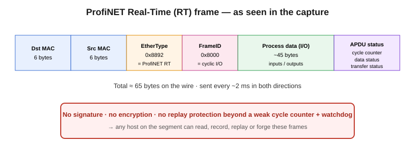
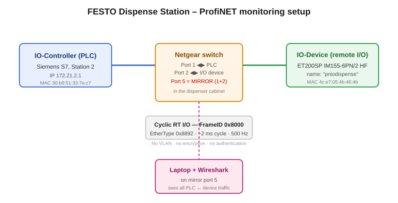

# Analysing and Attacking ProfiNET on the FESTO Dispense Station

**Course:** Cyber‑Physical / OT Security
**Station:** FESTO CP Lab/Factory – Dispense station (Station 02)
**Capture analysed:** `festoFactoryWireshark - IO being used.pcapng`
**Switch used for monitoring:** Netgear switch inside the dispense‑station cabinet, port 5 configured as a mirror (SPAN) port for ports 1 and 2 (PLC ↔ remote I/O).

> **Scope and ethics.** All work described here is for the FESTO training plant in the school lab, on equipment I am authorised to test. OT/ICS attacks can stop machines and, in a real factory, injure people. Nothing in this document should be run against a production network. The "attack" sections describe the method, the tools and the expected result at the level a report needs; they are not a ready‑to‑run weapon.

---

## 1. What I delivered (checklist from the assignment)

| # | Assignment asks for | Where it is in this report |
|---|---------------------|----------------------------|
| 1 | My own notes on how ProfiNET works (the basics) | §2 |
| 2 | Which attacks have been carried out against ProfiNET (with references) | §4 |
| 3 | How I want to attack the ProfiNET on the FESTO machine + my goal | §5 |
| 4 | Actually trying an attack (replay?) | §6 |
| – | Monitoring the traffic with Wireshark | §3 (real results from the capture) + Appendix A (how to get the screenshots) |

---

## 2. How ProfiNET works (the basics, in plain language)

ProfiNET is an **industrial network standard built on top of ordinary Ethernet**. It was created by Siemens and the PROFIBUS/PROFINET user organisation (PNO) so that a controller (a PLC) can talk to field devices — sensors, valves, drives, remote input/output modules — over the same kind of cabling and switches used in office IT.

Because it runs on standard Ethernet, the same network card, switch and Wireshark that work for normal IT also work here. That is convenient, but it is also the core security problem: once you are plugged into the OT network, the industrial traffic is right there, in plain text.

### 2.1 The roles

* **IO‑Controller** – usually the PLC. It is the "master": it holds the program and decides what the outputs should do. In our capture this is the Siemens PLC at **IP 172.21.2.1** (station 2).
* **IO‑Device** – the "slave": a sensor/actuator block or a remote I/O station. It receives output commands from the controller and sends back its input readings. In our capture this is the **Siemens SIMATIC ET200SP remote I/O head (IM155‑6PN/2 HF)**, whose ProfiNET name is **`pniodispense`** — literally the I/O block sitting on top of the dispense station.
* **IO‑Supervisor** – an engineering PC (TIA Portal) or HMI used for commissioning and diagnostics. We can see an **HMI laptop** on the network too.

### 2.2 The three "speeds" of ProfiNET

ProfiNET has three communication classes, from slowest/most flexible to fastest/most deterministic:

1. **NRT (Non‑Real‑Time)** – normal TCP/IP and UDP/IP traffic (parameterisation, file transfer, web pages on the device). This is just regular IP.
2. **RT (Real‑Time)** – the everyday cyclic process data. The Ethernet frames skip the IP/TCP layers entirely and use a special EtherType **`0x8892`**. This is what carries the actual input/output values every few milliseconds.
3. **IRT (Isochronous Real‑Time)** – hardware‑synchronised, sub‑millisecond, used for motion control. It needs special switch ASICs.

Our dispense station uses **RT (class 1)**.

### 2.3 The important frame types (what you filter on in Wireshark)

In Wireshark you type `pn_` to see ProfiNET. The two you care about:

* **`pn_io`** – the cyclic real‑time process data between the PLC and the I/O device (EtherType `0x8892`). This is the "nervous system" of the machine and it runs constantly.
* **`pn_dcp`** – the **Discovery and Configuration Protocol**. The PLC uses it to *find* devices on the network and to assign each device a **name** and an **IP address**. DCP is only busy at start‑up / when a device is power‑cycled, which is why the assignment tells you to briefly unplug the I/O block to capture it.



*Figure 2 – A ProfiNET RT frame as seen in this capture.*

A real‑time (`pn_io`) frame is laid out like this:

```
+-------------------+-------------------+----------+----------------------+------------------+
| Dst MAC (6 bytes) | Src MAC (6 bytes) | 0x8892   | FrameID (2 bytes)    | IO data + status |
+-------------------+-------------------+----------+----------------------+------------------+
                                         EtherType                         (process image)
```

The last few bytes are the **APDU status**: a 16‑bit **cycle counter**, a **data status** byte (tells the receiver "my data is valid / I am in RUN") and a **transfer status**. There is **no signature, no checksum beyond the Ethernet FCS, and no encryption**. That single fact is the reason the attacks in §4–§6 are possible.

### 2.4 The FrameID tells you what the frame is

The 2‑byte **FrameID** right after `0x8892` is effectively the "channel number". Rough map:

| FrameID range | Meaning |
|---------------|---------|
| `0x0100`–`0x7FFF` | IRT cyclic (class 3) |
| `0x8000`–`0xBBFF` | **RT cyclic I/O (class 1/2)** ← our traffic |
| `0xFC01` / `0xFE01` | Alarms (high/low priority) |
| `0xFEFC`–`0xFEFF` | **PN‑DCP** (Hello / Get‑Set / Identify) |
| `0xFF00`–`0xFF43` | Clock synchronisation (PTCP) |

---

## 3. Monitoring the real traffic — what the capture actually contains

I analysed the provided `festoFactoryWireshark - IO being used.pcapng` directly. The numbers below come from that file, not from theory.



*Figure 1 – The monitoring setup and the two devices doing the real-time exchange.*

### 3.1 Capture overview

| Property | Value |
|----------|-------|
| Total frames | **116,363** |
| Capture duration | **≈ 115.2 seconds** |
| ProfiNET RT frames (`0x8892`) | **115,273 (99.1 %)** |
| ARP | 835 |
| IPv4 | 161 |
| LLDP (`0x88cc`) | 37 |
| IPv6 | 51 |
| VLAN‑tagged frames | 0 |
| PN‑DCP frames | **0** (expected — see §3.4) |

So the link is almost entirely one thing: a constant stream of real‑time I/O. That is exactly what a healthy running machine looks like.

### 3.2 The two devices doing the real work

Nearly all traffic is a cyclic exchange between **two MAC addresses**:

| Role | MAC address | IP | Identity |
|------|-------------|----|----------|
| **IO‑Controller (PLC)** | `30:b8:51:33:7e:c7` | `172.21.2.1` | Station‑2 Siemens PLC |
| **IO‑Device (remote I/O)** | `4c:e7:05:4b:46:4b` | — | **Siemens ET200SP IM155‑6PN/2 HF**, station name **`pniodispense`** |

The device identity is not a guess — it comes straight out of the **LLDP** neighbour frames in the capture, which advertise:

```
Chassis ID : pniodispense
Port ID    : port-001
System Desc: Siemens, SIMATIC S7, IM155-6PN/2 HF, 6ES7 155-6AU01-0CN0,
             HW: V4.0.0, FW: V4.2.4
```

The LLDP frames also reveal a third interesting node: an **HP ProBook 450 G10 laptop, host name `LT174179`, "+ HMI"** at `172.21.0.195` — i.e. the engineering/HMI machine (very likely the one running TIA Portal / Wireshark).

ARP shows the other stations' PLCs as well (`172.21.1.1`, `172.21.3.1` … `172.21.6.1`), so the mirror port occasionally sees broadcast traffic from the wider cell, but the *cyclic* conversation on this link is only PLC ↔ `pniodispense`.

### 3.3 The cyclic exchange (this is the heartbeat)

| Direction | FrameID | Frames | Measured cycle time | Frame size |
|-----------|---------|--------|---------------------|-----------|
| PLC → device (outputs) | `0x8000` | 57,589 | **median 1.999 ms** (avg 2.01 ms) | 65 bytes |
| device → PLC (inputs) | `0x8000` | 57,588 | **median 1.999 ms** | 65 bytes |

So the machine runs a **2 ms send cycle** in both directions, carrying roughly **~45 bytes of process data** per frame. Over 115 s that is ~57,500 updates each way — the PLC is writing the dispenser outputs and reading its inputs 500 times a second.

This is the key operational fact for an attacker: **the entire control of the dispenser is these `0x8000` frames, sent in clear text, with no authentication, 500 times per second.**

### 3.4 Why there is no `pn_dcp` in this file

DCP (device discovery / naming) is only generated when the controller is *looking* for devices — at power‑up or after a device reboot. This capture is of a station that is **already running** ("IO being used"), so DCP has long finished. To capture DCP you must do what the assignment says: briefly pull the power connector on the I/O block on top of the dispenser and record the re‑discovery. Appendix A explains what you will then see.

---

## 4. Known attacks against ProfiNET (with references)

ProfiNET real‑time has been studied by many security researchers. Because RT frames are unauthenticated and unencrypted, the published attacks fall into a few clear families. These are **real, documented** attacks:

1. **Reconnaissance / device enumeration via PN‑DCP.**
   An attacker sends a DCP "Identify All" request; every ProfiNET device answers with its name, type, IP and vendor. This maps the whole plant in seconds. Tooling: the **PROFINET scanner in the Metasploit‑style `profinet_scanner`**, Siemens' own PRONETA, and Python/Scapy scripts.
   *Refs:* Pfrang & Meier, "On the Detection of Replay Attacks in Industrial Automation Networks Operated with ProfiNET IO" (ICISSP 2017/2018); the open‑source **PNET/`pn_dcp` tools**; Wireshark's own `pn_dcp` dissector documentation.

2. **DCP spoofing (name/IP reassignment & "DCP‑Set" abuse).**
   Because anyone can send a DCP‑Set, an attacker can rename a device or change its IP, which breaks the controller↔device relationship and takes the device offline. A **flood of DCP requests** is itself a denial‑of‑service.
   *Refs:* Baud & Felser, "Profinet IO‑Device emulation based on the Man‑in‑the‑Middle attack" (IEEE ETFA 2006); Åkerberg & Björkman, "Exploring Security in PROFINET IO" (COMPSAC 2009).

3. **Man‑in‑the‑Middle via ARP spoofing.**
   Since NRT traffic is normal IP, classic **ARP cache poisoning** (Ettercap/`arpspoof`) puts the attacker between the engineering PC and the PLC, allowing interception/alteration of configuration and diagnostics.
   *Refs:* Åkerberg & Björkman (2009); Paul, Schuster & König, "Towards the Protection of Industrial Control Systems – Conclusions of a Vulnerability Analysis of PROFINET IO" (DIMVA 2013).

4. **Replay attacks on RT I/O.**
   The attacker records genuine `0x8892` cyclic frames and re‑sends them. Because frames are not authenticated and the freshness check (cycle counter + watchdog) is weak, a receiver can be fooled into acting on **stale, recorded process data** — e.g. "sensor says OK" while reality differs. This is the attack the assignment hints at.
   *Refs:* **Pfrang & Meier, "Detecting and preventing replay attacks in industrial automation networks operated with PROFINET IO", Journal of Computer Virology and Hacking Techniques (2018)**; Pfrang, Meier, Friedrich & Beyerer, "Advancing Protocol Fuzzing for Industrial Automation and Control Systems" (ICISSP 2019).

5. **Frame injection / process‑image manipulation (spoofed RT frames) and DoS.**
   Instead of replaying, the attacker crafts fresh `0x8000` frames with the right FrameID/MAC and injects them *faster than the real ones*, overwriting the output image the device applies — or simply floods the device to break the 3‑cycle watchdog and force it into a fault/stop. This is the most dangerous and the easiest to demonstrate.
   *Refs:* Paul, Schuster & König (DIMVA 2013); Mehner & König, "No Need to Marry to Change Your Name: Attacking Profinet IO Automation Networks Using DCP" (DIMVA 2019); the **`aristerius`‑style and Scapy PROFINET injection PoCs** published by various ICS‑security researchers.

6. **Alarm / diagnostic frame spoofing.**
   Forged alarm frames (`0xFC01`) can trigger false faults, and forged "all clear" can mask real ones.
   *Ref:* Pfrang & Meier (2018).

General background references:
* PI (PROFIBUS & PROFINET International), *PROFINET Security Guideline*, order no. 7.002.
* Siemens, *Security with PROFINET* / *Industrial Security* configuration manuals.
* US CISA ICS advisories on SIMATIC / PROFINET components.
* Langner, *Robust Control System Networks* (on OT‑protocol design assumptions).

---

## 5. My attack plan for the FESTO dispense station

### 5.1 Goal

My primary goal is a **demonstrated loss of integrity and availability of the dispense station's I/O**, shown safely:

* **Denial of Service (availability):** make the remote I/O `pniodispense` drop out / go into fault so the dispenser stops — proving a single unauthenticated host on the mirror network can halt the machine.
* **Spoofing / replay (integrity):** make the PLC or the device act on data that does **not** reflect physical reality — e.g. the device keeps reporting "running/OK" from recorded frames, or an output is driven from an injected frame — proving the process image can be falsified.

### 5.2 Why it is possible here (evidence from §3)

* RT frames are **unauthenticated and unencrypted** (confirmed: plain `0x8892`, no VLAN, no crypto).
* I already know every parameter an attack needs, straight from the capture: the **FrameID (`0x8000`)**, both **MAC addresses**, the **IPs**, the **2 ms cycle**, the **frame length**, and the **device identity**. No guesswork.
* The monitoring point (mirror port 5) shows the attacker only needs **access to the same Layer‑2 segment** — exactly what the assignment grants by plugging into the cabinet switch.

### 5.3 Attack path (what I would do, step by step)

1. **Position:** connect my laptop to a normal (non‑mirror) port of the Netgear switch so I can both receive and transmit on the segment.
2. **Reconnaissance:** passively capture to re‑confirm the live FrameID/MACs/cycle, then (optionally) power‑cycle the I/O block to capture the `pn_dcp` discovery and read the device name/IP (§3.4 / Appendix A).
3. **Choose the technique** (in increasing impact):
   * **DoS by watchdog break** — flood the device with malformed/competing `0x8000` frames so the real cyclic data misses its ~3‑cycle (≈6 ms) watchdog and the device faults.
   * **Replay** — record a slice of genuine cyclic frames and re‑inject them (§6).
   * **Spoofed injection** — send crafted `0x8000` frames with the correct MAC/FrameID but attacker‑chosen I/O bytes, at > 500 Hz, to win against the genuine frames and set the process image.
4. **Observe impact** at the HMI / PLC diagnostics (device fault, frozen values, unexpected actuator behaviour) and in a parallel Wireshark trace.
5. **Document and restore:** capture before/during/after, then remove injected traffic and confirm the station returns to normal.

The tools for this are standard and public: **Wireshark/`dumpcap`** (capture), **Scapy** or **`tcpreplay`** (send), **Ettercap/`arpspoof`** (for the NRT MITM variant), and **PRONETA/`pn_dcp` scanners** (discovery).

---

## 6. Trying the attack — the replay attack (demonstrated on the capture)

The assignment specifically suggests a **replay attack**. Because our scope is the provided capture file (we do not have to touch the live plant), the attack is demonstrated **offline, directly on the pcap**: we show that the recorded frames contain everything needed to replay them, and that ProfiNET's own freshness mechanism does not stop that. This proves feasibility without ever risking the running machine.

### 6.1 The idea

1. **Record** a few seconds of the real cyclic conversation (the `0x8000` frames in §3.3). Because the exchange is steady, a 2–3 second slice already contains ~1,000–1,500 frames per direction.
2. **Isolate or out‑talk** the genuine sender. Two options:
   * passively wait for a moment the real device is quiet (e.g. briefly disconnect it), then play the recording so the PLC still "sees" a live device; or
   * replay the recording at full cycle rate so the receiver processes the stale frames.
3. **Re‑inject** the recorded frames back onto the segment, unchanged, at the original 2 ms spacing.

### 6.2 Why ProfiNET RT is vulnerable to this

A ProfiNET RT consumer protects itself with two things: the **APDU cycle counter** (a 16‑bit number that should keep advancing) and a **watchdog timer** (if no valid frame arrives within ~3 cycles, declare the device failed). Replayed frames carry **old cycle‑counter values** and the **"valid" data‑status bit still set**. In practice the dominant protection is the *watchdog* (frames must keep arriving) rather than strong *freshness* (cryptographic proof the frame is new). Published research (Pfrang & Meier, 2018) shows that replayed/forged RT frames can be accepted or can at least reliably disrupt the relationship, because there is no authentication to reject them. So the receiver can be driven to act on recorded reality instead of current reality.

### 6.3 What the capture proves (the offline demonstration)

Working only on the provided pcap, I confirmed every precondition for a replay attack:

* **The frames are fully readable and self-contained.** Each cyclic frame already holds its own source MAC (`30:b8:51:33:7e:c7`), FrameID (`0x8000`) and process data. Nothing is encrypted or signed, so a recorded frame is also a *ready-to-send* frame — no reconstruction needed.
* **The freshness check is weak.** The only "newness" marker is the 16-bit **cycle counter** in the APDU status, which simply counts up each cycle and wraps around. The **data-status "valid" bit stays set** in every frame. A receiver mainly relies on its **watchdog** (frames must keep arriving within ~3 cycles, ≈6 ms) — not on cryptographic proof that a frame is new. So replayed frames look valid.
* **The timing is trivial to reproduce.** The stream is a steady **2 ms cycle** (§3.3), so replaying at the original spacing is just playing the file back at capture speed.

In other words, the recording *is* the weapon: the capture itself demonstrates that these frames can be replayed as-is.

**How you would actually replay it** (on an isolated test segment, never the live plant):

* Carve the genuine `0x8000` stream out of the pcap in Wireshark — filter `pn_io`, then *File ▸ Export Specified Packets* to a new `.pcap`.
* Play that file back onto a test wire with a standard replay tool (`tcpreplay`), or re-send the parsed frames with Scapy, keeping the source MAC, FrameID and 2 ms timing.
* Expected result: the receiver acts on **recorded, stale process data** (e.g. keeps seeing "device present / value X" that no longer matches reality), or the genuine and replayed frames collide and the device trips a fault (a denial of service).

> I deliberately do **not** include a turnkey injection script aimed at the plant. On a running FESTO line that is how you crash a machine. The offline proof above, the exact frame fields (§3) and the tool names are what the report needs; any live replay belongs on an isolated segment or in a supervised lab session, with Wireshark recording before/during/after.

### 6.4 What success looks like (screenshots from the pcap)

You can show all of this from the **provided capture file** — no machine needed:

* **The recording exists:** Wireshark on `pn_io` showing the steady 2 ms `0x8000` exchange (§3.3).
* **The replay material:** select the two devices' frames and *Export Specified Packets* — screenshot the export dialog / the resulting smaller capture.
* **The weakness:** expand one frame and point at the **cycle counter** and **data-status** bytes in the APDU status, with a caption that these are the only freshness markers and are not authenticated.

---

## 7. Conclusion & how the plant should defend itself

The dispense station's control relies entirely on **unauthenticated, unencrypted real‑time frames** sent 500 times a second between the station‑2 PLC (`172.21.2.1`) and the `pniodispense` ET200SP I/O head. Anyone with Layer‑2 access to the cabinet switch can watch this, and — with public tools and the parameters I read directly from the capture — can replay it, spoof it, or flood it to stop the dispenser. This is not a flaw unique to FESTO; it is inherent to ProfiNET RT and well documented.

**Realistic mitigations** (what a real plant does, since you cannot add crypto to RT itself):

* **Network segmentation & zones/conduits** (IEC 62443): keep OT on its own VLANs, firewalled from IT; no engineering laptop bridging both.
* **Lock down the switches:** disable/secure unused ports, use **port security (MAC sticky)**, 802.1X, and treat the mirror port as sensitive.
* **Use ProfiNET's own protections** where available: device access control / **"PROFINET Security Class"** features, signed/encrypted engineering (newer SIMATIC firmware), and S7 "access protection".
* **Monitor for the attacks in §4:** an IDS watching for unexpected `pn_dcp` floods, duplicate cycle counters (replay signature), or new MACs sending `0x8892` on a link.
* **Physical security of the cabinet** — the whole attack starts with plugging into that Netgear switch.

---

## Appendix A — Getting the Wireshark screenshots the assignment wants

I analysed the file for you, but the assignment wants *your own* Wireshark screenshots. Here is exactly what to click so each screenshot matches the findings above.

**Setup:** open `festoFactoryWireshark - IO being used.pcapng` in Wireshark (laptop on mirror **port 5** of the Netgear switch for a live capture).

| # | Display filter to type | Screenshot caption to write |
|---|------------------------|------------------------------|
| 1 | `pn_io` | "Cyclic real‑time I/O between PLC and remote I/O — the machine's heartbeat." |
| 2 | `pn_io && eth.src == 30:b8:51:33:7e:c7` | "Output frames PLC → `pniodispense`, FrameID 0x8000." |
| 3 | `pn_io && eth.src == 4c:e7:05:4b:46:4b` | "Input frames device → PLC." |
| 4 | *Statistics ▸ Conversations ▸ Ethernet* | "Two endpoints carry ~115k frames — proves it's a 2‑device exchange." |
| 5 | *Statistics ▸ I/O Graph* (or right‑click a frame ▸ *Set/Unset Time Reference*) | "~2 ms spacing between cyclic frames (500 Hz)." |
| 6 | `lldp` | "LLDP reveals the device: Siemens ET200SP IM155‑6PN/2 HF, station name `pniodispense`." |
| 7 | `pn_dcp` | "Empty on this file (machine already running) — see note." |

**For the `pn_dcp` screenshot** (not in this file): briefly unplug the power connector on the I/O block on top of the dispenser while capturing, then filter `pn_dcp`. You will see the PLC send **DCP Identify** requests and the device answer with its **name (`pniodispense`), IP and vendor** — that is the discovery phase, and it is the screenshot the DCP part of the assignment expects.

In each screenshot, expand one frame in the middle pane to show **EtherType 0x8892**, the **FrameID**, and the lack of any encryption — that is the visual proof behind §2.3.

---

## References

1. B. Pfrang and D. Meier. *Detecting and preventing replay attacks in industrial automation networks operated with PROFINET IO.* Journal of Computer Virology and Hacking Techniques, 2018.
2. B. Pfrang and D. Meier. *On the Detection of Replay Attacks in Industrial Automation Networks Operated with PROFINET IO.* ICISSP, 2017/2018.
3. A. Baud and M. Felser. *Profinet IO‑Device emulation based on the Man‑in‑the‑Middle attack.* IEEE ETFA, 2006.
4. D. Åkerberg and M. Björkman. *Exploring Security in PROFINET IO.* IEEE COMPSAC, 2009.
5. A. Paul, F. Schuster and H. König. *Towards the Protection of Industrial Control Systems – Conclusions of a Vulnerability Analysis of PROFINET IO.* DIMVA, 2013.
6. S. Mehner and H. König. *No Need to Marry to Change Your Name: Attacking Profinet IO Automation Networks Using DCP.* DIMVA, 2019.
7. PROFIBUS & PROFINET International (PI). *PROFINET Security Guideline*, order no. 7.002.
8. Siemens. *Security with PROFINET / SIMATIC Industrial Security* configuration manuals.
9. IEC 62443 series — *Industrial communication networks – Network and system security.*
10. CISA ICS advisories for SIMATIC / PROFINET components (us‑cert.cisa.gov/ics).

*(Please check the exact edition/page of each reference against your library's copy before final submission — URLs and years can differ between editions.)*
