<!-- GENERATED by scripts/build_library.py from data/references.json. Do not edit by hand. -->

# FUL - Full-Screen Animations (replace the talking head)

93 references. Palette values are measured from the image; animation/use/recreation are inferred from a still and must be treated as proposals.

### FUL-001 - Holographic Wireframe Chain Links (Connector)

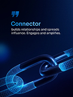

- **Original file:** `inspiration/0d5f97cf819551eb8f9a5cd9373970ee 1.png` (122x162 px, source folder: (root), batch-001 (inspiration.zip, 2026-10-13))
- **Category / subcategory:** FUL / metaphor-object-dark. **Style family:** 3D-METAPHOR. **Also useful for:** -
- **Tags:** chain, wireframe, hologram, blue, connection, quote-glyph, series-archetypes, vertical
- **Alternate copies:** none

**Observed (visible in the image)**
- **Visual description:** Vertical navy; blue quote-mark glyph top-left; heading 'Connector' in blue + white body ('builds relationships and spreads influence…'); lower half: interlocking chain links rendered as blue wireframe/mesh hologram diagonally.
- **Typography:** Medium blue sans heading, small white body; left-aligned editorial block.
- **Colour palette (measured, dominant first):** `#020A2A` 22.4%  `#010418` 22.3%  `#03143D` 16.2%  `#031031` 16.2%  `#0C2554` 11.7%  `#2B699F` 11.3%
- **Composition:** Text top-left 40%; object diagonal bottom-right bleeding off frame.
- **Lighting & effects:** Self-lit wireframe with soft glow; dark vignette.
- **Depth & layering:** Object large in foreground, cropped.

**Inferred (creative interpretation - not visible in a still)**
- **Animation behaviour:** INFERRED: wireframe draws on (edges trace), then fills with light; slow rotation; text types in.
- **Suitable use cases:** Archetypes/personality types, connection/relationships ideas.
- **Technical recreation:** 3D wireframe render (Blender wireframe modifier + emission) or generated image + 2.5D parallax; glyph+heading layout reusable across series.

> Note: Part of a series with FUL-009, FUL-015, FUL-074 (shared glyph + heading layout).

---

### FUL-002 - Thin Outline 300 on Glowing Planet Horizon

- **Original file:** `inspiration/103c90fb8d01d8c6703a76fb5cb50ab1 1.png` (158x198 px, source folder: (root), batch-001 (inspiration.zip, 2026-10-13))
- **Category / subcategory:** FUL / horizon-arc. **Style family:** HORIZON-ARC. **Also useful for:** -
- **Tags:** big-number, outline-numerals, planet-horizon, blue, stat, vertical
- **Alternate copies:** none

**Observed (visible in the image)**
- **Visual description:** Vertical black; 'CONTRIBUTED OVER' tracked caps; giant thin-outline numerals '300' standing on a curved blue glowing planet horizon; small body below; logo at bottom.
- **Typography:** Ultra-thin outline/hairline numerals (huge), tracked caps kicker, small centred body.
- **Colour palette (measured, dominant first):** `#000000` 59.2%  `#020713` 13.1%  `#061D44` 12.0%  `#275798` 8.1%  `#010003` 6.6%  `#010000` 1.1%
- **Composition:** Centred, numerals overlap horizon edge.
- **Lighting & effects:** Atmospheric rim glow along horizon arc.
- **Depth & layering:** Planet below, numerals in front of atmosphere.

**Inferred (creative interpretation - not visible in a still)**
- **Animation behaviour:** INFERRED: horizon rises/brightens (sunrise), numerals draw stroke-by-stroke, count-up.
- **Suitable use cases:** Big milestone numbers, impact stats.
- **Technical recreation:** Horizon = large circle with blurred inner/outer glow; numerals SVG text stroke-only.

---

### FUL-003 - Journey Line Chart with Highlight Column (Idea → Scale)

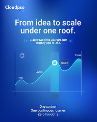

- **Original file:** `inspiration/115158b311bb5bcc56702a089baf7055 1.png` (198x248 px, source folder: (root), batch-001 (inspiration.zip, 2026-10-13))
- **Category / subcategory:** FUL / data-viz-scene. **Style family:** DATA-GLOW. **Also useful for:** -
- **Tags:** line-chart, journey, milestones, blue, highlight-column, poster, vertical
- **Alternate copies:** none

**Observed (visible in the image)**
- **Visual description:** Vertical bright-blue gradient; logo; headline 'From idea to scale under one roof.' white bold; line chart with labels Idea→Launch→Scale→Evolve; translucent vertical glass column highlighting 'Scale' with ring marker; footer 'One partner. One continuous journey. Zero handoffs.'
- **Typography:** Bold white sans headline; small labels; stacked footer lines.
- **Colour palette (measured, dominant first):** `#072A8D` 21.6%  `#2561C0` 20.1%  `#397DD0` 19.6%  `#0D3AA2` 16.1%  `#1746AD` 14.8%  `#65ABDB` 7.7%
- **Composition:** Headline top 25%, chart middle 50%, tagline bottom.
- **Lighting & effects:** Monochrome blue with white line glow.
- **Depth & layering:** Glass column overlay.

**Inferred (creative interpretation - not visible in a still)**
- **Animation behaviour:** INFERRED: line draws through stages; column slides to active stage; labels fade.
- **Suitable use cases:** Process/lifecycle, 'from A to Z'.
- **Technical recreation:** SVG chart; column = translucent rect with blur.

---

### FUL-004 - Giant 3D Quote Marks with Frosted Text Bar (light)

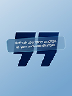

- **Original file:** `inspiration/13cda48dae23f52d6cc7bfa7e308ea2e 1.png` (122x162 px, source folder: (root), batch-001 (inspiration.zip, 2026-10-13))
- **Category / subcategory:** FUL / typographic-quote. **Style family:** 3D-METAPHOR. **Also useful for:** TXT
- **Tags:** quote, quote-marks, 3d-glyph, frosted-bar, light-blue, statement
- **Alternate copies:** none

**Observed (visible in the image)**
- **Visual description:** Light sky-blue; giant navy 3D quotation marks; a tilted frosted-glass bar crosses them carrying 'Refresh your story as often as your audience changes.'
- **Typography:** Medium white sans in bar.
- **Colour palette (measured, dominant first):** `#7EABD1` 20.5%  `#ACC9E2` 19.0%  `#88B1D4` 18.0%  `#3D5F88` 15.9%  `#9ABDDB` 15.0%  `#B9D2E7` 11.5%
- **Composition:** Glyph centred; bar diagonal across.
- **Lighting & effects:** Soft studio light; frosted glass blur of glyph behind.
- **Depth & layering:** Bar in front of glyph.

**Inferred (creative interpretation - not visible in a still)**
- **Animation behaviour:** INFERRED: glyph rotates in 3D slightly; bar slides in with blur; text reveals.
- **Suitable use cases:** Quotes, key statements, testimonials.
- **Technical recreation:** Glyph SVG with extrude-ish shadow; bar backdrop-filter blur.

---

### FUL-005 - Light Hero with Inline Toggle and Floating 3D App Icons

- **Original file:** `inspiration/1a627d483097063c2257c9e75ab2f170 1.png` (198x170 px, source folder: (root), batch-001 (inspiration.zip, 2026-10-13))
- **Category / subcategory:** FUL / web-hero-light. **Style family:** FROST-LIGHT. **Also useful for:** -
- **Tags:** hero, light, inline-ui-in-headline, toggle, floating-icons, blue-rings
- **Alternate copies:**
  - `assets/references/_alternates/FUL-005__alt1__1a627d483097063c2257c9e75ab2f170_2.png` (original `inspiration/1a627d483097063c2257c9e75ab2f170 2.png`, 198x170, identical bytes, distance 0)

**Observed (visible in the image)**
- **Visual description:** White web hero: headline 'Power Up [toggle] Connectly with Your Favorite Apps' with an iOS toggle inline in the text; floating glossy blue 3D app icons around; concentric blue gradient semicircles at bottom.
- **Typography:** Bold dark sans with blue accent word.
- **Colour palette (measured, dominant first):** `#F4F4F4` 44.2%  `#AECDF3` 22.3%  `#5392E5` 21.3%  `#F3F3F4` 8.2%  `#F9F9F7` 3.2%  `#F5F3F4` 0.8%
- **Composition:** Centred headline; icons at four corners; rings bottom.
- **Lighting & effects:** Bright, soft; glossy icons.
- **Depth & layering:** Icons float at different depths.

**Inferred (creative interpretation - not visible in a still)**
- **Animation behaviour:** INFERRED: toggle switches on as word is said; icons float/parallax; rings pulse outward.
- **Suitable use cases:** Integrations, 'connect your apps', light-theme explainer.
- **Technical recreation:** Inline toggle element in text; icons as PNG with parallax.

---

### FUL-006 - Blue X Light-Streak Key Visual (Galaxy Unpacked)

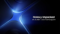

- **Original file:** `inspiration/1e601a4065c50294f3f3bf364c688c98 1.png` (121x69 px, source folder: (root), batch-001 (inspiration.zip, 2026-10-13))
- **Category / subcategory:** FUL / light-streak. **Style family:** LIGHT-STREAK. **Also useful for:** -
- **Tags:** light-streaks, x-shape, blue, event, key-visual, energy
- **Alternate copies:** none

**Observed (visible in the image)**
- **Visual description:** Black; luminous blue light ribbons crossing in an X from the left; event title text right ('Galaxy Unpacked').
- **Typography:** Medium white wordmark + small date line.
- **Colour palette (measured, dominant first):** `#000000` 22.2%  `#0D1439` 19.3%  `#1D3270` 16.1%  `#020106` 15.8%  `#030519` 15.7%  `#5279C1` 10.9%
- **Composition:** Visual left 55%, text right.
- **Lighting & effects:** Bright core with bloom falloff.
- **Depth & layering:** Ribbons curve in depth.

**Inferred (creative interpretation - not visible in a still)**
- **Animation behaviour:** INFERRED: streaks shoot in and intersect, flash, text fades.
- **Suitable use cases:** Event/launch intros, energetic transitions.
- **Technical recreation:** Bezier strokes with gradient + additive blur; or ffmpeg/After Effects light streaks.

---

### FUL-007 - Orbit Rings Diorama with Tiny World in Centre

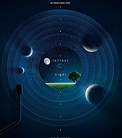

- **Original file:** `inspiration/2111200a196671ed83b8ed704b47b385 1.png` (122x138 px, source folder: (root), batch-001 (inspiration.zip, 2026-10-13))
- **Category / subcategory:** FUL / cosmic-diorama. **Style family:** HORIZON-ARC. **Also useful for:** -
- **Tags:** orbits, planets, moons, diorama, fantasy, teal, vertical
- **Alternate copies:** none

**Observed (visible in the image)**
- **Visual description:** Vertical deep teal-navy; concentric orbit rings with moons/planets; centre circular window showing grass and a tree under a starry sky; tiny centred text.
- **Typography:** Tiny widely-tracked caps.
- **Colour palette (measured, dominant first):** `#0A3250` 20.8%  `#0A243D` 20.0%  `#021223` 18.8%  `#010C1B` 17.1%  `#06172E` 15.7%  `#1B4F6B` 7.6%
- **Composition:** Radial symmetry.
- **Lighting & effects:** Soft starlight, planets lit from one side.
- **Depth & layering:** Multiple depth layers.

**Inferred (creative interpretation - not visible in a still)**
- **Animation behaviour:** INFERRED: rings rotate at different speeds; slow zoom into centre world.
- **Suitable use cases:** Dreamy/vision/imagination moments, chapter breaks.
- **Technical recreation:** Layered PNG/SVG rings with rotate; centre image masked circle.

---

### FUL-008 - Particle Torus Horizon Web Hero (violet)

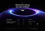

- **Original file:** `inspiration/220d5e37ec3242724b20de61d42648f6 1.png` (94x64 px, source folder: (root), batch-001 (inspiration.zip, 2026-10-13))
- **Category / subcategory:** FUL / horizon-arc. **Style family:** HORIZON-ARC. **Also useful for:** -
- **Tags:** particles, torus, violet, blue, hero, web
- **Alternate copies:** none

**Observed (visible in the image)**
- **Visual description:** Black web hero; glowing violet/blue particle ring/torus (planet edge) wraps the headline 'Start promoting on coin official'; dark footer UI.
- **Typography:** Medium white headline.
- **Colour palette (measured, dominant first):** `#030303` 44.5%  `#0B061B` 21.0%  `#474779` 13.3%  `#080313` 9.1%  `#030302` 6.2%  `#05010F` 5.9%
- **Composition:** Headline inside ring top-centre.
- **Lighting & effects:** Particle glow.
- **Depth & layering:** Ring in 3D.

**Inferred (creative interpretation - not visible in a still)**
- **Animation behaviour:** INFERRED: particles flow around ring continuously.
- **Suitable use cases:** Crypto/tech intros.
- **Technical recreation:** Particle system (canvas/three.js) or video loop.

---

### FUL-009 - Hand Holding Neon-Outlined Lightbulb (Creator)

- **Original file:** `inspiration/2451af9e83c3e8e75b898e5a7d5fa384 1.png` (122x162 px, source folder: (root), batch-001 (inspiration.zip, 2026-10-13))
- **Category / subcategory:** FUL / metaphor-object-dark. **Style family:** 3D-METAPHOR. **Also useful for:** -
- **Tags:** lightbulb, idea, hand, neon-rim, blue, archetype, series-archetypes, vertical
- **Alternate copies:** none

**Observed (visible in the image)**
- **Visual description:** Vertical navy; dark hand from top holds a lightbulb whose glass is drawn only by a glowing blue rim; quote glyph; 'Creator' blue heading + white body bottom-left.
- **Typography:** Same series typography as FUL-001 'Connector'.
- **Colour palette (measured, dominant first):** `#050D24` 19.8%  `#091B40` 18.6%  `#01061A` 18.5%  `#021036` 17.8%  `#041438` 17.6%  `#374E72` 7.7%
- **Composition:** Object top-centre, text bottom-left.
- **Lighting & effects:** Rim light only — silhouette style.
- **Depth & layering:** Hand/bulb in front of dark bg.

**Inferred (creative interpretation - not visible in a still)**
- **Animation behaviour:** INFERRED: bulb rim ignites with flicker; text fades.
- **Suitable use cases:** Ideas, creativity, creator archetype.
- **Technical recreation:** Generated image or 3D with rim light; series layout.

---

### FUL-010 - Blue Hourglass + Stacked Condensed Caps (TODAY/TOMORROW)

- **Original file:** `inspiration/2902959e28deb8634559636315f85069 1.png` (122x152 px, source folder: (root), batch-001 (inspiration.zip, 2026-10-13))
- **Category / subcategory:** FUL / metaphor-object-dark. **Style family:** 3D-METAPHOR. **Also useful for:** TXT
- **Tags:** hourglass, time, condensed-caps, stacked-type, blue, light-swoosh, vertical
- **Alternate copies:** none

**Observed (visible in the image)**
- **Visual description:** Vertical dark; glowing blue glass hourglass left with light swoosh; right: 'BUILT FOR / TODAY / READY FOR / TOMORROW' — small tracked caps alternate with huge condensed bold caps; logo bottom-right.
- **Typography:** Condensed heavy caps (Bebas/Anton-like) + small tracked caps.
- **Colour palette (measured, dominant first):** `#010102` 26.4%  `#212745` 22.7%  `#0A0F2D` 15.6%  `#CDD3EB` 12.4%  `#06070E` 11.9%  `#4B568B` 11.0%
- **Composition:** Object left half, type stack right-aligned.
- **Lighting & effects:** Blue rim and swoosh trail.
- **Depth & layering:** Hourglass large, cropped.

**Inferred (creative interpretation - not visible in a still)**
- **Animation behaviour:** INFERRED: type lines slam/slide in alternately; sand flows.
- **Suitable use cases:** Future-proof/time messaging.
- **Technical recreation:** Type stack in HTML; hourglass from 3D/generated.

---

### FUL-011 - Snowy Blue Waves with Floating Glossy Coins

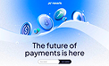

- **Original file:** `inspiration/2f249a31854c9e4a165a1d2f2b6d76bd 1.png` (122x74 px, source folder: (root), batch-001 (inspiration.zip, 2026-10-13))
- **Category / subcategory:** FUL / web-hero-light. **Style family:** FROST-LIGHT. **Also useful for:** -
- **Tags:** coins, crypto, payments, light, blue, waves, 3d
- **Alternate copies:** none

**Observed (visible in the image)**
- **Visual description:** Light white/blue scene with soft wave dunes; floating glossy blue 3D coins with crypto symbols; headline 'The future of payments is here'; email pill input.
- **Typography:** Medium dark sans centred.
- **Colour palette (measured, dominant first):** `#2479DB` 20.4%  `#D7E5FA` 19.5%  `#EDF1FB` 17.3%  `#82BBFB` 15.5%  `#B6D0F7` 14.4%  `#F7F9FD` 12.8%
- **Composition:** Coins top half; headline lower.
- **Lighting & effects:** Soft, high-key.
- **Depth & layering:** Coins at various depths.

**Inferred (creative interpretation - not visible in a still)**
- **Animation behaviour:** INFERRED: coins float/rotate; parallax.
- **Suitable use cases:** Payments/fintech, positive light scenes.
- **Technical recreation:** 3D coin renders + layered parallax.

---

### FUL-012 - Light-Speed Blue Streaks Burst (Technology Background)

- **Original file:** `inspiration/36e28be6138579556d80ac05059631ef 1.png` (122x183 px, source folder: (root), batch-001 (inspiration.zip, 2026-10-13))
- **Category / subcategory:** FUL / light-streak. **Style family:** LIGHT-STREAK. **Also useful for:** -
- **Tags:** light-streaks, speed, blue, tech, background, vertical
- **Alternate copies:** none

**Observed (visible in the image)**
- **Visual description:** Vertical navy; blue/cyan light-speed streaks bursting from right edge; 'TECHNOLOGY BACKGROUND' teal caps + body + outline button left.
- **Typography:** Medium caps, small body.
- **Colour palette (measured, dominant first):** `#041A39` 22.4%  `#040E1D` 20.4%  `#031326` 19.0%  `#042D64` 14.9%  `#061121` 13.2%  `#0E6BB6` 10.1%
- **Composition:** Text left-middle; streaks right.
- **Lighting & effects:** Additive cyan streaks.
- **Depth & layering:** Motion depth.

**Inferred (creative interpretation - not visible in a still)**
- **Animation behaviour:** INFERRED: streaks accelerate toward camera.
- **Suitable use cases:** Transitions, speed/tech backgrounds behind headline.
- **Technical recreation:** Streak particles radial from vanishing point.

---

### FUL-013 - Planet Arc Glow over Product Hero (Lumine)

- **Original file:** `inspiration/37cce64bc95918146fefb124a8d236c0 1.png` (199x141 px, source folder: (root), batch-001 (inspiration.zip, 2026-10-13))
- **Category / subcategory:** FUL / horizon-arc. **Style family:** HORIZON-ARC. **Also useful for:** -
- **Tags:** planet-arc, hero, dashboard, blue, saas, web
- **Alternate copies:** none

**Observed (visible in the image)**
- **Visual description:** Dark navy hero; glowing blue planet-horizon arc at top; 'Build Faster With Lumine Insights' headline, body, two buttons; dashboard mockup emerging below.
- **Typography:** Medium white headline.
- **Colour palette (measured, dominant first):** `#010619` 48.7%  `#02061A` 23.3%  `#212B47` 22.1%  `#010314` 3.1%  `#010617` 2.5%  `#00061A` 0.3%
- **Composition:** Centred.
- **Lighting & effects:** Arc rim light.
- **Depth & layering:** Dashboard below horizon.

**Inferred (creative interpretation - not visible in a still)**
- **Animation behaviour:** INFERRED: arc brightens, dashboard rises into view.
- **Suitable use cases:** Product reveal.
- **Technical recreation:** Arc via large circle edge glow.

---

### FUL-014 - Parametric Wave of Blue Slats + Floating Sphere (light studio)

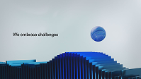

- **Original file:** `inspiration/39ba3dedcbde663502aaae3f8554b6ab 1.png` (199x112 px, source folder: (root), batch-001 (inspiration.zip, 2026-10-13))
- **Category / subcategory:** FUL / abstract-material. **Style family:** MATERIAL-ABSTRACT. **Also useful for:** -
- **Tags:** parametric, slats, wave, blue, sphere, light-grey, minimal-3d
- **Alternate copies:** none

**Observed (visible in the image)**
- **Visual description:** Light grey studio; a flowing wave formed by many blue vertical 3D slats/bars; a glossy blue sphere floats above; small text 'We embrace challenges' left.
- **Typography:** Small dark sans.
- **Colour palette (measured, dominant first):** `#1A3058` 24.8%  `#C5D1D5` 24.0%  `#C0C8CE` 21.7%  `#CBD5DA` 13.1%  `#D5DCE1` 12.3%  `#97B1C2` 4.1%
- **Composition:** Wave lower third horizontal; sphere right-centre.
- **Lighting & effects:** Soft studio light, subtle shadows.
- **Depth & layering:** 3D.

**Inferred (creative interpretation - not visible in a still)**
- **Animation behaviour:** INFERRED: wave ripples through slats; sphere bobs.
- **Suitable use cases:** Challenges/resilience, calm premium transitions.
- **Technical recreation:** 3D (Blender array + wave modifier) or canvas bars with sine heights.

---

### FUL-015 - Glowing Crowned Figure among Silhouettes (unique audience)

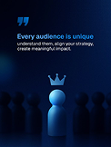

- **Original file:** `inspiration/3ba1308bfaf8d851ac49dcb47e7b7472 1.png` (122x162 px, source folder: (root), batch-001 (inspiration.zip, 2026-10-13))
- **Category / subcategory:** FUL / metaphor-object-dark. **Style family:** 3D-METAPHOR. **Also useful for:** -
- **Tags:** stand-out, crown, figure, crowd, blue, archetype, series-archetypes, vertical
- **Alternate copies:** none

**Observed (visible in the image)**
- **Visual description:** Vertical navy; glowing blue pawn-like figure with a crown among dark silhouettes; quote glyph; 'Every audience is unique' heading + body.
- **Typography:** Series typography.
- **Colour palette (measured, dominant first):** `#010314` 24.4%  `#03163D` 22.2%  `#010922` 20.8%  `#010F31` 14.1%  `#031032` 11.1%  `#21466F` 7.4%
- **Composition:** Figure centre-bottom; text top-left.
- **Lighting & effects:** Figure emissive; crowd dark.
- **Depth & layering:** Crowd depth rows.

**Inferred (creative interpretation - not visible in a still)**
- **Animation behaviour:** INFERRED: crowd fades, figure lights up, crown drops.
- **Suitable use cases:** Standing out, audience targeting.
- **Technical recreation:** Generated/3D; series layout.

---

### FUL-016 - Human Hand Shaking Digital Particle Hand

- **Original file:** `inspiration/4022c420b7cb0f1bc9147642ff29ba33 1.png` (122x121 px, source folder: (root), batch-001 (inspiration.zip, 2026-10-13))
- **Category / subcategory:** FUL / metaphor-object-dark. **Style family:** 3D-METAPHOR. **Also useful for:** -
- **Tags:** handshake, digital, particles, voxel, blue, partnership, ai
- **Alternate copies:** none

**Observed (visible in the image)**
- **Visual description:** Square navy grid bg; realistic human hand shakes a hand made of blue voxels/particles; 'Every solution we build' blue heading + body; logo top.
- **Typography:** Medium blue heading.
- **Colour palette (measured, dominant first):** `#000513` 28.7%  `#01071A` 21.2%  `#04102C` 20.9%  `#1B2E57` 12.8%  `#7488AF` 11.3%  `#01040E` 5.1%
- **Composition:** Hands across centre-right; text top-left.
- **Lighting & effects:** Particle hand self-illuminated.
- **Depth & layering:** Grid floor perspective.

**Inferred (creative interpretation - not visible in a still)**
- **Animation behaviour:** INFERRED: particle hand assembles from points then grips.
- **Suitable use cases:** Human + AI, partnerships.
- **Technical recreation:** Generated image + particle overlay animation.

---

### FUL-017 - Chrome Pawns with Blue King Standing Out (Don't Just Exist)

- **Original file:** `inspiration/40735c53b0b82998d7ee6ffee3cde9f2 1.png` (106x132 px, source folder: (root), batch-001 (inspiration.zip, 2026-10-13))
- **Category / subcategory:** FUL / metaphor-object-light. **Style family:** 3D-METAPHOR. **Also useful for:** -
- **Tags:** chess, stand-out, chrome, blue, white, branding, vertical
- **Alternate copies:** none

**Observed (visible in the image)**
- **Visual description:** Vertical white; 'Don't Just Exist' heavy navy sans with blue tag 'Be Unmissable'; row of chrome pawns receding with a glossy blue king; small body right.
- **Typography:** Heavy sans headline; tag in filled blue bar.
- **Colour palette (measured, dominant first):** `#F6F6F6` 23.1%  `#5F6386` 19.4%  `#F8F8F8` 18.8%  `#E3E3E7` 16.9%  `#F7F7F7` 13.7%  `#FBFBFA` 8.1%
- **Composition:** Headline top-right; pieces diagonal bottom-left.
- **Lighting & effects:** Studio reflections, chrome.
- **Depth & layering:** Depth-of-field row.

**Inferred (creative interpretation - not visible in a still)**
- **Animation behaviour:** INFERRED: camera dolly along row, focus racks to the blue king.
- **Suitable use cases:** Differentiation, standing out.
- **Technical recreation:** 3D render or generated still with rack-focus blur animation.

---

### FUL-018 - Flipping Glossy Coins Arc (Digital Ownership)

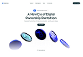

- **Original file:** `inspiration/43a83b431c68263293d32ca2d0bbb94d 1.png` (122x84 px, source folder: (root), batch-001 (inspiration.zip, 2026-10-13))
- **Category / subcategory:** FUL / web-hero-light. **Style family:** FROST-LIGHT. **Also useful for:** -
- **Tags:** coins, flip, arc, light, blue, crypto, hero
- **Alternate copies:** none

**Observed (visible in the image)**
- **Visual description:** White hero 'A New Era of Digital Ownership Starts Now'; glossy blue coins in an arc at various flip angles.
- **Typography:** Medium dark sans.
- **Colour palette (measured, dominant first):** `#FFFFFF` 75.8%  `#687198` 8.4%  `#FEFEFE` 8.4%  `#EBF0F2` 6.0%  `#FFFFFE` 1.2%  `#F1FFFE` 0.2%
- **Composition:** Headline top, coins arc lower.
- **Lighting & effects:** Soft.
- **Depth & layering:** Coins perspective.

**Inferred (creative interpretation - not visible in a still)**
- **Animation behaviour:** INFERRED: a single coin flips along arc path (motion study).
- **Suitable use cases:** Ownership, crypto, transformation sequences.
- **Technical recreation:** 3D coin; sequence along path.

---

### FUL-019 - Violet Glowing Curve with Node + Outline Pill (Adaptive AI)

- **Original file:** `inspiration/44beb81141fbec3685b9692c3d9bae70 1.png` (179x225 px, source folder: (root), batch-001 (inspiration.zip, 2026-10-13))
- **Category / subcategory:** FUL / data-viz-scene. **Style family:** DATA-GLOW. **Also useful for:** -
- **Tags:** curve, violet, node, outline-pill, ai, vertical
- **Alternate copies:** none

**Observed (visible in the image)**
- **Visual description:** Vertical dark; logo top-left; violet glowing curve rising to a bright node; outline pill 'Adaptive AI Routing'; body with violet highlighted 'AI model'.
- **Typography:** Light sans body with coloured keyword.
- **Colour palette (measured, dominant first):** `#0E0E0E` 64.2%  `#120E15` 18.0%  `#26202B` 10.6%  `#0C0C0E` 3.6%  `#0D0E0D` 3.1%  `#0E0E0D` 0.4%
- **Composition:** Visual top, text bottom-left.
- **Lighting & effects:** Violet emissive node bloom.
- **Depth & layering:** Flat with faint verticals.

**Inferred (creative interpretation - not visible in a still)**
- **Animation behaviour:** INFERRED: line draws to node, node flares, text reveals.
- **Suitable use cases:** AI features, routing, decisions.
- **Technical recreation:** SVG + glow.

---

### FUL-020 - Revenue Forecast Fan on Wall Screen in Dark Room

- **Original file:** `inspiration/46cda8b962557f9dc677068a45c489db 1.png` (165x165 px, source folder: (root), batch-001 (inspiration.zip, 2026-10-13))
- **Category / subcategory:** FUL / in-situ-display. **Style family:** DATA-GLOW. **Also useful for:** -
- **Tags:** forecast, scenarios, lines, blue, boardroom, in-situ, screen
- **Alternate copies:** none

**Observed (visible in the image)**
- **Visual description:** Dark boardroom with chair silhouettes; large wall screen 'REVENUE FORECAST' with multiple glowing blue lines fanning into scenarios, stats at right.
- **Typography:** Small caps title, tiny stats.
- **Colour palette (measured, dominant first):** `#010415` 27.9%  `#010208` 21.1%  `#040811` 19.3%  `#080D29` 13.5%  `#19274D` 9.9%  `#04082A` 8.3%
- **Composition:** Screen fills frame, chairs foreground bottom.
- **Lighting & effects:** Screen is light source; room dark.
- **Depth & layering:** Foreground chairs, screen background.

**Inferred (creative interpretation - not visible in a still)**
- **Animation behaviour:** INFERRED: camera push toward screen; lines fan out from a single point.
- **Suitable use cases:** Forecasts, scenarios, business planning.
- **Technical recreation:** Render chart, composite onto room plate (corner pin).

---

### FUL-021 - Glass Dome on Mirror Horizon with Orbit Line

- **Original file:** `inspiration/48e54c5ec99bd5cd4e9ac522930df4e5 1.png` (199x112 px, source folder: (root), batch-001 (inspiration.zip, 2026-10-13))
- **Category / subcategory:** FUL / horizon-arc. **Style family:** HORIZON-ARC. **Also useful for:** -
- **Tags:** dome, sphere, reflection, orbit, violet, navy, serif-caps
- **Alternate copies:** none

**Observed (visible in the image)**
- **Visual description:** Dark navy/violet; glowing glass half-dome sits on reflective horizon, orbit line with small moon; tiny serif caps text on the dome and mirrored text in reflection.
- **Typography:** Tiny tracked serif caps.
- **Colour palette (measured, dominant first):** `#010511` 22.3%  `#020E29` 21.7%  `#10041A` 17.5%  `#1E2754` 14.8%  `#161338` 12.6%  `#6870A6` 11.0%
- **Composition:** Centred symmetry.
- **Lighting & effects:** Violet underglow, specular dome.
- **Depth & layering:** Mirror floor.

**Inferred (creative interpretation - not visible in a still)**
- **Animation behaviour:** INFERRED: moon orbits; dome rises from horizon.
- **Suitable use cases:** Reflection/introspection, premium titles.
- **Technical recreation:** Sphere + mirrored masked copy.

---

### FUL-022 - Chaos Scribble → Light Trail → System Cube

- **Original file:** `inspiration/4afc1c4fe46e7cbc0e936f18d13e1d16 1.png` (154x191 px, source folder: (root), batch-001 (inspiration.zip, 2026-10-13))
- **Category / subcategory:** FUL / metaphor-object-dark. **Style family:** 3D-METAPHOR. **Also useful for:** TXT
- **Tags:** chaos-to-order, scribble, cube, violet, transformation, poster, vertical
- **Alternate copies:** none

**Observed (visible in the image)**
- **Visual description:** Vertical violet grid poster; headline 'YOUR BUSINESS IS RUNNING ON CHAOS, NOT A SYSTEM.' white caps; black tangled scribble ball labelled 'CHAOS' emits a violet light trail into a white 3D cube labelled 'SYSTEM'; small body; footer CTA.
- **Typography:** Bold caps headline; small labels.
- **Colour palette (measured, dominant first):** `#27164E` 20.8%  `#7251A4` 18.9%  `#54338F` 17.4%  `#371F6C` 17.3%  `#42267B` 16.6%  `#B5A9C6` 8.9%
- **Composition:** Headline top; left→right transformation mid; body bottom.
- **Lighting & effects:** Violet glow trail.
- **Depth & layering:** 3D cube with shadow.

**Inferred (creative interpretation - not visible in a still)**
- **Animation behaviour:** INFERRED: scribble untangles into a single line that wraps/forms the cube.
- **Suitable use cases:** Chaos to order, systems, before/after.
- **Technical recreation:** SVG scribble path morph/draw into cube outline; cube 3D or CSS.

---

### FUL-023 - Hourglass Sand onto Blue Cube (9 AM & 11 PM)

- **Original file:** `inspiration/4da966fce6042d48bfbe8e499b7fc847 1.png` (122x152 px, source folder: (root), batch-001 (inspiration.zip, 2026-10-13))
- **Category / subcategory:** FUL / metaphor-object-light. **Style family:** 3D-METAPHOR. **Also useful for:** -
- **Tags:** hourglass, time, blue, cube, light, poster, vertical
- **Alternate copies:** none

**Observed (visible in the image)**
- **Visual description:** Vertical white/blue; logo; 'Your website shouldn't look the same at 9 AM & 11 PM.' with blue large time; giant glass hourglass with blue sand pouring onto a blue cube.
- **Typography:** Small grey text + large blue medium numerals.
- **Colour palette (measured, dominant first):** `#18467E` 24.0%  `#F6F6F8` 20.3%  `#FCFCFD` 16.8%  `#FFFFFF` 16.3%  `#E8EAF0` 13.3%  `#BAC3CF` 9.4%
- **Composition:** Text left column; hourglass right bleeding off.
- **Lighting & effects:** Bright studio.
- **Depth & layering:** Macro object.

**Inferred (creative interpretation - not visible in a still)**
- **Animation behaviour:** INFERRED: sand pours continuously; cube grows.
- **Suitable use cases:** Time-based personalisation, timing.
- **Technical recreation:** Generated still + particle sand overlay.

---

### FUL-024 - 3D Violet '11' with Crown + Ghost Month Text

- **Original file:** `inspiration/4e9737fab3a496d851c8895218e6bd80 1.png` (122x152 px, source folder: (root), batch-001 (inspiration.zip, 2026-10-13))
- **Category / subcategory:** FUL / big-numeral-3d. **Style family:** 3D-METAPHOR. **Also useful for:** -
- **Tags:** 3d-numeral, crown, violet, month, ghost-text, vertical
- **Alternate copies:** none

**Observed (visible in the image)**
- **Visual description:** Vertical violet; logo; 'New Month, New Visibility Goals!'; huge glossy violet extruded '11' with crown on top; huge faint 'NOVEMBER' text behind.
- **Typography:** Medium white headline; ghost display text at 10% opacity.
- **Colour palette (measured, dominant first):** `#2C1365` 24.2%  `#6C34C1` 20.3%  `#4C1F9D` 16.4%  `#9860E7` 15.9%  `#49129E` 11.9%  `#CDA9F9` 11.3%
- **Composition:** Numeral centre-bottom; headline top.
- **Lighting & effects:** Glossy specular violet.
- **Depth & layering:** Ghost text behind numeral.

**Inferred (creative interpretation - not visible in a still)**
- **Animation behaviour:** INFERRED: numeral rises, crown drops and settles; ghost text slides.
- **Suitable use cases:** Dates, rankings, 'number 1', milestones.
- **Technical recreation:** 3D extruded text (Blender) or generated.

---

### FUL-025 - Curved Blue Speed Trails under Headline (Abstract Technology)

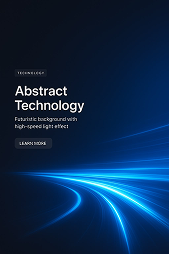

- **Original file:** `inspiration/50658e3882f70aedd11eed20687bf755 1.png` (169x254 px, source folder: (root), batch-001 (inspiration.zip, 2026-10-13))
- **Category / subcategory:** FUL / light-streak. **Style family:** LIGHT-STREAK. **Also useful for:** -
- **Tags:** light-trails, curved, blue, tech, background, vertical
- **Alternate copies:** none

**Observed (visible in the image)**
- **Visual description:** Vertical navy; 'Abstract Technology' white + body + button upper-left; curved blue light trails sweep along bottom.
- **Typography:** Medium white sans.
- **Colour palette (measured, dominant first):** `#0A111E` 21.0%  `#041F45` 20.4%  `#061731` 17.1%  `#091427` 16.0%  `#053372` 14.7%  `#2281C7` 10.8%
- **Composition:** Text top-left; trails bottom.
- **Lighting & effects:** Cyan-blue additive.
- **Depth & layering:** Trails recede.

**Inferred (creative interpretation - not visible in a still)**
- **Animation behaviour:** INFERRED: trails flow continuously.
- **Suitable use cases:** Background plates for statements.
- **Technical recreation:** Bezier trails with gradients + blur; loopable.

---

### FUL-026 - 3D Axes Rising Surface with Scatter → Glow Peak

- **Original file:** `inspiration/577ae12480ed2751a8d1e9ec29b592a0 1.png` (118x118 px, source folder: (root), batch-001 (inspiration.zip, 2026-10-13))
- **Category / subcategory:** FUL / data-viz-3d. **Style family:** DATA-GLOW. **Also useful for:** -
- **Tags:** 3d-chart, surface, scatter, orange-to-blue, peak, growth
- **Alternate copies:** none

**Observed (visible in the image)**
- **Visual description:** Dark; 3D axes and grid; a rising ribbon/surface from orange scatter points to blue to a white glowing peak.
- **Typography:** Tiny axis labels.
- **Colour palette (measured, dominant first):** `#080B12` 60.3%  `#090B13` 22.2%  `#212433` 9.3%  `#080B11` 4.7%  `#060B12` 1.8%  `#05080F` 1.7%
- **Composition:** Diagonal rise bottom-left→top-right.
- **Lighting & effects:** Hot peak bloom.
- **Depth & layering:** True 3D axes.

**Inferred (creative interpretation - not visible in a still)**
- **Animation behaviour:** INFERRED: camera orbits chart while surface grows; points scatter in.
- **Suitable use cases:** Data growth, 'all leads to this'.
- **Technical recreation:** three.js or Blender; or matplotlib 3D frames + glow post.

---

### FUL-027 - Spiral of Blue Glass Rings (web hero)

- **Original file:** `inspiration/58118ac26e00488a36b8ab8dce44dcdb 1.png` (121x68 px, source folder: (root), batch-001 (inspiration.zip, 2026-10-13))
- **Category / subcategory:** FUL / abstract-material. **Style family:** MATERIAL-ABSTRACT. **Also useful for:** -
- **Tags:** glass-rings, spiral, coil, blue, hero, clarity
- **Alternate copies:** none

**Observed (visible in the image)**
- **Visual description:** Dark web hero; spiral chain of glowing blue glass rings at right; 'No more clutter. Clarity, resilience and confidence.' left.
- **Typography:** Medium white.
- **Colour palette (measured, dominant first):** `#091A3A` 21.1%  `#030B21` 19.3%  `#020817` 18.5%  `#051027` 15.6%  `#0F2A56` 14.9%  `#3274B0` 10.6%
- **Composition:** Text left third; object right.
- **Lighting & effects:** Blue rim and inner glow.
- **Depth & layering:** Rings recede.

**Inferred (creative interpretation - not visible in a still)**
- **Animation behaviour:** INFERRED: rings rotate/coil continuously.
- **Suitable use cases:** Clarity/flow/continuity backgrounds.
- **Technical recreation:** 3D loop render.

---

### FUL-028 - Planet Earth Rim from Orbit with Wordmark

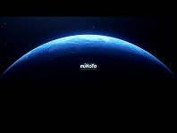

- **Original file:** `inspiration/5d617fd714022de53e1d2bc7d88f40d3 1.png` (198x149 px, source folder: (root), batch-001 (inspiration.zip, 2026-10-13))
- **Category / subcategory:** FUL / horizon-arc. **Style family:** HORIZON-ARC. **Also useful for:** -
- **Tags:** planet, earth, orbit, atmosphere, blue, intro, wordmark
- **Alternate copies:** none

**Observed (visible in the image)**
- **Visual description:** Black space; large blue planet arc with atmospheric rim light; small centred wordmark.
- **Typography:** Small wordmark.
- **Colour palette (measured, dominant first):** `#000000` 51.2%  `#01061C` 19.0%  `#00000C` 11.7%  `#000003` 9.6%  `#234A7C` 8.3%  `#010000` 0.1%
- **Composition:** Planet lower 60%.
- **Lighting & effects:** Atmospheric scattering rim.
- **Depth & layering:** Space depth.

**Inferred (creative interpretation - not visible in a still)**
- **Animation behaviour:** INFERRED: slow rotation, sunrise flare over rim.
- **Suitable use cases:** Global/scale openers, outros.
- **Technical recreation:** Stock/generated + glow; slow push.

---

### FUL-029 - Perspective Data Light Lines to Horizon + Question

- **Original file:** `inspiration/60583247d2a8213f8d55ccf669da1227 1.png` (122x69 px, source folder: (root), batch-001 (inspiration.zip, 2026-10-13))
- **Category / subcategory:** FUL / light-streak. **Style family:** LIGHT-STREAK. **Also useful for:** -
- **Tags:** light-lines, perspective, data-stream, blue, question, ai
- **Alternate copies:** none

**Observed (visible in the image)**
- **Visual description:** Black; blue/white thin light lines run in perspective toward horizon (like a data highway); centred question 'How would life change when AI meets your fridge?'
- **Typography:** Small white sans centred.
- **Colour palette (measured, dominant first):** `#07080A` 20.1%  `#183464` 18.6%  `#2F6098` 18.5%  `#080B0E` 18.2%  `#0A1124` 14.6%  `#71A1C8` 9.9%
- **Composition:** Text on horizon line.
- **Lighting & effects:** Luminous lines fading in depth.
- **Depth & layering:** Strong perspective.

**Inferred (creative interpretation - not visible in a still)**
- **Animation behaviour:** INFERRED: lines stream toward viewer; text fades.
- **Suitable use cases:** Rhetorical questions, chapter openers.
- **Technical recreation:** Canvas lines with perspective projection.

---

### FUL-030 - Blue 3D Signpost of Brand Directions

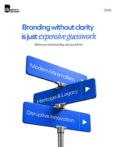

- **Original file:** `inspiration/650a5ea669acc1d16ef9a83741f0d693 1.png` (194x241 px, source folder: (root), batch-001 (inspiration.zip, 2026-10-13))
- **Category / subcategory:** FUL / metaphor-object-light. **Style family:** 3D-METAPHOR. **Also useful for:** TXT
- **Tags:** signpost, direction, choice, blue, branding, serif-mix, vertical
- **Alternate copies:** none

**Observed (visible in the image)**
- **Visual description:** Vertical white; 'Branding without clarity is just expensive guesswork' blue sans with italic serif for 'expensive guesswork'; small sub; blue 3D signpost with arrows 'Modern Minimalism', 'Heritage & Legacy', 'Disruptive Innovation'.
- **Typography:** Sans + italic serif mix in one colour.
- **Colour palette (measured, dominant first):** `#FFFFFF` 69.8%  `#174EBF` 13.1%  `#638AE0` 9.1%  `#C8D4E5` 4.1%  `#FFFFFD` 3.2%  `#FEFFFF` 0.8%
- **Composition:** Headline top; signpost centre-bottom.
- **Lighting & effects:** Studio light.
- **Depth & layering:** 3D sign.

**Inferred (creative interpretation - not visible in a still)**
- **Animation behaviour:** INFERRED: signs swing into place one by one.
- **Suitable use cases:** Choices/directions.
- **Technical recreation:** 3D or generated signpost with text replaced.

---

### FUL-031 - Giant Pencil Draws Bridge between Cliffs

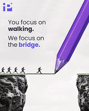

- **Original file:** `inspiration/65a9f860849be3b274c799814068ce7b 1.png` (179x223 px, source folder: (root), batch-001 (inspiration.zip, 2026-10-13))
- **Category / subcategory:** FUL / metaphor-object-light. **Style family:** 3D-METAPHOR. **Also useful for:** -
- **Tags:** pencil, bridge, cliffs, figures, violet, light, vertical
- **Alternate copies:** none

**Observed (visible in the image)**
- **Visual description:** Vertical light grey; 'You focus on walking. We focus on the bridge.' (bold, violet 'bridge'); giant violet pencil draws a thin line bridging two B&W rock cliffs; tiny walking figures cross.
- **Typography:** Light + bold sans mix with violet keyword.
- **Colour palette (measured, dominant first):** `#ECEBEA` 26.6%  `#574475` 23.7%  `#F2F0EF` 16.6%  `#F6F4F3` 14.4%  `#F0EDED` 12.7%  `#DAD8DB` 6.0%
- **Composition:** Text top-left; pencil diagonal right; cliffs bottom.
- **Lighting & effects:** Neutral.
- **Depth & layering:** Scale contrast (tiny figures).

**Inferred (creative interpretation - not visible in a still)**
- **Animation behaviour:** INFERRED: pencil draws line across gap; figures walk across after.
- **Suitable use cases:** Bridging gaps, service enabling.
- **Technical recreation:** Stroke draw synced with pencil transform.

---

### FUL-032 - Eclipse Ring with Teal Light Cone (Portfolio)

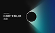

- **Original file:** `inspiration/677b27344bdba1518ae637b277f65294 1.png` (93x56 px, source folder: (root), batch-001 (inspiration.zip, 2026-10-13))
- **Category / subcategory:** FUL / light-streak. **Style family:** LIGHT-STREAK. **Also useful for:** -
- **Tags:** eclipse, ring, teal, light-cone, portfolio, dark
- **Alternate copies:** none

**Observed (visible in the image)**
- **Visual description:** Dark; black disc eclipse with bright teal rim and a cone of teal light emanating right; 'PORTFOLIO 2025' left.
- **Typography:** Heavy caps title.
- **Colour palette (measured, dominant first):** `#0E0E0E` 43.6%  `#172E47` 23.9%  `#37737F` 18.7%  `#0F0F0F` 10.3%  `#050505` 2.6%  `#0C0F0D` 0.9%
- **Composition:** Text left, eclipse right.
- **Lighting & effects:** Volumetric cone.
- **Depth & layering:** Flat.

**Inferred (creative interpretation - not visible in a still)**
- **Animation behaviour:** INFERRED: eclipse rim ignites, cone sweeps.
- **Suitable use cases:** Title cards.
- **Technical recreation:** Radial gradients + blurred cone.

---

### FUL-033 - Calendar Page Close-up with Pinned SAT Sticky Note

- **Original file:** `inspiration/70965c5f2d848f8f83df7d0561ecc3dd 1.png` (122x152 px, source folder: (root), batch-001 (inspiration.zip, 2026-10-13))
- **Category / subcategory:** FUL / metaphor-object-light. **Style family:** 3D-METAPHOR. **Also useful for:** -
- **Tags:** calendar, date, sticky-note, pin, blue, paper, vertical
- **Alternate copies:** none

**Observed (visible in the image)**
- **Visual description:** Vertical blue-tinted calendar close-up; big date numbers (24-27 'Yanvar'); curled paper sticky note 'SAT' pinned with red pin; small note card.
- **Typography:** Large bold condensed date numerals.
- **Colour palette (measured, dominant first):** `#014481` 23.5%  `#4F91BC` 21.3%  `#004283` 17.1%  `#ADCADB` 16.5%  `#E1E8EE` 13.1%  `#134C80` 8.6%
- **Composition:** Diagonal tilt of calendar.
- **Lighting & effects:** Soft blue tint.
- **Depth & layering:** Macro DOF.

**Inferred (creative interpretation - not visible in a still)**
- **Animation behaviour:** INFERRED: camera drifts over dates, note flutters.
- **Suitable use cases:** Deadlines, dates, schedules.
- **Technical recreation:** Generated image + parallax.

---

### FUL-034 - Pins and Strings Network (Start syncing everything)

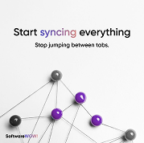

- **Original file:** `inspiration/716ab5e9198f97df1acd94f1080fe1f1 1.png` (179x178 px, source folder: (root), batch-001 (inspiration.zip, 2026-10-13))
- **Category / subcategory:** FUL / metaphor-object-light. **Style family:** 3D-METAPHOR. **Also useful for:** -
- **Tags:** network, pins, strings, violet, light, sync
- **Alternate copies:** none

**Observed (visible in the image)**
- **Visual description:** White; 'Start syncing everything' with gradient violet 'syncing'; 'Stop jumping between tabs.'; 3D pushpins (violet and grey spheres) connected by thin strings.
- **Typography:** Medium sans with gradient keyword.
- **Colour palette (measured, dominant first):** `#F9F9F9` 23.0%  `#F2F2F2` 21.9%  `#F7F7F7` 15.3%  `#F4F4F4` 15.1%  `#F6F6F5` 13.7%  `#BDB7C0` 11.0%
- **Composition:** Text top; network bottom.
- **Lighting & effects:** Soft shadows.
- **Depth & layering:** 3D pins.

**Inferred (creative interpretation - not visible in a still)**
- **Animation behaviour:** INFERRED: strings connect pins sequentially.
- **Suitable use cases:** Connecting tools/ideas.
- **Technical recreation:** 3D or 2.5D: circles with shading + SVG lines.

---

### FUL-035 - Fanned Blue Sheets Sculpture (skeps)

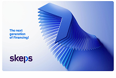

- **Original file:** `inspiration/726e5d732c4c09cec21388e790142399 1.png` (198x133 px, source folder: (root), batch-001 (inspiration.zip, 2026-10-13))
- **Category / subcategory:** FUL / abstract-material. **Style family:** MATERIAL-ABSTRACT. **Also useful for:** -
- **Tags:** fanned-sheets, sculpture, blue, light, finance, 3d
- **Alternate copies:** none

**Observed (visible in the image)**
- **Visual description:** White/light-blue card; blue 3D fanned sheets/pages forming a curved wave sculpture; 'The next generation of Financing!' + logo.
- **Typography:** Small bold blue.
- **Colour palette (measured, dominant first):** `#F8F8FA` 21.7%  `#283FAB` 21.6%  `#638AD9` 16.1%  `#DCE3F2` 14.4%  `#97ACE0` 13.1%  `#FDFDFD` 13.0%
- **Composition:** Text left; object right.
- **Lighting & effects:** Soft gradient shading.
- **Depth & layering:** 3D.

**Inferred (creative interpretation - not visible in a still)**
- **Animation behaviour:** INFERRED: sheets fan open sequentially.
- **Suitable use cases:** Growth/stacking/next-gen.
- **Technical recreation:** Array of rotated planes.

---

### FUL-036 - Glowing Figure Standing Out in Crowd (violet)

- **Original file:** `inspiration/746b0b0edece41837425f917fbab7429 1.png` (122x182 px, source folder: (root), batch-001 (inspiration.zip, 2026-10-13))
- **Category / subcategory:** FUL / metaphor-object-dark. **Style family:** 3D-METAPHOR. **Also useful for:** -
- **Tags:** stand-out, silhouette, crowd, violet, volumetric, vertical
- **Alternate copies:** none

**Observed (visible in the image)**
- **Visual description:** Vertical dark violet; glowing white-violet human silhouette in a crowd of dark silhouettes; volumetric haze.
- **Typography:** None.
- **Colour palette (measured, dominant first):** `#0B0C13` 24.0%  `#1B1241` 22.8%  `#0F0E1D` 15.9%  `#140F31` 15.1%  `#181037` 13.6%  `#674EA3` 8.7%
- **Composition:** Figure centred.
- **Lighting & effects:** Emissive figure, haze.
- **Depth & layering:** Crowd rows depth.

**Inferred (creative interpretation - not visible in a still)**
- **Animation behaviour:** INFERRED: crowd dims as figure ignites.
- **Suitable use cases:** Standing out, being noticed.
- **Technical recreation:** Generated still + glow animation.

---

### FUL-037 - Chrome Chain with One Violet Link (Stronger)

- **Original file:** `inspiration/754d8b8e4aae33f3ec5c2bad19132b7f 1.png` (169x211 px, source folder: (root), batch-001 (inspiration.zip, 2026-10-13))
- **Category / subcategory:** FUL / metaphor-object-light. **Style family:** 3D-METAPHOR. **Also useful for:** -
- **Tags:** chain, strength, violet, chrome, light, vertical
- **Alternate copies:** none

**Observed (visible in the image)**
- **Visual description:** Vertical light violet; logo; 'WE WILL MAKE YOU STRONGER WITH DATA-DRIVEN MARKETING' (bold violet 'STRONGER'); chrome chain with one violet link centre.
- **Typography:** Heavy caps + small caps.
- **Colour palette (measured, dominant first):** `#D6C8DF` 18.9%  `#E5E1E7` 18.5%  `#DED7E4` 17.8%  `#8D71A0` 15.8%  `#FAF9FC` 14.8%  `#EFECF2` 14.2%
- **Composition:** Text top; chain diagonal.
- **Lighting & effects:** Studio chrome.
- **Depth & layering:** 3D.

**Inferred (creative interpretation - not visible in a still)**
- **Animation behaviour:** INFERRED: violet link locks in, chain tightens.
- **Suitable use cases:** Strength, weak link, connection.
- **Technical recreation:** Generated/3D.

---

### FUL-038 - Violet Sand Hourglass Macro (Every moment counts)

- **Original file:** `inspiration/7738d8020f4517f5d9c28aea945c5e85 1.png` (179x178 px, source folder: (root), batch-001 (inspiration.zip, 2026-10-13))
- **Category / subcategory:** FUL / metaphor-object-light. **Style family:** 3D-METAPHOR. **Also useful for:** -
- **Tags:** hourglass, time, violet, light, macro
- **Alternate copies:** none

**Observed (visible in the image)**
- **Visual description:** Light; hourglass close-up with violet sand and a violet block inside; 'Every moment counts' + body.
- **Typography:** Medium dark sans.
- **Colour palette (measured, dominant first):** `#3F3D7A` 24.1%  `#F5F4F3` 19.8%  `#FBF9F7` 17.1%  `#FAF8F6` 14.9%  `#E0DDE2` 12.5%  `#FBFBF8` 11.6%
- **Composition:** Object left bleed; text right.
- **Lighting & effects:** Soft.
- **Depth & layering:** Macro.

**Inferred (creative interpretation - not visible in a still)**
- **Animation behaviour:** INFERRED: sand flows.
- **Suitable use cases:** Time/urgency.
- **Technical recreation:** Generated + sand particles.

---

### FUL-039 - Twisted Ribbon of Blue Glass Slats

- **Original file:** `inspiration/77f8b448743edd1b07d0365c0887a0da 1.png` (121x68 px, source folder: (root), batch-001 (inspiration.zip, 2026-10-13))
- **Category / subcategory:** FUL / abstract-material. **Style family:** MATERIAL-ABSTRACT. **Also useful for:** -
- **Tags:** ribbon, slats, twist, blue, glass, abstract, transition
- **Alternate copies:** none

**Observed (visible in the image)**
- **Visual description:** Dark navy; a diagonal twisted ribbon formed of many blue glass slats.
- **Typography:** None.
- **Colour palette (measured, dominant first):** `#010021` 38.0%  `#02001C` 15.0%  `#020026` 14.9%  `#08218E` 14.1%  `#338CDB` 11.1%  `#02022C` 6.9%
- **Composition:** Diagonal band.
- **Lighting & effects:** Edge highlights.
- **Depth & layering:** 3D twist.

**Inferred (creative interpretation - not visible in a still)**
- **Animation behaviour:** INFERRED: twist travels along ribbon.
- **Suitable use cases:** Transitions, background loops.
- **Technical recreation:** 3D array + twist modifier.

---

### FUL-040 - Halftone Dot Sphere Glow Event Page (OnRamp)

- **Original file:** `inspiration/7db05076605ac55ee3d4b9ba9dbea2e5 1.png` (198x298 px, source folder: (root), batch-001 (inspiration.zip, 2026-10-13))
- **Category / subcategory:** FUL / web-hero-light. **Style family:** FROST-LIGHT. **Also useful for:** -
- **Tags:** halftone, dots, sphere, blue, event, web, light
- **Alternate copies:** none

**Observed (visible in the image)**
- **Visual description:** Vertical web page; top hero blue halftone-dot gradient with glowing sphere 'OnRamp'; white content below (agenda, icons).
- **Typography:** Medium white wordmark; small dark body.
- **Colour palette (measured, dominant first):** `#FFFFFF` 38.8%  `#204B92` 24.6%  `#ABC0DD` 20.7%  `#F1F2F7` 12.5%  `#FAF9FF` 2.4%  `#FEFFFF` 1.0%
- **Composition:** Hero 45%, content below.
- **Lighting & effects:** Dot gradient glow.
- **Depth & layering:** Flat.

**Inferred (creative interpretation - not visible in a still)**
- **Animation behaviour:** INFERRED: dots ripple outward.
- **Suitable use cases:** Events, halftone textures.
- **Technical recreation:** Canvas dot grid sized by radial gradient.

---

### FUL-041 - Bright Blue Poster with Frosted Pocket of Flyers

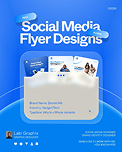

- **Original file:** `inspiration/80cdd34cb41f7cad4ffa570aa188b029 1.png` (122x152 px, source folder: (root), batch-001 (inspiration.zip, 2026-10-13))
- **Category / subcategory:** FUL / typographic-poster. **Style family:** FROST-LIGHT. **Also useful for:** -
- **Tags:** poster, blue, frosted-glass, pocket, label-pills, vertical
- **Alternate copies:** none

**Observed (visible in the image)**
- **Visual description:** Vertical bright blue; 'Social Media Flyer Designs' bold white with small tilted label pills; frosted glass pocket with flyer cards peeking out; info lines; footer.
- **Typography:** Heavy white sans; pill labels.
- **Colour palette (measured, dominant first):** `#DCDEDB` 24.7%  `#348AF4` 19.8%  `#047FF0` 19.5%  `#2779F2` 18.2%  `#1866E8` 11.8%  `#7DA9E1` 5.9%
- **Composition:** Headline top; pocket centre.
- **Lighting & effects:** Glass blur.
- **Depth & layering:** Cards inside pocket.

**Inferred (creative interpretation - not visible in a still)**
- **Animation behaviour:** INFERRED: cards slide up out of pocket.
- **Suitable use cases:** Portfolio/showcase reveals.
- **Technical recreation:** Clip region for pocket; backdrop blur.

---

### FUL-042 - Mint Translucent Glyph with Dark Glass Bar (quote)

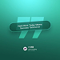

- **Original file:** `inspiration/85438f3d131c3248f9c49eb6c2179e8d 1.png` (75x75 px, source folder: (root), batch-001 (inspiration.zip, 2026-10-13))
- **Category / subcategory:** FUL / typographic-quote. **Style family:** 3D-METAPHOR. **Also useful for:** TXT
- **Tags:** quote, glyph, mint, teal, glass-bar, statement
- **Alternate copies:** none

**Observed (visible in the image)**
- **Visual description:** Teal-mint gradient; giant translucent mint quote/hash glyph; dark glass bar diagonal with 'Hard Work Today More Success Tomorrow'; small logo bottom.
- **Typography:** Medium white in bar.
- **Colour palette (measured, dominant first):** `#145548` 22.0%  `#217564` 17.7%  `#4BD3C2` 17.2%  `#196959` 15.3%  `#38A792` 15.0%  `#60E9E0` 12.7%
- **Composition:** Same layout family as FUL-004.
- **Lighting & effects:** Soft.
- **Depth & layering:** Bar in front.

**Inferred (creative interpretation - not visible in a still)**
- **Animation behaviour:** INFERRED: as FUL-004.
- **Suitable use cases:** Motivational statements.
- **Technical recreation:** See FUL-004 (same layout family).

---

### FUL-043 - Clay Thinker on Keyboard (escape the bad design)

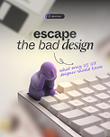

- **Original file:** `inspiration/8a5a1386e0c061ddcfebf35547694484 1.png` (122x152 px, source folder: (root), batch-001 (inspiration.zip, 2026-10-13))
- **Category / subcategory:** FUL / metaphor-object-light. **Style family:** 3D-METAPHOR. **Also useful for:** TXT
- **Tags:** clay, figure, keyboard, handwritten, serif-mix, warm, dof, vertical
- **Alternate copies:** none

**Observed (visible in the image)**
- **Visual description:** Vertical warm light; tag pill top; 'escape' bold + 'the bad design' italic serif; violet handwritten annotation with arrow; violet clay 'thinker' figure sitting on mechanical keyboard; shallow DOF.
- **Typography:** Sans/serif mix + handwritten script annotation.
- **Colour palette (measured, dominant first):** `#645A5E` 19.6%  `#ECE5DA` 19.5%  `#A19895` 17.2%  `#BBAEAA` 16.7%  `#D5CCC5` 15.2%  `#F7F1DF` 11.7%
- **Composition:** Text top; object bottom-right.
- **Lighting & effects:** Warm window light.
- **Depth & layering:** Shallow DOF.

**Inferred (creative interpretation - not visible in a still)**
- **Animation behaviour:** INFERRED: handwriting draws on; rack focus to figure.
- **Suitable use cases:** Design mistakes, reflective moments.
- **Technical recreation:** Generated image; SVG handwriting path draw.

---

### FUL-044 - Testimonial Quote Cards Stack (3D Project Workflow)

- **Original file:** `inspiration/8b12f6ecf093b3944d1ae5e25eece2e6 1.png` (122x152 px, source folder: (root), batch-001 (inspiration.zip, 2026-10-13))
- **Category / subcategory:** FUL / typographic-poster. **Style family:** FROST-LIGHT. **Also useful for:** -
- **Tags:** testimonials, quote-cards, light, blue, stack, vertical
- **Alternate copies:** none

**Observed (visible in the image)**
- **Visual description:** Vertical light grey-blue; 'My 3D Project Workflow Blueprint' ('Blueprint' blue); stacked white testimonial cards with quote marks; blue gradient bottom.
- **Typography:** Medium dark sans.
- **Colour palette (measured, dominant first):** `#DDDEE0` 22.7%  `#799DC9` 18.7%  `#E4E4E5` 17.9%  `#D8D9DA` 14.1%  `#C7D1DD` 13.6%  `#EDEDEE` 13.0%
- **Composition:** Headline top; cards column.
- **Lighting & effects:** Soft shadows.
- **Depth & layering:** Stacked cards.

**Inferred (creative interpretation - not visible in a still)**
- **Animation behaviour:** INFERRED: cards slide up sequentially.
- **Suitable use cases:** Testimonials, social proof.
- **Technical recreation:** HTML cards.

---

### FUL-045 - Row of Dark Tiles with Lit Centre Framer Tile + Hero Text

- **Original file:** `inspiration/8c317decf89ebe769525b6c2fff2a378 1.png` (122x69 px, source folder: (root), batch-001 (inspiration.zip, 2026-10-13))
- **Category / subcategory:** FUL / web-hero-dark. **Style family:** NEON-RIM. **Also useful for:** -
- **Tags:** tiles, framer, hero, blue, glow, design
- **Alternate copies:** none

**Observed (visible in the image)**
- **Visual description:** Black; row of dark glass app tiles with centre (Framer) lit blue by a hand/figure; 'Step into the future of design' + body + buttons.
- **Typography:** Medium white.
- **Colour palette (measured, dominant first):** `#000000` 71.3%  `#153661` 8.8%  `#040C1B` 7.5%  `#6D97B7` 5.3%  `#010005` 5.1%  `#000003` 2.0%
- **Composition:** Tiles top, text centre.
- **Lighting & effects:** Single centre light.
- **Depth & layering:** Tiles recede.

**Inferred (creative interpretation - not visible in a still)**
- **Animation behaviour:** INFERRED: centre tile lights up as others dim.
- **Suitable use cases:** Tool focus intros.
- **Technical recreation:** As ONS-010.

---

### FUL-046 - Frosted Glass Donut with Blurred Blue Core

- **Original file:** `inspiration/8c62155cc8837dafa2340d994083c526 1.png` (122x122 px, source folder: (root), batch-001 (inspiration.zip, 2026-10-13))
- **Category / subcategory:** FUL / data-viz-scene. **Style family:** FROST-LIGHT. **Also useful for:** -
- **Tags:** donut, pie, frosted, blue, light, neumorphic, percent
- **Alternate copies:** none

**Observed (visible in the image)**
- **Visual description:** Light grey; large frosted white glass donut/pie with a separated segment; inner deep blue blurred glow showing 30% / 70%.
- **Typography:** Small white percentages.
- **Colour palette (measured, dominant first):** `#D1D1D2` 39.9%  `#EDEDED` 28.3%  `#E5E5E5` 13.7%  `#949ED7` 9.5%  `#EBEDED` 6.8%  `#F1F1F1` 1.8%
- **Composition:** Donut left-centre large.
- **Lighting & effects:** Blue glow through frosted glass.
- **Depth & layering:** Glass layers.

**Inferred (creative interpretation - not visible in a still)**
- **Animation behaviour:** INFERRED: segment slides out, glow intensifies.
- **Suitable use cases:** Proportions on light theme.
- **Technical recreation:** Layered circles with backdrop blur over blue blob.

---

### FUL-047 - Violet Light Rays through Key Grid (Premiere key)

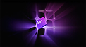

- **Original file:** `inspiration/93d23a55a0912f5ab25713f9fed31e09 1.png` (122x68 px, source folder: (root), batch-001 (inspiration.zip, 2026-10-13))
- **Category / subcategory:** FUL / abstract-material. **Style family:** MATERIAL-ABSTRACT. **Also useful for:** -
- **Tags:** keys, grid, violet, rays, premiere, 3d
- **Alternate copies:** none

**Observed (visible in the image)**
- **Visual description:** Dark; violet volumetric rays radiate behind a grid of dark keycaps; central glossy violet 'Pr' key raised.
- **Typography:** Logo on key.
- **Colour palette (measured, dominant first):** `#040405` 28.2%  `#08040D` 19.8%  `#14081C` 18.2%  `#341249` 15.9%  `#793FA3` 10.8%  `#020202` 7.0%
- **Composition:** Centred.
- **Lighting & effects:** Rays + emissive key.
- **Depth & layering:** 3D grid.

**Inferred (creative interpretation - not visible in a still)**
- **Animation behaviour:** INFERRED: central key rises and glows, rays expand.
- **Suitable use cases:** Software/tool reveals.
- **Technical recreation:** 3D render.

---

### FUL-048 - Isometric Glass Tiles with Blue Underlight (macro)

- **Original file:** `inspiration/946180e17dec456d5d0f47ae6ae4f33f 1.png` (191x265 px, source folder: (root), batch-001 (inspiration.zip, 2026-10-13))
- **Category / subcategory:** FUL / abstract-material. **Style family:** MATERIAL-ABSTRACT. **Also useful for:** -
- **Tags:** tiles, isometric, glass, blue, underlight, macro, vertical
- **Alternate copies:** none

**Observed (visible in the image)**
- **Visual description:** Vertical black; isometric macro of acrylic tiles with blue under-light edges.
- **Typography:** None.
- **Colour palette (measured, dominant first):** `#000000` 49.6%  `#295A9E` 19.5%  `#000002` 11.5%  `#041734` 9.8%  `#6F9BD7` 9.2%  `#010000` 0.4%
- **Composition:** Diagonal grid.
- **Lighting & effects:** Edge glow.
- **Depth & layering:** Macro.

**Inferred (creative interpretation - not visible in a still)**
- **Animation behaviour:** INFERRED: tiles light up in waves.
- **Suitable use cases:** Tech b-roll, backgrounds.
- **Technical recreation:** 3D or generated loop.

---

### FUL-049 - Starry Night Palette Poster (ripple + gradient bar)

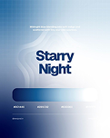

- **Original file:** `inspiration/96f33288037febe8c297ad7125607247 1.png` (121x152 px, source folder: (root), batch-001 (inspiration.zip, 2026-10-13))
- **Category / subcategory:** FUL / typographic-poster. **Style family:** FROST-LIGHT. **Also useful for:** -
- **Tags:** palette, gradient-bar, ripple, navy, light, vertical
- **Alternate copies:** none

**Observed (visible in the image)**
- **Visual description:** Vertical white→blue gradient; ripple contour lines; 'Starry Night' bold navy centred; wide pill gradient swatch bar with hex labels.
- **Typography:** Heavy navy sans.
- **Colour palette (measured, dominant first):** `#D5E1EC` 20.2%  `#325180` 19.0%  `#7E9CBC` 18.4%  `#FDFEFE` 16.9%  `#A8BDD2` 12.9%  `#F3F7FA` 12.6%
- **Composition:** Centred stack.
- **Lighting & effects:** Soft.
- **Depth & layering:** Ripples.

**Inferred (creative interpretation - not visible in a still)**
- **Animation behaviour:** INFERRED: ripple expand; swatch fills left→right.
- **Suitable use cases:** Colour/brand topics, calm title cards.
- **Technical recreation:** SVG concentric paths.

---

### FUL-050 - Robot and Human Hands Reaching (Bridge to the Future)

- **Original file:** `inspiration/a1f9a5437bc584f7f63ced1367c99b51 1.png` (199x248 px, source folder: (root), batch-001 (inspiration.zip, 2026-10-13))
- **Category / subcategory:** FUL / metaphor-object-light. **Style family:** 3D-METAPHOR. **Also useful for:** -
- **Tags:** creation-of-adam, robot, hands, ai, violet, lavender, vertical
- **Alternate copies:** none

**Observed (visible in the image)**
- **Visual description:** Vertical lavender; 'BUILDING THE BRIDGE TO THE FUTURE' violet caps with filled violet box on 'THE FUTURE'; robot hand and human hand nearly touching with spark glow.
- **Typography:** Medium caps + highlight box.
- **Colour palette (measured, dominant first):** `#EDE9F4` 19.4%  `#CBBCE3` 19.0%  `#D6C9E8` 16.8%  `#775E9B` 16.7%  `#E3DBEE` 16.1%  `#F5F2F8` 12.0%
- **Composition:** Text top; hands bottom diagonal.
- **Lighting & effects:** Spark at touch point.
- **Depth & layering:** Hands foreground.

**Inferred (creative interpretation - not visible in a still)**
- **Animation behaviour:** INFERRED: hands move closer, spark flashes on touch.
- **Suitable use cases:** Human + AI collaboration.
- **Technical recreation:** Generated image + spark overlay.

---

### FUL-051 - 3D Blue '1' with Gold Crown (1 Year)

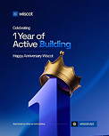

- **Original file:** `inspiration/a8377f219621e4e188034c0f32cbc96a 1.png` (122x153 px, source folder: (root), batch-001 (inspiration.zip, 2026-10-13))
- **Category / subcategory:** FUL / big-numeral-3d. **Style family:** 3D-METAPHOR. **Also useful for:** -
- **Tags:** 3d-numeral, crown, gold, blue, anniversary, vertical
- **Alternate copies:** none

**Observed (visible in the image)**
- **Visual description:** Vertical deep blue; 'Celebrating 1 Year of Active Building' (blue accent 'Building'); giant glossy blue 3D '1' with gold crown.
- **Typography:** Medium white + blue accent.
- **Colour palette (measured, dominant first):** `#031351` 27.4%  `#08114A` 20.5%  `#2854AA` 19.7%  `#0D3182` 18.2%  `#7C8BBD` 9.2%  `#011250` 5.1%
- **Composition:** Text top-left; numeral bottom-centre.
- **Lighting & effects:** Gold specular, blue gloss.
- **Depth & layering:** 3D.

**Inferred (creative interpretation - not visible in a still)**
- **Animation behaviour:** INFERRED: numeral rises, crown drops.
- **Suitable use cases:** Anniversaries, rank #1.
- **Technical recreation:** 3D text.

---

### FUL-052 - Violet Planet Arc over Centred Headline (meetings)

- **Original file:** `inspiration/a85101d4b77ba3408e2db82cfa378ca4 1.png` (122x73 px, source folder: (root), batch-001 (inspiration.zip, 2026-10-13))
- **Category / subcategory:** FUL / horizon-arc. **Style family:** HORIZON-ARC. **Also useful for:** -
- **Tags:** planet-arc, violet, headline, centred, saas
- **Alternate copies:** none

**Observed (visible in the image)**
- **Visual description:** Dark navy; violet glowing planet arc at top; 'Get more out of your meetings' centred white; small body.
- **Typography:** Medium white.
- **Colour palette (measured, dominant first):** `#030116` 39.3%  `#030118` 35.1%  `#302950` 14.4%  `#010010` 4.8%  `#020116` 3.8%  `#020112` 2.6%
- **Composition:** Centred under arc.
- **Lighting & effects:** Arc glow.
- **Depth & layering:** Flat.

**Inferred (creative interpretation - not visible in a still)**
- **Animation behaviour:** INFERRED: arc brightens like sunrise; headline fades up.
- **Suitable use cases:** Statement cards.
- **Technical recreation:** Arc glow recipe.

---

### FUL-053 - Web2.0 → Logo → Web3.0 Lens Flare Transition

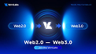

- **Original file:** `inspiration/a8bdaaec9edc5305383228b6c8e40ecb 1.png` (122x69 px, source folder: (root), batch-001 (inspiration.zip, 2026-10-13))
- **Category / subcategory:** FUL / transition-concept. **Style family:** NEON-RIM. **Also useful for:** -
- **Tags:** transition, before-after, lens-flare, blue, pills, arrows
- **Alternate copies:** none

**Observed (visible in the image)**
- **Visual description:** Blue; glowing pill 'Web2.0' → logo with radial lens flare rings → pill 'Web3.0'; title 'Web2.0 — Web3.0' below.
- **Typography:** Bold white.
- **Colour palette (measured, dominant first):** `#01051D` 27.0%  `#0326A1` 19.0%  `#03145F` 18.7%  `#102863` 12.9%  `#174DA1` 11.4%  `#4FAAEA` 10.9%
- **Composition:** Horizontal symmetric.
- **Lighting & effects:** Strong flares.
- **Depth & layering:** Flat.

**Inferred (creative interpretation - not visible in a still)**
- **Animation behaviour:** INFERRED: left pill flows through centre and transforms into right pill.
- **Suitable use cases:** Before → after, evolution.
- **Technical recreation:** Pills + radial gradients.

---

### FUL-054 - Human and Robot Hands on Navy Grid (clarity meets creativity)

- **Original file:** `inspiration/b148f2e07365a6b897c8e370a1594da1 1.png` (178x224 px, source folder: (root), batch-001 (inspiration.zip, 2026-10-13))
- **Category / subcategory:** FUL / metaphor-object-dark. **Style family:** 3D-METAPHOR. **Also useful for:** -
- **Tags:** hands, robot, ai, navy, grid, vertical
- **Alternate copies:** none

**Observed (visible in the image)**
- **Visual description:** Vertical navy grid; 'Where clarity meets creativity.' light+bold mix; human hand and robot hand with glowing joints reaching.
- **Typography:** Light + bold sans mix.
- **Colour palette (measured, dominant first):** `#102950` 25.6%  `#040D20` 24.1%  `#183968` 21.5%  `#081935` 19.2%  `#425E88` 6.9%  `#0D1A33` 2.6%
- **Composition:** Text top; hands middle.
- **Lighting & effects:** Blue joint glows.
- **Depth & layering:** Grid perspective.

**Inferred (creative interpretation - not visible in a still)**
- **Animation behaviour:** INFERRED: hands approach.
- **Suitable use cases:** AI + human.
- **Technical recreation:** Generated.

---

### FUL-055 - Ornate Glass Hourglass in Blue Studio (savings)

- **Original file:** `inspiration/b873f49d85fc95894193aae00380a131 1.png` (165x166 px, source folder: (root), batch-001 (inspiration.zip, 2026-10-13))
- **Category / subcategory:** FUL / metaphor-object-dark. **Style family:** 3D-METAPHOR. **Also useful for:** -
- **Tags:** hourglass, time, blue, savings, poster, vertical
- **Alternate copies:** none

**Observed (visible in the image)**
- **Visual description:** Vertical blue; logo; 'Secure Your Savings Before You Run out of Time.'; ornate glass hourglass with blue sand; app badges footer.
- **Typography:** Bold white sans.
- **Colour palette (measured, dominant first):** `#083E9E` 29.8%  `#2252A5` 22.6%  `#0B409F` 20.1%  `#ADC0DD` 19.9%  `#061959` 6.0%  `#053F93` 1.7%
- **Composition:** Text top; object centre.
- **Lighting & effects:** Studio blue.
- **Depth & layering:** Object hero.

**Inferred (creative interpretation - not visible in a still)**
- **Animation behaviour:** INFERRED: sand flows, slow push-in.
- **Suitable use cases:** Urgency/time.
- **Technical recreation:** Generated + particles.

---

### FUL-056 - Hand Reaching to Glowing Orb (decentralization)

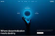

- **Original file:** `inspiration/bb209cf6c9db2da8da96853f6b29b381 1.png` (112x75 px, source folder: (root), batch-001 (inspiration.zip, 2026-10-13))
- **Category / subcategory:** FUL / web-hero-dark. **Style family:** HORIZON-ARC. **Also useful for:** -
- **Tags:** orb, hand, reach, blue, hero, web
- **Alternate copies:** none

**Observed (visible in the image)**
- **Visual description:** Blue web hero; hand reaching up to a glowing blue orb; 'Where decentralization meets destiny.' bottom-left.
- **Typography:** Medium white.
- **Colour palette (measured, dominant first):** `#010B16` 22.2%  `#096191` 21.3%  `#06416A` 18.7%  `#062745` 15.9%  `#021930` 15.0%  `#2885AF` 7.0%
- **Composition:** Orb centre; text bottom-left.
- **Lighting & effects:** Orb glow.
- **Depth & layering:** Hand foreground.

**Inferred (creative interpretation - not visible in a still)**
- **Animation behaviour:** INFERRED: orb pulses, hand rises.
- **Suitable use cases:** Aspiration, reaching goals.
- **Technical recreation:** Generated + glow.

---

### FUL-057 - Chrome Clock Face Perspective (Timing matters!)

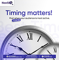

- **Original file:** `inspiration/bc2fd3d245864982b474c3f1cefc9d3d 1.png` (121x122 px, source folder: (root), batch-001 (inspiration.zip, 2026-10-13))
- **Category / subcategory:** FUL / metaphor-object-light. **Style family:** 3D-METAPHOR. **Also useful for:** -
- **Tags:** clock, time, chrome, lavender, ghost-text, vertical
- **Alternate copies:** none

**Observed (visible in the image)**
- **Visual description:** Vertical light lavender; 'Timing matters!' blue bold; sub with pill tag; big chrome clock face with roman numerals in perspective; ghost text 'Best Time' behind.
- **Typography:** Heavy blue sans.
- **Colour palette (measured, dominant first):** `#5C5B8B` 22.4%  `#E5E5E7` 20.6%  `#CAC8DD` 19.4%  `#FFFFFF` 16.0%  `#FBFBFB` 10.8%  `#F1F1F3` 10.7%
- **Composition:** Text top; clock bottom bleeding.
- **Lighting & effects:** Chrome reflections.
- **Depth & layering:** Perspective clock.

**Inferred (creative interpretation - not visible in a still)**
- **Animation behaviour:** INFERRED: clock hands sweep fast then stop on target time.
- **Suitable use cases:** Timing, scheduling.
- **Technical recreation:** Generated clock + animated hands overlay.

---

### FUL-058 - Giant Dial Hand with Violet Timeline Arc

- **Original file:** `inspiration/be2dbc8bbe6c218a83e2760cf76b40d9 1.png` (122x122 px, source folder: (root), batch-001 (inspiration.zip, 2026-10-13))
- **Category / subcategory:** FUL / metaphor-object-light. **Style family:** 3D-METAPHOR. **Also useful for:** -
- **Tags:** dial, watch-hand, timeline, violet, navy, light, minimal
- **Alternate copies:** none

**Observed (visible in the image)**
- **Visual description:** Light grey; huge navy watch hand pivoting from bottom-centre; purple arc track with nodes and labels along dial edge; 'Minimal Doesn't Mean Less.' (violet 'Doesn't'); logo.
- **Typography:** Medium navy + violet accent.
- **Colour palette (measured, dominant first):** `#ECEAED` 22.4%  `#E6E4E7` 22.3%  `#F0EEF1` 17.3%  `#E9E7EA` 13.5%  `#F6F4F6` 13.1%  `#A39DB7` 11.4%
- **Composition:** Dial macro from lower-left.
- **Lighting & effects:** Soft.
- **Depth & layering:** Macro.

**Inferred (creative interpretation - not visible in a still)**
- **Animation behaviour:** INFERRED: hand sweeps from node to node along arc.
- **Suitable use cases:** Timelines, steps over time.
- **Technical recreation:** SVG arc + rotating hand.

---

### FUL-059 - Floating Blue Glass Shards around Title (FutureTech)

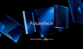

- **Original file:** `inspiration/c16d7e5b666c6e8631c6c1d34ce98ea0 1.png` (122x72 px, source folder: (root), batch-001 (inspiration.zip, 2026-10-13))
- **Category / subcategory:** FUL / abstract-material. **Style family:** MATERIAL-ABSTRACT. **Also useful for:** -
- **Tags:** glass-shards, panels, blue, title, depth
- **Alternate copies:** none

**Observed (visible in the image)**
- **Visual description:** Black; floating blue glass panels/shards at varied angles around 'FutureTech' title.
- **Typography:** Medium white wordmark.
- **Colour palette (measured, dominant first):** `#000000` 50.6%  `#040B28` 18.4%  `#06285A` 14.0%  `#2469AD` 9.8%  `#01000A` 4.6%  `#010000` 2.5%
- **Composition:** Centred title, shards around.
- **Lighting & effects:** Edge highlights, reflections.
- **Depth & layering:** Many depth layers.

**Inferred (creative interpretation - not visible in a still)**
- **Animation behaviour:** INFERRED: shards drift past camera (parallax), title resolves.
- **Suitable use cases:** Title cards, futuristic intros.
- **Technical recreation:** 3D or layered PNG parallax.

---

### FUL-060 - Blurred Light-Blue Bars (soft bokeh transition)

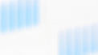

- **Original file:** `inspiration/c1cac7458c91b63ae48d77111a691c0c 1.png` (122x68 px, source folder: (root), batch-001 (inspiration.zip, 2026-10-13))
- **Category / subcategory:** FUL / transition-plate. **Style family:** LIGHT-STREAK. **Also useful for:** -
- **Tags:** blur, bokeh, light-blue, white, transition, abstract
- **Alternate copies:** none

**Observed (visible in the image)**
- **Visual description:** White field with heavily defocused light-blue vertical bars.
- **Typography:** None.
- **Colour palette (measured, dominant first):** `#F8F8F8` 23.1%  `#C5E5FC` 21.5%  `#F9F9F9` 20.8%  `#DBE9F9` 16.0%  `#FAFAFA` 11.4%  `#ECF2F9` 7.1%
- **Composition:** Bars left/right edges.
- **Lighting & effects:** Soft defocus.
- **Depth & layering:** Out-of-focus foreground.

**Inferred (creative interpretation - not visible in a still)**
- **Animation behaviour:** INFERRED: bars slide horizontally as a soft wipe.
- **Suitable use cases:** Light-theme transitions.
- **Technical recreation:** Blurred rects (blur 40px) translate.

---

### FUL-061 - Tangled Cables Straighten into Arrow (Less Complexity)

- **Original file:** `inspiration/c22d2407417533c70d97e906b3072f33 1.png` (170x169 px, source folder: (root), batch-001 (inspiration.zip, 2026-10-13))
- **Category / subcategory:** FUL / metaphor-object-light. **Style family:** 3D-METAPHOR. **Also useful for:** TXT
- **Tags:** tangle, simplify, cables, arrow, warm-white, violet-orange, before-after
- **Alternate copies:** none

**Observed (visible in the image)**
- **Visual description:** Warm white; colourful tangled cable knot (violet/orange/blue) on left resolves into parallel flowing lines ending in an arrow at right; 'Less Complexity. More Creativity.' light/bold pair; body; footer.
- **Typography:** Light vs regular weight pair, thin sans.
- **Colour palette (measured, dominant first):** `#ECE7E6` 22.5%  `#FAF7F4` 17.6%  `#FEFCFA` 16.7%  `#FEF9F8` 15.5%  `#C0ADB9` 14.1%  `#F3EDEA` 13.6%
- **Composition:** Object diagonal bottom-left→top-right; text top-right.
- **Lighting & effects:** Soft shadows.
- **Depth & layering:** 3D cables.

**Inferred (creative interpretation - not visible in a still)**
- **Animation behaviour:** INFERRED: knot untangles as lines pull to the right (path morph).
- **Suitable use cases:** Simplification, chaos→clarity.
- **Technical recreation:** SVG paths morph tangled→parallel; or 3D cloth/curve sim.

---

### FUL-062 - Money Roll with Bars + Glowing Line (RIBAA!?)

- **Original file:** `inspiration/c4f47bdaba4fc5ac05162be6d82ab07f 1.png` (199x112 px, source folder: (root), batch-001 (inspiration.zip, 2026-10-13))
- **Category / subcategory:** FUL / data-viz-scene. **Style family:** DATA-GLOW. **Also useful for:** TXT
- **Tags:** money, finance, bars, line, blue, headline-caps, question
- **Alternate copies:** none

**Observed (visible in the image)**
- **Visual description:** Blue; rolled dollar bill centre, blue bar chart left, glowing line chart rising right, axes both sides; 'Are You Concerned About' small kicker + 'RIBAA!?' heavy white caps.
- **Typography:** Heavy wide white caps headline.
- **Colour palette (measured, dominant first):** `#000206` 23.3%  `#052D60` 22.9%  `#1253A6` 16.2%  `#010A18` 14.6%  `#021733` 14.5%  `#68A2D5` 8.4%
- **Composition:** Headline bottom-centre over object.
- **Lighting & effects:** Blue line glow.
- **Depth & layering:** Object between charts.

**Inferred (creative interpretation - not visible in a still)**
- **Animation behaviour:** INFERRED: bars grow, line shoots up, headline slams.
- **Suitable use cases:** Finance hooks/questions.
- **Technical recreation:** Composite money PNG + SVG charts.

---

### FUL-063 - Mixed-Weight Stacked Spanish Headline (Esta historia comienza ahora)

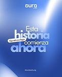

- **Original file:** `inspiration/ca8f247df699dd080bfed06d8b327e69 1.png` (122x152 px, source folder: (root), batch-001 (inspiration.zip, 2026-10-13))
- **Category / subcategory:** FUL / typographic-poster. **Style family:** SERIF-ACCENT-CAPTION. **Also useful for:** TXT
- **Tags:** kinetic-typography, stacked, mixed-weights, outline, handwritten-tag, blue, vertical
- **Alternate copies:** none

**Observed (visible in the image)**
- **Visual description:** Vertical blue gradient with light swoosh; 'Esta historia comienza ahora' stacked: light thin 'Esta', heavy 'historia', medium 'comienza', heavy outline-ish 'ahora'; tilted handwritten tag 'Haz esto por lograr'; logo top.
- **Typography:** Single family, extreme weight contrast (Thin↔Black), tight leading, overlapping lines.
- **Colour palette (measured, dominant first):** `#264599` 26.1%  `#7093DA` 21.3%  `#9CB7EC` 15.0%  `#4E74C6` 15.0%  `#DDE7F9` 11.5%  `#3458AF` 11.2%
- **Composition:** Centred stack.
- **Lighting & effects:** Soft white gradient sweep.
- **Depth & layering:** Lines overlap.

**Inferred (creative interpretation - not visible in a still)**
- **Animation behaviour:** INFERRED: each line enters with different motion (slide, scale, mask), tag stamps on.
- **Suitable use cases:** Hook titles, story openers.
- **Technical recreation:** Variable font weight animation (Inter 100→900).

---

### FUL-064 - Giant Key Bridging a Canyon (dream step by step)

- **Original file:** `inspiration/cbacaa4f88a8deee3555c53ac52d1514 1.png` (121x152 px, source folder: (root), batch-001 (inspiration.zip, 2026-10-13))
- **Category / subcategory:** FUL / metaphor-object-light. **Style family:** 3D-METAPHOR. **Also useful for:** -
- **Tags:** key, bridge, canyon, figure, blue, matte, vertical
- **Alternate copies:** none

**Observed (visible in the image)**
- **Visual description:** Vertical light-blue; 'Let's build your dream one step at a time' + scribble underline; giant key laid across a canyon between cliffs, a house on left, tiny figure on right; matte blue landscape.
- **Typography:** Medium navy sans.
- **Colour palette (measured, dominant first):** `#020F1E` 25.0%  `#C9D5E5` 21.0%  `#DFE7F1` 20.8%  `#082B47` 15.9%  `#E8EFF7` 11.5%  `#5B7895` 5.9%
- **Composition:** Text top; scene bottom half.
- **Lighting & effects:** Soft fog.
- **Depth & layering:** Atmospheric perspective.

**Inferred (creative interpretation - not visible in a still)**
- **Animation behaviour:** INFERRED: key lowers into place to form bridge; figure walks.
- **Suitable use cases:** Unlocking/bridging, dreams.
- **Technical recreation:** Generated + 2.5D.

---

### FUL-065 - Cyan Line Dips then Rises on Grid Floor (Brand Evolving)

- **Original file:** `inspiration/ceabbb07563626b2230c05f0f9d759db (1) 1.png` (121x162 px, source folder: (root), batch-001 (inspiration.zip, 2026-10-13))
- **Category / subcategory:** FUL / data-viz-scene. **Style family:** DATA-GLOW. **Also useful for:** -
- **Tags:** line-chart, cyan, grid-floor, brand, node, vertical
- **Alternate copies:**
  - `assets/references/_alternates/FUL-065__alt1__ceabbb07563626b2230c05f0f9d759db_1_2.png` (original `inspiration/ceabbb07563626b2230c05f0f9d759db (1) 2.png`, 122x162, same design, different resolution/crop, distance 9)

**Observed (visible in the image)**
- **Visual description:** Vertical navy with perspective grid floor; 'When a Brand Stops Evolving' (blue gradient 'Brand'); arrow pill; cyan glowing line wiggles then rises to endpoint node.
- **Typography:** Medium white + gradient keyword.
- **Colour palette (measured, dominant first):** `#030E3A` 26.9%  `#03092D` 20.9%  `#0E2459` 18.6%  `#06123E` 15.1%  `#081748` 11.6%  `#305984` 6.9%
- **Composition:** Text top-left; line lower half.
- **Lighting & effects:** Cyan glow.
- **Depth & layering:** Grid floor.

**Inferred (creative interpretation - not visible in a still)**
- **Animation behaviour:** INFERRED: line draws; node flashes.
- **Suitable use cases:** Decline/recovery narratives.
- **Technical recreation:** SVG + CSS perspective grid.

---

### FUL-066 - Rainbow Neon Tubes Looping into Frosted Capsule

- **Original file:** `inspiration/d1546db33a16d4d578ea06b7ed323b05 1.png` (67x66 px, source folder: (root), batch-001 (inspiration.zip, 2026-10-13))
- **Category / subcategory:** FUL / abstract-material. **Style family:** MATERIAL-ABSTRACT. **Also useful for:** -
- **Tags:** neon-tubes, rainbow, capsule, flow, convergence, black
- **Alternate copies:** none

**Observed (visible in the image)**
- **Visual description:** Black; thick glowing neon tubes (blue, violet, orange, yellow) loop and flow into a frosted glass pill capsule; small figure silhouette atop; tiny text top.
- **Typography:** Tiny.
- **Colour palette (measured, dominant first):** `#000000` 30.6%  `#6A6764` 21.6%  `#120C1A` 18.5%  `#020104` 17.6%  `#000100` 8.9%  `#030200` 2.8%
- **Composition:** Tubes left, capsule centre-right.
- **Lighting & effects:** Strong neon bloom.
- **Depth & layering:** Tubes overlap.

**Inferred (creative interpretation - not visible in a still)**
- **Animation behaviour:** INFERRED: energy flows through tubes into capsule, capsule glows.
- **Suitable use cases:** Inputs merging into a product.
- **Technical recreation:** Thick blurred SVG strokes + gradients.

---

### FUL-067 - Wireframe Hologram Hand Building a Bridge (Right Path)

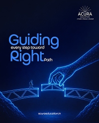

- **Original file:** `inspiration/d3522bf2358887caa38dc678a9d1464c 1.png` (199x248 px, source folder: (root), batch-001 (inspiration.zip, 2026-10-13))
- **Category / subcategory:** FUL / metaphor-object-dark. **Style family:** 3D-METAPHOR. **Also useful for:** -
- **Tags:** wireframe, hologram, hand, bridge, figure, blue, vertical
- **Alternate copies:** none

**Observed (visible in the image)**
- **Visual description:** Vertical navy; 'Guiding every step toward Right Path' with large blue gradient words and small inline words; blue wireframe hand placing a bridge segment; tiny figure walking.
- **Typography:** Large gradient display + small inline words (size contrast).
- **Colour palette (measured, dominant first):** `#061442` 21.8%  `#080D21` 19.4%  `#050D2D` 17.8%  `#062162` 15.5%  `#020829` 15.2%  `#275EA9` 10.3%
- **Composition:** Text top-left; scene bottom.
- **Lighting & effects:** Wireframe glow.
- **Depth & layering:** Bridge perspective.

**Inferred (creative interpretation - not visible in a still)**
- **Animation behaviour:** INFERRED: hand places the missing segment; figure crosses.
- **Suitable use cases:** Guidance/mentorship.
- **Technical recreation:** Wireframe 3D.

---

### FUL-068 - Close-up Glowing Glass Keys Grid (blue)

- **Original file:** `inspiration/dcbe45c0e1ae80c24e20cf0d5abba272 1.png` (122x151 px, source folder: (root), batch-001 (inspiration.zip, 2026-10-13))
- **Category / subcategory:** FUL / abstract-material. **Style family:** MATERIAL-ABSTRACT. **Also useful for:** -
- **Tags:** keys, tiles, glass, blue, neon, macro, vertical
- **Alternate copies:** none

**Observed (visible in the image)**
- **Visual description:** Vertical; close-up of big blue glowing glass keys/tiles grid with tiny labels.
- **Typography:** Tiny labels.
- **Colour palette (measured, dominant first):** `#07102A` 25.1%  `#07265E` 23.9%  `#073077` 15.4%  `#041B48` 14.1%  `#091B43` 11.1%  `#2760BD` 10.3%
- **Composition:** Grid fills frame.
- **Lighting & effects:** Edge neon.
- **Depth & layering:** Macro.

**Inferred (creative interpretation - not visible in a still)**
- **Animation behaviour:** INFERRED: keys press in sequence.
- **Suitable use cases:** Tech b-roll, background.
- **Technical recreation:** 3D or CSS 3D grid.

---

### FUL-069 - Giant 3D Violet Question Mark (Why Marketing?)

- **Original file:** `inspiration/e1163dfabcaf4b73a8b07d501c509a8b 1.png` (179x179 px, source folder: (root), batch-001 (inspiration.zip, 2026-10-13))
- **Category / subcategory:** FUL / big-numeral-3d. **Style family:** 3D-METAPHOR. **Also useful for:** -
- **Tags:** question-mark, 3d, violet, white, poster, vertical
- **Alternate copies:** none

**Observed (visible in the image)**
- **Visual description:** Vertical black; logo; giant extruded glossy violet/white question mark with a cube; 'Why Your Brand Needs Marketing?' white bold; body; CTA pill.
- **Typography:** Bold white sans.
- **Colour palette (measured, dominant first):** `#030303` 30.5%  `#06050B` 17.8%  `#120C20` 16.1%  `#EAE6F5` 13.8%  `#2F1870` 12.0%  `#6F59AA` 9.9%
- **Composition:** Object top-right; text bottom-right.
- **Lighting & effects:** Violet glow and white gloss.
- **Depth & layering:** 3D extrusion.

**Inferred (creative interpretation - not visible in a still)**
- **Animation behaviour:** INFERRED: question mark rotates into view.
- **Suitable use cases:** Question hooks.
- **Technical recreation:** 3D text.

---

### FUL-070 - Double Violet Planet Arcs Framing Headline (10000X)

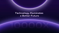

- **Original file:** `inspiration/e232285f4fd934697e590c6db798b2bf 1.png` (121x69 px, source folder: (root), batch-001 (inspiration.zip, 2026-10-13))
- **Category / subcategory:** FUL / horizon-arc. **Style family:** HORIZON-ARC. **Also useful for:** -
- **Tags:** planet-arc, violet, double-arc, headline, ghost-text
- **Alternate copies:** none

**Observed (visible in the image)**
- **Visual description:** Dark violet; two glowing violet planet arcs (top and bottom) frame 'Technology Illuminates a Better Future'; ghost '10000X' faint in lower arc.
- **Typography:** Medium white headline.
- **Colour palette (measured, dominant first):** `#140934` 22.0%  `#1A093F` 19.6%  `#261755` 16.6%  `#483488` 15.7%  `#090722` 15.4%  `#8169B8` 10.7%
- **Composition:** Centred between arcs.
- **Lighting & effects:** Rim glows.
- **Depth & layering:** Flat.

**Inferred (creative interpretation - not visible in a still)**
- **Animation behaviour:** INFERRED: arcs slide in from top/bottom, meet framing text.
- **Suitable use cases:** Statement cards.
- **Technical recreation:** Two circles with glow.

---

### FUL-071 - Glowing Blue Person in Crowd + Boxed Question

- **Original file:** `inspiration/e9645a9e726a1255661caec0bee04ccc 1.png` (122x163 px, source folder: (root), batch-001 (inspiration.zip, 2026-10-13))
- **Category / subcategory:** FUL / metaphor-object-dark. **Style family:** 3D-METAPHOR. **Also useful for:** -
- **Tags:** stand-out, crowd, silhouette, blue, question, audience, vertical
- **Alternate copies:** none

**Observed (visible in the image)**
- **Visual description:** Vertical navy; 'Do you really know' + 'Your Audience?' in glass outline box; arrow pill; glowing blue person silhouette amid dark crowd.
- **Typography:** Medium white; boxed bold phrase.
- **Colour palette (measured, dominant first):** `#06070F` 27.3%  `#040B25` 20.5%  `#122E66` 17.1%  `#0A1F51` 15.5%  `#0C1532` 12.2%  `#667BAA` 7.3%
- **Composition:** Text top, crowd bottom.
- **Lighting & effects:** Emissive person.
- **Depth & layering:** Crowd depth.

**Inferred (creative interpretation - not visible in a still)**
- **Animation behaviour:** INFERRED: spotlight finds person.
- **Suitable use cases:** Audience/targeting.
- **Technical recreation:** Generated.

---

### FUL-072 - Violet Glowing Key Grid in Perspective (Motion Design)

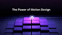

- **Original file:** `inspiration/f090d59958137c86c106d59089aac2af 1.png` (122x69 px, source folder: (root), batch-001 (inspiration.zip, 2026-10-13))
- **Category / subcategory:** FUL / abstract-material. **Style family:** MATERIAL-ABSTRACT. **Also useful for:** -
- **Tags:** keys, grid, perspective, violet, title, glow
- **Alternate copies:** none

**Observed (visible in the image)**
- **Visual description:** Dark; 'The Power of Motion Design' top; violet glowing 3D tiles grid in perspective, centre tile with ring highlight.
- **Typography:** Medium white.
- **Colour palette (measured, dominant first):** `#020106` 24.1%  `#0F0718` 22.5%  `#1F184A` 17.8%  `#3E2E8C` 16.1%  `#8E5CCF` 11.4%  `#070416` 8.1%
- **Composition:** Title top, grid lower.
- **Lighting & effects:** Violet emission.
- **Depth & layering:** Perspective.

**Inferred (creative interpretation - not visible in a still)**
- **Animation behaviour:** INFERRED: tiles light in waves from centre.
- **Suitable use cases:** Topic title cards.
- **Technical recreation:** CSS 3D grid or 3D render.

---

### FUL-073 - Dark Hand Holding Glowing Blue Sphere (wide)

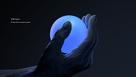

- **Original file:** `inspiration/f14281875b7b16d18596fab170cd9b29 1.png` (198x112 px, source folder: (root), batch-001 (inspiration.zip, 2026-10-13))
- **Category / subcategory:** FUL / metaphor-object-dark. **Style family:** 3D-METAPHOR. **Also useful for:** -
- **Tags:** hand, sphere, orb, blue, dark, wide
- **Alternate copies:** none

**Observed (visible in the image)**
- **Visual description:** Dark navy; dark sculpted hand holds glowing blue sphere; small text left.
- **Typography:** Tiny.
- **Colour palette (measured, dominant first):** `#161C29` 25.1%  `#07090E` 20.4%  `#131823` 16.1%  `#0A0E17` 14.8%  `#0E1118` 14.4%  `#4361A6` 9.2%
- **Composition:** Object right-centre.
- **Lighting & effects:** Sphere emissive.
- **Depth & layering:** Hand around sphere.

**Inferred (creative interpretation - not visible in a still)**
- **Animation behaviour:** INFERRED: sphere brightens; hand rotates slightly.
- **Suitable use cases:** Holding potential/power.
- **Technical recreation:** Generated + glow.

---

### FUL-074 - Explorer Archetype: Hand + Glowing Sphere (series)

- **Original file:** `inspiration/f34b8489b465dae67e0582a3214bd12c 1.png` (122x163 px, source folder: (root), batch-001 (inspiration.zip, 2026-10-13))
- **Category / subcategory:** FUL / metaphor-object-dark. **Style family:** 3D-METAPHOR. **Also useful for:** -
- **Tags:** hand, sphere, archetype, series-archetypes, blue, vertical
- **Alternate copies:** none

**Observed (visible in the image)**
- **Visual description:** Vertical navy; quote glyph; 'Explorer' blue heading + body; dark hand holding glowing blue sphere bottom.
- **Typography:** Series typography.
- **Colour palette (measured, dominant first):** `#031236` 22.2%  `#05173E` 19.9%  `#010414` 19.2%  `#030A20` 14.8%  `#020D2C` 14.7%  `#31548D` 9.1%
- **Composition:** Text top-left; object bottom.
- **Lighting & effects:** Emissive.
- **Depth & layering:** Object front.

**Inferred (creative interpretation - not visible in a still)**
- **Animation behaviour:** INFERRED: sphere ignites.
- **Suitable use cases:** Archetype/personality series.
- **Technical recreation:** Series layout shared with FUL-001, FUL-009, FUL-015.

---

### FUL-075 - Neon Tubes Converge into Chrome Capsule → White Beam

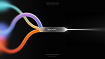

- **Original file:** `inspiration/f8c4c648fd8f077ceb64f8842bef1c41 1.png` (105x59 px, source folder: (root), batch-001 (inspiration.zip, 2026-10-13))
- **Category / subcategory:** FUL / abstract-material. **Style family:** MATERIAL-ABSTRACT. **Also useful for:** -
- **Tags:** neon-tubes, convergence, capsule, beam, compress, black
- **Alternate copies:** none

**Observed (visible in the image)**
- **Visual description:** Black; glowing tubes (cyan, violet, orange, yellow) converge into a chrome capsule that emits a single white beam to the right.
- **Typography:** Tiny.
- **Colour palette (measured, dominant first):** `#030303` 32.7%  `#090909` 30.5%  `#5E5157` 15.9%  `#050404` 13.8%  `#010101` 6.8%  `#010407` 0.2%
- **Composition:** Left→right funnel.
- **Lighting & effects:** Neon + white beam.
- **Depth & layering:** Tubes curve in depth.

**Inferred (creative interpretation - not visible in a still)**
- **Animation behaviour:** INFERRED: colour streams enter, white beam exits — compression/merge.
- **Suitable use cases:** Many-into-one, distillation.
- **Technical recreation:** Thick blurred strokes + beam.

---

### FUL-076 - Hands Holding Envelope with Calendar Card (holidays)

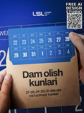

- **Original file:** `inspiration/f9001e99cec4a33f94467c8df7bfb93d 1.png` (122x163 px, source folder: (root), batch-001 (inspiration.zip, 2026-10-13))
- **Category / subcategory:** FUL / metaphor-object-light. **Style family:** 3D-METAPHOR. **Also useful for:** -
- **Tags:** envelope, calendar, hands, blue, kraft, dates, vertical
- **Alternate copies:** none

**Observed (visible in the image)**
- **Visual description:** Vertical blue; hands hold kraft envelope with blue calendar card emerging (dates 22–31, 1–4); 'Dam olish kunlari' bold black on envelope; logo top.
- **Typography:** Heavy black sans on kraft.
- **Colour palette (measured, dominant first):** `#1E3D9B` 24.5%  `#58433D` 20.8%  `#111D45` 18.3%  `#7888A4` 16.7%  `#CDBFB2` 13.0%  `#5D6987` 6.7%
- **Composition:** Object fills centre.
- **Lighting & effects:** Studio.
- **Depth & layering:** Hands front.

**Inferred (creative interpretation - not visible in a still)**
- **Animation behaviour:** INFERRED: card slides out of envelope.
- **Suitable use cases:** Announcements, dates.
- **Technical recreation:** Generated.

> Note: Source contains third-party watermark 'FREE AI DESIGN STUDIO' + QR — not part of the design; never reproduce.

---

### FUL-077 - Diagonal Coil of Blue Glowing Glass Discs

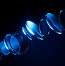

- **Original file:** `inspiration/fd90b546fb9f916e70f8180e14aa0292 1.png` (93x94 px, source folder: (root), batch-001 (inspiration.zip, 2026-10-13))
- **Category / subcategory:** FUL / abstract-material. **Style family:** MATERIAL-ABSTRACT. **Also useful for:** -
- **Tags:** glass-rings, coil, spiral, blue, transition, loop
- **Alternate copies:** none

**Observed (visible in the image)**
- **Visual description:** Dark navy; diagonal spiral of blue glowing glass rings/discs.
- **Typography:** None.
- **Colour palette (measured, dominant first):** `#000001` 25.4%  `#010929` 18.9%  `#01061E` 17.8%  `#031744` 12.9%  `#01020E` 12.7%  `#2373BE` 12.3%
- **Composition:** Diagonal.
- **Lighting & effects:** Rim glows.
- **Depth & layering:** 3D.

**Inferred (creative interpretation - not visible in a still)**
- **Animation behaviour:** INFERRED: coil rotates continuously.
- **Suitable use cases:** Transition or background.
- **Technical recreation:** 3D loop.

---

### FUL-078 - World Brain Day Condensed Type + Wired Brain

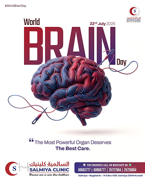

- **Original file:** `inspiration/image 100.png` (290x362 px, source folder: (root), batch-001 (inspiration.zip, 2026-10-13))
- **Category / subcategory:** FUL / editorial-poster. **Style family:** EDITORIAL-PRINT. **Also useful for:** TXT
- **Tags:** editorial, poster, brain, condensed, crimson, navy, print, vertical
- **Alternate copies:** none

**Observed (visible in the image)**
- **Visual description:** Vertical white print poster; 'World' small + giant condensed crimson/navy 'BRAIN' + 'Day' script; red/blue 3D brain with cable plug; quote line; clinic footer with Arabic.
- **Typography:** Ultra-condensed bold display, small script accent.
- **Colour palette (measured, dominant first):** `#FFFFFF` 50.8%  `#602D4B` 20.7%  `#FFFFFD` 10.6%  `#A792A7` 9.3%  `#F0ECED` 7.5%  `#FEFFFF` 1.1%
- **Composition:** Type top half, object overlaps type.
- **Lighting & effects:** Studio.
- **Depth & layering:** Brain in front of type.

**Inferred (creative interpretation - not visible in a still)**
- **Animation behaviour:** INFERRED: letters slide up, brain drops in front.
- **Suitable use cases:** Health/awareness themes.
- **Technical recreation:** Text-behind-object layering.

---

### FUL-079 - White Brain in Frame (Your Brain Has No Limits)

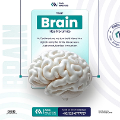

- **Original file:** `inspiration/image 101.png` (202x202 px, source folder: (root), batch-001 (inspiration.zip, 2026-10-13))
- **Category / subcategory:** FUL / editorial-poster. **Style family:** EDITORIAL-PRINT. **Also useful for:** -
- **Tags:** editorial, brain, teal, label-box, ghost-text, light
- **Alternate copies:** none

**Observed (visible in the image)**
- **Visual description:** White; teal label box 'Brain' within 'Your Brain Has No Limits'; white 3D brain hanging in thin frame; ghost vertical 'BRAIN' text; footer contact bar.
- **Typography:** Bold sans in teal box.
- **Colour palette (measured, dominant first):** `#FFFFFF` 23.5%  `#7F9496` 20.1%  `#F0F9FA` 17.0%  `#EEF1F3` 15.6%  `#CED9D9` 15.2%  `#FEFEFE` 8.6%
- **Composition:** Centred frame.
- **Lighting & effects:** Soft.
- **Depth & layering:** Brain breaks frame.

**Inferred (creative interpretation - not visible in a still)**
- **Animation behaviour:** INFERRED: brain lowers into frame.
- **Suitable use cases:** Education/potential.
- **Technical recreation:** Generated + layered text.

---

### FUL-080 - Halftone Profile with Brain + Blue Pie Wedge HUD

- **Original file:** `inspiration/image 87.png` (202x360 px, source folder: (root), batch-001 (inspiration.zip, 2026-10-13))
- **Category / subcategory:** FUL / editorial-poster. **Style family:** EDITORIAL-PRINT. **Also useful for:** -
- **Tags:** halftone, profile, brain, hud, callout, blue, editorial, vertical
- **Alternate copies:** none

**Observed (visible in the image)**
- **Visual description:** Vertical light-blue editorial; B&W halftone profile of a man with exposed brain; blue pie wedge overlay labelled '12% activated' with thin callout line; small HUD marks.
- **Typography:** Tiny sans annotations.
- **Colour palette (measured, dominant first):** `#313232` 24.2%  `#FCFCFB` 20.0%  `#C2D1E7` 16.9%  `#DCE8FB` 16.8%  `#FAFAFB` 11.5%  `#91A0B5` 10.6%
- **Composition:** Head centre-left; callout top-right.
- **Lighting & effects:** Flat print.
- **Depth & layering:** Overlay on cutout.

**Inferred (creative interpretation - not visible in a still)**
- **Animation behaviour:** INFERRED: wedge sweeps open, callout line draws, label types.
- **Suitable use cases:** Psychology/brain facts.
- **Technical recreation:** Halftone filter (ImageMagick/PIL) on cutout + SVG overlay.

---

### FUL-081 - Halftone Brain + Blue Circle + Serif Headline

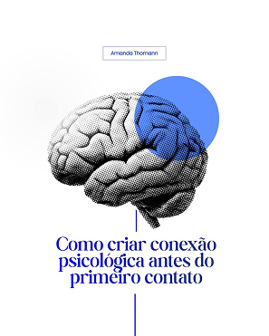

- **Original file:** `inspiration/image 88.png` (297x371 px, source folder: (root), batch-001 (inspiration.zip, 2026-10-13))
- **Category / subcategory:** FUL / editorial-poster. **Style family:** EDITORIAL-PRINT. **Also useful for:** TXT
- **Tags:** halftone, brain, blue-circle, serif, editorial, white, vertical
- **Alternate copies:** none

**Observed (visible in the image)**
- **Visual description:** Vertical white; name pill top; halftone B&W brain with solid blue circle overlay (multiply); royal-blue serif headline 'Como criar conexão psicológica antes do primeiro contato'; thin vertical line.
- **Typography:** Royal-blue transitional serif (Times/Libre Caslon-like) centred.
- **Colour palette (measured, dominant first):** `#FFFFFF` 60.9%  `#596793` 16.4%  `#FCFCFC` 9.5%  `#DDDEE4` 8.7%  `#FEFFFF` 2.4%  `#FFFFFD` 2.1%
- **Composition:** Object middle; headline lower third.
- **Lighting & effects:** Flat.
- **Depth & layering:** Circle blend over brain.

**Inferred (creative interpretation - not visible in a still)**
- **Animation behaviour:** INFERRED: circle scales in behind, halftone dots resolve.
- **Suitable use cases:** Psychology/education, editorial tone.
- **Technical recreation:** Halftone + mix-blend multiply circle.

---

### FUL-082 - Thin Serif 'Brain' + Bullets + Halftone Brain (green)

- **Original file:** `inspiration/image 89.png` (297x371 px, source folder: (root), batch-001 (inspiration.zip, 2026-10-13))
- **Category / subcategory:** FUL / editorial-poster. **Style family:** EDITORIAL-PRINT. **Also useful for:** -
- **Tags:** halftone, brain, green-circle, thin-serif, bullets, editorial
- **Alternate copies:** none

**Observed (visible in the image)**
- **Visual description:** Vertical off-white; 'Brain' thin serif title; bullet list; halftone brain with green circle overlay; signature.
- **Typography:** Thin serif display; small sans bullets.
- **Colour palette (measured, dominant first):** `#FAF8F8` 20.3%  `#FAF9F9` 18.5%  `#9CA299` 17.6%  `#F9F9F7` 17.0%  `#FAF9F7` 16.3%  `#FBFAF9` 10.3%
- **Composition:** Title top-centre; object bottom.
- **Lighting & effects:** Flat.
- **Depth & layering:** Overlay.

**Inferred (creative interpretation - not visible in a still)**
- **Animation behaviour:** INFERRED: bullets reveal one-by-one.
- **Suitable use cases:** Fact lists.
- **Technical recreation:** As the EDITORIAL-PRINT halftone recipe.

---

### FUL-083 - Silver Coin + Heavy Condensed Money Headline + Barcode

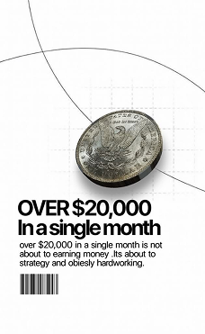

- **Original file:** `inspiration/image 90.png` (228x371 px, source folder: (root), batch-001 (inspiration.zip, 2026-10-13))
- **Category / subcategory:** FUL / editorial-poster. **Style family:** EDITORIAL-PRINT. **Also useful for:** TXT
- **Tags:** coin, money, condensed, barcode, editorial, white, orbit-lines
- **Alternate copies:** none

**Observed (visible in the image)**
- **Visual description:** Vertical white; realistic silver coin; 'OVER $20,000 In a single month' heavy condensed tight sans; body; barcode; thin orbit lines.
- **Typography:** Heavy condensed grotesk, tight tracking.
- **Colour palette (measured, dominant first):** `#FDFDFD` 34.3%  `#FEFEFE` 30.2%  `#AAAAA7` 19.5%  `#FDFDFC` 11.3%  `#FFFFFF` 4.6%  `#FDFEFD` 0.0%
- **Composition:** Coin top-right; text left-middle.
- **Lighting & effects:** Coin specular.
- **Depth & layering:** Flat.

**Inferred (creative interpretation - not visible in a still)**
- **Animation behaviour:** INFERRED: coin spins in; number counts.
- **Suitable use cases:** Income claims.
- **Technical recreation:** Coin PNG + type.

---

### FUL-084 - Handshake Photo with Ghost Serif Letters

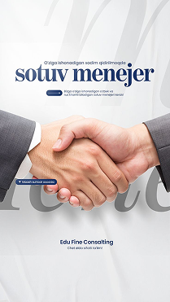

- **Original file:** `inspiration/image 91.png` (209x371 px, source folder: (root), batch-001 (inspiration.zip, 2026-10-13))
- **Category / subcategory:** FUL / editorial-poster. **Style family:** EDITORIAL-PRINT. **Also useful for:** -
- **Tags:** handshake, business, serif, ghost-text, white, editorial
- **Alternate copies:** none

**Observed (visible in the image)**
- **Visual description:** Vertical white; 'sotuv menejer' navy serif; small kicker; business handshake photo; huge ghost italic serif letters behind.
- **Typography:** Navy serif; ghost italic serif.
- **Colour palette (measured, dominant first):** `#977D79` 21.5%  `#E6E7E9` 18.5%  `#DBD4D2` 18.4%  `#EAEAEB` 17.2%  `#FAFAFA` 14.6%  `#F1F1F2` 9.9%
- **Composition:** Title top; photo centre.
- **Lighting & effects:** Studio.
- **Depth & layering:** Ghost text behind photo.

**Inferred (creative interpretation - not visible in a still)**
- **Animation behaviour:** INFERRED: ghost text drifts, hands meet.
- **Suitable use cases:** Sales/partnership.
- **Technical recreation:** Cutout photo + ghost type.

---

### FUL-085 - Dollar Bills Corners + Serif/Sans Statement (leaking money)

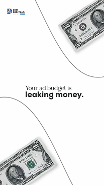

- **Original file:** `inspiration/image 92.png` (207x368 px, source folder: (root), batch-001 (inspiration.zip, 2026-10-13))
- **Category / subcategory:** FUL / editorial-poster. **Style family:** EDITORIAL-PRINT. **Also useful for:** TXT
- **Tags:** money, dollar-bills, white, serif-sans-mix, minimal, curves
- **Alternate copies:** none

**Observed (visible in the image)**
- **Visual description:** Vertical white; 'Your ad budget is' small serif + 'leaking money.' bold sans; dollar bills at top-right and bottom-left with thin curved lines.
- **Typography:** Serif/sans pairing.
- **Colour palette (measured, dominant first):** `#FEFEFE` 70.5%  `#B0B2B2` 17.7%  `#FDFEFE` 7.9%  `#FFFFFF` 3.4%  `#FEFEFD` 0.4%  `#FFFEFE` 0.0%
- **Composition:** Centre text; diagonal props.
- **Lighting & effects:** Flat.
- **Depth & layering:** Bills shadows.

**Inferred (creative interpretation - not visible in a still)**
- **Animation behaviour:** INFERRED: bills slide out of frame (leaking).
- **Suitable use cases:** Money loss/waste.
- **Technical recreation:** PNG props + lines.

---

### FUL-086 - Orbit Icons around Avatar over B&W Skyscraper

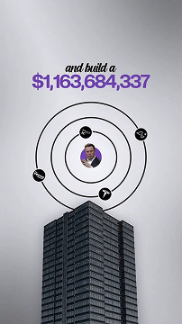

- **Original file:** `inspiration/image 93.png` (202x360 px, source folder: (root), batch-001 (inspiration.zip, 2026-10-13))
- **Category / subcategory:** FUL / editorial-poster. **Style family:** EDITORIAL-PRINT. **Also useful for:** TXT
- **Tags:** orbit, skyscraper, money, italic-serif, violet-numerals, grey
- **Alternate copies:** none

**Observed (visible in the image)**
- **Visual description:** Vertical grey; 'and build a' italic serif + '$1,163,684,337' violet bold; orbit rings with icons around avatar above a B&W skyscraper.
- **Typography:** Italic serif kicker + bold numerals.
- **Colour palette (measured, dominant first):** `#444551` 21.3%  `#A9A9B0` 19.7%  `#C4C5CB` 18.5%  `#D5D6DC` 14.9%  `#CDCED4` 13.4%  `#E5E5EB` 12.1%
- **Composition:** Text top; orbit middle; building bottom.
- **Lighting & effects:** Grey atmosphere.
- **Depth & layering:** Orbit above tower.

**Inferred (creative interpretation - not visible in a still)**
- **Animation behaviour:** INFERRED: icons orbit; number counts.
- **Suitable use cases:** Business empire stories.
- **Technical recreation:** Composite.

---

### FUL-087 - Huge Blue Condensed Caps + Person Covering Face

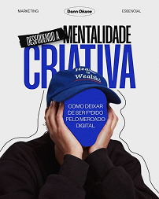

- **Original file:** `inspiration/image 94.png` (202x253 px, source folder: (root), batch-001 (inspiration.zip, 2026-10-13))
- **Category / subcategory:** FUL / editorial-poster. **Style family:** EDITORIAL-PRINT. **Also useful for:** TXT
- **Tags:** condensed-caps, blue, cutout, person, bold, editorial
- **Alternate copies:** none

**Observed (visible in the image)**
- **Visual description:** Vertical white; 'DESBLOQUEANDO A' black tag + 'MENTALIDADE CRIATIVA' huge blue condensed caps; person in blue cap covering face with hands, small text over face area; cutout outline.
- **Typography:** Ultra-condensed caps.
- **Colour palette (measured, dominant first):** `#EBEBEB` 30.4%  `#161013` 28.3%  `#393F8A` 20.8%  `#D3CFD1` 8.2%  `#EBEBE9` 7.7%  `#F2F1F0` 4.7%
- **Composition:** Type top half behind person.
- **Lighting & effects:** Flat.
- **Depth & layering:** Person in front of type.

**Inferred (creative interpretation - not visible in a still)**
- **Animation behaviour:** INFERRED: type slams, person cutout pops.
- **Suitable use cases:** Mindset/creativity hooks.
- **Technical recreation:** Text-behind-subject.

---

### FUL-088 - Blue Brain in Open Birdcage (A importância da mente)

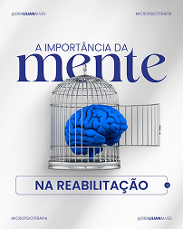

- **Original file:** `inspiration/image 95.png` (202x253 px, source folder: (root), batch-001 (inspiration.zip, 2026-10-13))
- **Category / subcategory:** FUL / editorial-poster. **Style family:** EDITORIAL-PRINT. **Also useful for:** TXT
- **Tags:** brain, birdcage, freedom, serif, navy, outline-pill
- **Alternate copies:** none

**Observed (visible in the image)**
- **Visual description:** Vertical white; 'A IMPORTÂNCIA DA' caps + big navy serif 'mente' + outline pill 'NA REABILITAÇÃO'; blue brain inside open birdcage.
- **Typography:** Large serif + caps.
- **Colour palette (measured, dominant first):** `#CCCCCE` 20.2%  `#ECECEC` 19.9%  `#6D7FA7` 16.2%  `#F6F6F6` 16.1%  `#DCDCDD` 14.3%  `#FAFAFA` 13.3%
- **Composition:** Text top/bottom sandwich object.
- **Lighting & effects:** Soft.
- **Depth & layering:** Cage overlaps text.

**Inferred (creative interpretation - not visible in a still)**
- **Animation behaviour:** INFERRED: cage door opens.
- **Suitable use cases:** Freedom/mindset.
- **Technical recreation:** Generated object.

---

### FUL-089 - Brain Hub Connected to App Icons (extensions)

- **Original file:** `inspiration/image 96.png` (212x282 px, source folder: (root), batch-001 (inspiration.zip, 2026-10-13))
- **Category / subcategory:** FUL / editorial-poster. **Style family:** EDITORIAL-PRINT. **Also useful for:** -
- **Tags:** brain, hub, icons, connectors, white, minimal
- **Alternate copies:** none

**Observed (visible in the image)**
- **Visual description:** Vertical white; small brain in concentric grey discs centre; six app icons around connected with curves; 'EXTENSÕES PARA O SEU CÉREBRO'.
- **Typography:** Thin + bold caps.
- **Colour palette (measured, dominant first):** `#F9F9F9` 20.8%  `#F0F0F0` 19.6%  `#F4F4F4` 19.5%  `#FFFFFF` 15.6%  `#B9B8B7` 13.1%  `#FDFDFD` 11.5%
- **Composition:** Radial hub.
- **Lighting & effects:** Soft.
- **Depth & layering:** Discs.

**Inferred (creative interpretation - not visible in a still)**
- **Animation behaviour:** INFERRED: connections draw outward.
- **Suitable use cases:** Tools that extend you.
- **Technical recreation:** SVG.

---

### FUL-090 - Chrome Pawns + Blue King with Highlighted Caps Statement

- **Original file:** `inspiration/image 97.png` (202x360 px, source folder: (root), batch-001 (inspiration.zip, 2026-10-13))
- **Category / subcategory:** FUL / editorial-poster. **Style family:** EDITORIAL-PRINT. **Also useful for:** TXT
- **Tags:** chess, stand-out, caps, highlight-box, blue
- **Alternate copies:** none

**Observed (visible in the image)**
- **Visual description:** Vertical white; 'CRIAMOS MARCAS QUE NÃO APENAS EXISTEM, MAS QUE IMPACTAM.' blue caps with highlight box; chrome pawns with blue king.
- **Typography:** Caps with highlighted phrase.
- **Colour palette (measured, dominant first):** `#F7F8F7` 22.6%  `#F5F6F5` 18.9%  `#F6F7F6` 17.8%  `#757FA0` 16.9%  `#E4E6E9` 14.0%  `#F9FAF9` 9.8%
- **Composition:** Text top; pieces bottom-left.
- **Lighting & effects:** Studio.
- **Depth & layering:** DOF.

**Inferred (creative interpretation - not visible in a still)**
- **Animation behaviour:** INFERRED: highlight box wipes on.
- **Suitable use cases:** Differentiation.
- **Technical recreation:** See FUL-017 (same concept).

---

### FUL-091 - Brain Balloon Tied to Rock (Sobrecarga Emocional)

- **Original file:** `inspiration/image 98.png` (209x261 px, source folder: (root), batch-001 (inspiration.zip, 2026-10-13))
- **Category / subcategory:** FUL / editorial-poster. **Style family:** EDITORIAL-PRINT. **Also useful for:** -
- **Tags:** brain, balloon, rock, burden, violet, magenta, condensed-serif
- **Alternate copies:** none

**Observed (visible in the image)**
- **Visual description:** Vertical cream; 'Sobrecarga Emocional' condensed serif; violet brain as hot-air balloon tied by rope to a heavy rock; magenta accent text bottom.
- **Typography:** Condensed serif display.
- **Colour palette (measured, dominant first):** `#E9E8E4` 31.9%  `#734964` 19.5%  `#EAE8E4` 17.6%  `#E8E8E3` 15.1%  `#E0D8D9` 8.8%  `#EBEAE6` 7.2%
- **Composition:** Title top; object centre.
- **Lighting & effects:** Soft.
- **Depth & layering:** Object.

**Inferred (creative interpretation - not visible in a still)**
- **Animation behaviour:** INFERRED: balloon strains upward, rope tight.
- **Suitable use cases:** Burden/overload.
- **Technical recreation:** Generated.

---

### FUL-092 - Performance Isn't Created: Boxed Italic + Brain Disc

- **Original file:** `inspiration/image 99.png` (303x538 px, source folder: (root), batch-001 (inspiration.zip, 2026-10-13))
- **Category / subcategory:** FUL / editorial-poster. **Style family:** EDITORIAL-PRINT. **Also useful for:** TXT
- **Tags:** boxed-italic, brain, disc, dotted-ring, grey, editorial
- **Alternate copies:** none

**Observed (visible in the image)**
- **Visual description:** Vertical light grey; 'Performance' bold sans + 'isn't created' italic serif white on black box; B&W 3D brain in dark circle with dotted ring; thin line accents.
- **Typography:** Bold sans + reversed italic serif box.
- **Colour palette (measured, dominant first):** `#D4D4D4` 58.5%  `#777676` 22.9%  `#D2D4D4` 11.5%  `#D6D4D4` 2.5%  `#D4D4D3` 2.4%  `#D8D7D7` 2.2%
- **Composition:** Text top; disc centre.
- **Lighting & effects:** Soft.
- **Depth & layering:** Disc shadow.

**Inferred (creative interpretation - not visible in a still)**
- **Animation behaviour:** INFERRED: box wipes, dotted ring rotates.
- **Suitable use cases:** Performance/mindset.
- **Technical recreation:** HTML type + PNG.

---

### FUL-093 - Violet Light Portal Doorway from Floor

- **Original file:** `inspiration/image 123 1.png` (244x142 px, source folder: (root), batch-001 (inspiration.zip, 2026-10-13))
- **Category / subcategory:** FUL / transition-plate. **Style family:** LIGHT-STREAK. **Also useful for:** -
- **Tags:** portal, light-wall, violet, doorway, transition, reveal
- **Alternate copies:** none

**Observed (visible in the image)**
- **Visual description:** Dark violet; glowing violet vertical light wall/portal rising from a floor line with reflections.
- **Typography:** None.
- **Colour palette (measured, dominant first):** `#030013` 65.0%  `#050217` 24.9%  `#201443` 7.0%  `#030015` 2.4%  `#030012` 0.6%  `#020013` 0.1%
- **Composition:** Centred.
- **Lighting & effects:** Emissive gradient wall.
- **Depth & layering:** Floor plane.

**Inferred (creative interpretation - not visible in a still)**
- **Animation behaviour:** INFERRED: portal rises; camera passes through as transition.
- **Suitable use cases:** Transitions into a new section.
- **Technical recreation:** Gradient rect + reflection.

---

